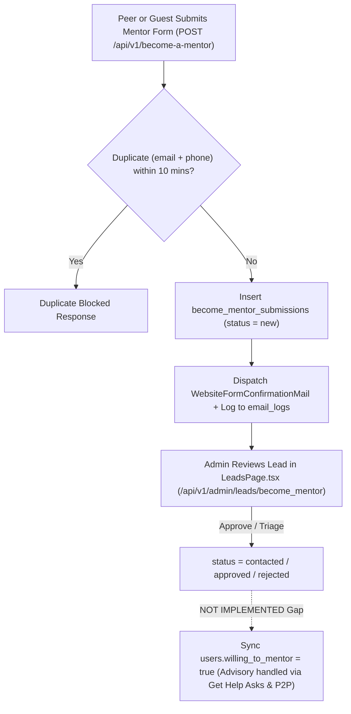

# Activity 15: Become a Mentor Form

| Metadata Field | Verified Value |
|---|---|
| **Workbook Activity #** | `15` (`Row 23` in Sheet 1, `Row 22` in Sheets 2 & 3) |
| **Exact Workbook Name** | `Become a Mentor Form` |
| **Domain Category** | `Mentorship & Growth` (Sheets 1 & 2) / `Mentorship / Advisory` (Sheet 3) |
| **Activity Governance Tier** | Tier 3 — Mentorship Lead Intake & Advisory Onboarding |
| **Overall Implementation Status** | `Partially Implemented` (6-field lead intake form, 10-minute duplicate guard, confirmation email, and Admin/Leader lead viewers exist; Workbook's Mentorship Domains, Experience Years, Slot Booking Engine, and Public Mentors Directory are NOT implemented—though Get Help Asks Activity 6 covers advisory requests; Admin/Leader Leads API has P0 auth/scope flaws) |
| **Surface Status Breakdown** | **Backend:** `Implemented but Incorrect` (Intake works; `/api/v1/admin/leads/become_mentor` lacks admin guard & `/api/v1/leader/leads/become_mentor` lacks organizational scope) \| **Member App:** `Fully Implemented` (6-field form + submission history) \| **Leadership App:** `Missing` (No UI consuming `/leader/leads/become_mentor`) \| **Admin Web:** `Fully Implemented` ([LeadsPage.tsx](file:///D:/office%20project/unity-admin-web/src/features/leads/LeadsPage.tsx) & Blade `/admin/pending-requests/leads/become-mentor`) |
| **Related Canonical Documents** | [12-master-35-activities-index.md](../12-master-35-activities-index.md) \| [06-get-help-asks.md](./06-get-help-asks.md) \| [19-activity-to-role-access-matrix.md](../19-activity-to-role-access-matrix.md) \| [25-activity-workflow-reference.md](../25-activity-workflow-reference.md) |

---

## 1. Business Purpose (§9.1)

- **WORKBOOK REQUIREMENT:** Enables seasoned entrepreneurs to *"Offer pro-bono or structured 1-on-1 advisory sessions in specialized business domains"* by submitting mentorship domains (Finance, Tech, Sales, Operations), years of experience, available calendar slots, and bio, resulting in publication to a `MentorsDirectoryScreen` where peers book sessions (`CalendarSlotManager`, `MentorshipBookingService`).
- **FACT:** In the actual codebase (`unity-app-new` & `unity_app`), Activity 15 is implemented as a **lightweight 6-field Mentor Interest Lead Form** (`become_mentor_submissions`: First Name, Last Name, Email, Phone, City, LinkedIn Profile) handled by [BecomeMentorController.php](file:///c:/Users/malic/OneDrive/Documents/GitHub/unity-app-new/app/Http/Controllers/Api/V1/Forms/BecomeMentorController.php#L15-L240). Meanwhile, peer-to-peer mentorship discovery and requests are handled via:
  1. `users.willing_to_mentor` (`bool`) on the member profile ([edit_additional_info_screen.dart](file:///D:/office%20project/peers-unity/unity_app/lib/features/profile/presentation/screens/edit_additional_info_screen.dart)), and
  2. **Activity 6 — Get Help Asks** (`ask_flows.code = 'help'`, types `founder_mentorship`, `industry_mentorship`, `mentorship`), plus **Activity 2 — P2P Meetings** (`p2p_meeting_requests`) for 1-on-1 scheduling.
- **Classification by Actor:**
  - **Member / Public Guest Action:** Submitting mentor interest (`POST /api/v1/become-a-mentor`) and viewing own submitted applications (`GET /api/v1/become-a-mentor`).
  - **Leadership Action:** Optional read access via `/api/v1/leader/leads/become_mentor` (unintegrated in Leadership App UI).
  - **Admin Action:** Reviewing mentor leads and updating `status` / `notes` in Admin Web ([LeadsPage.tsx](file:///D:/office%20project/unity-admin-web/src/features/leads/LeadsPage.tsx)).

---

## 2. Sub-Activities Catalogue (§9.2)

| # | Sub-Activity / Atomic Operation | Member App (`unity_app`) | Leadership App (`LeaderApp`) | Admin Web (`unity-admin-web` / Blade) | Backend (`unity-app-new`) | Classification Status |
|---:|---|---|---|---|---|---|
| 15.1 | Submit Become a Mentor Form | [become_mentor_screen.dart](file:///D:/office%20project/peers-unity/unity_app/lib/features/highlights/presentation/screens/become_mentor_screen.dart), [become_mentor_form_fields.dart](file:///D:/office%20project/peers-unity/unity_app/lib/features/highlights/presentation/widgets/become_mentor_form_fields.dart) | Not Required | Public Website Form | `POST /api/v1/become-a-mentor` ([BecomeMentorController.php](file:///c:/Users/malic/OneDrive/Documents/GitHub/unity-app-new/app/Http/Controllers/Api/V1/Forms/BecomeMentorController.php#L97-L240)) | `Fully Implemented` |
| 15.2 | View Own Mentor Application Status & History | [become_mentor_screen.dart](file:///D:/office%20project/peers-unity/unity_app/lib/features/highlights/presentation/screens/become_mentor_screen.dart) | Not Required | N/A | `GET /api/v1/become-a-mentor`, `GET /api/v1/become-a-mentor/{id}` ([BecomeMentorController.php](file:///c:/Users/malic/OneDrive/Documents/GitHub/unity-app-new/app/Http/Controllers/Api/V1/Forms/BecomeMentorController.php#L17-L95)) | `Fully Implemented` (Matches authenticated user's `email` or `phone`) |
| 15.3 | Toggle "Willing to Mentor" on Member Profile | [edit_additional_info_screen.dart](file:///D:/office%20project/peers-unity/unity_app/lib/features/profile/presentation/screens/edit_additional_info_screen.dart) | Read-only in Peer Profile | [PeerEditorPage.tsx](file:///D:/office%20project/unity-admin-web/src/features/users/PeerEditorPage.tsx) | `PUT /api/v1/profile` (`users.willing_to_mentor`) | `Fully Implemented` (Decoupled from `become_mentor_submissions`) |
| 15.4 | Leader View of Mentor Leads | N/A | **Missing UI** | N/A | `GET /api/v1/leader/leads/become_mentor[/{id}]` (`LeadAdminApiController`) | `Implemented but Not Integrated` (Unscoped backend route; no Flutter UI) |
| 15.5 | Admin Triage & Status Update on Mentor Leads | N/A | Not Required | [LeadsPage.tsx](file:///D:/office%20project/unity-admin-web/src/features/leads/LeadsPage.tsx) & Blade `/admin/pending-requests/leads/become-mentor` | `GET\|POST\|PUT\|PATCH\|DELETE /api/v1/admin/leads/become_mentor[/{id}\|/{id}/status]` (`LeadAdminApiController`) | `Implemented but Incorrect` (Missing admin role middleware on `/api/v1/admin/*`) |
| 15.6 | Mentor Directory, Domain Selector & Calendar Slot Booking | **Missing** (`MentorsDirectoryScreen`, `DomainSelectorWidget`, `SlotConfigSheet`) | **Missing** | **Missing** | **NOT IMPLEMENTED** (`CalendarSlotManager`, `MentorshipBookingService`) | `Missing` (**BUSINESS DECISION REQUIRED** — overlaps with Get Help Asks & P2P Meetings) |

---

## 3. Input Form & Field Validation Mapping (§9.3)

- **FACT:** Verified against [SubmitBecomeMentorRequest.php](file:///c:/Users/malic/OneDrive/Documents/GitHub/unity-app-new/app/Http/Requests/Forms/SubmitBecomeMentorRequest.php#L26-L36) and [become_mentor_form_fields.dart](file:///D:/office%20project/peers-unity/unity_app/lib/features/highlights/presentation/widgets/become_mentor_form_fields.dart).
- **Workbook vs Code Discrepancy:** None of the 4 domain-specific fields described in Workbook Sheet 1 (*"Mentorship domains (Finance, Tech, Sales, Operations), Years of experience, Available slots, Bio"*) exist in `become_mentor_submissions` or `become_mentor_form_fields.dart`! Also note the column/request key naming inconsistency with Activity 14: Activity 15 uses `linkedin_profile`, whereas Activity 14 uses `linkedin_profile_url`.

| Field Name | Data Type | Required/Optional | Validation (Backend + Client; mark missing as Requires Confirmation) | Default | Input Widget | Data Source | Visibility | Who Enters | Who Edits | Who Views | Sensitive? | Backend Request Key |
|---|---|---|---|---|---|---|---|---|---|---|---|---|
| **First Name** | `string` | Required | **Backend:** `required`, `string`, `max:100` (trimmed). **Client:** `"First Name *"` required check. | `User.first_name` in app | `TextFormField` | User profile / input | Applicant, Admin, Leader API | Peer Member or Guest | Admin (`PUT /admin/leads/become_mentor/{id}`) | Applicant, Leaders (via API), Admin | No | `first_name` |
| **Last Name** | `string` | Required | **Backend:** `required`, `string`, `max:100` (trimmed). **Client:** `"Last Name *"` required check. | `User.last_name` in app | `TextFormField` | User profile / input | Applicant, Admin, Leader API | Peer Member or Guest | Admin | Applicant, Leaders, Admin | No | `last_name` |
| **Email Address** | `string` | Required | **Backend:** `required`, `email`, `max:255` (trimmed). **Client:** `"Email Address *"` email validator. | `User.email` in app | `TextFormField` (`emailAddress`) | User profile / input | Applicant, Admin, Leader API | Peer Member or Guest | Admin | Applicant, Leaders, Admin | Yes (Email PII) | `email` |
| **Phone Number** | `string` | Required | **Backend:** `required`, `string`, `max:30` (trimmed; missing format/digit regex — Requires Confirmation). **Client:** `"Phone Number *"`. | `User.phone` in app | Phone `TextFormField` | User profile / input | Applicant, Admin, Leader API | Peer Member or Guest | Admin | Applicant, Leaders, Admin | Yes (Phone PII) | `phone` |
| **City / Location** | `string` | Required | **Backend:** `required`, `string`, `max:150` (trimmed). **Client:** `"City / Location *"`. | `User.city` in app | `TextFormField` | User profile / input | Applicant, Admin, Leader API | Peer Member or Guest | Admin | Applicant, Leaders, Admin | No | `city` |
| **LinkedIn Profile URL** | `string` (URL) | Optional in Backend / Required `*` in UI | **Backend:** `nullable`, `url`, `max:500` (trimmed). **Client:** `"LinkedIn Profile URL *"` required in UI. | `User.linkedin_url` or `null` | `TextFormField` (`url`) | User input | Applicant, Admin, Leader API | Peer Member or Guest | Admin | Applicant, Leaders, Admin | No | `linkedin_profile` |
| **Mentorship Domains / Experience Years / Available Slots / Bio** (Workbook Only) | `array` / `int` / `json` / `text` | Workbook Only | **NOT IMPLEMENTED** in `SubmitBecomeMentorRequest` or `become_mentor_form_fields.dart` (**Requires Business Confirmation**). | N/A | Workbook: `DomainSelectorWidget`, `SlotConfigSheet` (Absent) | N/A | N/A | N/A | N/A | N/A | No | N/A (`NOT IMPLEMENTED`) |
| **Admin Lead Status & Notes** | `string` / `text` | Admin Optional | **Backend:** `status` (`string`, default `'new'`), `notes` (`nullable\|string`). | `'new'` | Admin Dropdown & Textarea | Admin input | Admin & Applicant (`status`) | Admin | Admin | Admin (`notes`), Applicant (`status`) | Internal Notes | `status`, `notes` |

---

## 4. Workflow, Lifecycle & Mermaid Diagram (§9.4)

- **WORKBOOK REQUIREMENT:** `Application -> Screening -> Profile Published -> Sessions Bookable`.
- **FACT:** `BecomeMentorController@submit` checks for a duplicate `(email, phone)` within the last 10 minutes (`L108-112`), creates `BecomeMentorSubmission` with `status = 'new'`, sends `WebsiteFormConfirmationMail` logged via `EmailLogService`, and exposes the record to `LeadAdminApiController` (`status` updated manually by Admin to `contacted` / `approved` / `rejected`). Approving a mentor submission does **not** set `users.willing_to_mentor = true` or publish a bookable mentor profile.

---

## 5. Outputs & Deliverables (§9.5)

| Output / Deliverable | Workbook Specification | Actual Repository Status | Verification Evidence |
|---|---|---|---|
| **Submission Confirmation & Email** | Application submitted receipt | `Fully Implemented` (**FACT**) | Returns `BecomeMentorSubmissionResource` + sends `WebsiteFormConfirmationMail`. |
| **Applicant History List** | `BecomeMentorScreen` | `Fully Implemented` (**FACT**) | `GET /api/v1/become-a-mentor` rendered in [become_mentor_screen.dart](file:///D:/office%20project/peers-unity/unity_app/lib/features/highlights/presentation/screens/become_mentor_screen.dart). |
| **Public Mentor Directory & Booking** | `MentorsDirectoryScreen` + bookable advisory sessions | `Missing` (**NOT IMPLEMENTED**) | Absent; advisory matching is instead delivered by Activity 6 (`Get Help Asks` -> `AskMatchingService`) and Activity 22 (`Life Impact` mentorship logging). |
| **Mentorship Sessions Counter** | `sessionsCompletedCount` | `Missing` (**NOT IMPLEMENTED**) | No standalone mentor session counter exists. |

---

## 6. Database & Metrics Mapping (§9.6)

- **Eloquent Model:** `App\Models\BecomeMentorSubmission` ([BecomeMentorSubmission.php](file:///c:/Users/malic/OneDrive/Documents/GitHub/unity-app-new/app/Models/BecomeMentorSubmission.php)) -> PostgreSQL table `become_mentor_submissions`.
- **Columns:** `id` (`uuid` PK), `first_name`, `last_name`, `email`, `phone`, `city`, `linkedin_profile`, `status` (`varchar`, default `'new'`), `notes` (`text`), `created_at`, `updated_at`.
- **Ownership & Organizational Scope Caveat:** Like Activity 14, `become_mentor_submissions` has **no `user_id` or `circle_id` column**; `BecomeMentorController@index` (`L21-28`) filters by `email = $user->email OR phone = $user->phone`, and `LeadAdminApiController` on `/api/v1/leader/leads/become_mentor` applies **zero organizational scoping**.

### Sheet 3 Workbook Metric Keys Comparison
| Workbook Metric Key (Sheet 3) | Actual Backend / DB Equivalent | Status |
|---|---|---|
| `mentorStatus` | `become_mentor_submissions.status` (`'new'`, etc.) + `users.willing_to_mentor` (`bool`) | `Partially Implemented` (Disconnected) |
| `mentorDomains` | `users.i_can_help_with` / `users.skills` (on profile, NOT on `become_mentor_submissions`) | `Partially Implemented` (Stored on `users`, absent on form) |
| `sessionsCompletedCount` | None | `Missing` (`NOT IMPLEMENTED`) |

---

## 7. API & Backend Service Mapping (§9.7)

| Surface | Method & Endpoint | Controller @ Action | Request / Resource | Auth Middleware | Scope Enforcement & Security Bugs | Client Integration |
|---|---|---|---|---|---|---|
| Public / Member API | `POST /api/v1/become-a-mentor` | [BecomeMentorController.php](file:///c:/Users/malic/OneDrive/Documents/GitHub/unity-app-new/app/Http/Controllers/Api/V1/Forms/BecomeMentorController.php#L97) `@submit` | `SubmitBecomeMentorRequest`, `BecomeMentorSubmissionResource` | Public (`api`) | 10-min duplicate throttle by `(email, phone)`. Safe. | Integrated in Member App (`MentorRemoteDatasource`) & Website |
| Member API | `GET /api/v1/become-a-mentor`, `GET /api/v1/become-a-mentor/{id}` | `BecomeMentorController@index`, `@show` | `BecomeMentorSubmissionResource` | `auth:sanctum`, `unity.user` | Filtered by `$user->email` or `$user->phone`. | Integrated in Member App |
| Leader API | `GET /api/v1/leader/leads/become_mentor[/{id}]` | `LeadAdminApiController@index`, `@show` | Inline | `auth:sanctum`, `leader.user` | **Scope Leak:** Unscoped global leads returned to any leader! | **Not Integrated** in Flutter Leadership App |
| Admin V1 API | `GET\|POST\|PUT\|PATCH\|DELETE /api/v1/admin/leads/become_mentor[/{id}\|/{id}/status]` | `LeadAdminApiController` | Inline | `auth:sanctum`, `unity.user` | **CRITICAL P0 BUG:** Missing admin guard middleware on `/api/v1/admin/*`—any Peer token can read/modify/delete all mentor leads! | Integrated in React Admin Web (`leadService.ts`) |
| Admin Web | `GET /admin/pending-requests/leads/become-mentor`, `GET\|PATCH .../{id}` | `Admin\LeadSubmissionsController` | Blade | `web`, `admin.auth` | Web admin session protected. | Blade Admin Panel |

### Workbook Cloud Service vs Actual Laravel Service Comparison
- **WORKBOOK REQUIREMENT:** `CalendarSlotManager`, `MentorshipBookingService`.
- **FACT:** **NOT IMPLEMENTED.** Mentor advisory matching in Peers Unity is fulfilled via `App\Services\Ask\AskMatchingService` (`flow = 'help'`) rather than a calendar slot booking microservice.

---

## 8. Role-Wise Access Governance (§9.8)

| Role | View Activity | Create Record | Edit Own | Edit Others | Submit for Review | Verify | Approve | Reject | Assign | Manage | Delete | View Aggregated Reports |
|---|---|---|---|---|---|---|---|---|---|---|---|---|
| **Super Admin** | Allowed (Global) | Allowed | Allowed | Allowed (`/admin/leads/become_mentor/{id}`) | Allowed | Allowed | Allowed (`PATCH .../status`) | Allowed (`PATCH .../status`) | DENIED — No mentor-mentee assignment table exists. | Allowed (Full Lead CRUD) | Allowed (`DELETE .../become_mentor/{id}`) | Allowed (Global) |
| **Country Director** | Allowed (Country scope intended; **currently unscoped global via `/leader/leads/become_mentor`**) | Allowed | DENIED | DENIED — No permission under the verified backend authorization model. | Allowed | UNVERIFIED — Requires backend/business confirmation. | DENIED — Read-only on `/leader/leads/*`. | DENIED — Read-only on `/leader/leads/*`. | DENIED — No permission under the verified backend authorization model. | DENIED — No permission under the verified backend authorization model. | DENIED — No permission under the verified backend authorization model. | UNVERIFIED — Requires backend/business confirmation. |
| **DED** | Allowed (District scope intended; **currently unscoped**) | Allowed | DENIED | DENIED — No permission under the verified backend authorization model. | Allowed | UNVERIFIED — Requires backend/business confirmation. | DENIED — Read-only on `/leader/leads/*`. | DENIED — Read-only on `/leader/leads/*`. | DENIED — No permission under the verified backend authorization model. | DENIED — No permission under the verified backend authorization model. | DENIED — No permission under the verified backend authorization model. | UNVERIFIED — Requires backend/business confirmation. |
| **Industry Director** | Allowed (Industry scope intended; **currently unscoped**) | Allowed | DENIED | DENIED — No permission under the verified backend authorization model. | Allowed | DENIED — No permission under the verified backend authorization model. | DENIED — No permission under the verified backend authorization model. | DENIED — No permission under the verified backend authorization model. | DENIED — No permission under the verified backend authorization model. | DENIED — No permission under the verified backend authorization model. | DENIED — No permission under the verified backend authorization model. | DENIED — No permission under the verified backend authorization model. |
| **Circle Founder** | Allowed for Own Circle Peers (intended; **currently unscoped**) | Allowed | DENIED | DENIED — No permission under the verified backend authorization model. | Allowed | DENIED — No permission under the verified backend authorization model. | DENIED — No permission under the verified backend authorization model. | DENIED — No permission under the verified backend authorization model. | DENIED — No permission under the verified backend authorization model. | DENIED — No permission under the verified backend authorization model. | DENIED — No permission under the verified backend authorization model. | DENIED — No permission under the verified backend authorization model. |
| **Circle Director** | Allowed for Own Circle Peers (intended; **currently unscoped**) | Allowed | DENIED | DENIED — No permission under the verified backend authorization model. | Allowed | DENIED — No permission under the verified backend authorization model. | DENIED — No permission under the verified backend authorization model. | DENIED — No permission under the verified backend authorization model. | DENIED — No permission under the verified backend authorization model. | DENIED — No permission under the verified backend authorization model. | DENIED — No permission under the verified backend authorization model. | DENIED — No permission under the verified backend authorization model. |
| **Chair / Committee Chairs** | DENIED (Intended; **currently exposed via `/leader/leads/become_mentor`**) | Allowed | DENIED | DENIED — No permission under the verified backend authorization model. | Allowed | DENIED — No permission under the verified backend authorization model. | DENIED — No permission under the verified backend authorization model. | DENIED — No permission under the verified backend authorization model. | DENIED — No permission under the verified backend authorization model. | DENIED — No permission under the verified backend authorization model. | DENIED — No permission under the verified backend authorization model. | DENIED — No permission under the verified backend authorization model. |
| **Vice Chair** | DENIED (Intended; **currently exposed**) | Allowed | DENIED | DENIED — No permission under the verified backend authorization model. | Allowed | DENIED — No permission under the verified backend authorization model. | DENIED — No permission under the verified backend authorization model. | DENIED — No permission under the verified backend authorization model. | DENIED — No permission under the verified backend authorization model. | DENIED — No permission under the verified backend authorization model. | DENIED — No permission under the verified backend authorization model. | DENIED — No permission under the verified backend authorization model. |
| **Secretary** | DENIED (Intended; **currently exposed**) | Allowed | DENIED | DENIED — No permission under the verified backend authorization model. | Allowed | DENIED — No permission under the verified backend authorization model. | DENIED — No permission under the verified backend authorization model. | DENIED — No permission under the verified backend authorization model. | DENIED — No permission under the verified backend authorization model. | DENIED — No permission under the verified backend authorization model. | DENIED — No permission under the verified backend authorization model. | DENIED — No permission under the verified backend authorization model. |
| **Committee Leader** | DENIED — No permission under the verified backend authorization model. | Allowed | DENIED | DENIED — No permission under the verified backend authorization model. | Allowed | DENIED — No permission under the verified backend authorization model. | DENIED — No permission under the verified backend authorization model. | DENIED — No permission under the verified backend authorization model. | DENIED — No permission under the verified backend authorization model. | DENIED — No permission under the verified backend authorization model. | DENIED — No permission under the verified backend authorization model. | DENIED — No permission under the verified backend authorization model. |
| **Peer Member** | Allowed (Own submissions via `GET /api/v1/become-a-mentor`) | Allowed | DENIED (Immutable) | DENIED — No permission under the verified backend authorization model. | Allowed | DENIED — No permission under the verified backend authorization model. | DENIED — No permission under the verified backend authorization model. | DENIED — No permission under the verified backend authorization model. | DENIED — No permission under the verified backend authorization model. | DENIED — No permission under the verified backend authorization model. | DENIED — No permission under the verified backend authorization model. | DENIED — No permission under the verified backend authorization model. |

---

## 9. Existing Implementation Summary, Gaps & Minimum-Change Enhancement Recommendations

| # | 1. Existing Implementation Summary | 2. Identified Gap / Defect | 3. Classification Status | 4. Impact / Risk Severity | 5. Target Repo & Layer | 6. Exact File(s) / Endpoint(s) / Table(s) | 7. Minimum-Change Enhancement Specification | 8. RBAC & Scope Enforcement Rule | 9. Migration / Compatibility Impact | 10. Verification / Test Criteria |
|---:|---|---|---|---|---|---|---|---|---|---|
| **15-R1** | `LeadAdminApiController` serves `/api/v1/admin/leads/become_mentor` and `/api/v1/leader/leads/become_mentor`. | Missing admin role guard on `/api/v1/admin/leads/*` allows any authenticated Peer to view/edit/delete mentor leads; `/api/v1/leader/leads/become_mentor` leaks all global mentor leads without scope filtering. | `Implemented but Incorrect` | **P0 Critical (Privilege Escalation & Global PII Leak)** | `unity-app-new` (Routes & Controller) | `routes/api.php`, `LeadAdminApiController.php` | Enforce `admin.auth` + `admin.permission:leads.view` on `/api/v1/admin/leads/*`; add circle/district/industry member scope filter on `/api/v1/leader/leads/become_mentor` (and restrict to CD/CF/ID/DED/Country Director/Super Admin). | Only authorized Admin roles mutate leads; Leaders only view mentor leads belonging to peers in `resolveManagedCircles($user)`. | Non-breaking for Admin Web. | Feature test asserting `403` for Peer token on `/admin/leads/become_mentor` and scoped results for CD on `/leader/leads/become_mentor`. |
| **15-R2** | `become_mentor_submissions` stores 6 contact fields without `user_id`, domains, or bio, and approval does not toggle `users.willing_to_mentor`. | Approved mentors in Admin Leads are not linked to `users.id` or `users.willing_to_mentor`, so `AskMatchingService` (`help` flow) cannot automatically match them to mentees. | `Requires Enhancement` | **P2 Medium (Broken Onboarding-to-Matching Loop)** | `unity-app-new` & `unity_app` | `become_mentor_submissions`, [BecomeMentorController.php](file:///c:/Users/malic/OneDrive/Documents/GitHub/unity-app-new/app/Http/Controllers/Api/V1/Forms/BecomeMentorController.php#L97), `LeadAdminApiController.php` | Add nullable `user_id` (`uuid`), `mentorship_domains` (`jsonb`), `experience_years` (`int`), and `bio` (`text`) to `become_mentor_submissions`; auto-populate `user_id = auth('sanctum')->id()` when submitted from Member App; when Admin sets `status = 'approved'`, automatically set `users.willing_to_mentor = true` on the linked `User` so existing `Get Help Asks` matching immediately includes them (**Enhance, Never Duplicate** — do NOT build a separate `MentorshipBookingService` when `Get Help Asks` + `P2P Meetings` already exist!). | Approval restricted to authorized Admin; `user_id` derived strictly from authenticated token (never client body). | Additive nullable columns; existing 6-field web/app payloads continue working unchanged. | Submit mentor form as authenticated Peer -> approve in Admin -> assert `users.willing_to_mentor === true` and mentor appears in `Get Help` Ask matches. |
