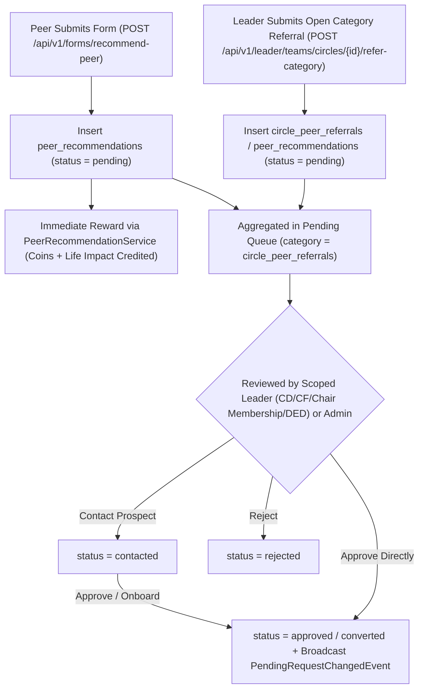

# Activity 16: Recommend a Peer Form

| Metadata Field | Verified Value |
|---|---|
| **Workbook Activity #** | `16` (`Row 24` in Sheet 1, `Row 23` in Sheets 2 & 3) |
| **Exact Workbook Name** | `Recommend a Peer Form` |
| **Domain Category** | `Social Proof & Reputation` (Sheets 1 & 2) / `Reputation / Endorsements` (Sheet 3) — **CRITICAL WORKBOOK-VS-CODE SEMANTIC MISMATCH: Actually implemented as Chapter Membership Candidate Referral / Prospective Peer Nomination!** |
| **Activity Governance Tier** | Tier 2 — Membership Growth, Open Category Nomination & Pending Queue Review |
| **Overall Implementation Status** | `Partially Implemented` (End-to-end prospective peer recommendation, immediate coin + life-impact rewards, DED feed, Leader open-category referral sheet, and unified `circle_peer_referrals` approval queue work; **HOWEVER**, Workbook misdescribes Activity 16 as an internal peer endorsement badge—which overlaps Activity 8 Testimonials—and Leader App lacks a dedicated Recommend-a-Peer review screen) |
| **Surface Status Breakdown** | **Backend:** `Fully Implemented` (Minor P0 `/api/v1/admin/forms/recommend-peer` missing admin guard + `ReferCategory` scope check gap) \| **Member App:** `Fully Implemented` ([recommend_peer_screen.dart](file:///D:/office%20project/peers-unity/unity_app/lib/features/highlights/presentation/screens/recommend_peer_screen.dart), [recommend_peer_history_screen.dart](file:///D:/office%20project/peers-unity/unity_app/lib/features/highlights/presentation/screens/recommend_peer_history_screen.dart)) \| **Leadership App:** `Partially Implemented` ([refer_category_bottom_sheet.dart](file:///D:/office%20project/LeaderApp-Fornt-end-/lib/features/circle_details/view/widgets/refer_category_bottom_sheet.dart) creates open-category referrals; no dedicated review screen for `circle_peer_referrals`) \| **Admin Web:** `Fully Implemented` ([PendingRequestsPage.tsx](file:///D:/office%20project/unity-admin-web/src/features/pendingRequests/PendingRequestsPage.tsx) & Blade `/admin/activities/recommend-peer`) |
| **Related Canonical Documents** | [12-master-35-activities-index.md](../12-master-35-activities-index.md) \| [03-normal-referrals.md](./03-normal-referrals.md) \| [08-testimonials.md](./08-testimonials.md) \| [19-activity-to-role-access-matrix.md](../19-activity-to-role-access-matrix.md) \| [25-activity-workflow-reference.md](../25-activity-workflow-reference.md) |

---

## 1. Business Purpose (§9.1)

- **WORKBOOK REQUIREMENT:** Workbook Sheets 1–3 describe Activity 16 as *"Formally endorse a peer's reliability, character, and craftsmanship for fellow members"* using *"Target Peer selector, Endorsement Category (Integrity, Quality, Punctuality), Justification remarks"* to generate an *"Endorsement Badge on recommended peer's profile"*.
- **FACT (Verified Codebase Reality):** Across **all** repositories (`unity-app-new`, `unity_app`, `LeaderApp-Fornt-end-`, and `unity-admin-web`), Activity 16 (`Recommend a Peer Form`) is **NOT** an internal character-endorsement badge (internal peer commendations are handled by **Activity 8: Testimonials**). Instead, Activity 16 is **Membership Growth Prospective Peer Nomination** (`peer_recommendations` + `peer_referrals` / `circle_peer_referrals`), where an existing Peer or Leader nominates an external entrepreneur/business owner (`peer_name`, `peer_mobile`, `peer_business`, `main_business_category`, `how_well_known`, `why_valuable`) to be invited into Peers Global or to fill an open category seat in a Circle!
  - Submitting `POST /api/v1/forms/recommend-peer` immediately awards **Coins** and **Life Impact points** via `PeerRecommendationService` ([PeerRecommendationController.php](file:///c:/Users/malic/OneDrive/Documents/GitHub/unity-app-new/app/Http/Controllers/Api/V1/Forms/PeerRecommendationController.php#L23-L50)), counts toward `recommended_peers` in `LastMonthActivityService` (Activity 35), and enters the `circle_peer_referrals` category of the Unified Pending Requests Queue ([PendingRequestAdminController.php](file:///c:/Users/malic/OneDrive/Documents/GitHub/unity-app-new/app/Http/Controllers/Api/Admin/PendingRequestAdminController.php)) for Membership Growth Chairs, Circle Directors, DEDs, and Admins to contact and convert into a Circle Peer!
- **Classification by Actor:**
  - **Member Action:** Recommending a prospective peer (`POST /api/v1/forms/recommend-peer` or open-category `POST /api/v1/peer-referrals`) and tracking conversion status (`GET /api/v1/forms/recommend-peer/my`).
  - **Leadership Action:** Nominating a contact or peer for an open sub-industry category in a circle via [refer_category_bottom_sheet.dart](file:///D:/office%20project/LeaderApp-Fornt-end-/lib/features/circle_details/view/widgets/refer_category_bottom_sheet.dart) (`POST /api/v1/leader/teams/circles/{id}/refer-category`), inspecting scoped recommendations (`GET /api/v1/ded/activities/recommend-a-peer`, `GET /api/v1/leader/activities/peer-recommendations`), and approving/rejecting `circle_peer_referrals` via `/api/v1/leader/pending-requests/circle_peer_referrals/{id}/approve|reject`.
  - **Admin Action:** Reviewing, contacting, approving/rejecting, or marking candidates `converted` (`PATCH /api/v1/admin/forms/recommend-peer/{id}/status`).

---

## 2. Sub-Activities Catalogue (§9.2)

| # | Sub-Activity / Atomic Operation | Member App (`unity_app`) | Leadership App (`LeaderApp`) | Admin Web (`unity-admin-web` / Blade) | Backend (`unity-app-new`) | Classification Status |
|---:|---|---|---|---|---|---|
| 16.1 | Submit Recommend a Peer Form (with immediate Coins & Life Impact reward) | [recommend_peer_screen.dart](file:///D:/office%20project/peers-unity/unity_app/lib/features/highlights/presentation/screens/recommend_peer_screen.dart), [recommend_peer_form_fields.dart](file:///D:/office%20project/peers-unity/unity_app/lib/features/highlights/presentation/widgets/recommend_peer_form_fields.dart) | N/A | N/A | `POST /api/v1/forms/recommend-peer` ([PeerRecommendationController.php](file:///c:/Users/malic/OneDrive/Documents/GitHub/unity-app-new/app/Http/Controllers/Api/V1/Forms/PeerRecommendationController.php#L23-L50)) | `Fully Implemented` |
| 16.2 | View Own Recommended Peers History & Status | [recommend_peer_history_screen.dart](file:///D:/office%20project/peers-unity/unity_app/lib/features/highlights/presentation/screens/recommend_peer_history_screen.dart) | N/A | N/A | `GET /api/v1/forms/recommend-peer/my` ([PeerRecommendationController.php](file:///c:/Users/malic/OneDrive/Documents/GitHub/unity-app-new/app/Http/Controllers/Api/V1/Forms/PeerRecommendationController.php#L55-L97)) | `Fully Implemented` |
| 16.3 | Nominate Candidate for Open Circle Category (`ReferCategory`) | `POST /api/v1/peer-referrals` (`PeerReferralsApiController`) | [refer_category_bottom_sheet.dart](file:///D:/office%20project/LeaderApp-Fornt-end-/lib/features/circle_details/view/widgets/refer_category_bottom_sheet.dart) | N/A | `POST /api/v1/leader/teams/circles/{id}/refer-category` ([LeaderTeamsService.php](file:///c:/Users/malic/OneDrive/Documents/GitHub/unity-app-new/app/Leader/Services/LeaderTeamsService.php#L1806-L1927)) | `Implemented but Incorrect` (Works in UI, but `referCategory` lacks circle scope check on `{id}`) |
| 16.4 | View Scoped Peer Recommendations Feed (Leader & DED) | N/A | Missing dedicated filter chip in `LeaderActivitiesView` | Blade `/admin/activities/recommend-peer` | `GET /api/v1/leader/activities/peer-recommendations`, `GET /api/v1/ded/activities/recommend-a-peer` | `Implemented but Not Integrated` (Backend endpoints exist; Leadership App UI does not surface a dedicated Peer Recommendations list) |
| 16.5 | Approve / Reject / Convert Peer Recommendation in Pending Queue | N/A | **Missing Pending Queue UI** (Backend `/leader/pending-requests/circle_peer_referrals/*` ready) | [PendingRequestsPage.tsx](file:///D:/office%20project/unity-admin-web/src/features/pendingRequests/PendingRequestsPage.tsx) (`circle_peer_referrals`) | `POST /api/v1/leader/pending-requests/circle_peer_referrals/{id}/approve\|reject`, `PATCH /api/v1/admin/forms/recommend-peer/{id}/status` | `Partially Implemented` (Works in Admin Web; `/admin/forms/recommend-peer` lacks admin guard; Leadership App lacks Action Center UI) |
| 16.6 | Workbook Internal Character Endorsement Badge (`Integrity`, `Quality`, `Punctuality`) | Handled via Activity 8 Testimonials instead | Handled via Testimonials | Handled via Testimonials | **NOT IMPLEMENTED** (`EndorsementAggregationService`) | `Requires Business Confirmation` (Likely documentation error in Workbook; covered by Testimonials) |

---

## 3. Input Form & Field Validation Mapping (§9.3)

- **FACT:** Verified against [StorePeerRecommendationRequest.php](file:///c:/Users/malic/OneDrive/Documents/GitHub/unity-app-new/app/Http/Requests/Forms/StorePeerRecommendationRequest.php#L17-L52) and [recommend_peer_form_fields.dart](file:///D:/office%20project/peers-unity/unity_app/lib/features/highlights/presentation/widgets/recommend_peer_form_fields.dart).

| Field Name | Data Type | Required/Optional | Validation (Backend + Client; mark missing as Requires Confirmation) | Default | Input Widget | Data Source | Visibility | Who Enters | Who Edits | Who Views | Sensitive? | Backend Request Key |
|---|---|---|---|---|---|---|---|---|---|---|---|---|
| **Peer Full Name** | `string` | Required | **Backend:** `required`, `string`, `max:255`. **Client:** `"Peer Full Name *"` required text. | `null` | `TextFormField` / Contact Picker | User input / Phonebook | Recommender, Scoped Leaders, Admin | Peer Member / Leader | Immutable | Recommender, Scoped Leaders, DED, Admin | PII (Prospect Name) | `peer_name` |
| **Peer Mobile Number** | `string` | Required | **Backend:** `required`, `string`, `min:10`, `max:20`. **Client:** `"Peer Mobile Number *"` phone validation. | `null` | Phone `TextFormField` | User input / Phonebook | Recommender, Scoped Leaders, Admin | Peer Member / Leader | Immutable | Recommender, Scoped Leaders, DED, Admin | Yes (Phone PII) | `peer_mobile` |
| **Peer Email** | `string` | Optional | **Backend:** `nullable`, `email`, `max:255`. **Client:** `"Peer Email"` optional email check. | `null` | `TextFormField` (`emailAddress`) | User input | Recommender, Scoped Leaders, Admin | Peer Member / Leader | Immutable | Recommender, Scoped Leaders, DED, Admin | Yes (Email PII) | `peer_email` |
| **City / Country** | `string` | Optional | **Backend:** `nullable`, `string`, `max:255`. **Client:** `"City / Country"`. | `null` | `TextFormField` | User input / `/api/v1/cities` | Recommender, Scoped Leaders, Admin | Peer Member | Immutable | Recommender, Scoped Leaders, DED, Admin | No | `peer_city` (`peer_city_country` alias) |
| **Business / Profession Name** | `string` | Optional | **Backend:** `nullable`, `string`, `max:255`. **Client:** `"Business / Profession Name"`. | `null` | `TextFormField` | User input | Recommender, Scoped Leaders, Admin | Peer Member / Leader | Immutable | Recommender, Scoped Leaders, DED, Admin | No | `peer_business` |
| **Industry / Interests** | `string` | Optional | **Backend:** `nullable`, `string`, `max:255`. **Client:** `"Industry / Interests"`. | `null` | `TextFormField` | User input | Recommender, Scoped Leaders, Admin | Peer Member | Immutable | Recommender, Scoped Leaders, DED, Admin | No | `peer_industry` |
| **Main Business Category** | `integer` + `string` | Optional | **Backend:** `main_business_category_id` (`nullable\|integer`), `main_business_category` (`nullable\|string\|max:255`), plus aliases `category_id`, `category`. **Client:** `"Business Category"` dropdown + `"Specify Custom Business Category"`. | `null` | Category Dropdown | `/api/v1/business-categories/main` | Recommender, Scoped Leaders, Admin | Peer Member / Leader | Immutable | Recommender, Scoped Leaders, DED, Admin | No | `main_business_category_id`, `main_business_category` |
| **Business Subcategory** | `integer`/`string` | Optional | **Backend:** `business_subcategory_id` (`nullable`), `business_subcategory` (`nullable\|string\|max:255`). **Client:** Subcategory selector. | `null` | Subcategory Dropdown | `/api/v1/business-categories/{id}/children` | Recommender, Scoped Leaders, Admin | Peer Member / Leader | Immutable | Recommender, Scoped Leaders, DED, Admin | No | `business_subcategory_id`, `business_subcategory` |
| **Target Circle** | `uuid` + `string` | Optional (Required in Leader `refer-category`) | **Backend:** `circle_id` (`nullable`; **Missing `uuid\|exists:circles,id` in `StorePeerRecommendationRequest` — Requires Confirmation**), `circle_name` (`nullable\|string\|max:255`). | Recommender's circle or `null` | Circle Selector | `/api/v1/circles` | Recommender, Circle Leaders, Admin | Peer Member / Leader | Immutable | Recommender, Circle Leaders, DED, Admin | No | `circle_id`, `circle_name` |
| **How Well Known** | `string` (enum) | Required | **Backend:** `required`, `string`, `Rule::in(['business_associate', 'close_friend', 'client', 'community_contact'])`. **Client:** Relationship selector. | `null` | Dropdown / Choice Chips | Static enum | Recommender, Scoped Leaders, Admin | Peer Member | Immutable | Recommender, Scoped Leaders, DED, Admin | No | `how_well_known` |
| **Is Prospect Aware of Nomination?** | `boolean` | Optional | **Backend:** `nullable`, `boolean` (`prepareForValidation` defaults `null` -> `true` at `L19-21`). **Client:** Checkbox/Switch. | `true` | Checkbox / Switch | User input | Recommender, Scoped Leaders, Admin | Peer Member | Immutable | Recommender, Scoped Leaders, DED, Admin | No | `is_aware` |
| **Why Recommend / Valuable** | `text` | Optional | **Backend:** `nullable`, `string`, `max:2000`. **Client:** `"Why do you recommend this peer?"`. | `null` | Multi-line `TextFormField` | User input | Recommender, Scoped Leaders, Admin | Peer Member | Immutable | Recommender, Scoped Leaders, DED, Admin | No | `why_valuable` |
| **Note for Team** | `text` | Optional | **Backend:** `nullable`, `string`, `max:2000`. **Client:** `"Any Note for the Team?"`. | `null` | Multi-line `TextFormField` | User input | Recommender, Scoped Leaders, Admin | Peer Member | Immutable | Recommender, Scoped Leaders, DED, Admin | No | `note` |

---

## 4. Workflow, Lifecycle & Mermaid Diagram (§9.4)

- **WORKBOOK REQUIREMENT:** `Endorsement Submitted -> Notification Sent -> Profile Badge Added`.
- **FACT:** Actual PostgreSQL status lifecycle on `peer_recommendations.status` is `pending` (initial state on submit; coins & life impact awarded immediately upon submission) -> `contacted` -> `approved` / `converted` or `rejected`. Records also surface in `PendingRequestAdminController` under category `circle_peer_referrals` alongside `peer_referrals` and `circle_peer_referrals`.

---

## 5. Outputs & Deliverables (§9.5)

| Output / Deliverable | Workbook Specification | Actual Repository Status | Verification Evidence |
|---|---|---|---|
| **Activity Reward Payload (Coins + Impact)** | Not mentioned in Workbook | `Fully Implemented` (**FACT**) | `PeerRecommendationController@store` returns `coins_earned`, `current_coins_balance`, `impact_points`, `updated_life_impact` (`L33-47`). |
| **Recommendation History Log Card** | `RecommendPeerHistoryScreen` | `Fully Implemented` (**FACT**) | [recommend_peer_history_screen.dart](file:///D:/office%20project/peers-unity/unity_app/lib/features/highlights/presentation/screens/recommend_peer_history_screen.dart) consumes `GET /api/v1/forms/recommend-peer/my`. |
| **Monthly Summary Attribution** | Counted in monthly networking ROI | `Fully Implemented` (**FACT**) | `LastMonthActivityService` aggregates `peer_recommendations` under `recommended_peers`. |
| **Endorsement Badge on Peer Profile** | Endorsement Badge on recommended peer's profile | `Not Required` / Mismatched (**WORKBOOK REQUIREMENT** vs **FACT**) | Recommended person is an *external prospect* (not yet a platform user); internal peer commendations use Activity 8 (`Testimonials`). |

---

## 6. Database & Metrics Mapping (§9.6)

- **Primary Model & Table:** `App\Models\PeerRecommendation` ([PeerRecommendation.php](file:///c:/Users/malic/OneDrive/Documents/GitHub/unity-app-new/app/Models/PeerRecommendation.php)) -> `peer_recommendations`.
  - **Columns:** `id` (`uuid`), `user_id` (`uuid` FK -> `users.id` recommender), `peer_name`, `peer_mobile`, `peer_email`, `peer_city`, `peer_business`, `peer_industry`, `why_valuable`, `category`, `category_id`, `main_business_category_id`, `main_business_category`, `business_subcategory_id`, `business_subcategory`, `circle_id`, `circle_name`, `how_well_known`, `is_aware` (`bool`), `note`, `status` (`pending`|`approved`|`rejected`|`contacted`|`converted`), `coins_awarded` (`bool`), `coins_awarded_at`, `created_at`, `updated_at`.
- **Companion Open-Category Table:** `App\Models\PeerReferral` (`peer_referrals`) & `circle_peer_referrals` (used by `PeerReferralsApiController` and `LeaderTeamsService::referCategory()`).
- **Organizational Scope:** Scoped via `circle_id` (when specified) or recommender's `user_id -> circle_members.circle_id` in `PendingRequestAdminController::resolveLeaderScope()`, `LeaderActivitiesService`, and `DedApiService`.

### Sheet 3 Workbook Metric Keys Comparison
| Workbook Metric Key (Sheet 3) | Actual Backend / DB Equivalent | Status |
|---|---|---|
| `recommendedPeers` | `COUNT(peer_recommendations WHERE user_id = ?)` (`recommended_peers` in `LastMonthActivityService`) | `Fully Implemented` |
| `endorsementsGiven` | `testimonialsGiven` (Activity 8) / `peer_recommendations` submitted count | `Requires Business Confirmation` (Workbook conflates Testimonials with Peer Recommendations) |
| `endorsementsReceived` | `testimonialsReceived` (Activity 8) — N/A on `peer_recommendations` | `Not Required` on `peer_recommendations` |

---

## 7. API & Backend Service Mapping (§9.7)

| Surface | Method & Endpoint | Controller @ Action | Service / Request | Auth Middleware | Scope Enforcement & Security Bugs | Client Integration |
|---|---|---|---|---|---|---|
| Member API | `POST /api/v1/forms/recommend-peer` (& `/api/forms/recommend-peer`) | [PeerRecommendationController.php](file:///c:/Users/malic/OneDrive/Documents/GitHub/unity-app-new/app/Http/Controllers/Api/V1/Forms/PeerRecommendationController.php#L23) `@store` | `PeerRecommendationService`, `StorePeerRecommendationRequest` | `auth:sanctum`, `unity.user` | Scoped to `$request->user()`. Safe. | Integrated in Member App (`RecommendPeerRemoteDatasource`) |
| Member API | `GET /api/v1/forms/recommend-peer/my` | `PeerRecommendationController@myIndex` | `PeerRecommendationService` | `auth:sanctum`, `unity.user` | Filtered by `user_id = $authUser->id`. Safe. | Integrated in Member App (`RecommendPeerHistoryScreen`) |
| Member API | `GET\|POST /api/v1/peer-referrals` | `PeerReferralsApiController` | Inline | `auth:sanctum`, `unity.user` | Open-category circle candidate referrals. | Integrated in Member App (`ApiEndpoints.peerReferrals`) |
| Leader API | `POST /api/v1/leader/teams/circles/{id}/refer-category` | [LeaderTeamsController.php](file:///c:/Users/malic/OneDrive/Documents/GitHub/unity-app-new/app/Leader/Controllers/LeaderTeamsController.php#L135) `@referCategory` | `LeaderTeamsService::referCategory` | `auth:sanctum`, `leader.user` | **IDOR / Scope Bug:** Does NOT verify `$circleId` belongs to `$user`'s managed circles (`LeaderTeamsService.php:1806`)! | Integrated in Leadership App ([refer_category_bottom_sheet.dart](file:///D:/office%20project/LeaderApp-Fornt-end-/lib/features/circle_details/view/widgets/refer_category_bottom_sheet.dart)) |
| Leader API | `GET /api/v1/leader/activities/peer-recommendations` | `LeaderActivitiesController` | `LeaderActivitiesService` | `auth:sanctum`, `leader.user` | Scoped on list; `showDetail` lacks `$scopedPeerIds` check. | Not surfaced as dedicated tab in Leadership App |
| Leader & Admin Pending Queue | `GET /api/v1/leader/pending-requests` (`?category=circle_peer_referrals`), `POST .../circle_peer_referrals/{id}/approve\|reject` | [PendingRequestAdminController.php](file:///c:/Users/malic/OneDrive/Documents/GitHub/unity-app-new/app/Http/Controllers/Api/Admin/PendingRequestAdminController.php) | `resolveLeaderScope()` | `auth:sanctum`, `leader.user` | Scoped to leader's circles/categories, **BUG:** Does not check capability (`viceChair`/`secretary` can approve/reject). | Integrated in React Admin Web; **Missing Action Center UI in Leadership App** |
| DED API | `GET /api/v1/ded/activities/recommend-a-peer` | `DedActivitiesController` | `DedApiService` | `auth:sanctum`, `ensure.ded.api` | Properly scoped to DED's assigned districts via `DistrictScopeService`. | Backend ready (`AdminUser` DED guard) |
| Admin V1 API | `GET /api/v1/admin/forms/recommend-peer[/{id}]`, `PATCH .../{id}/status` | `AdminOpsController` | Inline | `auth:sanctum`, `unity.user` | **CRITICAL P0 BUG:** Mounted under `/api/v1/admin/*` without admin role middleware! | Integrated in Admin Web |

---

## 8. Role-Wise Access Governance (§9.8)

| Role | View Activity | Create Record | Edit Own | Edit Others | Submit for Review | Verify | Approve | Reject | Assign | Manage | Delete | View Aggregated Reports |
|---|---|---|---|---|---|---|---|---|---|---|---|---|
| **Super Admin** | Allowed (Global) | Allowed | Allowed | Allowed (`PATCH .../status`) | Allowed | Allowed | Allowed (Global) | Allowed (Global) | DENIED — No prospect-owner assignment column exists. | Allowed (Global) | DENIED (No delete route; status update only) | Allowed (Global) |
| **Country Director** | Allowed (Country scope) | Allowed (`refer-category` & Member form) | DENIED (Immutable) | DENIED — No permission under the verified backend authorization model. | Allowed | Allowed | Allowed (Country scope via `/leader/pending-requests`) | Allowed (Country scope) | DENIED — No permission under the verified backend authorization model. | Allowed (Country scope status review) | DENIED — No permission under the verified backend authorization model. | Allowed (Country scope) |
| **DED** | Allowed (District scope via `/ded/activities/recommend-a-peer` & `/leader/*`) | Allowed | DENIED | DENIED — No permission under the verified backend authorization model. | Allowed | Allowed | Allowed (District scope via `/leader/pending-requests`) | Allowed (District scope) | DENIED — No permission under the verified backend authorization model. | Allowed (District scope) | DENIED — No permission under the verified backend authorization model. | Allowed (District scope) |
| **Industry Director** | Allowed (Industry scope) | Allowed | DENIED | DENIED — No permission under the verified backend authorization model. | Allowed | Allowed | Allowed (Industry scope via `/leader/pending-requests`) | Allowed (Industry scope) | DENIED — No permission under the verified backend authorization model. | DENIED — No permission under the verified backend authorization model. | DENIED — No permission under the verified backend authorization model. | Allowed (Industry scope) |
| **Circle Founder** | Allowed (Own Circle) | Allowed (`refer-category`) | DENIED | DENIED — No permission under the verified backend authorization model. | Allowed | Allowed | Allowed (Own Circle `circle_peer_referrals`) | Allowed (Own Circle) | DENIED — No permission under the verified backend authorization model. | Allowed (Own Circle) | DENIED — No permission under the verified backend authorization model. | Allowed (Own Circle) |
| **Circle Director** | Allowed (Own Circle) | Allowed (`refer-category`) | DENIED | DENIED — No permission under the verified backend authorization model. | Allowed | Allowed | Allowed (Own Circle `circle_peer_referrals`) | Allowed (Own Circle) | DENIED — No permission under the verified backend authorization model. | Allowed (Own Circle) | DENIED — No permission under the verified backend authorization model. | Allowed (Own Circle) |
| **Chair / Committee Chairs** (`chairMembership` primary) | Allowed (Own Circle) | Allowed (`refer-category`) | DENIED | DENIED — No permission under the verified backend authorization model. | Allowed | UNVERIFIED — `chairMembership` should verify/triage prospective peer nominations; requires explicit capability gate. | UNVERIFIED — Currently allowed by `PendingRequestAdminController` due to missing capability check; confirm whether `chairMembership` approves or only CD/CF approves. | UNVERIFIED — Requires backend/business confirmation. | DENIED — No permission under the verified backend authorization model. | DENIED — No permission under the verified backend authorization model. | DENIED — No permission under the verified backend authorization model. | Allowed (Own Circle) |
| **Vice Chair** | Allowed (Own Circle read-only) | Allowed | DENIED | DENIED — No permission under the verified backend authorization model. | Allowed | DENIED (Intended; **currently unblocked in `PendingRequestAdminController`**) | DENIED — Should require `can_review_pending_peers`. | DENIED — Should require `can_review_pending_peers`. | DENIED — No permission under the verified backend authorization model. | DENIED — No permission under the verified backend authorization model. | DENIED — No permission under the verified backend authorization model. | Allowed (Own Circle) |
| **Secretary** | Allowed (Own Circle read-only) | Allowed | DENIED | DENIED — No permission under the verified backend authorization model. | Allowed | DENIED (Intended) | DENIED — Should require `can_review_pending_peers`. | DENIED — Should require `can_review_pending_peers`. | DENIED — No permission under the verified backend authorization model. | DENIED — No permission under the verified backend authorization model. | DENIED — No permission under the verified backend authorization model. | Allowed (Own Circle) |
| **Committee Leader** | DENIED in Leader App (Role resolver bug); Own records in Member App | Allowed (Member App) | DENIED | DENIED — No permission under the verified backend authorization model. | Allowed | DENIED — No permission under the verified backend authorization model. | DENIED — No permission under the verified backend authorization model. | DENIED — No permission under the verified backend authorization model. | DENIED — No permission under the verified backend authorization model. | DENIED — No permission under the verified backend authorization model. | DENIED — No permission under the verified backend authorization model. | DENIED — No permission under the verified backend authorization model. |
| **Peer Member** | Allowed (Own recommendations via `/forms/recommend-peer/my`) | Allowed (`POST /forms/recommend-peer`, `POST /peer-referrals`) | DENIED (Immutable) | DENIED — No permission under the verified backend authorization model. | Allowed | DENIED — No permission under the verified backend authorization model. | DENIED — No permission under the verified backend authorization model. | DENIED — No permission under the verified backend authorization model. | DENIED — No permission under the verified backend authorization model. | DENIED — No permission under the verified backend authorization model. | DENIED — No permission under the verified backend authorization model. | DENIED — No permission under the verified backend authorization model. |

---

## 9. Existing Implementation Summary, Gaps & Minimum-Change Enhancement Recommendations

| # | 1. Existing Implementation Summary | 2. Identified Gap / Defect | 3. Classification Status | 4. Impact / Risk Severity | 5. Target Repo & Layer | 6. Exact File(s) / Endpoint(s) / Table(s) | 7. Minimum-Change Enhancement Specification | 8. RBAC & Scope Enforcement Rule | 9. Migration / Compatibility Impact | 10. Verification / Test Criteria |
|---:|---|---|---|---|---|---|---|---|---|---|
| **16-R1** | `/api/v1/admin/forms/recommend-peer/*` is exposed under `unity.user`, `LeaderTeamsService::referCategory` skips circle scope check, and `PendingRequestAdminController` skips capability check. | Any Peer token can read/mutate all peer recommendations via `/admin/forms/recommend-peer`; any Leader can post `refer-category` to an unrelated circle; `viceChair`/`secretary` can approve/reject `circle_peer_referrals`. | `Implemented but Incorrect` | **P0 Critical / P1 High (Auth & Scope Enforcement)** | `unity-app-new` (Routes, Services, Controllers) | `routes/api.php`, `AdminOpsController.php`, [LeaderTeamsService.php](file:///c:/Users/malic/OneDrive/Documents/GitHub/unity-app-new/app/Leader/Services/LeaderTeamsService.php#L1806), [PendingRequestAdminController.php](file:///c:/Users/malic/OneDrive/Documents/GitHub/unity-app-new/app/Http/Controllers/Api/Admin/PendingRequestAdminController.php#L75-L205) | Add `admin.auth` + `admin.permission` middleware on `/api/v1/admin/forms/*`; verify `$circleId` is in `resolveScopedCircleIds($user)` inside `LeaderTeamsService::referCategory()`; enforce `can_review_pending_peers` (`access_teams`) on `PendingRequestAdminController@approve|reject`. | Only `CF`, `CD`, `chairMembership` (if confirmed), `ID`, `DED`, `countryDirector`, and `superAdmin` may approve/reject `circle_peer_referrals` within their scoped circles. | Zero DB migration required. | Feature tests asserting `403` for Peer on `/admin/forms/recommend-peer`, `403` for CD of Circle A calling `refer-category` on Circle B, and `403` for `secretary` approving `circle_peer_referrals`. |
| **16-R2** | Backend `/api/v1/leader/pending-requests?category=circle_peer_referrals` and `/api/v1/leader/activities/peer-recommendations` exist, and Dashboard shows `pending_peers_count`. | Flutter Leadership App has no Pending Approvals / Action Center screen for `circle_peer_referrals` and no `Peer Recommendations` filter in `LeaderActivitiesView`, forcing CDs/Membership Chairs to use Web Admin to follow up on nominated prospects. | `Implemented but Not Integrated` | **P1 High (Core Membership Growth Workflow Missing in Leader App)** | `LeaderApp-Fornt-end-` (`leader_activities` & Action Center) | [leader_activities_view.dart](file:///D:/office%20project/LeaderApp-Fornt-end-/lib/features/leader_activities/view/leader_activities_view.dart), [dashboard_pending_peers_card.dart](file:///D:/office%20project/LeaderApp-Fornt-end-/lib/features/dashboard/view/widgets/dashboard_pending_peers_card.dart) | Wire `circle_peer_referrals` into the unified Leadership App Pending Requests / Action Center (reusing existing `GET /api/v1/leader/pending-requests?category=circle_peer_referrals` and `POST .../approve\|reject`) with 1-tap Call/WhatsApp action on `peer_mobile`, and add `peer-recommendations` chip in `LeaderActivitiesView`. | Hide Approve/Reject buttons when `leaderPermissions.canReviewPendingPeers == false`. | Reuses existing `/api/v1/leader/pending-requests` contract without new endpoints. | Widget + integration test verifying CD sees scoped `circle_peer_referrals` items and can transition status to `approved`/`rejected`. |
| **16-R3** | Coins and Life Impact are awarded immediately on `POST /api/v1/forms/recommend-peer` before any leader verifies the phone number or prospect quality; Workbook describes Activity 16 as an internal endorsement badge. | Potential gamification farming via fake prospect submissions; documentation mismatch in Workbook Sheet 1–3. | `Requires Business Confirmation` (**BUSINESS DECISION REQUIRED**) | **P2 Medium (Gamification Integrity & Spec Alignment)** | Product / `PeerRecommendationService` | [PeerRecommendationController.php](file:///c:/Users/malic/OneDrive/Documents/GitHub/unity-app-new/app/Http/Controllers/Api/V1/Forms/PeerRecommendationController.php#L28-L39), `PeerRecommendationService.php` | Confirm with Founders: (1) Update Master Workbook row 16 to reflect *Prospective Peer Nomination* (leaving character endorsements to Activity 8 Testimonials), and (2) decide whether Coins/Life Impact should remain instant on submission or move to `PendingRequestAdminController` approval. | If moved to approval, credit coins idempotently via `coins_awarded` flag only once upon `status = approved`. | Zero schema change (`coins_awarded` & `coins_awarded_at` already exist on `peer_recommendations`!). | Confirm `coins_awarded` transitions `false -> true` once and prevents duplicate payouts. |
