# Activity 17: Register a Visitor Form

| Metadata Field | Verified Value |
|---|---|
| **Workbook Activity #** | `17` (`Row 25` in Sheet 1, `Row 24` in Sheets 2 & 3) |
| **Exact Workbook Name** | `Register a Visitor Form` |
| **Domain Category** | `Chapter Growth & Visitors` (Sheets 1 & 2) / `Chapter Operations / CRM` (Sheet 3) |
| **Activity Governance Tier** | Tier 2 — Chapter Growth, Visitor Verification, QR Gate Check-In & Pending Approval Queue |
| **Overall Implementation Status** | `Partially Implemented` (Two parallel visitor mechanisms exist: (1) General `visitor_registrations` form with Pending Queue approval & coin reward, and (2) Event-occurrence `event_registrations` (`registration_type='visitor'`) with QR pass & WhatsApp dispatch; however, the two tables are not unified, Leadership App lacks Pending Queue approval UI, and `/api/v1/admin/forms/register-visitor` lacks admin role guard) |
| **Surface Status Breakdown** | **Backend:** `Partially Implemented` (Both flows work; `/admin/forms/register-visitor` missing admin guard; `PendingRequestAdminController` missing capability guard) \| **Member App:** `Fully Implemented` ([register_visitor_screen.dart](file:///D:/office%20project/peers-unity/unity_app/lib/features/highlights/presentation/screens/register_visitor_screen.dart) + Event Visitor Registration) \| **Leadership App:** `Partially Implemented` (Read-only `visitors` feed in `LeaderActivitiesView`; no Approve/Reject UI for `visitor_registrations`) \| **Admin Web:** `Fully Implemented` ([PendingRequestsPage.tsx](file:///D:/office%20project/unity-admin-web/src/features/pendingRequests/PendingRequestsPage.tsx), Blade `/admin/visitor-registrations/*`) |
| **Related Canonical Documents** | [12-master-35-activities-index.md](../12-master-35-activities-index.md) \| [19-activity-to-role-access-matrix.md](../19-activity-to-role-access-matrix.md) \| [21-attended-events-and-registrations.md](./21-attended-events-and-registrations.md) \| [25-activity-workflow-reference.md](../25-activity-workflow-reference.md) \| [26-events-and-attendance-flow.md](../26-events-and-attendance-flow.md) |

---

## 1. Business Purpose (§9.1)

- **WORKBOOK REQUIREMENT:** Enables Peers to *"Invite business colleagues and prospective members to attend an upcoming chapter networking breakfast"*, issuing a *"Personalized Digital Visitor Pass with QR Code dispatched via WhatsApp/SMS"* and tracking gate check-in (`Visitor Registered -> QR Pass Issued -> Checked In at Gate`).
- **FACT:** The backend implements **three distinct visitor data paths** across different controllers and tables:
  1. **Path A — Standalone "Register a Visitor" Activity Form (`visitor_registrations`)**: Submitted from Member App Highlights ([register_visitor_screen.dart](file:///D:/office%20project/peers-unity/unity_app/lib/features/highlights/presentation/screens/register_visitor_screen.dart)) to `POST /api/v1/forms/register-visitor` ([VisitorRegistrationController.php](file:///c:/Users/malic/OneDrive/Documents/GitHub/unity-app-new/app/Http/Controllers/Api/V1/Forms/VisitorRegistrationController.php#L12-L90)). Immediately awards **Life Impact points** (`visitor_registration`) on submission, sets `status = 'pending'`, `coins_awarded = false`, and enters the Unified Pending Requests Queue (`visitor_registrations` in `PendingRequestAdminController` and `DedPendingRequestsController`), where approval awards **Coins**! **However, Path A does NOT generate a `qr_token` or send a WhatsApp QR pass!**
  2. **Path B — Event-Specific Visitor Pass (`event_registrations` where `registration_type = 'visitor'`)**: Submitted via `POST /api/v1/events/{event_id}/occurrences/{occurrence_id}/visitor-register` (public) or `.../visitor-register-as-user` (authenticated Peer) in `EventController` (plus public web `/events/{event}/occurrences/{occurrence}/visitor-register`). Generates a cryptographic `qr_token`, supports Razorpay fee payment if paid event, dispatches WhatsApp QR pass (`WhatsAppEventPassesPage.tsx`), and tracks venue QR scan check-in (`checkin_status = 'checked_in'`).
  3. **Path C — Referral-Link Visitor Leads (`visitor_leads`)**: Captures prospective visitors arriving via a Peer's referral link (`GET /api/v1/referrals/visitors`).
- **Classification by Actor:**
  - **Member Action:** Registering a visitor via Path A (`POST /api/v1/forms/register-visitor`) or Path B (`POST .../visitor-register-as-user`) and viewing history (`GET /api/v1/forms/register-visitor/my`).
  - **Leadership Action:** Viewing scoped visitor registrations (`GET /api/v1/leader/activities?type=visitors`, `GET /api/v1/ded/activities/register-a-visitor`) and approving/rejecting visitor attendance in the Pending Queue (`POST /api/v1/leader/pending-requests/visitor_registrations/{id}/approve|reject`, `POST /api/v1/ded/pending-requests/visitor-registrations/{id}/approve|reject`) or scanning QR passes at the gate (`ScanAppEventController`).
  - **Admin Action:** Bulk import/export, approval/rejection, and WhatsApp event pass monitoring (`/admin/visitor-registrations/*`, `PendingRequestsPage.tsx`).

---

## 2. Sub-Activities Catalogue (§9.2)

| # | Sub-Activity / Atomic Operation | Member App (`unity_app`) | Leadership App (`LeaderApp`) | Admin Web (`unity-admin-web` / Blade) | Backend (`unity-app-new`) | Classification Status |
|---:|---|---|---|---|---|---|
| 17.1 | Submit Standalone Visitor Registration Form (Path A) | [register_visitor_screen.dart](file:///D:/office%20project/peers-unity/unity_app/lib/features/highlights/presentation/screens/register_visitor_screen.dart), [register_visitor_form_fields.dart](file:///D:/office%20project/peers-unity/unity_app/lib/features/highlights/presentation/widgets/register_visitor_form_fields.dart) | N/A | N/A | `POST /api/v1/forms/register-visitor` ([VisitorRegistrationController.php](file:///c:/Users/malic/OneDrive/Documents/GitHub/unity-app-new/app/Http/Controllers/Api/V1/Forms/VisitorRegistrationController.php#L12-L90)) | `Fully Implemented` (No QR pass generated on Path A) |
| 17.2 | View Own Registered Visitors History | [register_visitor_screen.dart](file:///D:/office%20project/peers-unity/unity_app/lib/features/highlights/presentation/screens/register_visitor_screen.dart) (`History` tab) | N/A | N/A | `GET /api/v1/forms/register-visitor/my` (& `/visitor-registrations/my`) | `Fully Implemented` |
| 17.3 | Register Visitor for Specific Event Occurrence & Issue QR Pass (Path B) | [event_detail_screen.dart](file:///D:/office%20project/peers-unity/unity_app/lib/features/events/presentation/screens/event_detail_screen.dart) (`eventVisitorRegisterAsUser`) | N/A | Public Web `/events/{e}/occurrences/{o}/visitor-register` & [WhatsAppEventPassesPage.tsx](file:///D:/office%20project/unity-admin-web/src/features/whatsapp/WhatsAppEventPassesPage.tsx) | `POST /api/v1/events/{event_id}/occurrences/{occurrence_id}/visitor-register[-as-user]` (`EventController`) | `Fully Implemented` |
| 17.4 | Leader & DED Scoped Visitor Activity Feed | N/A | [leader_activities_view.dart](file:///D:/office%20project/LeaderApp-Fornt-end-/lib/features/leader_activities/view/leader_activities_view.dart) (`visitors`) | Blade `/admin/activities/register-visitor` | `GET /api/v1/leader/activities?type=visitors`, `GET /api/v1/ded/activities/register-a-visitor` | `Partially Implemented` (`showDetail` on `/leader/activities/visitors/{id}` lacks `$scopedPeerIds` check) |
| 17.5 | Approve / Reject Visitor Registration (Awards Coins to Host Peer) | N/A | **Missing Pending Queue UI** (Backend `/leader/pending-requests/visitor_registrations/*` ready) | [PendingRequestsPage.tsx](file:///D:/office%20project/unity-admin-web/src/features/pendingRequests/PendingRequestsPage.tsx) & Blade `/admin/visitor-registrations` | `POST /api/v1/leader/pending-requests/visitor_registrations/{id}/approve\|reject`, `POST /api/v1/ded/pending-requests/visitor-registrations/{id}/approve\|reject` | `Partially Implemented` (Backend + Admin Web work; Leadership App lacks approval UI; `PendingRequestAdminController` skips capability check) |
| 17.6 | Manual Coin Claim for Invite Visitor (`invite_visitor`) | [claim_coins_form_screen.dart](file:///D:/office%20project/peers-unity/unity_app/lib/features/highlights/presentation/screens/claim_coins_form_screen.dart) | N/A | [CoinClaimsPage.tsx](file:///D:/office%20project/unity-admin-web/src/features/coins/CoinClaimsPage.tsx) | `POST /api/v1/coin-claims` (`activity_code = 'invite_visitor'`, 1,000 coins in [config/coin_claims.php](file:///c:/Users/malic/OneDrive/Documents/GitHub/unity-app-new/config/coin_claims.php#L50-L60)) | `Fully Implemented` (Potential double-dip risk with Path A approval coins!) |

---

## 3. Input Form & Field Validation Mapping (§9.3)

- **FACT:** Verified against [StoreVisitorRegistrationRequest.php](file:///c:/Users/malic/OneDrive/Documents/GitHub/unity-app-new/app/Http/Requests/Forms/StoreVisitorRegistrationRequest.php#L16-L37) and [register_visitor_form_fields.dart](file:///D:/office%20project/peers-unity/unity_app/lib/features/highlights/presentation/widgets/register_visitor_form_fields.dart).

| Field Name | Data Type | Required/Optional | Validation (Backend + Client; mark missing as Requires Confirmation) | Default | Input Widget | Data Source | Visibility | Who Enters | Who Edits | Who Views | Sensitive? | Backend Request Key |
|---|---|---|---|---|---|---|---|---|---|---|---|---|
| **Event Type** | `string` (enum) | Required | **Backend:** `required`, `Rule::in(['physical', 'virtual'])`. **Client:** Physical / Virtual toggle. | `'physical'` | Segmented Control / Radio | Static enum | Host Peer, Scoped Leaders, DED, Admin | Peer Member | Immutable | Host Peer, Scoped Leaders, DED, Admin | No | `event_type` |
| **Event Name** | `string` | Required | **Backend:** `required`, `string`, `max:190` (**Free-text string, NOT FK to `events.id` on Path A!**). **Client:** `"Event Name *"` required text. | `null` | `TextFormField` | User input | Host Peer, Scoped Leaders, DED, Admin | Peer Member | Immutable | Host Peer, Scoped Leaders, DED, Admin | No | `event_name` |
| **Event / Chapter Meeting Date** | `date` | Required | **Backend:** `required`, `date` (no `after_or_equal:today` rule — allows retroactive logging; Requires Confirmation). **Client:** Date picker. | Today | Date Picker | Calendar | Host Peer, Scoped Leaders, DED, Admin | Peer Member | Immutable | Host Peer, Scoped Leaders, DED, Admin | No | `event_date` |
| **Visitor Full Name** | `string` | Required | **Backend:** `required`, `string`, `max:150`. **Client:** `"Visitor Full Name *"`. | `null` | `TextFormField` / Contact Picker | User input / Contacts | Host Peer, Scoped Leaders, DED, Admin | Peer Member | Immutable | Host Peer, Scoped Leaders, DED, Admin | PII (Visitor Name) | `visitor_full_name` |
| **Visitor Mobile Number** | `string` | Required | **Backend:** `required`, `string`, `max:30` (missing min digits / regex — Requires Confirmation). **Client:** `"Visitor Mobile Number *"`. | `null` | Phone `TextFormField` | User input / Contacts | Host Peer, Scoped Leaders, DED, Admin | Peer Member | Immutable | Host Peer, Scoped Leaders, DED, Admin | Yes (Phone PII) | `visitor_mobile` |
| **Visitor Email** | `string` | Optional | **Backend:** `nullable`, `email`, `max:190`. **Client:** `"Visitor Email"`. | `null` | `TextFormField` (`emailAddress`) | User input | Host Peer, Scoped Leaders, DED, Admin | Peer Member | Immutable | Host Peer, Scoped Leaders, DED, Admin | Yes (Email PII) | `visitor_email` |
| **Visitor City** | `string` | Required | **Backend:** `required`, `string`, `max:120`. **Client:** `"Visitor City *"`. | `null` | `TextFormField` | User input | Host Peer, Scoped Leaders, DED, Admin | Peer Member | Immutable | Host Peer, Scoped Leaders, DED, Admin | No | `visitor_city` |
| **Visitor Business / Company Name** | `string` | Required | **Backend:** `required`, `string`, `max:150`. **Client:** `"Business / Profession *"`. | `null` | `TextFormField` | User input | Host Peer, Scoped Leaders, DED, Admin | Peer Member | Immutable | Host Peer, Scoped Leaders, DED, Admin | No | `visitor_business` |
| **Visitor Designation** | `string` | Optional | **Backend:** `nullable`, `string`, `max:150` (fallback-mapped into `how_known` in controller `L40` because `visitor_designation` is not persisted as a separate select column in `myIndex`!). | `null` | `TextFormField` | User input | Host Peer, Admin | Peer Member | Immutable | Host Peer, Admin | No | `visitor_designation` |
| **Visitor Business Category ID & Name** | `integer` + `string` | Optional | **Backend:** `visitor_business_category_id` (`nullable\|integer\|exists:level4_categories,id` or `circle_category_level4,id`), `visitor_business_category` (`nullable\|string\|max:150`). | `null` | Category Picker | Level 4 Categories | Host Peer, Scoped Leaders, DED, Admin | Peer Member | Immutable | Host Peer, Scoped Leaders, DED, Admin | No | `visitor_business_category_id`, `visitor_business_category` |
| **Visitor Business Website** | `string` (URL) | Optional | **Backend:** `nullable`, `url`, `max:255`. | `null` | `TextFormField` (`url`) | User input | Host Peer, Scoped Leaders, DED, Admin | Peer Member | Immutable | Host Peer, Scoped Leaders, DED, Admin | No | `visitor_business_website` |
| **Invited By Type & User ID** | `string` + `uuid` | Optional / Conditional | **Backend:** `invited_by_type` (`nullable\|in:peers_global_team,circle_member_peer,other`), `invited_by_user_id` (`nullable\|uuid\|exists:users,id\|required_if:invited_by_type,circle_member_peer,other`). | `null` | Dropdown + Peer Picker | `/api/v1/members/limited` | Host Peer, Scoped Leaders, Admin | Peer Member | Immutable | Host Peer, Scoped Leaders, Admin | No | `invited_by_type`, `invited_by_user_id` |
| **How Known** | `string` (enum) | Optional | **Backend:** `nullable`, `Rule::in(['friend', 'business_associate', 'client', 'family', 'community_contact', 'peers_global_team', 'circle_member_peer', 'other'])`. | `null` | Dropdown | Static enum | Host Peer, Scoped Leaders, Admin | Peer Member | Immutable | Host Peer, Scoped Leaders, Admin | No | `how_known` |
| **Remarks / Business Brief** | `text` | Optional | **Backend:** `note` (`nullable\|string\|max:1000`), `visitor_business_brief` (`nullable\|string\|max:2000`, fallback-mapped into `note`). **Client:** `"Remarks / Notes"`. | `null` | Multi-line `TextFormField` | User input | Host Peer, Scoped Leaders, Admin | Peer Member | Immutable | Host Peer, Scoped Leaders, Admin | No | `note` (`visitor_business_brief`) |

---

## 4. Workflow, Lifecycle & Mermaid Diagram (§9.4)

- **WORKBOOK REQUIREMENT:** `Visitor Registered -> QR Pass Issued -> Checked In at Gate`.
- **FACT:** Split across Path A (`visitor_registrations.status`: `pending` -> `approved` | `rejected`) and Path B (`event_registrations`: `status = 'registered'`, `checkin_status`: `pending` -> `checked_in`). Notice in [VisitorRegistrationController.php](file:///c:/Users/malic/OneDrive/Documents/GitHub/unity-app-new/app/Http/Controllers/Api/V1/Forms/VisitorRegistrationController.php#L46-L78) a subtle bug on `L78`: `(int) ($authUser->coin_balance ?? 0)` reads `$authUser->coin_balance` instead of `users.coins_balance` (returning `0` in the immediate response payload!), and awards Life Impact immediately while deferring Coins until `status = 'approved'`.

```mermaid
flowchart TD
    subgraph PathA["Path A: Standalone Visitor Form (visitor_registrations)"]
        A1["Peer Submits Form (POST /api/v1/forms/register-visitor)"] --> A2["Insert visitor_registrations (status = pending, coins_awarded = false)"]
        A2 --> A3["Immediate Life Impact Credited (action_key = visitor_registration)"]
        A3 --> A4["Enters Pending Queue (visitor_registrations)"]
        A4 -->|"Approve (Leader / DED / Admin)"| A5["status = approved + Coins Awarded (coins_awarded = true)"]
        A4 -->|"Reject"| A6["status = rejected (Note: Life Impact NOT reversed!)"]
    end

    subgraph PathB["Path B: Event Occurrence Visitor Pass (event_registrations)"]
        B1["Peer or Public Visitor Registers on Event (POST .../visitor-register[-as-user])"] --> B2["Insert event_registrations (registration_type = visitor, qr_token generated)"]
        B2 --> B3["WhatsApp Digital QR Pass Sent"]
        B3 --> B4["QR Scanned at Venue Gate (ScanApp / EventCheckinService)"]
        B4 --> B5["checkin_status = checked_in (checked_in_at recorded)"]
    end
```

---

## 5. Outputs & Deliverables (§9.5)

| Output / Deliverable | Workbook Specification | Actual Repository Status | Verification Evidence |
|---|---|---|---|
| **Personalized Digital Visitor Pass with QR Code (WhatsApp/SMS)** | Dispatched automatically on visitor registration | `Partially Implemented` (**FACT**) | **Implemented ONLY on Path B** (`event_registrations` via WhatsApp QR delivery); **NOT generated on Path A** (`POST /api/v1/forms/register-visitor` has no `event_id` or `qr_token`). |
| **Immediate Life Impact + Approval Coins** | Reward host peer | `Implemented but Incorrect` (**FACT**) | Path A awards Life Impact on submit (`VisitorRegistrationController.php:47`) and Coins on approval; if rejected, Life Impact is not reversed, and response `L78` reads typo `$authUser->coin_balance` (`0`) instead of `coins_balance`. |
| **Member History & Monthly Summary** | `RegisterVisitorScreen`, `ActivitySummaryScreen` | `Fully Implemented` (**FACT**) | `GET /api/v1/forms/register-visitor/my` + `LastMonthActivityService` sums **both** `visitor_registrations` and `event_registrations` (`registration_type='visitor'`). |

---

## 6. Database & Metrics Mapping (§9.6)

- **Primary Table (Path A):** `App\Models\VisitorRegistration` ([VisitorRegistration.php](file:///c:/Users/malic/OneDrive/Documents/GitHub/unity-app-new/app/Models/VisitorRegistration.php)) -> `visitor_registrations`.
  - **Columns:** `id` (`uuid`), `user_id` (`uuid` host peer), `event_type`, `event_name`, `event_date` (`date`), `visitor_full_name`, `visitor_mobile`, `visitor_email`, `visitor_city`, `visitor_business`, `visitor_business_category_id`, `visitor_business_category`, `visitor_business_website`, `invited_by_type`, `invited_by_user_id`, `how_known`, `note`, `status` (`pending`|`approved`|`rejected`), `reviewed_by_admin_user_id`, `reviewed_at`, `coins_awarded` (`bool`), `coins_awarded_at`, `created_at`, `updated_at`.
  - **Scope Note:** `visitor_registrations` has **no `circle_id` or `event_id` FK**! Circle/District scope is inferred at query time from `user_id -> circle_members.circle_id` (`PendingRequestAdminController`, `DedApiService`, `LeaderActivitiesService`).
- **Event Pass Table (Path B):** `App\Models\EventRegistration` (`event_registrations` where `registration_type = 'visitor'`, `qr_token`, `checkin_status`).

### Sheet 3 Workbook Metric Keys Comparison
| Workbook Metric Key (Sheet 3) | Actual Backend / DB Equivalent | Status |
|---|---|---|
| `registeredVisitors` | `COUNT(visitor_registrations)` + `COUNT(event_registrations WHERE registration_type='visitor')` | `Fully Implemented` (Merged in `LastMonthActivityService`) |
| `visitorAttendanceStatus` | `visitor_registrations.status` (`pending`\|`approved`\|`rejected`) / `event_registrations.checkin_status` (`pending`\|`checked_in`) | `Partially Implemented` (Split across two tables) |
| `visitorPassToken` | `event_registrations.qr_token` (Path B only; absent on `visitor_registrations`) | `Partially Implemented` |

---

## 7. API & Backend Service Mapping (§9.7)

| Surface | Method & Endpoint | Controller @ Action | Service / Request | Auth Middleware | Scope Enforcement & Security Bugs | Client Integration |
|---|---|---|---|---|---|---|
| Member API | `POST /api/v1/forms/register-visitor` | [VisitorRegistrationController.php](file:///c:/Users/malic/OneDrive/Documents/GitHub/unity-app-new/app/Http/Controllers/Api/V1/Forms/VisitorRegistrationController.php#L12) `@store` | `StoreVisitorRegistrationRequest` | `auth:sanctum`, `unity.user` | Scoped to `$request->user()->id`. Typo `$authUser->coin_balance` on `L78`. | Integrated in Member App (`RegisterVisitorRemoteDatasource`) |
| Member API | `GET /api/v1/forms/register-visitor/my` (& `/visitor-registrations/my`) | `VisitorRegistrationController@myIndex` | Inline | `auth:sanctum`, `unity.user` | Filtered by `user_id = $authUser->id`. | Integrated in Member App |
| Event Visitor API | `POST /api/v1/events/{event_id}/occurrences/{occurrence_id}/visitor-register[-as-user]` | `App\Http\Controllers\Api\EventController` | `EventRegistrationService` | Public / `auth:sanctum` | Validates event visibility & occurrence capacity; issues `qr_token`. | Integrated in Member App & Public Web |
| Leader API | `GET /api/v1/leader/activities?type=visitors` (& `/activities/visitor-registrations`) | `LeaderActivitiesController` | `LeaderActivitiesService` | `auth:sanctum`, `leader.user` | List scoped via `resolveActivityScope()`; `showDetail` (`/{type}/{id}`) has **IDOR** (no `$scopedPeerIds` check). | Integrated in Leadership App (`LeaderActivitiesView`) |
| Leader Pending Queue | `GET /api/v1/leader/pending-requests?category=visitor_registrations`, `POST .../visitor_registrations/{id}/approve\|reject` | `PendingRequestAdminController` | `resolveLeaderScope()` | `auth:sanctum`, `leader.user` | Scoped to leader's circles, **BUG:** Missing capability gate (`secretary`/`viceChair` can approve & trigger coin payouts!). | **Not Integrated** in Flutter Leadership App |
| DED API | `GET /api/v1/ded/activities/register-a-visitor`, `GET\|POST /api/v1/ded/pending-requests/visitor-registrations[/{id}/approve\|reject]` | `DedActivitiesController`, `DedPendingRequestsController` | `DedApiService` | `auth:sanctum`, `ensure.ded.api` | Properly scoped to DED's assigned districts; awards coins on approval. | Backend ready (`AdminUser` DED guard) |
| Admin V1 API | `GET /api/v1/admin/forms/register-visitor[/{id}]`, `PATCH .../{id}/status` | `AdminOpsController` | Inline | `auth:sanctum`, `unity.user` | **CRITICAL P0 BUG:** Missing admin role middleware on `/api/v1/admin/*`! | Integrated in React Admin Web |
| Admin Web | `GET\|POST /admin/visitor-registrations/*` (`approve`, `reject`, `import`, `export`) | `Admin\VisitorRegistrationsController` | Blade | `web`, `admin.auth` | Protected by web admin guard. | Blade Admin Panel |

---

## 8. Role-Wise Access Governance (§9.8)

| Role | View Activity | Create Record | Edit Own | Edit Others | Submit for Review | Verify | Approve | Reject | Assign | Manage | Delete | View Aggregated Reports |
|---|---|---|---|---|---|---|---|---|---|---|---|---|
| **Super Admin** | Allowed (Global) | Allowed | Allowed | Allowed (Import/Status) | Allowed | Allowed | Allowed (Global + Coin payout) | Allowed (Global) | DENIED — No assignee field. | Allowed (Import/Export/Manage) | DENIED (Soft/status reject only) | Allowed (Global) |
| **Country Director** | Allowed (Country scope) | Allowed | DENIED | DENIED — No permission under the verified backend authorization model. | Allowed | Allowed | Allowed (Country scope via `/leader/pending-requests`) | Allowed (Country scope) | DENIED — No permission under the verified backend authorization model. | Allowed (CSV export) | DENIED — No permission under the verified backend authorization model. | Allowed (Country scope) |
| **DED** | Allowed (District scope via `/ded/*` & `/leader/*`) | Allowed | DENIED | DENIED — No permission under the verified backend authorization model. | Allowed | Allowed | Allowed (District scope via `/ded/pending-requests/visitor-registrations/{id}/approve`) | Allowed (District scope) | DENIED — No permission under the verified backend authorization model. | Allowed (District scope) | DENIED — No permission under the verified backend authorization model. | Allowed (District scope) |
| **Industry Director** | Allowed (Industry scope) | Allowed | DENIED | DENIED — No permission under the verified backend authorization model. | Allowed | Allowed | Allowed (Industry scope via `/leader/pending-requests`) | Allowed (Industry scope) | DENIED — No permission under the verified backend authorization model. | DENIED — No permission under the verified backend authorization model. | DENIED — No permission under the verified backend authorization model. | Allowed (Industry scope) |
| **Circle Founder** | Allowed (Own Circle) | Allowed | DENIED | DENIED — No permission under the verified backend authorization model. | Allowed | Allowed | Allowed (Own Circle via `/leader/pending-requests`) | Allowed (Own Circle) | DENIED — No permission under the verified backend authorization model. | DENIED — No permission under the verified backend authorization model. | DENIED — No permission under the verified backend authorization model. | Allowed (Own Circle) |
| **Circle Director** | Allowed (Own Circle) | Allowed | DENIED | DENIED — No permission under the verified backend authorization model. | Allowed | Allowed | Allowed (Own Circle via `/leader/pending-requests`) | Allowed (Own Circle) | DENIED — No permission under the verified backend authorization model. | DENIED — No permission under the verified backend authorization model. | DENIED — No permission under the verified backend authorization model. | Allowed (Own Circle) |
| **Chair / Committee Chairs** (`chairMembership` / `chairEventsPrograms`) | Allowed (Own Circle) | Allowed | DENIED | DENIED — No permission under the verified backend authorization model. | Allowed | UNVERIFIED — Gate attendance check vs final coin approval authority requires confirmation. | UNVERIFIED — Currently unblocked in `PendingRequestAdminController`; confirm whether Event/Membership Chair or only CD/CF approves visitor coin payouts. | UNVERIFIED — Requires backend/business confirmation. | DENIED — No permission under the verified backend authorization model. | DENIED — No permission under the verified backend authorization model. | DENIED — No permission under the verified backend authorization model. | Allowed (Own Circle) |
| **Vice Chair** | Allowed (Own Circle read-only) | Allowed | DENIED | DENIED — No permission under the verified backend authorization model. | Allowed | DENIED (Intended) | DENIED — Should require `can_review_pending_peers`. | DENIED — Should require `can_review_pending_peers`. | DENIED — No permission under the verified backend authorization model. | DENIED — No permission under the verified backend authorization model. | DENIED — No permission under the verified backend authorization model. | Allowed (Own Circle) |
| **Secretary** | Allowed (Own Circle read-only) | Allowed | DENIED | DENIED — No permission under the verified backend authorization model. | Allowed | Allowed for Meeting Attendance Roster; DENIED for coin approval (requires confirmation). | UNVERIFIED — Requires backend/business confirmation (Secretary records meeting attendance in many chapters, but currently triggers coin payouts via unguarded `PendingRequestAdminController`). | UNVERIFIED — Requires backend/business confirmation. | DENIED — No permission under the verified backend authorization model. | DENIED — No permission under the verified backend authorization model. | DENIED — No permission under the verified backend authorization model. | Allowed (Own Circle) |
| **Committee Leader** | DENIED in Leader App (Role resolver bug); Own records in Member App | Allowed | DENIED | DENIED — No permission under the verified backend authorization model. | Allowed | DENIED — No permission under the verified backend authorization model. | DENIED — No permission under the verified backend authorization model. | DENIED — No permission under the verified backend authorization model. | DENIED — No permission under the verified backend authorization model. | DENIED — No permission under the verified backend authorization model. | DENIED — No permission under the verified backend authorization model. | DENIED — No permission under the verified backend authorization model. |
| **Peer Member** | Allowed (Own visitors via `/forms/register-visitor/my`) | Allowed (`POST /forms/register-visitor` & Event Visitor Register) | DENIED (Immutable) | DENIED — No permission under the verified backend authorization model. | Allowed | DENIED — No permission under the verified backend authorization model. | DENIED — No permission under the verified backend authorization model. | DENIED — No permission under the verified backend authorization model. | DENIED — No permission under the verified backend authorization model. | DENIED — No permission under the verified backend authorization model. | DENIED — No permission under the verified backend authorization model. | DENIED — No permission under the verified backend authorization model. |

---

## 9. Existing Implementation Summary, Gaps & Minimum-Change Enhancement Recommendations

| # | 1. Existing Implementation Summary | 2. Identified Gap / Defect | 3. Classification Status | 4. Impact / Risk Severity | 5. Target Repo & Layer | 6. Exact File(s) / Endpoint(s) / Table(s) | 7. Minimum-Change Enhancement Specification | 8. RBAC & Scope Enforcement Rule | 9. Migration / Compatibility Impact | 10. Verification / Test Criteria |
|---:|---|---|---|---|---|---|---|---|---|---|
| **17-R1** | `/api/v1/admin/forms/register-visitor` lacks admin middleware; `LeaderActivitiesService::showDetail` skips `$scopedPeerIds`; `PendingRequestAdminController` skips capability checks; `VisitorRegistrationController:78` reads `$authUser->coin_balance`. | Regular Peer tokens can mutate visitor statuses via `/admin/forms/register-visitor`; Leaders can view cross-circle visitor details by UUID; response payload returns `0` coin balance due to column typo. | `Implemented but Incorrect` | **P0 Critical / P1 High** | `unity-app-new` | `routes/api.php`, [VisitorRegistrationController.php](file:///c:/Users/malic/OneDrive/Documents/GitHub/unity-app-new/app/Http/Controllers/Api/V1/Forms/VisitorRegistrationController.php#L78), `PendingRequestAdminController.php`, `LeaderActivitiesService.php` | Guard `/api/v1/admin/forms/*` with `admin.auth` + `admin.permission`; fix `$authUser->coins_balance` on `L78`; enforce `$scopedPeerIds` on `showDetail` and `can_review_pending_peers` on `PendingRequestAdminController`; defer Life Impact credit until approval (or reverse on rejection) so rejected visitors do not inflate `life_impacted_count`. | Only `CD`, `CF`, `ID`, `DED`, `countryDirector`, and `superAdmin` (plus `chairEventsPrograms`/`secretary` if confirmed) approve scoped `visitor_registrations`. | Non-breaking response fix. | Test `POST /forms/register-visitor` returns accurate `current_coins_balance`, `403` for Peer on `/admin/forms/register-visitor`, and `403` on cross-circle `showDetail`. |
| **17-R2** | Path A (`visitor_registrations`) uses free-text `event_name` without `circle_id`/`event_id` or QR pass, while Path B (`event_registrations`) issues QR passes, and Leadership App lacks Pending Queue UI for `visitor_registrations`. | Visitors registered via the main "Register a Visitor" screen receive no QR pass, cannot link to a specific circle when a host Peer belongs to multiple circles, and cannot be approved inside the Leadership App. | `Requires Enhancement` | **P1 High (Fragmented Visitor Experience & Multi-Circle Ambiguity)** | `unity-app-new`, `unity_app`, `LeaderApp-Fornt-end-` | `visitor_registrations` (additive `circle_id`, `event_id` nullable UUIDs), `VisitorRegistrationController.php`, Leadership App Action Center | Add optional `circle_id` and `event_id` (`occurrence_id`) to `visitor_registrations`; when `event_id` is supplied, delegate internally to `EventRegistrationService` to issue a real `qr_token` + WhatsApp Visitor Pass; surface `visitor_registrations` in Leadership App Pending Requests screen using existing `/api/v1/leader/pending-requests?category=visitor_registrations`. | Scope multi-circle Peers' visitor submissions explicitly by `visitor_registrations.circle_id` when present, falling back to `circle_members`. | Additive nullable columns; legacy free-text `event_name` remains supported. | Register visitor for an upcoming Circle Event -> verify both `visitor_registrations` and QR pass generation + Leader App approval flow. |
