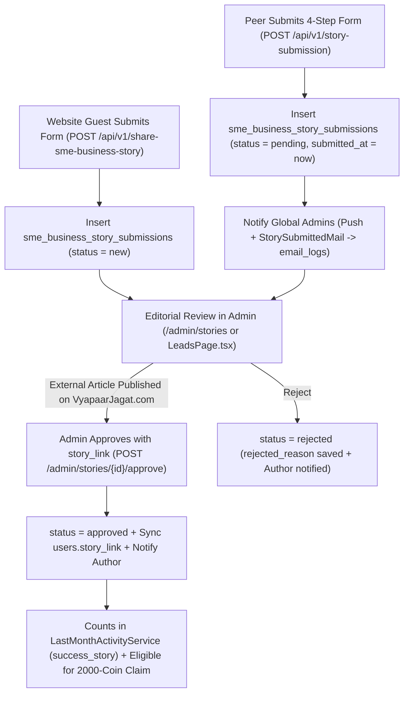

# Activity 18: Vyapaar Jagat Story Form

| Metadata Field | Verified Value |
|---|---|
| **Workbook Activity #** | `18` (`Row 26` in Sheet 1, `Row 25` in Sheets 2 & 3) |
| **Exact Workbook Name** | `Vyapaar Jagat Story Form` |
| **Domain Category** | `Media & Spotlight` (Sheets 1 & 2) / `Media / Publications` (Sheet 3) |
| **Activity Governance Tier** | Tier 3 — Editorial Story Submission, Admin Publication Sync & Spotlight Recognition |
| **Overall Implementation Status** | `Partially Implemented` (4-screen Vyapaar Jagat story form, attachment uploads, status check, Admin approval with `story_link` sync to `users.story_link`, and Leader feed exist; **CRITICAL P0 PII/Data Leak** in `GET /api/v1/share-sme-business-story` & `/admin/leads/story_submissions`; no `draft` state or in-app `EditorialFeedView` reader exists) |
| **Surface Status Breakdown** | **Backend:** `Implemented but Incorrect` (3 submission endpoints work, but `WebsiteFormsController@indexSmeBusinessStory` & `@showSmeBusinessStory` expose ALL users' unpublished stories & PII to any authenticated user, and `/admin/leads/story_submissions` lacks admin guard) \| **Member App:** `Fully Implemented` ([vyapaar_jagat_story_screen.dart](file:///D:/office%20project/peers-unity/unity_app/lib/features/highlights/presentation/screens/vyapaar_jagat_story_screen.dart)) \| **Leadership App:** `Partially Implemented` (Backend `/api/v1/leader/activities/vyapaar-jagat` exists; not surfaced as dedicated Leader UI view) \| **Admin Web:** `Fully Implemented` ([LeadsPage.tsx](file:///D:/office%20project/unity-admin-web/src/features/leads/LeadsPage.tsx), [StorySubmissionsEditTab.tsx](file:///D:/office%20project/unity-admin-web/src/components/PeerDetailDrawer/editTabs/StorySubmissionsEditTab.tsx), Blade `/admin/stories`) |
| **Related Canonical Documents** | [12-master-35-activities-index.md](../12-master-35-activities-index.md) \| [19-activity-to-role-access-matrix.md](../19-activity-to-role-access-matrix.md) \| [23-coins-activity-wallet-and-history.md](./23-coins-activity-wallet-and-history.md) \| [25-activity-workflow-reference.md](../25-activity-workflow-reference.md) \| [35-last-month-activity-summary.md](./35-last-month-activity-summary.md) |

---

## 1. Business Purpose (§9.1)

- **WORKBOOK REQUIREMENT:** Enables founders to *"Submit founder journey narrative and enterprise milestones for nationwide editorial publication"* in *Vyapaar Jagat* magazine and an in-app Spotlight feed (`Draft -> Editorial Review -> Copy Edit -> Published Worldwide`).
- **FACT:** Implemented via `App\Models\SmeBusinessStorySubmission` (`sme_business_story_submissions`), which backs **three** API submission variants:
  1. **Structured 4-Step In-App Vyapaar Jagat Form (`POST /api/v1/story-submission`)**: Handled by `StorySubmissionApiController@submitVyapaarStory` ([SubmitVyapaarStoryRequest.php](file:///c:/Users/malic/OneDrive/Documents/GitHub/unity-app-new/app/Http/Requests/Forms/SubmitVyapaarStoryRequest.php#L37-L67)) and consumed by Flutter Member App ([vyapaar_jagat_story_screen.dart](file:///D:/office%20project/peers-unity/unity_app/lib/features/highlights/presentation/screens/vyapaar_jagat_story_screen.dart), `ApiEndpoints.storySubmission`).
  2. **Simplified Authenticated Story Form (`POST /api/v1/story/submit`)**: Handled by [StorySubmissionApiController.php](file:///c:/Users/malic/OneDrive/Documents/GitHub/unity-app-new/app/Http/Controllers/Api/V1/StorySubmissionApiController.php#L31-L107) (`SubmitStoryRequest`: `title`, `story`, `short_description`, `cover_image`, `attachments`).
  3. **Public Website SME Story Form (`POST /api/v1/share-sme-business-story`)**: Handled by `WebsiteFormsController@submitShareSmeBusinessStory` (`SubmitSmeBusinessStoryRequest`).
  - Upon editorial publication on the external Vyapaar Jagat portal, an Admin approves the record (`POST /admin/stories/{id}/approve` in `Admin\StorySubmissionsController`), attaching the external `story_link`, syncing `users.story_link`, sending email/push notifications, counting toward `success_story` in `LastMonthActivityService` (Activity 35), and qualifying the member to claim `2,000` coins under `vyapaarjagat_story` in `config/coin_claims.php`!
- **Classification by Actor:**
  - **Member Action:** Submitting founder story (`POST /api/v1/story-submission`) and checking review/publication URL (`GET /api/v1/story/status`, `GET /api/v1/story/my-submissions`).
  - **Leadership Action:** Read-only awareness of scoped peers' published/submitted stories (`GET /api/v1/leader/activities/vyapaar-jagat`).
  - **Admin / Content Team Action:** Editorial review, external Vyapaar Jagat publication, attaching `story_link`, and approving/rejecting (`Admin\StorySubmissionsController` / `LeadAdminApiController`).

---

## 2. Sub-Activities Catalogue (§9.2)

| # | Sub-Activity / Atomic Operation | Member App (`unity_app`) | Leadership App (`LeaderApp`) | Admin Web (`unity-admin-web` / Blade) | Backend (`unity-app-new`) | Classification Status |
|---:|---|---|---|---|---|---|
| 18.1 | Submit 4-Screen Vyapaar Jagat Story Form (`POST /story-submission`) | [vyapaar_jagat_story_screen.dart](file:///D:/office%20project/peers-unity/unity_app/lib/features/highlights/presentation/screens/vyapaar_jagat_story_screen.dart), [vyapaar_jagat_story_form_fields.dart](file:///D:/office%20project/peers-unity/unity_app/lib/features/highlights/presentation/widgets/vyapaar_jagat_story_form_fields.dart) | Not Required | Public Website (`/share-sme-business-story`) | `POST /api/v1/story-submission` (`StorySubmissionApiController@submitVyapaarStory`) | `Fully Implemented` |
| 18.2 | Check Own Story Status & Published Article Link | [vyapaar_jagat_story_screen.dart](file:///D:/office%20project/peers-unity/unity_app/lib/features/highlights/presentation/screens/vyapaar_jagat_story_screen.dart) (`ApiEndpoints.storyStatus`) | Peer Profile `story_link` field | [StorySubmissionsEditTab.tsx](file:///D:/office%20project/unity-admin-web/src/components/PeerDetailDrawer/editTabs/StorySubmissionsEditTab.tsx) | `GET /api/v1/story/status`, `GET /api/v1/story/my-submissions`, `GET /api/v1/story/{id}` | `Fully Implemented` (`StorySubmissionApiController@show` properly checks owner/admin at `L148`!) |
| 18.3 | Legacy SME Story Listing (`GET /share-sme-business-story`) | Unused by current Dart constants | N/A | N/A | `GET /api/v1/share-sme-business-story[/{id}]` ([WebsiteFormsController.php](file:///c:/Users/malic/OneDrive/Documents/GitHub/unity-app-new/app/Http/Controllers/Api/V1/Forms/WebsiteFormsController.php#L85-L113)) | `Implemented but Incorrect` (**P0 Data Leak:** Zero `$request->user()` filter — leaks all users' stories & PII!) |
| 18.4 | Admin Editorial Approval, `story_link` Sync & Reject | N/A | Not Required | Blade `/admin/stories/*`, React [LeadsPage.tsx](file:///D:/office%20project/unity-admin-web/src/features/leads/LeadsPage.tsx), [StorySubmissionsEditTab.tsx](file:///D:/office%20project/unity-admin-web/src/components/PeerDetailDrawer/editTabs/StorySubmissionsEditTab.tsx) | `POST /admin/stories/{id}/approve\|reject` (`Admin\StorySubmissionsController`), `/api/v1/admin/leads/story_submissions` | `Implemented but Incorrect` (Blade approval works & syncs `users.story_link`; `/api/v1/admin/leads/story_submissions` lacks admin middleware) |
| 18.5 | Leader Scoped Story Submissions Feed | N/A | Not surfaced in `LeaderActivitiesView` tabs | N/A | `GET /api/v1/leader/activities/vyapaar-jagat` (alias `stories`) & `/api/v1/leader/leads/story_submissions` | `Implemented but Not Integrated` (`/leader/leads/story_submissions` is also unscoped) |
| 18.6 | Draft Saving, Rich-Text Editor, In-App `EditorialFeedView` & `storyReadCount` | **Missing** (`EditorialRichTextEditor`, `EditorialFeedView`) | **Missing** | **Missing** | **NOT IMPLEMENTED** (`CmsPublishingWorker`, `storyReadCount`) | `Missing` (External Vyapaar Jagat CMS hosts published articles via `story_link`) |

---

## 3. Input Form & Field Validation Mapping (§9.3)

- **FACT:** Verified against [SubmitVyapaarStoryRequest.php](file:///c:/Users/malic/OneDrive/Documents/GitHub/unity-app-new/app/Http/Requests/Forms/SubmitVyapaarStoryRequest.php#L37-L67), [SubmitStoryRequest.php](file:///c:/Users/malic/OneDrive/Documents/GitHub/unity-app-new/app/Http/Requests/Forms/SubmitStoryRequest.php#L23-L32), and [vyapaar_jagat_story_form_fields.dart](file:///D:/office%20project/peers-unity/unity_app/lib/features/highlights/presentation/widgets/vyapaar_jagat_story_form_fields.dart).
- **Client vs Backend Validation Note:** Flutter UI marks `Designation *`, `Company Name *`, `Website *`, and `LinkedIn Profile URL *` with `*`, whereas `SubmitVyapaarStoryRequest` marks those 4 fields `nullable` on the backend. Also `SubmitVyapaarStoryRequest` accepts `user_id` (`nullable|string|uuid`) from the request body (`L41`) — backend must always override `user_id` from `$request->user()->id` when authenticated so a user cannot spoof another peer's `user_id`!

| Field Name | Data Type | Required/Optional | Validation (Backend + Client; mark missing as Requires Confirmation) | Default | Input Widget | Data Source | Visibility | Who Enters | Who Edits | Who Views | Sensitive? | Backend Request Key |
|---|---|---|---|---|---|---|---|---|---|---|---|---|
| **Full Name** | `string` | Required | **Backend:** `required`, `string`, `max:255` (trimmed). **Client:** `"Full Name *"`. | `User.display_name` | `TextFormField` | User profile / input | Author, Editorial Admin, Scoped Leaders | Peer Member / Guest | Admin | Author, Leaders, Admin (Public once published externally) | No | `full_name` |
| **Designation** | `string` | Optional in Backend / `*` in UI | **Backend:** `nullable`, `string`, `max:255` (trimmed). **Client:** `"Designation *"`. | `User.designation` | `TextFormField` | User profile / input | Author, Admin, Leaders | Peer Member | Admin | Author, Leaders, Admin | No | `designation` |
| **Company Name** | `string` | Optional in Backend / `*` in UI | **Backend:** `nullable`, `string`, `max:255` (trimmed). **Client:** `"Company Name *"`. | `User.company_name` | `TextFormField` | User profile / input | Author, Admin, Leaders | Peer Member | Admin | Author, Leaders, Admin | No | `company_name` |
| **Website** | `string` (URL) | Optional in Backend / `*` in UI | **Backend:** `nullable`, `url`, `max:255` (trimmed). **Client:** `"Website *"`. | `User.website` | `TextFormField` (`url`) | User input | Author, Admin, Leaders | Peer Member | Admin | Author, Leaders, Admin | No | `website` |
| **Profile Photo** | `file` | Optional | **Backend:** `nullable`, `file`, `mimes:jpeg,jpg,png,webp`, `max:5120` (5 MB). **Client:** Photo picker. | `null` | Image Picker | Camera / Gallery | Author, Admin | Peer Member | Admin | Author, Admin | No | `profile_photo` |
| **Company Logo** | `file` | Optional | **Backend:** `nullable`, `file`, `mimes:jpeg,jpg,png,webp`, `max:5120` (5 MB). **Client:** Logo picker. | `null` | Image Picker | Gallery | Author, Admin | Peer Member | Admin | Author, Admin | No | `company_logo` |
| **Entrepreneurial Journey** | `text` | Required | **Backend:** `required`, `string` (missing `min`/`max` word/char bounds — Requires Confirmation). **Client:** `"Entrepreneurial Journey *"`. | `null` | Multi-line `TextFormField` | User input | Author, Admin | Peer Member | Admin | Author, Admin | No | `entrepreneurial_journey` |
| **Business Description** | `text` | Required | **Backend:** `required`, `string`. **Client:** `"Business Description *"`. | `null` | Multi-line `TextFormField` | User input | Author, Admin | Peer Member | Admin | Author, Admin | No | `business_description` |
| **Biggest Challenge** | `text` | Required | **Backend:** `required`, `string`. **Client:** `"Biggest Challenge *"`. | `null` | Multi-line `TextFormField` | User input | Author, Admin | Peer Member | Admin | Author, Admin | No | `biggest_challenge` |
| **Biggest Achievement / Turning Points** | `text` | Required | **Backend:** `required`, `string`. **Client:** `"Biggest Achievement *"`. | `null` | Multi-line `TextFormField` | User input | Author, Admin | Peer Member | Admin | Author, Admin | No | `biggest_achievement` |
| **Business / Societal Impact** | `text` | Required | **Backend:** `required`, `string`. **Client:** `"Business Impact *"`. | `null` | Multi-line `TextFormField` | User input | Author, Admin | Peer Member | Admin | Author, Admin | No | `business_impact` |
| **Future Goals** | `text` | Required | **Backend:** `required`, `string`. **Client:** `"Future Goals *"`. | `null` | Multi-line `TextFormField` | User input | Author, Admin | Peer Member | Admin | Author, Admin | No | `future_goals` |
| **Advice for Entrepreneurs** | `text` | Required | **Backend:** `required`, `string`. **Client:** `"Advice for Entrepreneurs *"`. | `null` | Multi-line `TextFormField` | User input | Author, Admin | Peer Member | Admin | Author, Admin | No | `advice_for_entrepreneurs` |
| **Social Promotion Links (LinkedIn, Facebook, Instagram, Twitter/X)** | `string` (URL) | Optional (`LinkedIn *` in UI) | **Backend:** Each `nullable`, `url`, `max:500` (trimmed). **Client:** `"LinkedIn Profile URL *"` + optional social links. | User social URLs | `TextFormField` (`url`) | User input | Author, Admin | Peer Member | Admin | Author, Admin | No | `linkedin_url`, `facebook_url`, `instagram_url`, `twitter_url` |
| **Editorial Publication Consent** | `boolean` | Required | **Backend:** `required`, `accepted`. **Client:** Mandatory consent checkbox on final step. | `false` | Checkbox | User input | Author, Admin | Peer Member | Immutable | Author, Admin | No | `consent` |
| **Simplified Endpoint Fields (`title`, `story`, `short_description`, `cover_image`, `attachments`)** | `string` / `text` / `array` | Conditional (`/story/submit` only) | **Backend (`SubmitStoryRequest`):** `title` (`req\|max:255`), `story` (`req\|string`), `short_description` (`nullable\|string`), `cover_image` (`nullable` file/uuid), `attachments` (`nullable\|array`). | `null` | Multi-line & File Picker | User input | Author, Admin | Peer Member | Admin | Author, Admin | No | `title`, `story`, `short_description`, `cover_image`, `attachments` |
| **Published Story URL (`story_link`) & Admin Remark** | `string` (URL) / `text` | Required on Approve / Reject | **Backend (`StorySubmissionsController`):** `story_link` (`required\|url` on approve; synced to `users.story_link`), `rejected_reason` / `admin_remark` on reject. | `null` | Admin Input | Editorial team | Public (`story_link`), Author (`rejected_reason`) | Admin / Content Team | Admin | Everyone (`users.story_link`), Author & Admin (`rejected_reason`) | No | `story_link`, `admin_remark`, `rejected_reason` |

---

## 4. Workflow, Lifecycle & Mermaid Diagram (§9.4)

- **WORKBOOK REQUIREMENT:** `Draft -> Editorial Review -> Copy Edit -> Published Worldwide` with statuses `Draft, Submitted, Published`.
- **FACT:** Actual PostgreSQL `sme_business_story_submissions.status` uses `'new'` (website form) or `'pending'` (in-app form) -> `'approved'` (when published externally and `story_link` attached) | `'rejected'`. **There is NO server-side `draft` status or `copy_edit` status.**

---

## 5. Outputs & Deliverables (§9.5)

| Output / Deliverable | Workbook Specification | Actual Repository Status | Verification Evidence |
|---|---|---|---|
| **Published Editorial Article Link on Profile** | Published article in Vyapaar Jagat magazine | `Fully Implemented` (**FACT**) | `story_link` stored on `sme_business_story_submissions.story_link` and synced to `users.story_link`, displayed on Peer Profile cards. |
| **Author Status Tracker** | `VyapaarJagatStoryScreen` (`Draft, Submitted, Published`) | `Partially Implemented` (**FACT**) | `GET /api/v1/story/status` & `my-submissions` show `pending` / `approved` (+ clickable `story_link`) / `rejected` (no `draft` state). |
| **In-App Spotlight Reader & Read Counter** | `EditorialFeedView`, `storyReadCount` | `Missing` (**NOT IMPLEMENTED**) | Stories open externally via `story_link` URL; no native `EditorialFeedView` or `storyReadCount` telemetry exists. |

---

## 6. Database & Metrics Mapping (§9.6)

- **Eloquent Model:** `App\Models\SmeBusinessStorySubmission` ([SmeBusinessStorySubmission.php](file:///c:/Users/malic/OneDrive/Documents/GitHub/unity-app-new/app/Models/SmeBusinessStorySubmission.php)) -> PostgreSQL table `sme_business_story_submissions`.
- **Columns:** `id` (`uuid`), `user_id` (`uuid`, nullable), `full_name`, `designation`, `company_name`, `business_name`, `email`, `contact_number`, `website`, `profile_photo`, `company_logo`, `cover_image`, `attachments` (`json`), `title`, `story`, `short_description`, `company_introduction`, `co_founders_and_partners_details`, `entrepreneurial_journey`, `business_description`, `biggest_challenge`, `biggest_achievement`, `business_impact`, `future_goals`, `advice_for_entrepreneurs`, `linkedin_url`, `facebook_url`, `instagram_url`, `twitter_url`, `consent` (`bool`), `status` (`new`|`pending`|`approved`|`rejected`), `notes`, `admin_remark`, `rejected_reason`, `story_link`, `submitted_at`, `reviewed_at`, `approved_by`, `approved_at`, `created_at`, `updated_at`.

### Sheet 3 Workbook Metric Keys Comparison
| Workbook Metric Key (Sheet 3) | Actual Backend / DB Equivalent | Status |
|---|---|---|
| `storyReviewStatus` | `sme_business_story_submissions.status` (`new`\|`pending`\|`approved`\|`rejected`) | `Fully Implemented` |
| `publishedArticleUrl` | `sme_business_story_submissions.story_link` & `users.story_link` | `Fully Implemented` |
| `storyReadCount` | None (external website analytics) | `Missing` (`NOT IMPLEMENTED`) |

---

## 7. API & Backend Service Mapping (§9.7)

| Surface | Method & Endpoint | Controller @ Action | Request / Service | Auth Middleware | Scope Enforcement & Security Bugs | Client Integration |
|---|---|---|---|---|---|---|
| Member API | `POST /api/v1/story-submission`, `POST /api/v1/story/submit` | [StorySubmissionApiController.php](file:///c:/Users/malic/OneDrive/Documents/GitHub/unity-app-new/app/Http/Controllers/Api/V1/StorySubmissionApiController.php#L31) | `SubmitVyapaarStoryRequest`, `SubmitStoryRequest`, `FileUploadService` | `auth:sanctum`, `unity.user` | Verify `submitVyapaarStory` binds `user_id` strictly from `$request->user()->id` rather than client-supplied `user_id`. | Integrated in Member App (`VyapaarJagatRemoteDatasource`) |
| Member API | `GET /api/v1/story/status`, `GET /api/v1/story/my-submissions`, `GET /api/v1/story/{id}` | `StorySubmissionApiController` | Inline | `auth:sanctum`, `unity.user` | Properly restricts `mySubmissions` to `$user->id` and `show` (`L148`) to owner or `canReview($user)`. | Integrated in Member App |
| Public / Legacy API | `POST /api/v1/share-sme-business-story`, `GET /api/v1/share-sme-business-story[/{id}]` | [WebsiteFormsController.php](file:///c:/Users/malic/OneDrive/Documents/GitHub/unity-app-new/app/Http/Controllers/Api/V1/Forms/WebsiteFormsController.php#L85-L113) | `SubmitSmeBusinessStoryRequest` | `POST` Public; `GET` `auth:sanctum` | **CRITICAL P0 DATA LEAK (`L85-113`):** `indexSmeBusinessStory` and `showSmeBusinessStory` apply **ZERO ownership or admin filter** — any authenticated Peer can dump every peer's unpublished story essays, phone numbers (`contact_number`), and emails! | Legacy / Website |
| Leader API | `GET /api/v1/leader/activities/vyapaar-jagat` (`stories`) & `GET /api/v1/leader/leads/story_submissions[/{id}]` | `LeaderActivitiesController` / `LeadAdminApiController` | `LeaderActivitiesService` | `auth:sanctum`, `leader.user` | `/leader/activities/vyapaar-jagat` scopes by circle; **BUG:** `/leader/leads/story_submissions` returns **unscoped global** records! | Not surfaced in Leadership App UI |
| Admin V1 & Web | `GET\|PUT\|PATCH\|DELETE /api/v1/admin/leads/story_submissions*` & Web `POST /admin/stories/{id}/approve\|reject` | `LeadAdminApiController` / `Admin\StorySubmissionsController` | `NotifyUserService`, `EmailLogService` | `/api/v1/admin/*` lacks admin guard; Web uses `admin.auth` | **CRITICAL P0 BUG:** `/api/v1/admin/leads/story_submissions` allows any Peer token to edit/delete stories! | Integrated in Admin Web |

---

## 8. Role-Wise Access Governance (§9.8)

| Role | View Activity | Create Record | Edit Own | Edit Others | Submit for Review | Verify | Approve | Reject | Assign | Manage | Delete | View Aggregated Reports |
|---|---|---|---|---|---|---|---|---|---|---|---|---|
| **Super Admin** | Allowed (Global) | Allowed | Allowed | Allowed (Editorial copy/link) | Allowed | Allowed | Allowed (`POST /admin/stories/{id}/approve` + `story_link`) | Allowed | DENIED — No editor assignment column. | Allowed (Global) | Allowed (`DELETE /admin/leads/story_submissions/{id}`) | Allowed (Global) |
| **Content / Marketing Team** (`content_team` / `marketing_team`) | Allowed (Global editorial queue in Web Admin) | DENIED | N/A | Allowed (Copy edit & `story_link`) | N/A | Allowed | Allowed (Web Admin editorial role) | Allowed | DENIED | Allowed (Editorial queue) | DENIED — Super Admin only recommended. | Allowed |
| **Country Director** | Allowed (Country scope via `/leader/activities/vyapaar-jagat`) | Allowed (Own story) | DENIED (No draft edit) | DENIED — No permission under the verified backend authorization model. | Allowed | DENIED — Editorial team function. | DENIED — No permission under the verified backend authorization model. | DENIED — No permission under the verified backend authorization model. | DENIED — No permission under the verified backend authorization model. | DENIED — No permission under the verified backend authorization model. | DENIED — No permission under the verified backend authorization model. | Allowed (Country scope) |
| **DED** | Allowed (District scope via `/leader/activities/vyapaar-jagat`) | Allowed (Own story) | DENIED | DENIED — No permission under the verified backend authorization model. | Allowed | DENIED — No permission under the verified backend authorization model. | DENIED — No permission under the verified backend authorization model. | DENIED — No permission under the verified backend authorization model. | DENIED — No permission under the verified backend authorization model. | DENIED — No permission under the verified backend authorization model. | DENIED — No permission under the verified backend authorization model. | Allowed (District scope) |
| **Industry Director** | Allowed (Industry scope) | Allowed (Own story) | DENIED | DENIED — No permission under the verified backend authorization model. | Allowed | DENIED — No permission under the verified backend authorization model. | DENIED — No permission under the verified backend authorization model. | DENIED — No permission under the verified backend authorization model. | DENIED — No permission under the verified backend authorization model. | DENIED — No permission under the verified backend authorization model. | DENIED — No permission under the verified backend authorization model. | Allowed (Industry scope) |
| **Circle Founder** | Allowed (Own Circle via `/leader/activities/vyapaar-jagat`) | Allowed (Own story) | DENIED | DENIED — No permission under the verified backend authorization model. | Allowed | DENIED — No permission under the verified backend authorization model. | DENIED — No permission under the verified backend authorization model. | DENIED — No permission under the verified backend authorization model. | DENIED — No permission under the verified backend authorization model. | DENIED — No permission under the verified backend authorization model. | DENIED — No permission under the verified backend authorization model. | Allowed (Own Circle) |
| **Circle Director** | Allowed (Own Circle via `/leader/activities/vyapaar-jagat`) | Allowed (Own story) | DENIED | DENIED — No permission under the verified backend authorization model. | Allowed | DENIED — No permission under the verified backend authorization model. | DENIED — No permission under the verified backend authorization model. | DENIED — No permission under the verified backend authorization model. | DENIED — No permission under the verified backend authorization model. | DENIED — No permission under the verified backend authorization model. | DENIED — No permission under the verified backend authorization model. | Allowed (Own Circle) |
| **Chair / Committee Chairs** | Allowed (Own Circle read-only) | Allowed (Own story) | DENIED | DENIED — No permission under the verified backend authorization model. | Allowed | DENIED — No permission under the verified backend authorization model. | DENIED — No permission under the verified backend authorization model. | DENIED — No permission under the verified backend authorization model. | DENIED — No permission under the verified backend authorization model. | DENIED — No permission under the verified backend authorization model. | DENIED — No permission under the verified backend authorization model. | Allowed (Own Circle) |
| **Vice Chair** | Allowed (Own Circle read-only) | Allowed (Own story) | DENIED | DENIED — No permission under the verified backend authorization model. | Allowed | DENIED — No permission under the verified backend authorization model. | DENIED — No permission under the verified backend authorization model. | DENIED — No permission under the verified backend authorization model. | DENIED — No permission under the verified backend authorization model. | DENIED — No permission under the verified backend authorization model. | DENIED — No permission under the verified backend authorization model. | Allowed (Own Circle) |
| **Secretary** | Allowed (Own Circle read-only) | Allowed (Own story) | DENIED | DENIED — No permission under the verified backend authorization model. | Allowed | DENIED — No permission under the verified backend authorization model. | DENIED — No permission under the verified backend authorization model. | DENIED — No permission under the verified backend authorization model. | DENIED — No permission under the verified backend authorization model. | DENIED — No permission under the verified backend authorization model. | DENIED — No permission under the verified backend authorization model. | Allowed (Own Circle) |
| **Committee Leader** | DENIED in Leader App; Own stories in Member App | Allowed (Own story) | DENIED | DENIED — No permission under the verified backend authorization model. | Allowed | DENIED — No permission under the verified backend authorization model. | DENIED — No permission under the verified backend authorization model. | DENIED — No permission under the verified backend authorization model. | DENIED — No permission under the verified backend authorization model. | DENIED — No permission under the verified backend authorization model. | DENIED — No permission under the verified backend authorization model. | DENIED — No permission under the verified backend authorization model. |
| **Peer Member** | Allowed (Own submissions via `/story/my-submissions` + public `users.story_link` on peer profiles) | Allowed (`POST /story-submission`) | DENIED (Immutable once submitted) | DENIED — No permission under the verified backend authorization model. | Allowed | DENIED — No permission under the verified backend authorization model. | DENIED — No permission under the verified backend authorization model. | DENIED — No permission under the verified backend authorization model. | DENIED — No permission under the verified backend authorization model. | DENIED — No permission under the verified backend authorization model. | DENIED — No permission under the verified backend authorization model. | DENIED — No permission under the verified backend authorization model. |

---

## 9. Existing Implementation Summary, Gaps & Minimum-Change Enhancement Recommendations

| # | 1. Existing Implementation Summary | 2. Identified Gap / Defect | 3. Classification Status | 4. Impact / Risk Severity | 5. Target Repo & Layer | 6. Exact File(s) / Endpoint(s) / Table(s) | 7. Minimum-Change Enhancement Specification | 8. RBAC & Scope Enforcement Rule | 9. Migration / Compatibility Impact | 10. Verification / Test Criteria |
|---:|---|---|---|---|---|---|---|---|---|---|
| **18-R1** | `WebsiteFormsController@indexSmeBusinessStory` (`L85`) and `@showSmeBusinessStory` (`L100`) return raw `SmeBusinessStorySubmission` rows; `/api/v1/admin/leads/story_submissions` lacks admin middleware; `/leader/leads/story_submissions` is unscoped. | Any authenticated Peer can read every founder's private/unapproved story narrative, email, and phone via `GET /api/v1/share-sme-business-story`, or modify/delete stories via `/admin/leads/story_submissions`. | `Implemented but Incorrect` | **P0 Critical (Bulk PII & Unpublished Content Leak + Privilege Escalation)** | `unity-app-new` | [WebsiteFormsController.php](file:///c:/Users/malic/OneDrive/Documents/GitHub/unity-app-new/app/Http/Controllers/Api/V1/Forms/WebsiteFormsController.php#L85-L113), `LeadAdminApiController.php`, `routes/api.php` | Restrict `indexSmeBusinessStory` and `showSmeBusinessStory` strictly to `where('user_id', $user->id)->orWhereRaw('LOWER(email) = ?', [strtolower($user->email)])` for non-admin callers; wrap `/api/v1/admin/leads/*` in `admin.auth` + `admin.permission`; scope `/api/v1/leader/leads/story_submissions` to `resolveManagedCircles($user)` and force `user_id = $request->user()->id` on authenticated `submitVyapaarStory`. | Peers read own submissions only; Leaders read scoped circle members' submissions; only `superAdmin` / `content_team` approve or attach `story_link`. | Non-breaking for Member App (uses `/story/status` & `/story/my-submissions`) and Admin Web. | Feature test confirming Peer B receives `404`/`403` on Peer A's story ID across both `/story/{id}` and `/share-sme-business-story/{id}`. |
| **18-R2** | Admin approval in Blade `StorySubmissionsController@approve` sets `story_link`, updates `users.story_link`, and notifies the peer, while React Admin Web also uses `LeadAdminApiController` (`PATCH /admin/leads/story_submissions/{id}/status`) and Peer must separately file a `vyapaarjagat_story` Coin Claim (`2,000` coins). | Updating `status = approved` via `LeadAdminApiController` in React Admin Web bypasses `users.story_link` sync and author push/email notifications, and requires manual coin-claim re-submission by the peer. | `Requires Enhancement` | **P2 Medium (Inconsistent Admin Approval Side Effects)** | `unity-app-new` & `unity-admin-web` | `Admin\StorySubmissionsController.php`, `LeadAdminApiController.php`, [LeadsPage.tsx](file:///D:/office%20project/unity-admin-web/src/features/leads/LeadsPage.tsx) | Extract `StoryApprovalService::approve($submission, $storyLink, $actor)` shared by both Blade and JSON Admin API so React Admin Web requires `story_link` on approval, syncs `users.story_link`, dispatches push/email, and (subject to business confirmation) auto-credits the `2,000` Vyapaar Jagat coins idempotently via `CoinsService`. | Only `superAdmin` and `content_team` with `stories.approve` permission may invoke `StoryApprovalService`. | Zero schema migration needed. | Approve story from React Admin Web -> verify `users.story_link` updated, author `app_notifications` created, and idempotent coin ledger entry recorded. |
