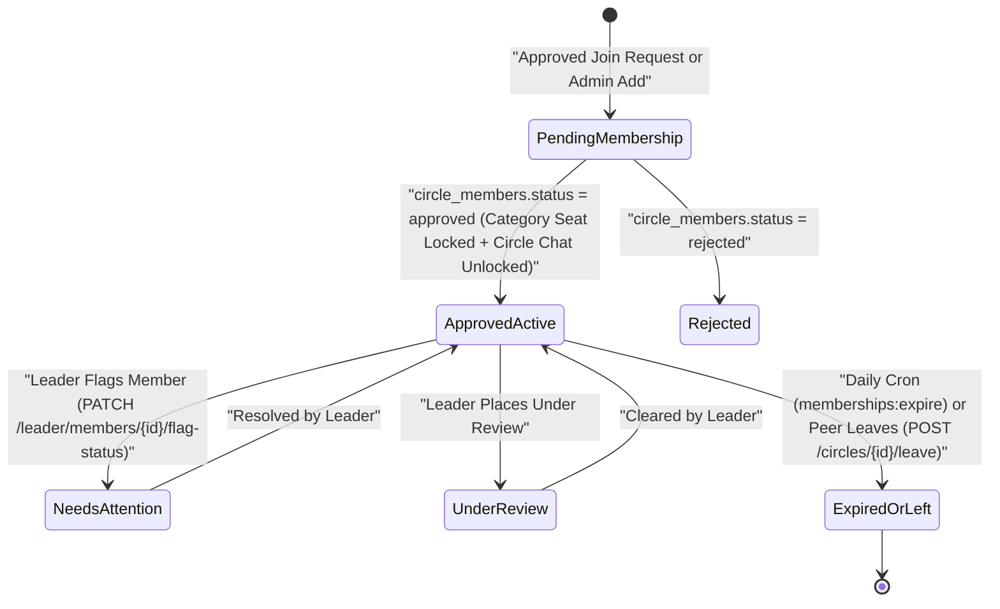

# Activity 19: Joined Circles & Memberships

| Metadata Field | Verified Value |
|---|---|
| **Workbook Activity #** | `19` (`Row 27` in Sheet 1, `Row 26` in Sheets 2 & 3) |
| **Exact Workbook Name** | `Joined Circles & Memberships` |
| **Domain Category** | `Governance & Circles` (Sheets 1, 2 & 3) |
| **Activity Governance Tier** | Tier 1 — Core Organizational Structure, Chapter Roster, Exclusive Category Seats & Multi-Circle Attribution |
| **Overall Implementation Status** | `Implemented but Incorrect` (Rich circle directory, Level 1–4 category exclusivity, circle chat, leadership roster, and Zoho/Razorpay circle subscriptions exist across all 3 apps; **HOWEVER**, critical bugs exist in Leader App horizontal circle IDORs, `flagStatus` / `LeadershipController` PostgreSQL enum mismatches, multi-circle `.first()` attribution, synthetic circle revenue `(circle_price ?? 120000) * peers`, and `UserRoleResolverService` loading all circles into memory) |
| **Surface Status Breakdown** | **Backend:** `Implemented but Incorrect` (Core APIs work; `/leader/teams/circles/{id}*` has IDORs, `my-leadership-circles` checks `director_user_id` instead of `circle_director_user_id`, and `LeaderTeamsService` fabricates circle revenue) \| **Member App:** `Fully Implemented` (`circles` module — 10 screens) \| **Leadership App:** `Partially Implemented` (`teams` & `circle_details` modules — 29 Dart files; read + `referCategory` + `flagStatus`, no Chair assignment or peer removal) \| **Admin Web:** `Fully Implemented` (`CirclesPage.tsx`, `CircleDetailsPage.tsx`, `CircleEditorPage.tsx`) |
| **Related Canonical Documents** | [12-master-35-activities-index.md](../12-master-35-activities-index.md) \| [09-organizational-data-scope-matrix.md](../09-organizational-data-scope-matrix.md) \| [19-activity-to-role-access-matrix.md](../19-activity-to-role-access-matrix.md) \| [20-circle-membership-requests-and-build-circle.md](./20-circle-membership-requests-and-build-circle.md) \| [23-organizational-structure-and-circle-flow.md](../23-organizational-structure-and-circle-flow.md) |

---

## 1. Business Purpose (§9.1)

- **WORKBOOK REQUIREMENT:** Enables Peers to *"Join specialized industry circles or local chapters to collaborate with specific peer groups"*, maintaining active circle memberships (`circleMemberships`), primary circle (`activePrimaryCircleId`), exclusive business category seats, Circle Group Chat access, and Circle Meetings access.
- **FACT:** Circles are the foundational organizational unit of Peers Global Unity (`circles` + `circle_members`). A Peer may belong to up to **3 active circles** (`UserCircleRequestController@checkPeer` checks `active_circles_count >= 3`), holding one exclusive **Level 1–4 Business Category** seat per circle (`circle_members.level_1_category_id..level_4_category_id`, `circle_member_category_selections`, `joined_circle_categories`), a circle role (`circle_member_role_enum`: `founder`, `director`, `chair`, `vice_chair`, `secretary`, `committee_leader`, `member`), and a circle subscription (`circle_subscriptions` / `circle_peer_memberships`).
- **Hard Audit Governance Rules Applicable:**
  1. **All-Circles Deduplication Rule:** Any All-Circles KPI or roster count across Multiple Circles (`DED`, `Industry Director`, `Country Director`, `Super Admin`, or multi-circle `CF`/`CD`) MUST count **DISTINCT `user_id`** across `circle_members` (never sum per-circle member counts that double-count multi-circle Peers!).
  2. **Authoritative Finance Rule:** Circle revenue on Teams/Circle Details cards MUST come from authoritative `payments` (with explicit `circle_id`) / `circle_subscriptions` / `finance_ledger_transactions` — NEVER `(circle_price_amount ?? 120000) * approved_peers_count` ([LeaderTeamsService.php](file:///c:/Users/malic/OneDrive/Documents/GitHub/unity-app-new/app/Leader/Services/LeaderTeamsService.php#L478-L500))!

---

## 2. Sub-Activities Catalogue (§9.2)

| # | Sub-Activity / Atomic Operation | Member App (`unity_app`) | Leadership App (`LeaderApp`) | Admin Web (`unity-admin-web` / Blade) | Backend (`unity-app-new`) | Classification Status |
|---:|---|---|---|---|---|---|
| 19.1 | Browse Circles Directory, Open/Closed Categories & Circle Details | [circles_screen.dart](file:///D:/office%20project/peers-unity/unity_app/lib/features/circles/presentation/screens/circles_screen.dart), [circle_detail_screen.dart](file:///D:/office%20project/peers-unity/unity_app/lib/features/circles/presentation/screens/circle_detail_screen.dart), [circle_subcategories_screen.dart](file:///D:/office%20project/peers-unity/unity_app/lib/features/circles/presentation/screens/circle_subcategories_screen.dart) | [teams_view.dart](file:///D:/office%20project/LeaderApp-Fornt-end-/lib/features/teams/view/teams_view.dart), [circle_details_view.dart](file:///D:/office%20project/LeaderApp-Fornt-end-/lib/features/circle_details/view/circle_details_view.dart), [circle_sub_industries_screen.dart](file:///D:/office%20project/LeaderApp-Fornt-end-/lib/features/circle_details/view/circle_sub_industries_screen.dart) | [CirclesPage.tsx](file:///D:/office%20project/unity-admin-web/src/features/circles/CirclesPage.tsx), [CircleDetailsPage.tsx](file:///D:/office%20project/unity-admin-web/src/features/circles/CircleDetailsPage.tsx) | `GET /api/v1/circles[/{id}]`, `GET /api/v1/leader/teams/circles[/{id}]`, `GET .../sub-industries` | `Implemented but Incorrect` (`/leader/teams/circles/{id}` & `/sub-industries` have **zero scope check**, and `/sub-industries` falls back to `Circle::first()` on invalid ID; `LeaderTeamsService` fabricates circle revenue!) |
| 19.2 | View My Joined Circles & My Leadership Circles | [circles_screen.dart](file:///D:/office%20project/peers-unity/unity_app/lib/features/circles/presentation/screens/circles_screen.dart), [edit_circle_membership_screen.dart](file:///D:/office%20project/peers-unity/unity_app/lib/features/profile/presentation/screens/edit_circle_membership_screen.dart) | [profile_assigned_circles_card.dart](file:///D:/office%20project/LeaderApp-Fornt-end-/lib/features/profile/view/widgets/profile_assigned_circles_card.dart), [dashboard_circle_switcher.dart](file:///D:/office%20project/LeaderApp-Fornt-end-/lib/features/dashboard/view/widgets/dashboard_circle_switcher.dart) | [CircleLeadershipTab.tsx](file:///D:/office%20project/unity-admin-web/src/components/PeerDetailDrawer/tabs/CircleLeadershipTab.tsx) | `GET /api/v1/circles/my`, `GET /api/v1/joined-circles`, `GET /api/v1/circles/my-leadership-circles` | `Implemented but Incorrect` (`my-leadership-circles` checks `director_user_id` instead of `circle_director_user_id`/`circle_founder_user_id`; `LeaderPermissionService::resolveManagedCircles` includes circles where leader is only a regular `member`!) |
| 19.3 | View Circle Members Roster, Leaders & Export Circle Directory PDF | [circle_members_screen.dart](file:///D:/office%20project/peers-unity/unity_app/lib/features/circles/presentation/screens/circle_members_screen.dart), [circle_directory_pdf_preview_screen.dart](file:///D:/office%20project/peers-unity/unity_app/lib/features/circles/presentation/screens/circle_directory_pdf_preview_screen.dart) | [circle_peers_screen.dart](file:///D:/office%20project/LeaderApp-Fornt-end-/lib/features/circle_details/view/circle_peers_screen.dart), [circle_leadership_card.dart](file:///D:/office%20project/LeaderApp-Fornt-end-/lib/features/circle_details/view/widgets/circle_leadership_card.dart) | [CircleDetailsPage.tsx](file:///D:/office%20project/unity-admin-web/src/features/circles/CircleDetailsPage.tsx) | `GET /api/v1/circles/{circle}/members\|circle-leaders\|regional-leaders`, `GET /api/v1/leader/teams/circles/{circle_id}/peers` | `Implemented but Incorrect` (`/leader/teams/circles/{circle_id}/peers` lacks circle scope validation and leaks raw `phone`/`email` ignoring `hide_phone`/`hide_email`) |
| 19.4 | Participate in Circle Group Chat & Circle Leadership Chat | [circle_chat_screen.dart](file:///D:/office%20project/peers-unity/unity_app/lib/features/chat/presentation/screens/circle_chat_screen.dart), [circle_leadership_chat_screen.dart](file:///D:/office%20project/peers-unity/unity_app/lib/features/chat/presentation/screens/circle_leadership_chat_screen.dart) | Not Present in Leader App | N/A | `GET\|POST /api/v1/circles/{circle}/leadership-group-chat/messages` (`CircleLeadershipController`) + Circle Chat endpoints | `Fully Implemented` in Member App |
| 19.5 | Subscribe / Renew Paid Circle Package | [circle_join_screen.dart](file:///D:/office%20project/peers-unity/unity_app/lib/features/circles/presentation/screens/circle_join_screen.dart) | [record_payment_bottom_sheet.dart](file:///D:/office%20project/LeaderApp-Fornt-end-/lib/features/finance/view/widgets/record_payment_bottom_sheet.dart) | [CirclesAdminEditTab.tsx](file:///D:/office%20project/unity-admin-web/src/components/PeerDetailDrawer/editTabs/CirclesAdminEditTab.tsx) | `GET /api/v1/circles/{circle}/package`, `POST .../checkout\|verify\|cancel` (`CircleSubscriptionController`) | `Fully Implemented` (Note: Leader `record-offline` drops `circle_id`!) |
| 19.6 | Leave a Circle | `ApiEndpoints.leaveCircle` | N/A | Remove member in `CircleDetailsPage.tsx` | `POST /api/v1/circles/{id}/leave` (`CircleController`) | `Fully Implemented` |
| 19.7 | Flag Member Circle Status / Add Leader Note (`needs_attention`, `under_review`) | N/A | Member 360 endpoints (`LeaderMemberController`) | [CirclesAdminEditTab.tsx](file:///D:/office%20project/unity-admin-web/src/components/PeerDetailDrawer/editTabs/CirclesAdminEditTab.tsx) | `PATCH /api/v1/leader/members/{member_id}/flag-status`, `POST .../add-note` ([LeaderMemberController.php](file:///c:/Users/malic/OneDrive/Documents/GitHub/unity-app-new/app/Leader/Controllers/LeaderMemberController.php#L350-L455)) | `Partially Implemented` (`flagStatus` requires manual PostgreSQL `ALTER TYPE circle_member_status_enum` if unmigrated; missing `manage_peers` check) |
| 19.8 | Admin Create / Edit Circle & Assign Founders/Directors/Committee | N/A | Missing Chair-assign API in `/leader/*` | [CircleEditorPage.tsx](file:///D:/office%20project/unity-admin-web/src/features/circles/CircleEditorPage.tsx), [CircleDetailsPage.tsx](file:///D:/office%20project/unity-admin-web/src/features/circles/CircleDetailsPage.tsx) | `/api/v1/admin/circles/*` (`CircleManagementController`) | `Implemented but Incorrect` (Functional in Admin Web, but `/api/v1/admin/circles/*` sits under `unity.user` without admin guard!) |

---

## 3. Input Form & Field Validation Mapping (§9.3)

- **Note:** Admission/Join Request form fields and Build-Circle wizard fields are documented exhaustively in [Activity 20](./20-circle-membership-requests-and-build-circle.md) (§3). Below are the operational inputs for **Active Circle Membership & Circle Management** (Activity 19).

| Field Name | Data Type | Required/Optional | Validation (Backend + Client; mark missing as Requires Confirmation) | Default | Input Widget | Data Source | Visibility | Who Enters | Who Edits | Who Views | Sensitive? | Backend Request Key |
|---|---|---|---|---|---|---|---|---|---|---|---|---|
| **Circle ID (Join / Leave / Switch Scope)** | `uuid` | Required | **Backend:** Route/body UUID `exists:circles,id`. **Client:** Circle card / switcher selection. | `users.active_circle_id` | `DashboardCircleSwitcher` / Circle Card | `GET /api/v1/circles/my` | Members, Leaders, Admin | Peer / Leader / Admin | Switchable | Members, Leaders, Admin | No | `circle_id` |
| **Member Circle Role (`assign-leadership-team`)** | `string` (enum) | Required on Role Assign | **Backend (`CircleManagementController`):** Maps `founder`, `director`, `chair`, `vice_chair`, `secretary`, `committee_leader`, `member` (`circle_member_role_enum`). | `'member'` | Role Dropdown | Role catalog | Circle Members, Leaders, Admin | Super Admin (and CD/CF/DED for Chair when enabled) | Super Admin | All Peers in Circle | No | `role`, `chair_user_id`, `vice_chair_user_id`, `secretary_user_id` |
| **Assigned Category Hierarchy (`level_1..4_category_id`)** | `integer` | Optional / Required per Circle | **Backend:** Validated against `circle_categories` & `circle_category_level4` seat exclusivity (`1` active approved peer per Level 4 subcategory per circle). | Peer's business category | Category Cascading Picker | `/api/v1/circles/{id}/open-categories` | Circle Directory | Applicant / Admin | Admin (`CircleManagementController`) | All Peers & Leaders | No | `level_1_category_id` .. `level_4_category_id` |
| **Leader Member Flag Status (`flagStatus`)** | `string` (enum) | Required | **Backend (`LeaderMemberController@flagStatus`):** `required\|string\|in:approved,needs_attention,under_review,active` (normalizes `active` -> `approved`). | `'approved'` | Status Action Sheet | Static enum | Scoped Circle Leaders & Admin (Internal) | Circle Leader (`manage_peers`) | Circle Leader / Admin | Scoped Circle Leaders & Admin | Internal Governance | `status`, `reason` |
| **Circle Leadership Group Chat Message** | `string` | Required | **Backend (`CircleLeadershipController@sendMessage`):** `required\|string\|max:2000` (rate-limited by `throttle:chat-send`). | `null` | Chat Composer | Leader input | Circle Leaders of that Circle only | Circle Leaders (`CF`, `CD`, `Chair`, `VC`, `Sec`, `ID`, `DED`) | Immutable | Circle Leaders of that Circle | Internal Leadership | `message` |
| **Admin Circle Configuration (`name`, `city_id`, `district_id`, `type`, `meeting_mode`, `meeting_frequency`, `circle_price`, `zoho_plan_code`)** | Mixed | Required on Create | **Backend (`CircleManagementController`):** `name` (`req\|max:200`), `type` (`public\|private`), `status` (`pending\|active\|archived`), `circle_price` (`numeric\|min:0`), `calendar` (`json`). | `status = 'active'` | `CircleEditorPage.tsx` Form | Admin input | Public Circle Directory (except internal notes) | Super Admin | Super Admin | All Users | Pricing/Billing Config | `name`, `city_id`, `district_id`, `type`, `status`, `circle_price`, `calendar` |

---

## 4. Workflow, Lifecycle & Mermaid Diagram (§9.4)

- **WORKBOOK REQUIREMENT:** `Request Submitted -> Circle Director Approval -> Access Granted`.
- **FACT:** Once approved via Activity 20 (or added by Admin), a `circle_members` row transitions through:
  - **Base PostgreSQL `circle_member_status_enum`:** `'pending'` -> `'approved'` | `'rejected'` (plus optional manual DDL values `'needs_attention'`, `'under_review'` used by `LeaderMember360Service::flagStatus()`).
  - **Retention / Expiry Lifecycle:** `paid_starts_at` -> `paid_ends_at` / `expires_at`; daily cron `00:00` `memberships:expire` transitions expired memberships, and `POST /api/v1/circles/{id}/leave` sets `left_at = now()` (or soft-deletes `deleted_at`).
  - **CRITICAL BUG in `UserRoleResolverService` (`L328-350`):** Queries `circle_members` where `deleted_at IS NULL` **without checking `status = 'approved'` or `left_at IS NULL`** — meaning a `pending`, `rejected`, or departed (`left_at IS NOT NULL`) member row with a leader `role` STILL grants active Leadership App access!

---

## 5. Outputs & Deliverables (§9.5)

| Output / Deliverable | Workbook Specification | Actual Repository Status | Verification Evidence |
|---|---|---|---|
| **Circle Member Badge & Profile Tag** | Circle Member Badge, Active Primary Circle | `Fully Implemented` (**FACT**) | Rendered on Peer Profile (`users.active_circle_id`, `circleMembers` list) — though Leader App collapses multi-circle peers to `.first()`! |
| **Circle Directory PDF** | Printable roster | `Fully Implemented` (**FACT**) | [circle_directory_pdf_preview_screen.dart](file:///D:/office%20project/peers-unity/unity_app/lib/features/circles/presentation/screens/circle_directory_pdf_preview_screen.dart) in Member App. |
| **Circle Group Chat & Leadership Chat** | `GroupChatAccessSynchronizer` | `Fully Implemented` (**FACT**) | [circle_chat_screen.dart](file:///D:/office%20project/peers-unity/unity_app/lib/features/chat/presentation/screens/circle_chat_screen.dart) & [circle_leadership_chat_screen.dart](file:///D:/office%20project/peers-unity/unity_app/lib/features/chat/presentation/screens/circle_leadership_chat_screen.dart) (`CircleLeadershipController`). |
| **Leader Teams & Circle Overview Analytics** | Chapter health & revenue | `Implemented but Incorrect` (**FACT**) | [teams_view.dart](file:///D:/office%20project/LeaderApp-Fornt-end-/lib/features/teams/view/teams_view.dart) & [circle_details_view.dart](file:///D:/office%20project/LeaderApp-Fornt-end-/lib/features/circle_details/view/circle_details_view.dart) display synthetic circle revenue `(circle_price ?? 120000) * approved_peers_count` (`LeaderTeamsService.php:478`) violating the Authoritative Finance Rule! |

---

## 6. Database & Metrics Mapping (§9.6)

- **Core Tables:**
  1. `circles` ([Circle.php](file:///c:/Users/malic/OneDrive/Documents/GitHub/unity-app-new/app/Models/Circle.php)): `id` (`uuid`), `name`, `slug`, `description`, `founder_user_id`, `circle_founder_user_id`, `director_user_id`, `circle_director_user_id`, `industry_director_user_id`, `ded_user_id`, `eed_user_id`, `chair_user_id`, `vice_chair_user_id`, `secretary_user_id`, `business_growth_committee_chair_user_id`, `membership_growth_committee_chair_user_id`, `events_impacts_committee_chair_user_id`, `calendar` (`jsonb` storing configurable `leadership` & `leadership_roles[]`), `district_id`, `city_id`, `city`, `country`, `industry_tags` (`jsonb`), `type`, `status`, `circle_stage`, `meeting_mode`, `meeting_frequency`, `circle_price`, `zoho_plan_code`, `zoho_addon_code`, `deleted_at`.
  2. `circle_members` ([CircleMember.php](file:///c:/Users/malic/OneDrive/Documents/GitHub/unity-app-new/app/Models/CircleMember.php), `SoftDeletes`): `id` (`uuid`), `circle_id`, `user_id`, `level_1_category_id`..`level_4_category_id`, `role` (`circle_member_role_enum`), `role_id` (`uuid` FK -> `roles.id`), `status` (`circle_member_status_enum`), `joined_at`, `left_at`, `paid_starts_at`, `paid_ends_at`, `expires_at`, `circle_subscription_id`, `payment_status`, `show_on_member_list`, `substitute_count`, `deleted_at`.
  3. `circle_subscriptions` (`CircleSubscription`), `circle_peer_memberships` (`App\Leader\Models\CirclePeerMembership`), `circle_category_mappings`, `joined_circle_categories`, `circle_member_category_selections`.
- **Audit History:** Admin changes to circles/members log to `admin_audit_logs` via `AdminAuditService` (`CircleManagementController`).

### Sheet 3 Workbook Metric Keys Comparison
| Workbook Metric Key (Sheet 3) | Actual Backend / DB Equivalent | Status |
|---|---|---|
| `circleMemberships` | `User::circleMembers()` (`status = 'approved'`, `left_at IS NULL`, `deleted_at IS NULL`) | `Fully Implemented` |
| `activePrimaryCircleId` | `users.active_circle_id` (`uuid` FK -> `circles.id`) | `Fully Implemented` |
| `circlesCount` | `COUNT(DISTINCT circle_id)` per user / Deduplicated `COUNT(DISTINCT user_id)` across circles for multi-circle leaders | `Implemented but Incorrect` (Some leader cards sum non-deduplicated circle member counts or pick `.first()` circle) |

---

## 7. API & Backend Service Mapping (§9.7)

| Surface | Method & Endpoint | Controller @ Action | Service | Auth Middleware | Scope Enforcement & Security Bugs | Client Integration |
|---|---|---|---|---|---|---|
| Member API | `GET /api/v1/circles`, `GET /api/v1/circles/{id}`, `GET /api/v1/circles/my`, `GET /api/v1/joined-circles`, `POST /api/v1/circles/{id}/leave` | `CircleController`, `MyCircleController` | `MembershipService` | `auth:sanctum`, `unity.user` | Respects public/private circle visibility and own memberships. | Integrated in Member App (`CirclesRemoteDatasource`) |
| Member / Leader Chat API | `GET /api/v1/circles/my-leadership-circles`, `GET\|POST /api/v1/circles/{circle}/leadership-group-chat/messages` | [CircleLeadershipController.php](file:///c:/Users/malic/OneDrive/Documents/GitHub/unity-app-new/app/Http/Controllers/Api/CircleLeadershipController.php#L25-L78) | Inline | `auth:sanctum`, `unity.user` | **Column Bug:** Checks `director_user_id` instead of `circle_director_user_id`/`circle_founder_user_id`! | Integrated in Member App (`CircleLeadershipChatScreen`) |
| Leader Teams API | `GET /api/v1/leader/teams/summary\|industries\|circles` | [LeaderTeamsController.php](file:///c:/Users/malic/OneDrive/Documents/GitHub/unity-app-new/app/Leader/Controllers/LeaderTeamsController.php#L22-L68) | [LeaderTeamsService.php](file:///c:/Users/malic/OneDrive/Documents/GitHub/unity-app-new/app/Leader/Services/LeaderTeamsService.php) | `auth:sanctum`, `leader.user` | **IDOR & Finance Bugs:** `resolveDedDistrictId` (`L30`) trusts arbitrary `?district_id=<uuid>`; `calculateCircleRevenue` (`L478`) fabricates `(circle_price ?? 120000) * peers`! | Integrated in Leadership App (`TeamsView`) |
| Leader Circle Detail API | `GET /api/v1/leader/teams/circles/{id}`, `.../peers`, `.../sub-industries`, `.../events` | `LeaderTeamsController` | `LeaderTeamsService` | `auth:sanctum`, `leader.user` | **CRITICAL IDOR:** **ZERO circle scope validation** on `{id}` across all 4 endpoints! Any Secretary/Chair can inspect any circle's roster & unmasked PII! | Integrated in Leadership App (`CircleDetailsView`) |
| Scoped Leadership API | `GET /api/v1/leadership/circles[/{id}]` | `LeadershipCirclesController` | `OrganizationalScopeService` | `auth:sanctum`, `leader.user` | Enforces `OrganizationalScopeService`, **BUG:** Collides with public `GET /api/v1/leadership/circles` in `routes/leadership.php`! | Not used by mobile apps |
| DED API | `GET /api/v1/ded/circles`, `GET /api/v1/ded/dashboard/circles` | `DedPeersController`, `DedDashboardController` | `DistrictAnalyticsService` | `auth:sanctum`, `ensure.ded.api` | Properly scoped via `DedScopeService::applyCirclesScope()`; uses real `circle_subscriptions.amount`. | Backend ready |
| Admin V1 API | `/api/v1/admin/circles/*` (CRUD, members, categories, `assign-founder`, `assign-director`, `assign-leadership-team`) | [CircleManagementController.php](file:///c:/Users/malic/OneDrive/Documents/GitHub/unity-app-new/app/Http/Controllers/Api/V1/Admin/CircleManagementController.php) | `AdminAuditService` | `auth:sanctum`, `unity.user` | **CRITICAL P0 BUG:** Mounted in `routes/api.php` without admin role guard — any Peer token can edit circles or assign themselves as Circle Founder/Director! | Integrated in React Admin Web (`circleService.ts`) |

---

## 8. Role-Wise Access Governance (§9.8)

| Role | View Activity | Create Record | Edit Own | Edit Others | Submit for Review | Verify | Approve | Reject | Assign | Manage | Delete | View Aggregated Reports |
|---|---|---|---|---|---|---|---|---|---|---|---|---|
| **Super Admin** | Allowed (Global: all circles & deduplicated peers) | Allowed (Create Circle & add members) | Allowed | Allowed (Any circle & member category/role) | N/A | Allowed | Allowed | Allowed | Allowed (All roles: EED, DED, ID, CF, CD, Chairs, VC, Sec, Committee) | Allowed (Full Circle lifecycle & archiving) | Allowed (Archive/soft-delete circle or remove member) | Allowed (Global, deduplicated) |
| **Country Director** | Allowed (Assigned Country circles only; **fix current global leak**) | DENIED (Circle creation is Super Admin) | Allowed (Own membership) | DENIED (Unless `manage_peers` within Country scope) | Allowed | Allowed | Allowed (Country scope) | Allowed (Country scope) | Allowed for Circle Chair (`can_assign_circle_chair`) | Allowed (Country scope circle oversight) | DENIED — Super Admin only. | Allowed (Country scope, deduplicated) |
| **DED** | Allowed (Assigned District circles only; **fix `?district_id` IDOR**) | DENIED | Allowed (Own membership) | Allowed (`flagStatus` / notes within District) | Allowed | Allowed | Allowed (Stage 2/DED join approval) | Allowed (District scope) | Allowed for Circle Chair (`can_assign_circle_chair`) | Allowed (District circles oversight) | DENIED — Super Admin only. | Allowed (District scope, deduplicated) |
| **Industry Director** | Allowed (Assigned Industry circles only) | DENIED | Allowed (Own membership) | DENIED (`manage_peers` is `false` for ID by default) | Allowed | Allowed | Allowed (Stage 2 Industry join approval) | Allowed (Industry scope) | DENIED — No permission under the verified backend authorization model. | Allowed (Industry circles view) | DENIED — No permission under the verified backend authorization model. | Allowed (Industry scope, deduplicated) |
| **Circle Founder** | Allowed (Own Circle(s) where holding active leadership role) | Allowed (Propose new circle via Build Circle Activity 20) | Allowed | Allowed (`flagStatus`, notes within Own Circle) | Allowed | Allowed | Allowed (Stage 1 Circle join approval) | Allowed (Own Circle) | Allowed for Circle Chair / Committee (`can_assign_circle_chair`) | Allowed (Own Circle operations) | DENIED (Cannot delete circle) | Allowed (Own Circle(s), deduplicated across multiple circles) |
| **Circle Director** | Allowed (Own Circle(s) where holding active leadership role) | Allowed (Propose via Build Circle) | Allowed | Allowed (`flagStatus`, notes within Own Circle) | Allowed | Allowed | Allowed (Stage 1 Circle join approval) | Allowed (Own Circle) | Allowed for Circle Chair / Committee (`can_assign_circle_chair`) | Allowed (Own Circle operations) | DENIED (Cannot delete circle) | Allowed (Own Circle(s), deduplicated) |
| **Chair / Committee Chairs** | Allowed (Own Circle roster & sub-industries via `access_teams`) | Allowed (Build Circle proposal) | Allowed | DENIED (`manage_peers` is `false` for Chairs) | Allowed | DENIED — No permission under the verified backend authorization model. | DENIED — Join approval is CD/CF -> ID/DED. | DENIED — No permission under the verified backend authorization model. | DENIED — No permission under the verified backend authorization model. | DENIED — Read + `referCategory` only. | DENIED — No permission under the verified backend authorization model. | Allowed (Own Circle) |
| **Vice Chair** | Allowed (Own Circle peers; note `access_teams` is `false` by default in `LeaderPermissionService`!) | Allowed (Build Circle proposal) | Allowed | DENIED — No permission under the verified backend authorization model. | Allowed | DENIED — No permission under the verified backend authorization model. | DENIED — No permission under the verified backend authorization model. | DENIED — No permission under the verified backend authorization model. | DENIED — No permission under the verified backend authorization model. | DENIED — No permission under the verified backend authorization model. | DENIED — No permission under the verified backend authorization model. | Allowed (Own Circle) |
| **Secretary** | Allowed (Own Circle peers; `access_teams` is `false` by default) | Allowed (Build Circle proposal) | Allowed | DENIED — No permission under the verified backend authorization model. | Allowed | DENIED — No permission under the verified backend authorization model. | DENIED — No permission under the verified backend authorization model. | DENIED — No permission under the verified backend authorization model. | DENIED — No permission under the verified backend authorization model. | DENIED — No permission under the verified backend authorization model. | DENIED — No permission under the verified backend authorization model. | Allowed (Own Circle) |
| **Committee Leader** | Allowed in Web RBAC; **BROKEN (`403`) in Leader App** due to missing `UserRoleResolverService` mapping | Allowed (Build Circle proposal) | Allowed | DENIED — No permission under the verified backend authorization model. | Allowed | DENIED — No permission under the verified backend authorization model. | DENIED — No permission under the verified backend authorization model. | DENIED — No permission under the verified backend authorization model. | DENIED — No permission under the verified backend authorization model. | DENIED — No permission under the verified backend authorization model. | DENIED — No permission under the verified backend authorization model. | DENIED — Requires confirmation once role added to Leader App. |
| **Peer Member** | Allowed (Public circle directory + Own joined circles' rosters & chat) | Allowed (Submit Join Request or Build Circle Proposal — Activity 20) | Allowed (`active_circle_id` / Leave Circle) | DENIED — No permission under the verified backend authorization model. | Allowed | DENIED — No permission under the verified backend authorization model. | DENIED — No permission under the verified backend authorization model. | DENIED — No permission under the verified backend authorization model. | DENIED — No permission under the verified backend authorization model. | DENIED — No permission under the verified backend authorization model. | DENIED — No permission under the verified backend authorization model. | DENIED — No permission under the verified backend authorization model. |

---

## 9. Existing Implementation Summary, Gaps & Minimum-Change Enhancement Recommendations

| # | 1. Existing Implementation Summary | 2. Identified Gap / Defect | 3. Classification Status | 4. Impact / Risk Severity | 5. Target Repo & Layer | 6. Exact File(s) / Endpoint(s) / Table(s) | 7. Minimum-Change Enhancement Specification | 8. RBAC & Scope Enforcement Rule | 9. Migration / Compatibility Impact | 10. Verification / Test Criteria |
|---:|---|---|---|---|---|---|---|---|---|---|
| **19-R1** | `/api/v1/admin/circles/*` lacks admin middleware; `/api/v1/leader/teams/circles/{id}*` and `?district_id` / `?scope=global` skip scope checks; `UserRoleResolverService` grants leader access on `pending`/`left` `circle_members` rows and loads all `Circle` rows into RAM. | Critical vertical privilege escalation on `/admin/circles/*`, horizontal cross-circle IDOR across `/leader/teams/circles/{id}/*`, departed/pending leaders retaining Leader App access, and O(N) memory spike on role resolution. | `Implemented but Incorrect` | **P0 Critical (Security, RBAC & Scalability)** | `unity-app-new` | `routes/api.php`, [LeaderTeamsService.php](file:///c:/Users/malic/OneDrive/Documents/GitHub/unity-app-new/app/Leader/Services/LeaderTeamsService.php#L28-L40), [UserRoleResolverService.php](file:///c:/Users/malic/OneDrive/Documents/GitHub/unity-app-new/app/Shared/Services/UserRoleResolverService.php#L283-L350), [LeaderPermissionService.php](file:///c:/Users/malic/OneDrive/Documents/GitHub/unity-app-new/app/Leader/Services/LeaderPermissionService.php#L564-L573) | Guard `/api/v1/admin/circles/*` with `admin.auth` + `admin.permission`; validate `$circleId` against `resolveScopedCircleIds($user)` on `getCircleDetail`, `getCirclePeers`, `getSubIndustries`, `getCircleEvents` (returning `403`/`404`, never `Circle::first()`); filter `circle_members` by `status = 'approved'` AND `left_at IS NULL` in `UserRoleResolverService` and only include circles where user holds a **leadership** role in `resolveManagedCircles()`; replace `Circle::get()` with targeted SQL JSONB/column `WHERE` queries; add `committee_leader` to `UserRoleResolverService`. | Strict intersection of requested `circle_id`/`district_id` with leader's assigned organizational scope; respect `users.hide_phone`/`hide_email` when `manage_peers == false`. | Non-breaking for valid scoped leaders. | Automated tests verifying `403` on out-of-scope `circle_id`/`district_id`, `403` for `left_at != null` ex-leader, and `200` login for `committee_leader`. |
| **19-R2** | `LeaderTeamsService::calculateCircleRevenue` (`L478`) estimates `(circle_price ?? 120000) * approved_peers_count`; All-Circles KPIs and multi-circle peer cards either double-count or pick `$u->circleMembers->first()`. | Violates **Authoritative Finance Rule** and **All-Circles Deduplication Rule**; misattributes multi-circle peers to unrelated circles. | `Implemented but Incorrect` | **P1 High (Financial & Reporting Integrity)** | `unity-app-new` & `LeaderApp-Fornt-end-` | [LeaderTeamsService.php](file:///c:/Users/malic/OneDrive/Documents/GitHub/unity-app-new/app/Leader/Services/LeaderTeamsService.php#L478-L500), `LeaderPeersService.php` (`L497`, `L644`), [teams_circle_card.dart](file:///D:/office%20project/LeaderApp-Fornt-end-/lib/features/teams/view/widgets/teams_circle_card.dart) | Replace synthetic multiplication in `calculateCircleRevenue()` with authoritative sum of paid `payments` (`WHERE circle_id = $circle->id`) / active `circle_subscriptions` (returning `null` / `'—'` when unavailable); deduplicate `COUNT(DISTINCT circle_members.user_id)` in `getTeamsSummary()`; intersect `$u->circleMembers` with `$scopedCircleIds` (and return `circles[]` badge array) for multi-circle peers. | Gate circle revenue fields on `can_view_overall_revenue` (`access_finance`). | Backward-compatible JSON keys (`revenue_formatted: "—"` when unavailable). | Unit test with a Peer in 2 circles confirming `total_peers = 1` in All-Circles summary and `₹0` / `—` revenue when `payments` is empty. |
