# Activity 20: Circle Membership Requests & Build Circle

| Metadata Field | Verified Value |
|---|---|
| **Workbook Activity #** | `20` (`Row 28` in Sheet 1, `Row 27` in Sheets 2 & 3) |
| **Exact Workbook Name** | `Circle Membership Requests & Build Circle` |
| **Domain Category** | `Governance & Circles` (Sheets 1, 2 & 3) |
| **Activity Governance Tier** | Tier 1 — Multi-Stage Circle Admission (`CD -> ID/DED -> Fee`) & New Chapter Chartering (`Build Your Own Circle`) |
| **Overall Implementation Status** | `Partially Implemented` (Backend implements BOTH (A) sophisticated multi-stage `circle_join_requests` (`CD -> ID/DED -> Fee -> Member`) and (B) 6-step `user_circle_requests` Build Circle wizard with 40-nominee target & `BuildYourOwnCircleApprovalService`; Member App & Admin Web are `Fully Implemented`; **HOWEVER**, Flutter Leadership App lacks the Pending Join Requests approval screen and Build Circle review screen, and `/api/v1/admin/*` routes lack admin guard middleware) |
| **Surface Status Breakdown** | **Backend (Workflow A `circle_join_requests`):** `Implemented but Incorrect` (Multi-stage workflow works, but `/admin/circle-join-requests/*` lacks admin guard, `PendingRequestAdminController` skips capability check, and `store()` auto-creates active circles when unmapped!) \| **Backend (Workflow B `user_circle_requests`):** `Fully Implemented` (Except missing admin guard on `/api/v1/admin/user-circle-requests`) \| **Member App:** `Fully Implemented` ([circle_join_screen.dart](file:///D:/office%20project/peers-unity/unity_app/lib/features/circles/presentation/screens/circle_join_screen.dart), [join_request_status_screen.dart](file:///D:/office%20project/peers-unity/unity_app/lib/features/circles/presentation/screens/join_request_status_screen.dart), [build_circle_screen.dart](file:///D:/office%20project/peers-unity/unity_app/lib/features/circles/presentation/screens/build_circle_screen.dart), [circle_request_detail_screen.dart](file:///D:/office%20project/peers-unity/unity_app/lib/features/circles/presentation/screens/circle_request_detail_screen.dart)) \| **Leadership App:** `Partially Implemented` (`dashboard_pending_peers_card.dart` displays count only; **missing stage-aware Approve/Reject UI**) \| **Admin Web:** `Fully Implemented` ([CircleJoinRequestsPage.tsx](file:///D:/office%20project/unity-admin-web/src/features/circles/CircleJoinRequestsPage.tsx), [UserCircleRequestsPage.tsx](file:///D:/office%20project/unity-admin-web/src/features/circles/UserCircleRequestsPage.tsx)) |
| **Related Canonical Documents** | [12-master-35-activities-index.md](../12-master-35-activities-index.md) \| [11-approval-and-delegation-authority.md](../11-approval-and-delegation-authority.md) \| [19-activity-to-role-access-matrix.md](../19-activity-to-role-access-matrix.md) \| [19-joined-circles-and-memberships.md](./19-joined-circles-and-memberships.md) \| [23-organizational-structure-and-circle-flow.md](../23-organizational-structure-and-circle-flow.md) \| [27-approval-and-escalation-flow.md](../27-approval-and-escalation-flow.md) |

---

## 1. Business Purpose (§9.1)

- **WORKBOOK REQUIREMENT:** Workbook Sheets 1–3 group two critical chapter-governance workflows into Activity 20 (complementing Activity 19):
  1. **Circle Membership Join Requests (`JoinRequestStatusScreen`)**: Applying for an open business category seat in an existing Circle and progressing through leadership review and fee clearance.
  2. **Build Your Own Circle (`BuildCircleScreen`)**: *"Charter and launch a brand new city chapter or niche vertical circle from the ground up"* by proposing a circle name, category/theme, target city, meeting plan, and founding peer nominees (`Proposal Filed -> Regional Board Audit -> Charter Approved`).
- **FACT:** Both workflows are first-class domain subsystems in `unity-app-new`:
  - **Workflow A (`circle_join_requests` — `App\Services\Circles\CircleJoinRequestService`)**: Enforces a sequential **2-tier leadership gate + payment clearance**: Stage 1 (`pending_cd_approval` reviewed by Circle Director / Circle Founder) -> Stage 2 (`pending_id_approval` reviewed by Industry Director / DED, plus `ded_approval_status`) -> Stage 3 (`pending_circle_fee` cleared via Razorpay/Zoho `CircleJoinPaymentService` or Admin `mark-paid`) -> Final (`circle_member` / `paid` via `PaidCircleMembershipFinalizer`, inserting the approved `circle_members` row).
  - **Workflow B (`user_circle_requests` + `user_circle_request_nominees` — `App\Services\Circles\BuildYourOwnCircleApprovalService`)**: Allows any Peer to submit a 6-step Circle Charter Proposal with at least `1` initial nominee (`SubmitUserCircleRequest` `min:1`) and iteratively add nominees via `PUT /api/v1/user-circle-requests/{id}/recommended-peers` toward the configurable target (`minimum_nominees_required = 40` from `Cache::get('circle.build_your_own.minimum_nominees', 40)`), enforcing 1-peer-per-Level-4-subcategory locking and a 3-circle-per-peer cap check (`POST /user-circle-requests/check-peer`). Admin approval (`POST /api/v1/admin/user-circle-requests/{id}/approve`) automatically creates the live `Circle` row and assigns the proposer as `Circle Founder`!

---

## 2. Sub-Activities Catalogue (§9.2)

| # | Sub-Activity / Atomic Operation | Workflow | Member App (`unity_app`) | Leadership App (`LeaderApp`) | Admin Web (`unity-admin-web` / Blade) | Backend (`unity-app-new`) | Classification Status |
|---:|---|---|---|---|---|---|---|
| 20.1 | Submit Circle Join Request (with Level 1/4 Category & optional Custom Category / GSTIN) | Workflow A | [circle_join_screen.dart](file:///D:/office%20project/peers-unity/unity_app/lib/features/circles/presentation/screens/circle_join_screen.dart) | N/A | N/A | `POST /api/v1/circle-join-requests` ([CircleJoinRequestController.php](file:///c:/Users/malic/OneDrive/Documents/GitHub/unity-app-new/app/Http/Controllers/Api/CircleJoinRequestController.php#L43-L164)) | `Implemented but Incorrect` (`L76-84` auto-creates a new active public `Circle` if a `category_id` has no mapped circle!) |
| 20.2 | Track Join Request Multi-Stage Status & Cancel Request | Workflow A | [join_request_status_screen.dart](file:///D:/office%20project/peers-unity/unity_app/lib/features/circles/presentation/screens/join_request_status_screen.dart) | N/A | N/A | `GET /api/v1/circle-join-requests/my`, `GET .../{id}/status`, `DELETE .../{id}` | `Fully Implemented` |
| 20.3 | Stage 1 Approval / Rejection by Circle Director / Founder (`pending_cd_approval`) | Workflow A | N/A | **Count shown on `dashboard_pending_peers_card.dart`; Approve/Reject UI Missing** | [CircleJoinRequestsPage.tsx](file:///D:/office%20project/unity-admin-web/src/features/circles/CircleJoinRequestsPage.tsx), [PendingRequestsPage.tsx](file:///D:/office%20project/unity-admin-web/src/features/pendingRequests/PendingRequestsPage.tsx) | `POST /api/v1/leader/pending-requests/circle_joining_requests/{id}/approve\|reject` & Admin `.../cd-approve\|cd-reject` | `Partially Implemented` (Backend stage-routing ready; Leadership App UI missing; `/admin/*` lacks admin guard) |
| 20.4 | Stage 2 Approval / Rejection by Industry Director / DED (`pending_id_approval`) | Workflow A | N/A | **Approve/Reject UI Missing** | [CircleJoinRequestsPage.tsx](file:///D:/office%20project/unity-admin-web/src/features/circles/CircleJoinRequestsPage.tsx) | `POST /api/v1/leader/pending-requests/circle_joining_requests/{id}/approve\|reject`, `POST /api/v1/ded/pending-requests/circle-joining-requests/{id}/ded-approve`, Admin `.../id-approve\|id-reject` | `Partially Implemented` (Backend ready; Leadership App UI missing) |
| 20.5 | Pay Circle Joining Fee (Razorpay / Zoho) or Admin Mark-Paid -> Finalize Membership | Workflow A | [join_request_status_screen.dart](file:///D:/office%20project/peers-unity/unity_app/lib/features/circles/presentation/screens/join_request_status_screen.dart) | N/A | [CircleJoinRequestsPage.tsx](file:///D:/office%20project/unity-admin-web/src/features/circles/CircleJoinRequestsPage.tsx) | `POST /api/v1/circle-join-requests/{id}/payment/order\|verify`, `PATCH /api/v1/admin/circle-join-requests/{id}/mark-paid` (`PaidCircleMembershipFinalizer`) | `Implemented but Incorrect` (`ApiEndpoints.markCircleJoinRequestPaid` is even present in Member App constants, and `/api/v1/admin/circle-join-requests/{id}/mark-paid` lacks admin guard — **P0 fee-bypass vulnerability**!) |
| 20.6 | Fetch Build Circle Config, Locked Level 4 Subcategories & Real-Time Peer Phone Check | Workflow B | [build_circle_screen.dart](file:///D:/office%20project/peers-unity/unity_app/lib/features/circles/presentation/screens/build_circle_screen.dart) | N/A | N/A | `GET /api/v1/user-circle-requests/config`, `GET .../categories/{categoryId}/subcategories`, `POST .../check-peer` ([UserCircleRequestController.php](file:///c:/Users/malic/OneDrive/Documents/GitHub/unity-app-new/app/Http/Controllers/Api/UserCircleRequestController.php#L34-L220)) | `Fully Implemented` |
| 20.7 | Submit 6-Step Build Circle Proposal & Incrementally Update Recommended Peers (`>= 40` target) | Workflow B | [build_circle_screen.dart](file:///D:/office%20project/peers-unity/unity_app/lib/features/circles/presentation/screens/build_circle_screen.dart), [circle_request_detail_screen.dart](file:///D:/office%20project/peers-unity/unity_app/lib/features/circles/presentation/screens/circle_request_detail_screen.dart) | N/A | N/A | `POST /api/v1/user-circle-requests`, `PUT .../{id}/recommended-peers`, `GET .../my`, `PATCH .../{id}/cancel` | `Fully Implemented` |
| 20.8 | Admin Audit & Charter Approval of Build Circle Proposal (Provisions Live `Circle` + Founder) | Workflow B | N/A | **Missing Read/Endorse View for DED/ID** | [UserCircleRequestsPage.tsx](file:///D:/office%20project/unity-admin-web/src/features/circles/UserCircleRequestsPage.tsx) | `GET /api/v1/admin/user-circle-requests`, `POST .../{id}/approve`, `PATCH .../{id}/status` (`UserCircleRequestAdminController` -> `BuildYourOwnCircleApprovalService`) | `Implemented but Incorrect` (Provisioning works cleanly; `/api/v1/admin/user-circle-requests/*` lacks admin middleware; no Charter PDF generated) |

---

## 3. Input Form & Field Validation Mapping (§9.3)

- **FACT:** Verified against [StoreCircleJoinRequest.php](file:///c:/Users/malic/OneDrive/Documents/GitHub/unity-app-new/app/Http/Requests/Api/CircleJoinRequests/StoreCircleJoinRequest.php#L47-L65) (Workflow A) and [SubmitUserCircleRequest.php](file:///c:/Users/malic/OneDrive/Documents/GitHub/unity-app-new/app/Http/Requests/Api/UserCircleRequest/SubmitUserCircleRequest.php#L102-L154) (Workflow B).

| Field Name | Data Type | Required/Optional | Validation (Backend + Client; mark missing as Requires Confirmation) | Default | Input Widget | Data Source | Visibility | Who Enters | Who Edits | Who Views | Sensitive? | Backend Request Key |
|---|---|---|---|---|---|---|---|---|---|---|---|---|
| **[Join] Target Circle ID** | `uuid` | Conditional Required | **Backend (`StoreCircleJoinRequest`):** `nullable`, `uuid`, `exists:circles,id` (resolved from `category_id` if omitted). | Selected circle | Circle Card / Picker | `/api/v1/circles` | Applicant, CD/CF, ID/DED, Admin | Peer Member | Immutable | Applicant, Scoped Leaders, Admin | No | `circle_id` |
| **[Join] Level 1 & Level 4 Business Category** | `integer` | Required (or Custom) | **Backend:** `level1_category_id` (`nullable\|integer\|exists:circle_categories,id`), `level4_category_id` (`nullable\|integer`; checked for seat availability in `CircleJoinRequestService`). | `null` | Category & Subcategory Picker | `/api/v1/circles/{id}/open-categories` | Applicant, Scoped Leaders, Admin | Peer Member | Admin | Applicant, Scoped Leaders, Admin | No | `level1_category_id` (`category_id`), `level4_category_id` |
| **[Join] Custom Category Name (`Other`)** | `string` | Conditional | **Backend:** `is_other_category` (`nullable\|boolean`), `other_category_name` (`nullable\|string\|max:255`; creates `CustomCategoryRequest`). | `false` / `null` | `TextFormField` | User input | Applicant, Admin | Peer Member | Admin | Applicant, Admin | No | `is_other_category`, `other_category_name` |
| **[Join] Reason for Joining** | `text` | Optional in Backend / Prompted in UI | **Backend:** `nullable`, `string`, `max:2000`. | `null` | Multi-line `TextFormField` | User input | Applicant, CD/CF, ID/DED, Admin | Peer Member | Immutable | Applicant, Scoped Leaders, Admin | No | `reason_for_joining` (`reason`) |
| **[Join] GST Number** | `string` | Optional | **Backend:** `nullable`, `string`, `max:50` (persisted onto `users.gst_number`, `CircleJoinRequestController.php:125-128`; missing GSTIN regex — Requires Confirmation). | `User.gst_number` | `TextFormField` | User input | Applicant, Finance/Admin | Peer Member | Peer / Admin | Applicant, Admin | Yes (Tax ID) | `gst_number` (`gstin`) |
| **[Build Step 1] Circle Type & Proposed Circle Name** | `string` | `circle_name` Required | **Backend (`SubmitUserCircleRequest`):** `circle_type` (`nullable\|in:industry,interest`), `circle_name` (`required\|string\|max:200`), `category_id` (`nullable\|integer`), `city` (`max:100`), `country` (`max:100`). | `'industry'` | Wizard Step 1 Inputs | `/user-circle-requests/config` | Proposer, Admin (and DED/ID if enabled) | Peer Member | Admin | Proposer, Admin | No | `circle_type`, `circle_name`, `category_id`, `city`, `country` |
| **[Build Step 1] Vision (`why_circle`, `description`, `ideal_member`, `problem_solved`)** | `text` | Optional in Backend | **Backend:** Each `nullable\|string\|max:2000`. **Client:** Step 1 textareas. | `null` | Multi-line `TextFormField`s | User input | Proposer, Admin | Peer Member | Admin | Proposer, Admin | No | `why_circle`, `description`, `ideal_member`, `problem_solved` |
| **[Build Step 2] Founder Profile (`founder_business_name`, `founder_years_in_business`, `founder_website_linkedin`, `founder_category_id`, `founder_subcategory_id`, `founder_leadership_experience`)** | Mixed | Optional in Backend | **Backend:** `founder_business_name` (`max:200`), `founder_years_in_business` (`int\|min:0`), `founder_website_linkedin` (`max:500`), `founder_category_id`/`founder_subcategory_id` (`int` — locks Level 4 seat for Founder!), `founder_leadership_experience` (`max:2000`). | Pre-filled from `User` | Wizard Step 2 Inputs | User profile + Subcategory API | Proposer, Admin | Peer Member | Admin | Proposer, Admin | No | `founder_*` keys |
| **[Build Step 3] Meeting Plan (`meeting_mode`, `preferred_day`, `preferred_time_slot`, `locality`, `meeting_language`, `target_first_meeting_days`, `meeting_frequency`)** | Mixed | Optional in Backend | **Backend:** `meeting_mode` (`in:online,offline,hybrid,in_person`), `target_first_meeting_days` (`in:30,60,90`), `meeting_frequency` (`in:monthly,quarterly`), `preferred_day` (`max:50`), `preferred_time_slot` (`max:100`), `locality` (`max:200`), `meeting_language` (`max:100`). | `in_person`, `monthly` | Wizard Step 3 Selectors | `/user-circle-requests/config` | Proposer, Admin | Peer Member | Admin | Proposer, Admin | No | `meeting_mode`, `meeting_frequency`, `target_first_meeting_days`, etc. |
| **[Build Step 4] Proposed Leadership Team** | `array` | Optional | **Backend:** `proposed_leadership` (`nullable\|array`). | `[]` | Peer / Contact Picker | User input | Proposer, Admin | Peer Member | Proposer / Admin | Proposer, Admin | PII (Nominee contacts) | `proposed_leadership` |
| **[Build Step 5] Recommended Founding Peers (`recommended_peers[]`)** | `array<object>` | Required (`min:1` on submit; `40` config target) | **Backend:** `required\|array\|min:1`; per item: `name` (`required\|string\|max:200`), `source` (`in:app,contacts,manual`), `peer_id` (`max:50`), `phone` (`max:30`), `email` (`email\|max:200`), `business_name` (`max:255`), `category_id` (`int`), `subcategory_id` (`int` — unique per request!), `interest_level` (`in:high,medium,low`). Self-nomination blocked in `withValidator()` (`L168-180`). | `[]` | Founding Peers List + Contact/Peer Picker | `/user-circle-requests/check-peer` & Subcategories | Proposer, Admin | Peer Member | Proposer (`PUT .../{id}/recommended-peers` while `pending`/`under_review`) | Proposer, Admin | Yes (Prospect Phone/Email PII) | `recommended_peers` (`nominees` alias) |
| **[Build Step 6] Rulebook & Exclusivity Declarations** | `boolean` | Optional in Backend / Required Checkbox in UI | **Backend:** `declarations_accepted` (`nullable\|boolean` — **Should be `required\|accepted` on backend; Requires Confirmation**). **Client:** 4 declaration checkboxes (`rulebook_accepted`, `one_member_per_category`, `contact_permission`, `information_truthful`). | `false` | 4 Checkboxes | `/user-circle-requests/config` | Proposer, Admin | Peer Member | Immutable | Proposer, Admin | No | `declarations_accepted` |

---

## 4. Workflow, Lifecycle & Mermaid Diagram (§9.4)

### Workbook vs Actual PostgreSQL Lifecycle Comparison
- **WORKBOOK REQUIREMENT:**
  - Join Circle (Sheet 1 Row 27): `Request Submitted -> Circle Director Approval -> Access Granted`.
  - Build Circle (Sheet 1 Row 28): `Proposal Filed -> Regional Board Audit -> Charter Approved` (`Under Review, Approved, Rejected`).
- **FACT (Workflow A — `circle_join_requests`):** Much richer than Workbook! Uses 8 explicit PostgreSQL status values: `pending_cd_approval` -> `pending_id_approval` -> `pending_circle_fee` -> `circle_member` / `paid`, plus terminal states `rejected_by_cd`, `rejected_by_id`, and `cancelled`, alongside parallel column `ded_approval_status` (`pending` | `approved` | `rejected`). Note that `WorkflowApprovalRule` (`workflow_approval_rules`) is **NOT** consulted; stage routing is hardcoded in `CircleJoinRequestService` and `PendingRequestAdminController`.
- **FACT (Workflow B — `user_circle_requests`):** Uses 5 PostgreSQL status values: `pending` -> `under_review` -> `approved` (triggers `BuildYourOwnCircleApprovalService`, writing `created_circle_id` & `circle_created_at`) | `rejected` | `cancelled`.

```mermaid
flowchart TD
    subgraph WFA["Workflow A: Join Existing Circle (circle_join_requests)"]
        J1["Peer Submits Join Request (POST /api/v1/circle-join-requests)"] --> J2["status = pending_cd_approval"]
        J2 -->|"CD or CF Approves"| J3["status = pending_id_approval (cd_approved_at set)"]
        J2 -->|"CD or CF Rejects"| J2R["status = rejected_by_cd"]
        J2 -->|"Peer Cancels"| J2C["status = cancelled"]
        J3 -->|"ID or DED Approves"| J4{"Is Circle Paid or Free?"}
        J3 -->|"ID or DED Rejects"| J3R["status = rejected_by_id"]
        J4 -->|"Paid Circle"| J5["status = pending_circle_fee"]
        J4 -->|"Free / Covered"| J6["PaidCircleMembershipFinalizer -> status = circle_member + Insert circle_members"]
        J5 -->|"Razorpay/Zoho Payment Verified or Admin mark-paid"| J6
    end

    subgraph WFB["Workflow B: Build Your Own Circle (user_circle_requests)"]
        B1["Peer Submits 6-Step Charter Proposal (POST /api/v1/user-circle-requests, min 1 peer)"] --> B2["status = pending (Locks Founder & Nominee Level-4 Subcategories)"]
        B2 -->|"Peer Adds Nominees toward 40 Target (PUT .../{id}/recommended-peers)"| B2
        B2 --> B3["Admin Screening (status = under_review)"]
        B3 -->|"Approve (POST /api/v1/admin/user-circle-requests/{id}/approve)"| B4["BuildYourOwnCircleApprovalService Creates Live Circle + Assigns Proposer as Circle Founder (status = approved)"]
        B3 -->|"Reject"| B5["status = rejected"]
    end
```

---

## 5. Outputs & Deliverables (§9.5)

| Output / Deliverable | Workbook Specification | Actual Repository Status | Verification Evidence |
|---|---|---|---|
| **Multi-Stage Join Request Tracker & Payment Sheet** | `JoinRequestStatusScreen` | `Fully Implemented` (**FACT**) | [join_request_status_screen.dart](file:///D:/office%20project/peers-unity/unity_app/lib/features/circles/presentation/screens/join_request_status_screen.dart) displays CD approval, ID/DED approval, and Pay Fee CTA. |
| **Chapter Creation Proposal Card & Nominee Progress Tracker** | `CircleRequestDetailScreen` | `Fully Implemented` (**FACT**) | [circle_request_detail_screen.dart](file:///D:/office%20project/peers-unity/unity_app/lib/features/circles/presentation/screens/circle_request_detail_screen.dart) tracks nominee count vs `minimum_nominees_required` (`40`) and locked Level 4 categories. |
| **Live Provisioned Circle & Founder Role** | `ChapterCharterService` | `Fully Implemented` (**FACT**) | `BuildYourOwnCircleApprovalService` creates `circles` record, links `created_circle_id`, and assigns `founder` role. |
| **Chapter Charter Certificate PDF** | Chapter Charter Certificate upon approval | `Missing` (**NOT IMPLEMENTED**) | No PDF certificate is generated by `BuildYourOwnCircleApprovalService`. |

---

## 6. Database & Metrics Mapping (§9.6)

1. **Workflow A (`App\Models\CircleJoinRequest` -> `circle_join_requests`):**
   - **Columns:** `id` (`uuid`), `user_id`, `circle_id`, `reason_for_joining`, `level1_category_id`..`level4_category_id`, `status` (`pending_cd_approval`|`pending_id_approval`|`pending_circle_fee`|`circle_member`|`paid`|`rejected_by_cd`|`rejected_by_id`|`cancelled`), `cd_approved_by`, `cd_approved_at`, `cd_rejected_by`, `cd_rejected_at`, `cd_rejection_reason`, `id_approved_by`, `id_approved_at`, `id_rejected_by`, `id_rejected_at`, `id_rejection_reason`, `ded_approval_status` (`pending`|`approved`|`rejected`), `ded_approved_by`, `ded_approved_at`, `fee_marked_at`, `fee_paid_at`, `payment_id`, `notes`, `created_at`, `updated_at`.
2. **Workflow B (`App\Models\UserCircleRequest` -> `user_circle_requests` & `App\Models\UserCircleRequestNominee` -> `user_circle_request_nominees`):**
   - `user_circle_requests` (`SoftDeletes`): `id` (`uuid`), `user_id`, `circle_name`, `category_id`, `founder_category_id`, `founder_subcategory_id`, `description`, `city_id`, `city`, `state`, `country`, `meeting_mode`, `meeting_frequency`, `preferred_launch_timeline`, `reason_to_build`, `founder_note`, `minimum_peers_required` (`int`), `status` (`pending`|`under_review`|`approved`|`rejected`|`cancelled`), `admin_notes`, `rejection_reason`, `reviewed_by`, `reviewed_at`, `created_circle_id` (`uuid` FK -> `circles.id`), `circle_created_at`, `metadata` (`jsonb`), `deleted_at`.
   - `user_circle_request_nominees`: `id` (`uuid`), `user_circle_request_id`, `nominee_user_id` (nullable `uuid`), `name`, `phone`, `email`, `business_name`, `city`, `category_id`, `subcategory_id`, `interest_level`, `source`, `notes`.

### Sheet 3 Workbook Metric Keys Comparison
| Workbook Metric Key (Sheet 3) | Actual Backend / DB Equivalent | Status |
|---|---|---|
| `circleBuildRequestStatus` | `user_circle_requests.status` & `circle_join_requests.status` | `Fully Implemented` |
| `proposedCircleId` | `user_circle_requests.created_circle_id` | `Fully Implemented` |
| `charterIssuedDate` | `user_circle_requests.circle_created_at` (`datetime`) | `Fully Implemented` |

---

## 7. API & Backend Service Mapping (§9.7)

| Surface | Method & Endpoint | Controller @ Action | Service / Request | Auth Middleware | Scope Enforcement & Security Bugs | Client Integration |
|---|---|---|---|---|---|---|
| Member API (Join) | `POST /api/v1/circle-join-requests`, `GET .../my`, `GET .../{id}[/status]`, `DELETE .../{id}` | [CircleJoinRequestController.php](file:///c:/Users/malic/OneDrive/Documents/GitHub/unity-app-new/app/Http/Controllers/Api/CircleJoinRequestController.php) | `CircleJoinRequestService`, `StoreCircleJoinRequest` | `auth:sanctum`, `unity.user` | **Logic Bug (`L76-84`):** Auto-creates an `active` public `Circle` if `category_id` has no circle! | Integrated in Member App |
| Member API (Join Fee) | `POST /api/v1/circle-join-requests/{id}/payment/order`, `POST .../payment/verify` (`verify-payment`) | `CircleJoinRequestPaymentController` | `CircleJoinPaymentService`, `PaidCircleMembershipFinalizer` | `auth:sanctum`, `unity.user` | Verifies request ownership & Razorpay signature. | Integrated in Member App |
| Member API (Build) | `GET /api/v1/user-circle-requests/config`, `GET .../categories/{categoryId}/subcategories`, `POST .../check-peer`, `POST /api/v1/user-circle-requests`, `GET .../my`, `GET .../{id}`, `PUT .../{id}/recommended-peers`, `PATCH .../{id}/cancel` | [UserCircleRequestController.php](file:///c:/Users/malic/OneDrive/Documents/GitHub/unity-app-new/app/Http/Controllers/Api/UserCircleRequestController.php) | `SubmitUserCircleRequest`, `UpdateUserCircleRequestNominees`, `UserCircleNomineeStatusResolver` | `auth:sanctum`, `unity.user` | Enforces owner check on `PUT`/`PATCH`; `checkPeer` exposes basic business/circle count by 10-digit phone (rate-limit recommended). | Integrated in Member App (`UserCircleRequestsRemoteDatasource`) |
| Leader Pending Queue | `GET /api/v1/leader/pending-requests` (`?category=circle_joining_requests`), `POST .../circle_joining_requests/{id}/approve\|reject` | [PendingRequestAdminController.php](file:///c:/Users/malic/OneDrive/Documents/GitHub/unity-app-new/app/Http/Controllers/Api/Admin/PendingRequestAdminController.php#L808) | `CircleJoinRequestService` (stage-filtered: CD/CF -> `pending_cd_approval`; ID/DED -> `pending_id_approval`) | `auth:sanctum`, `leader.user` | Scoped to leader's circles/categories; **BUG:** Missing capability gate (`secretary`/`viceChair` can call approve/reject). | **Count only on Dashboard; Approval List UI Missing in Leadership App!** |
| DED API | `GET /api/v1/ded/pending-requests/circle-joining-requests[/{id}]`, `POST .../{id}/approve\|ded-approve\|reject` | `DedPendingRequestsController` | `DedApiService` | `auth:sanctum`, `ensure.ded.api` | Scoped to DED districts. | Backend ready |
| Admin V1 API (Join & Build) | `/api/v1/admin/circle-join-requests/*` (`cd-approve`, `id-approve`, **`mark-paid`**) & `/api/v1/admin/user-circle-requests/*` (`approve`, `status`, `config`) | `CircleJoinRequestAdminController`, `UserCircleRequestAdminController` | `CircleJoinRequestService`, `BuildYourOwnCircleApprovalService` | `auth:sanctum`, `unity.user` | **CRITICAL P0 FINANCIAL/GOVERNANCE BUG:** Mounted under `unity.user` without admin guard — **any Peer can call `PATCH /api/v1/admin/circle-join-requests/{id}/mark-paid` (which is even defined in Member App `ApiEndpoints.markCircleJoinRequestPaid`!) to bypass circle fees**, or call `POST /api/v1/admin/user-circle-requests/{id}/approve` to charter their own circle! | Integrated in React Admin Web |

---

## 8. Role-Wise Access Governance (§9.8)

| Role | View Activity | Create Record | Edit Own | Edit Others | Submit for Review | Verify | Approve | Reject | Assign | Manage | Delete | View Aggregated Reports |
|---|---|---|---|---|---|---|---|---|---|---|---|---|
| **Super Admin** | Allowed (Global: all Join & Build requests) | Allowed | Allowed | Allowed (`mark-paid`, config `minimum_nominees`) | Allowed | Allowed | Allowed (Can approve CD stage, ID stage, `mark-paid`, & Build Circle charter) | Allowed (Global) | Allowed (Assigns Founder on Build Circle approval) | Allowed (Global) | Allowed (Cancel/soft-delete) | Allowed (Global) |
| **Country Director** | Allowed (Country scope Join requests; Build Circle proposals in Country recommended) | Allowed | Allowed (Cancel own) | DENIED — No permission under the verified backend authorization model. | Allowed | Allowed | Allowed (Country scope escalation/override on Join requests; Build Circle charter is Super Admin unless delegated) | Allowed (Country scope) | DENIED — Charter provisioning is Super Admin. | DENIED — No permission under the verified backend authorization model. | DENIED — No permission under the verified backend authorization model. | Allowed (Country scope) |
| **DED** | Allowed (District scope `circle_joining_requests`; Build Circle proposals in District recommended) | Allowed | Allowed (Cancel own) | DENIED — No permission under the verified backend authorization model. | Allowed | Allowed | Allowed (**Stage 2 / DED approval** on `circle_join_requests` in District; Build Circle endorsement requires confirmation) | Allowed (Stage 2 Reject in District) | DENIED — No permission under the verified backend authorization model. | DENIED — Cannot `mark-paid` without `manage_finance` confirmation. | DENIED — No permission under the verified backend authorization model. | Allowed (District scope) |
| **Industry Director** | Allowed (Assigned Industry `pending_id_approval` Join requests) | Allowed | Allowed (Cancel own) | DENIED — No permission under the verified backend authorization model. | Allowed | Allowed | Allowed (**Stage 2 Industry approval**: `pending_id_approval -> pending_circle_fee / circle_member`) | Allowed (`rejected_by_id` within Industry scope) | DENIED — No permission under the verified backend authorization model. | DENIED — No permission under the verified backend authorization model. | DENIED — No permission under the verified backend authorization model. | Allowed (Industry scope) |
| **Circle Founder** | Allowed (Own Circle `pending_cd_approval` Join requests + Own Build Circle proposals) | Allowed (Join or Build Circle) | Allowed (Update nominees on own Build Circle request) | DENIED — No permission under the verified backend authorization model. | Allowed | Allowed | Allowed (**Stage 1 Circle approval**: `pending_cd_approval -> pending_id_approval`) | Allowed (`rejected_by_cd` for Own Circle) | DENIED — No permission under the verified backend authorization model. | DENIED — No permission under the verified backend authorization model. | DENIED — No permission under the verified backend authorization model. | Allowed (Own Circle) |
| **Circle Director** | Allowed (Own Circle `pending_cd_approval` Join requests) | Allowed (Join or Build Circle) | Allowed (Own requests) | DENIED — No permission under the verified backend authorization model. | Allowed | Allowed | Allowed (**Stage 1 Circle approval**: `pending_cd_approval -> pending_id_approval`) | Allowed (`rejected_by_cd` for Own Circle) | DENIED — No permission under the verified backend authorization model. | DENIED — No permission under the verified backend authorization model. | DENIED — No permission under the verified backend authorization model. | Allowed (Own Circle) |
| **Chair / Committee Chairs** (`chairMembership`) | Allowed (View Own Circle pending join requests for screening — **Read-only recommended**) | Allowed | Allowed (Own requests) | DENIED — No permission under the verified backend authorization model. | Allowed | UNVERIFIED — Confirm whether `chairMembership` can record screening recommendation note before CD approves. | DENIED — Stage 1 approval authority belongs to CD/CF (`CircleJoinRequestService`). | DENIED — Stage 1 rejection belongs to CD/CF. | DENIED — No permission under the verified backend authorization model. | DENIED — No permission under the verified backend authorization model. | DENIED — No permission under the verified backend authorization model. | Allowed (Own Circle) |
| **Vice Chair** | DENIED on approval actions; read-only summary in Own Circle | Allowed | Allowed (Own requests) | DENIED — No permission under the verified backend authorization model. | Allowed | DENIED — No permission under the verified backend authorization model. | DENIED — No permission under the verified backend authorization model. | DENIED — No permission under the verified backend authorization model. | DENIED — No permission under the verified backend authorization model. | DENIED — No permission under the verified backend authorization model. | DENIED — No permission under the verified backend authorization model. | Allowed (Own Circle) |
| **Secretary** | DENIED on approval actions; read-only summary in Own Circle | Allowed | Allowed (Own requests) | DENIED — No permission under the verified backend authorization model. | Allowed | DENIED — No permission under the verified backend authorization model. | DENIED — No permission under the verified backend authorization model. | DENIED — No permission under the verified backend authorization model. | DENIED — No permission under the verified backend authorization model. | DENIED — No permission under the verified backend authorization model. | DENIED — No permission under the verified backend authorization model. | Allowed (Own Circle) |
| **Committee Leader** | DENIED in Leader App; Own requests in Member App | Allowed | Allowed (Own requests) | DENIED — No permission under the verified backend authorization model. | Allowed | DENIED — No permission under the verified backend authorization model. | DENIED — No permission under the verified backend authorization model. | DENIED — No permission under the verified backend authorization model. | DENIED — No permission under the verified backend authorization model. | DENIED — No permission under the verified backend authorization model. | DENIED — No permission under the verified backend authorization model. | DENIED — No permission under the verified backend authorization model. |
| **Peer Member** | Allowed (Own `circle_join_requests/my` & `user_circle-requests/my` only) | Allowed (`POST /circle-join-requests`, `POST /user-circle-requests`) | Allowed (Update `recommended_peers` while `pending`/`under_review`; cancel own request) | DENIED — No permission under the verified backend authorization model. | Allowed | DENIED — No permission under the verified backend authorization model. | DENIED — No permission under the verified backend authorization model. | DENIED — No permission under the verified backend authorization model. | DENIED — No permission under the verified backend authorization model. | DENIED — No permission under the verified backend authorization model. | Allowed (Cancel own request) | DENIED — No permission under the verified backend authorization model. |

---

## 9. Existing Implementation Summary, Gaps & Minimum-Change Enhancement Recommendations

| # | 1. Existing Implementation Summary | 2. Identified Gap / Defect | 3. Classification Status | 4. Impact / Risk Severity | 5. Target Repo & Layer | 6. Exact File(s) / Endpoint(s) / Table(s) | 7. Minimum-Change Enhancement Specification | 8. RBAC & Scope Enforcement Rule | 9. Migration / Compatibility Impact | 10. Verification / Test Criteria |
|---:|---|---|---|---|---|---|---|---|---|---|
| **20-R1** | `/api/v1/admin/circle-join-requests/*` (including `mark-paid`) and `/api/v1/admin/user-circle-requests/*` sit inside `['auth:sanctum', 'unity.user']`, and Member App `api_endpoints.dart:187` even defines `markCircleJoinRequestPaid`! Also `CircleJoinRequestController@store` (`L76-84`) auto-creates active circles when unmapped. | **Any Peer can self-approve their join request, mark their circle fee paid for ₹0, or self-approve their Build Circle charter!** Submitting an unmapped `category_id` pollutes `circles` with unplanned active chapters. | `Implemented but Incorrect` | **P0 Critical (Payment Bypass & Unauthorized Circle Creation)** | `unity-app-new` & `unity_app` | `routes/api.php`, [CircleJoinRequestController.php](file:///c:/Users/malic/OneDrive/Documents/GitHub/unity-app-new/app/Http/Controllers/Api/CircleJoinRequestController.php#L76-L84), [api_endpoints.dart](file:///D:/office%20project/peers-unity/unity_app/lib/core/constants/api_endpoints.dart#L187-L190) | Immediately move `/api/v1/admin/circle-join-requests/*` and `/api/v1/admin/user-circle-requests/*` behind `admin.auth` + `admin.permission`; remove unused `markCircleJoinRequestPaid` constant from Member App `api_endpoints.dart`; remove auto-creation of `Circle` inside `CircleJoinRequestController@store` (return `422` prompting Build Circle if no circle exists for that category/city). | Only `superAdmin` / `finance` Admin can invoke `mark-paid` or `user-circle-requests/{id}/approve`; stage approvals strictly enforce `CD/CF` (Stage 1) and `ID/DED` (Stage 2) within scope. | Blocks unauthorized calls; valid Razorpay/Zoho webhook & verify flows unaffected. | Feature test asserting `403` when a Peer token calls `PATCH /api/v1/admin/circle-join-requests/{id}/mark-paid` or `POST /api/v1/admin/user-circle-requests/{id}/approve`. |
| **20-R2** | `PendingRequestAdminController` already implements stage-aware `circle_joining_requests` (`CD/CF` -> `pending_cd_approval`, `ID/DED` -> `pending_id_approval`) on `/api/v1/leader/pending-requests`, and Leadership App Dashboard shows `DashboardPendingPeersCard` count. | Tapping `Pending Peers` in Flutter Leadership App has **no dedicated stage-aware Circle Join Request Review & Approval screen**, forcing CDs, CFs, IDs, and DEDs out of the Leadership App to approve chapter admissions! Also `user_circle_requests` has no read/endorse endpoint on `/api/v1/leader/*` for DEDs/IDs. | `Implemented but Not Integrated` | **P1 High (Primary Leadership App Value Proposition)** | `LeaderApp-Fornt-end-` & `unity-app-new` | [dashboard_pending_peers_card.dart](file:///D:/office%20project/LeaderApp-Fornt-end-/lib/features/dashboard/view/widgets/dashboard_pending_peers_card.dart), `PendingRequestAdminController.php` | Build the **Pending Approvals / Action Center** screen in Leadership App wired directly to existing `GET /api/v1/leader/pending-requests?category=circle_joining_requests` and `POST .../circle_joining_requests/{id}/approve\|reject` (displaying applicant profile, Level 1–4 category seat check, reason for joining, current stage badge `Stage 1: CD Review` vs `Stage 2: ID/DED Review`, and mandatory rejection reason modal); add read-only `GET /api/v1/leader/circle-build-requests` scoped to DED's district / ID's industry. | Enforce `can_review_pending_peers` (`CF`, `CD` for Stage 1; `ID`, `DED`, `countryDirector`, `superAdmin` for Stage 2); deny `viceChair`/`secretary`. | Reuses existing `circle_join_requests` columns and `CircleJoinRequestService` transitions. | End-to-end test: Peer submits join request -> CD approves in Leader App (`pending_cd_approval -> pending_id_approval`) -> ID approves in Leader App (`-> pending_circle_fee`) -> Peer pays -> `circle_members` row created. |
