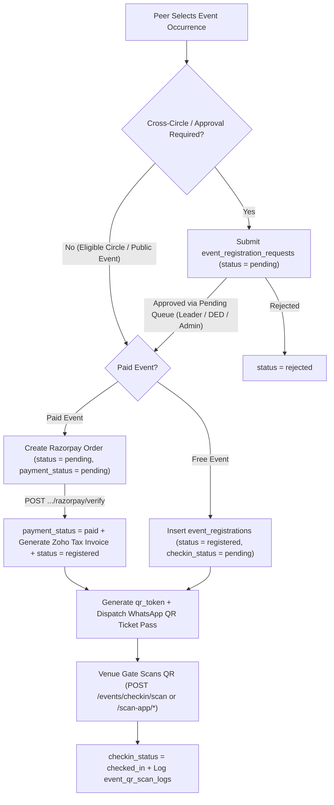

# Activity 21: Attended Events & Registrations

| Metadata Field | Verified Value |
|---|---|
| **Workbook Activity #** | `21` (`Row 29` in Sheet 1, `Row 28` in Sheets 2 & 3) |
| **Exact Workbook Name** | `Attended Events & Registrations` |
| **Domain Category** | `Events & Tickets` (Sheets 1 & 2) / `Events / Ticketing` (Sheet 3) |
| **Activity Governance Tier** | Tier 1 — Chapter Meetings, Regional Conclaves, Cross-Circle Event Clearance, Paid Ticketing & QR Gate Attendance |
| **Overall Implementation Status** | `Partially Implemented` (Comprehensive event occurrences, Razorpay/Zoho paid ticketing, coupons, dynamic QR passes, dedicated Scanner App APIs, cross-circle `event_registration_requests`, and circle meeting attendance rosters exist; **HOWEVER**, Leadership App lacks cross-circle event approval UI & attendance marking UI, `LeaderReportsService::getAttendanceTrend()` is an empty stub `[]`, `/leader/teams/circles/{id}/events` has an IDOR, and `scan_app_users` has a plaintext password migration bug) |
| **Surface Status Breakdown** | **Backend:** `Implemented but Incorrect` (Rich event/QR/meeting engine; `/api/v1/admin/events/*` lacks admin guard; `/leader/teams/circles/{id}/events` skips scope check; `LeaderReportsService` stubs attendance trend & injects fake `94.5%` default; `scan_app_users` stores `plain_password`) \| **Member App:** `Fully Implemented` (`events` + `speed_networking` modules) \| **Leadership App:** `Partially Implemented` ([circle_events_screen.dart](file:///D:/office%20project/LeaderApp-Fornt-end-/lib/features/circle_details/view/circle_events_screen.dart), [peer_events_attendance_screen.dart](file:///D:/office%20project/LeaderApp-Fornt-end-/lib/features/peer_profile/view/peer_events_attendance_screen.dart) read-only; no QR check-in, meeting attendance marking, or `event_joining_requests` approval UI) \| **Admin Web:** `Fully Implemented` (`EventsPage.tsx` — 8 tabs incl. `EventJoiningRequestsTab.tsx`, `EventScanCredentialsTab.tsx`, `TotalAttendanceTab.tsx`) |
| **Related Canonical Documents** | [12-master-35-activities-index.md](../12-master-35-activities-index.md) \| [17-register-a-visitor-form.md](./17-register-a-visitor-form.md) \| [19-activity-to-role-access-matrix.md](../19-activity-to-role-access-matrix.md) \| [25-activity-workflow-reference.md](../25-activity-workflow-reference.md) \| [26-events-and-attendance-flow.md](../26-events-and-attendance-flow.md) \| [30-submitted-feedback.md](./30-submitted-feedback.md) |

---

## 1. Business Purpose (§9.1)

- **WORKBOOK REQUIREMENT:** Enables Peers to *"Register for regional business conclaves, annual galas, and weekly networking meetings"*, supporting ticket tiers, coupon codes, payment gateway clearance, dynamic QR code ticket passes for venue check-in, and tax invoice PDFs (`Ticket Booked -> Payment Cleared -> QR Scanned at Venue`).
- **FACT:** In `unity-app-new`, Activity 21 spans **three interconnected attendance & event subsystems**:
  1. **Conclaves, Chapter Events & Occurrences (`events` + `event_occurrences` + `event_registrations`)**: Supports free and paid events (`base_amount`, `gst_percent`, `EventCoupon`), Razorpay + Zoho Invoice integration, cryptographic `qr_token` passes (`MyEventQrController`), WhatsApp pass delivery, venue QR check-in (`EventCheckinService` + standalone `ScanAppEventController`), and cross-circle attendance clearance (`event_registration_requests` -> `event_joining_requests` Pending Queue).
  2. **Structured Circle Meetings & Compliance Attendance (`circle_meetings` + `attendance_records` + `substitute_logs` + `absence_warnings`)**: Tracks recurring chapter meeting attendance, substitute representation (`circle_members.substitute_count`), and automated/admin absence warnings (`AdminOpsController`).
  3. **Virtual / Live Speed Networking (`speed_networking_events` + `participants` + `sessions` + `matches`)**: Automated round-robin peer matching (`speed-networking:auto-start` cron) that logs completed 1-on-1s into `p2p_meetings`.

---

## 2. Sub-Activities Catalogue (§9.2)

| # | Sub-Activity / Atomic Operation | Member App (`unity_app`) | Leadership App (`LeaderApp`) | Admin Web (`unity-admin-web` / Blade) | Backend (`unity-app-new`) | Classification Status |
|---:|---|---|---|---|---|---|
| 21.1 | Browse Upcoming/Live/Past Events & Circle Events | [events_screen.dart](file:///D:/office%20project/peers-unity/unity_app/lib/features/events/presentation/screens/events_screen.dart), [event_detail_screen.dart](file:///D:/office%20project/peers-unity/unity_app/lib/features/events/presentation/screens/event_detail_screen.dart) | [circle_events_screen.dart](file:///D:/office%20project/LeaderApp-Fornt-end-/lib/features/circle_details/view/circle_events_screen.dart), [circle_event_detail_screen.dart](file:///D:/office%20project/LeaderApp-Fornt-end-/lib/features/circle_details/view/circle_event_detail_screen.dart) | [EventsPage.tsx](file:///D:/office%20project/unity-admin-web/src/features/events/EventsPage.tsx) (`AllEventsTab.tsx`) | `GET /api/v1/events/all[-with-live-status]`, `GET /api/v1/leader/teams/circles/{id}/events`, `GET /api/v1/leadership/events` | `Implemented but Incorrect` (`/leader/teams/circles/{id}/events` has **zero circle scope check**!) |
| 21.2 | Register for Free or Paid Event Occurrence (with Coupon & Razorpay) | [event_detail_screen.dart](file:///D:/office%20project/peers-unity/unity_app/lib/features/events/presentation/screens/event_detail_screen.dart) | N/A | Public Event Registration Web Form | `POST /api/v1/events/{event_id}/occurrences/{occurrence_id}/register`, `POST .../razorpay/verify` (`EventRegistrationService`) | `Fully Implemented` |
| 21.3 | Request Cross-Circle / Restricted Event Clearance (`event_registration_requests`) | `ApiEndpoints.eventRegistrationRequest` | **Missing Pending Queue UI** | [EventJoiningRequestsTab.tsx](file:///D:/office%20project/unity-admin-web/src/features/events/tabs/EventJoiningRequestsTab.tsx), [PendingRequestsPage.tsx](file:///D:/office%20project/unity-admin-web/src/features/pendingRequests/PendingRequestsPage.tsx) | `POST /api/v1/events/{event_id}/occurrences/{occurrence_id}/registration-request`, `POST /api/v1/leader/pending-requests/event_joining_requests/{id}/approve\|reject`, DED `/ded/pending-requests/event-joining-requests/*` | `Partially Implemented` (Backend + Admin Web work; Leadership App lacks approval UI) |
| 21.4 | View My QR Ticket Pass & Download Event Tax Invoice | [my_events_screen.dart](file:///D:/office%20project/peers-unity/unity_app/lib/features/events/presentation/screens/my_events_screen.dart), [event_qr_ticket_screen.dart](file:///D:/office%20project/peers-unity/unity_app/lib/features/events/presentation/screens/event_qr_ticket_screen.dart) | N/A | [EventRegistrationsPage.tsx](file:///D:/office%20project/unity-admin-web/src/features/events/EventRegistrationsPage.tsx) | `GET /api/v1/my/events-with-qr`, `GET /api/v1/events/registrations/{id}/qr\|invoice` (`MyEventQrController`) | `Fully Implemented` |
| 21.5 | Venue QR Scan Check-In | Member self/peer scan or Scanner App | **Missing in Leader App** (Uses separate `scan-app` endpoints) | [EventScanCredentialsTab.tsx](file:///D:/office%20project/unity-admin-web/src/features/events/tabs/EventScanCredentialsTab.tsx), [TotalAttendanceTab.tsx](file:///D:/office%20project/unity-admin-web/src/features/events/tabs/TotalAttendanceTab.tsx) | `POST /api/v1/events/checkin/scan`, `/api/v1/scan-app/*` (`EventCheckinService`, `ScanAppEventController`) | `Implemented but Incorrect` (`scan_app_users` stores nullable `plain_password` column!) |
| 21.6 | View Member 360° Events & Attendance History in Leadership App | N/A | [peer_events_attendance_screen.dart](file:///D:/office%20project/LeaderApp-Fornt-end-/lib/features/peer_profile/view/peer_events_attendance_screen.dart) | [MeetingsTab.tsx](file:///D:/office%20project/unity-admin-web/src/components/PeerDetailDrawer/tabs/MeetingsTab.tsx) | `GET /api/v1/leader/members/{member_id}/events\|event-registrations\|attendance` (`LeaderMemberController`) | `Fully Implemented` (`LeaderMember360Service` enforces circle scope) |
| 21.7 | Record Circle Meeting Attendance, Substitutes & Absence Warnings + Attendance Trend Report | `attend_circle_meeting` Coin Claim (`1,000` coins) | [reports_view.dart](file:///D:/office%20project/LeaderApp-Fornt-end-/lib/features/reports/view/reports_view.dart) (Trend chart stubbed!) | `/api/v1/admin/circles/{circleId}/meetings`, `/meetings/{id}/attendance`, `/warnings` | `AdminOpsController`, [LeaderReportsService.php](file:///c:/Users/malic/OneDrive/Documents/GitHub/unity-app-new/app/Leader/Services/LeaderReportsService.php#L352-L356) | `Implemented but Incorrect` (`getAttendanceTrend()` returns hardcoded `[]`; `submitReport()` injects fake `94.5%` default; `/admin/meetings/*` lacks admin guard) |

---

## 3. Input Form & Field Validation Mapping (§9.3)

| Field Name | Data Type | Required/Optional | Validation (Backend + Client; mark missing as Requires Confirmation) | Default | Input Widget | Data Source | Visibility | Who Enters | Who Edits | Who Views | Sensitive? | Backend Request Key |
|---|---|---|---|---|---|---|---|---|---|---|---|---|
| **Event ID & Occurrence ID** | `uuid` | Required | **Backend:** Route UUIDs validated against `events.id` & `event_occurrences.id` (`EventRegistrationService`). **Client:** Selected event/date card. | Selected occurrence | Event Card / Occurrence Selector | `GET /api/v1/events/{id}` | Public / Peers / Leaders / Admin | Peer Member / Visitor | Immutable | Registrant, Scoped Leaders, Admin | No | `event_id`, `occurrence_id` |
| **Registration Type** | `string` (enum) | Required (implicit by route) | **Backend:** `'member'` (on `/register`) or `'visitor'` (on `/visitor-register[-as-user]`). | `'member'` | Route-driven | System | Registrant, Leaders, Admin | System / Peer | Immutable | Registrant, Leaders, Admin | No | `registration_type` |
| **Coupon / Promo Code** | `string` | Optional (Paid Events) | **Backend:** Validated against active `event_coupons` (`code`, `discount_type`, `discount_value`, `max_uses`, expiry). **Client:** Coupon input field on checkout sheet. | `null` | `TextFormField` + Apply CTA | `event_coupons` | Registrant, Admin | Peer Member | Immutable | Registrant, Finance/Admin | No | `coupon_code` |
| **Razorpay Payment Signature (`razorpay_order_id`, `razorpay_payment_id`, `razorpay_signature`)** | `string` | Conditional (Paid Events) | **Backend:** HMAC-SHA256 signature verification against Razorpay secret (`EventRegistrationService`). **Client:** Razorpay Flutter SDK callback. | `null` | Razorpay Checkout Sheet | Razorpay Gateway | Finance/Admin & Registrant | Payment Gateway | System | Registrant (receipt), Admin | Yes (Payment Credentials) | `razorpay_order_id`, `razorpay_payment_id`, `razorpay_signature` |
| **Cross-Circle Join Request Notes** | `text` | Optional | **Backend (`event_registration_requests`):** `nullable\|string\|max:1000`. **Client:** Request clearance dialog. | `null` | Multi-line `TextFormField` | User input | Requester, Host Circle Leaders, DED, Admin | Peer Member | Reviewer (`notes`) | Requester, Host Leaders, Admin | No | `notes` |
| **QR Check-In Token (`qr_token`)** | `string` | Required at Check-In | **Backend (`EventCheckinService`):** Cryptographic/unique token lookup on `event_registrations.qr_token`; prevents duplicate check-in and logs to `event_qr_scan_logs`. | Generated on registration | Camera QR Scanner | `event_registrations.qr_token` | Registrant & Gate Scanner | Scanner App / Admin | System (`checkin_status = 'checked_in'`) | Registrant, Leaders, Admin | Yes (Admission Bearer Token) | `qr_token` |
| **Admin Event Creation (`title`, `circle_id`, `start_at`, `end_at`, `is_virtual`, `location_text`, `visibility`, `is_paid`, `base_amount`, `gst_percent`, `qr_checkin_enabled`)** | Mixed | Required (`title`, `start_at`) | **Backend (`EventAdminController`):** `title` (`req\|max:255`), `start_at`/`end_at` (`date`), `is_paid` (`bool`), `base_amount` (`numeric\|min:0`), `gst_percent` (`numeric`), `visibility` (`public\|circle\|private`). | `gst_percent = 18` | [CreateEventPage.tsx](file:///D:/office%20project/unity-admin-web/src/features/events/CreateEventPage.tsx) | Admin input | Target audience per `visibility` | Super Admin / Circle Admin | Admin | Target Peers & Leaders | No | `title`, `circle_id`, `start_at`, `end_at`, `is_paid`, `base_amount`, `gst_percent` |

---

## 4. Workflow, Lifecycle & Mermaid Diagram (§9.4)

- **WORKBOOK REQUIREMENT:** `Ticket Booked -> Payment Cleared -> QR Scanned at Venue`.
- **FACT:** Actual PostgreSQL lifecycle spans **three** status columns across two tables:
  1. `event_registration_requests.status` (for restricted/cross-circle events): `pending` -> `approved` | `rejected` | `cancelled`.
  2. `event_registrations.status`: `pending` (awaiting payment) -> `registered` | `cancelled` | `rejected`, paired with `payment_status` (`pending` | `paid` | `free` | `failed`).
  3. `event_registrations.checkin_status`: `pending` -> `checked_in` (records `checked_in_at`, `checked_in_by_user_id`, and `event_qr_scan_logs`).

---

## 5. Outputs & Deliverables (§9.5)

| Output / Deliverable | Workbook Specification | Actual Repository Status | Verification Evidence |
|---|---|---|---|
| **Dynamic QR Code Ticket Pass** | `EventQrTicketScreen` + WhatsApp dispatch | `Fully Implemented` (**FACT**) | [event_qr_ticket_screen.dart](file:///D:/office%20project/peers-unity/unity_app/lib/features/events/presentation/screens/event_qr_ticket_screen.dart) consumes `/api/v1/my/events-with-qr`; WhatsApp delivery logged on `event_registrations`. |
| **Tax Invoice PDF** | Paid event GST Tax Invoice | `Fully Implemented` (**FACT**) | `GET /api/v1/events/registrations/{id}/invoice` (`ApiEndpoints.eventInvoice`) backed by Zoho/PDF invoice integration. |
| **Post-Event Rating Prompt** | Linked to Activity 30 Feedback | `Fully Implemented` (**FACT**) | `GET /api/v1/event-feedbacks/check-pending` prompts attended peers for 1–5 star event feedback. |
| **Leader Attendance Trend Chart & Roster** | Chapter attendance compliance | `Implemented but Incorrect` (**FACT**) | [reports_view.dart](file:///D:/office%20project/LeaderApp-Fornt-end-/lib/features/reports/view/reports_view.dart) calls `GET /api/v1/reports/attendance-trend`, which returns hardcoded `[]` (`LeaderReportsService.php:352`), and `getPeersRoster` reads non-existent `$user->attendance_rate` (`'0%'`)! |

---

## 6. Database & Metrics Mapping (§9.6)

- **Core Tables:**
  - `events` (`SoftDeletes`), `event_occurrences`, `event_registrations` (`SoftDeletes`), `event_registration_requests`, `event_rsvps`, `event_qr_scan_logs`, `event_coupons`, `event_gallery_media`, `scan_app_users`.
  - Circle Meetings: `circle_meetings`, `attendance_records`, `substitute_logs`, `absence_warnings`.

### Sheet 3 Workbook Metric Keys Comparison
| Workbook Metric Key (Sheet 3) | Actual Backend / DB Equivalent | Status |
|---|---|---|
| `registeredEventsCount` | `COUNT(event_registrations WHERE user_id = ? AND status = 'registered')` | `Fully Implemented` |
| `attendedEventsCount` | `COUNT(event_registrations WHERE user_id = ? AND checkin_status = 'checked_in')` + `COUNT(attendance_records WHERE status = 'present')` | `Partially Implemented` (Split between `event_registrations` and `attendance_records`; `LeaderReportsService` roster reads non-existent `$user->attendance_rate`) |
| `eventTicketsList` | `GET /api/v1/my/events-with-qr` / `GET /api/v1/events/my-registrations` | `Fully Implemented` |

---

## 7. API & Backend Service Mapping (§9.7)

| Surface | Method & Endpoint | Controller @ Action | Service | Auth Middleware | Scope Enforcement & Security Bugs | Client Integration |
|---|---|---|---|---|---|---|
| Member API | `GET /api/v1/events/all[-with-live-status]`, `POST .../occurrences/{occ}/register\|registration-request`, `GET /api/v1/my/events-with-qr`, `GET .../registrations/{id}/invoice` | `EventController`, `EventApiController`, `MyEventQrController` | `EventRegistrationService` | `auth:sanctum`, `unity.user` | Enforces event visibility, seat limits, and ticket ownership. | Integrated in Member App (`EventsRemoteDatasource`) |
| Check-In / Scanner API | `POST /api/v1/events/checkin/scan`, `/api/v1/scan-app/*` | `EventController`, `ScanAppEventController` | `EventCheckinService` | `auth:sanctum` / ScanApp token | **Security Bug:** Migration `2026_08_22_180000_add_plain_password_to_scan_app_users_table.php` stores plaintext `plain_password`! | Scanner App & Admin Web |
| Leader API | `GET /api/v1/leader/teams/circles/{id}/events`, `GET /api/v1/leader/members/{member_id}/events\|event-registrations\|attendance`, `GET /api/v1/reports/attendance-trend` | `LeaderTeamsController`, `LeaderMemberController`, `LeaderReportsController` | `LeaderTeamsService`, `LeaderMember360Service`, `LeaderReportsService` | `auth:sanctum`, `leader.user` | **Bugs:** `/teams/circles/{id}/events` has **IDOR** (no scope check on `{id}`); `attendance-trend` returns hardcoded `[]`. | Integrated in Leadership App |
| Leader & DED Pending Queue | `GET /api/v1/leader/pending-requests?category=event_joining_requests`, `POST .../approve\|reject`; DED `/api/v1/ded/pending-requests/event-joining-requests/*` | `PendingRequestAdminController`, `DedPendingRequestsController` | `DedApiService` | `leader.user` / `ensure.ded.api` | Scoped to host event circle/district; `PendingRequestAdminController` lacks capability check. | **Missing UI in Leadership App**; Integrated in Admin Web |
| Admin V1 API | `/api/v1/admin/events/*`, `/api/v1/admin/circles/{circleId}/meetings`, `/api/v1/admin/meetings/{id}/attendance` | `EventAdminController`, `AdminOpsController` | `EventRegistrationService` | `auth:sanctum`, `unity.user` | **CRITICAL P0 BUG:** Mounted in `routes/api.php` without admin guard! | Integrated in React Admin Web (`eventService.ts`) |

---

## 8. Role-Wise Access Governance (§9.8)

| Role | View Activity | Create Record | Edit Own | Edit Others | Submit for Review | Verify | Approve | Reject | Assign | Manage | Delete | View Aggregated Reports |
|---|---|---|---|---|---|---|---|---|---|---|---|---|
| **Super Admin** | Allowed (Global) | Allowed (Create Global/Regional/Circle Events & Meetings) | Allowed | Allowed (Any event, coupon, scan user, attendance) | N/A | Allowed (QR Check-in) | Allowed (Global `event_joining_requests`) | Allowed (Global) | Allowed (Create `ScanAppUser` credentials) | Allowed (Full Event & Attendance CRUD) | Allowed (Cancel/soft-delete event) | Allowed (Global) |
| **Country Director** | Allowed (Country scope events & attendance) | UNVERIFIED — Requires confirmation whether Country Director creates national events directly or via Super Admin. | Allowed (Own registration) | DENIED — No permission under the verified backend authorization model. | Allowed | Allowed | Allowed (Country scope `event_joining_requests`) | Allowed (Country scope) | DENIED | Allowed (Country scope oversight) | DENIED | Allowed (Country scope) |
| **DED** | Allowed (District scope events & attendance) | UNVERIFIED — Requires business confirmation on District conclave creation. | Allowed (Own registration) | DENIED — No permission under the verified backend authorization model. | Allowed | Allowed | Allowed (District `event-joining-requests` via `/ded/*` & `/leader/*`) | Allowed (District scope) | DENIED | Allowed (District oversight) | DENIED | Allowed (District scope) |
| **Industry Director** | Allowed (Assigned Industry circles' events) | DENIED | Allowed (Own registration) | DENIED — No permission under the verified backend authorization model. | Allowed | DENIED | Allowed (Industry scope `event_joining_requests`) | Allowed (Industry scope) | DENIED | DENIED | DENIED | Allowed (Industry scope) |
| **Circle Founder** | Allowed (Own Circle events & member attendance) | UNVERIFIED — Circle event/meeting creation via Leader App (`Requires Enhancement` / confirmation). | Allowed | Allowed (Mark circle meeting attendance — recommended) | Allowed | Allowed (Host gate check-in) | Allowed (Own Circle `event_joining_requests`) | Allowed (Own Circle) | DENIED | Allowed (Own Circle meetings) | DENIED | Allowed (Own Circle) |
| **Circle Director** | Allowed (Own Circle events & member attendance) | UNVERIFIED — Circle event/meeting creation via Leader App. | Allowed | Allowed (Mark circle meeting attendance — recommended) | Allowed | Allowed (Host gate check-in) | Allowed (Own Circle `event_joining_requests`) | Allowed (Own Circle) | DENIED | Allowed (Own Circle meetings) | DENIED | Allowed (Own Circle) |
| **Chair / Committee Chairs** (`chairEventsPrograms` primary) | Allowed (Own Circle events & attendance) | UNVERIFIED — `chairEventsPrograms` proposing chapter events requires confirmation. | Allowed | UNVERIFIED — Assisting with meeting attendance check-in. | Allowed | Allowed (Gate QR scan if authorized) | UNVERIFIED — Confirm whether `chairEventsPrograms` approves `event_joining_requests` or CD/CF only. | UNVERIFIED | DENIED | DENIED | DENIED | Allowed (Own Circle) |
| **Vice Chair** | Allowed (Own Circle read-only) | Allowed (Own ticket booking) | Allowed | DENIED — No permission under the verified backend authorization model. | Allowed | DENIED | DENIED — Should require `can_review_pending_peers`. | DENIED | DENIED | DENIED | DENIED | Allowed (Own Circle) |
| **Secretary** | Allowed (Own Circle events & attendance) | Allowed (Own ticket booking) | Allowed | UNVERIFIED — In standard chapter governance, **Secretary** marks meeting roll-call (`attendance_records`, `substitute_logs`); requires explicit `/leader/*` endpoint & confirmation! | Allowed | Allowed (Meeting roll-call verification if confirmed) | DENIED on cross-circle join requests unless delegated | DENIED | DENIED | DENIED | DENIED | Allowed (Own Circle) |
| **Committee Leader** | DENIED in Leader App (Role resolver bug); Member App events allowed | Allowed (Own ticket booking) | Allowed | DENIED — No permission under the verified backend authorization model. | Allowed | DENIED | DENIED | DENIED | DENIED | DENIED | DENIED | DENIED |
| **Peer Member** | Allowed (Eligible events + own registrations & QR passes) | Allowed (Book event ticket or submit `event_registration_requests`) | Allowed (Cancel own registration) | DENIED — No permission under the verified backend authorization model. | Allowed | DENIED | DENIED | DENIED | DENIED | DENIED | Allowed (Cancel own booking) | DENIED |

---

## 9. Existing Implementation Summary, Gaps & Minimum-Change Enhancement Recommendations

| # | 1. Existing Implementation Summary | 2. Identified Gap / Defect | 3. Classification Status | 4. Impact / Risk Severity | 5. Target Repo & Layer | 6. Exact File(s) / Endpoint(s) / Table(s) | 7. Minimum-Change Enhancement Specification | 8. RBAC & Scope Enforcement Rule | 9. Migration / Compatibility Impact | 10. Verification / Test Criteria |
|---:|---|---|---|---|---|---|---|---|---|---|
| **21-R1** | `/api/v1/admin/events/*` and `/api/v1/admin/meetings/*` lack admin middleware; `/api/v1/leader/teams/circles/{id}/events` lacks circle scope validation; `scan_app_users` stores `plain_password`. | Any Peer token can create/modify/delete events or attendance via `/api/v1/admin/events/*`; Leaders can query unrelated circles' private events; scanner credentials are stored in plaintext. | `Implemented but Incorrect` | **P0 Critical (Privilege Escalation, IDOR & Credential Exposure)** | `unity-app-new` | `routes/api.php`, [LeaderTeamsService.php](file:///c:/Users/malic/OneDrive/Documents/GitHub/unity-app-new/app/Leader/Services/LeaderTeamsService.php#L1571), `scan_app_users` (new migration dropping `plain_password`) | Protect `/api/v1/admin/events/*` & `/meetings/*` with `admin.auth` + `admin.permission`; enforce `in_array($circleId, $scopedCircleIds)` in `LeaderTeamsService::getCircleEvents()`; create a new migration dropping `scan_app_users.plain_password` (display generated password once at creation only, verifying exclusively via `password_hash`). | Event admin restricted to `superAdmin` / scoped admins; circle events restricted to `resolveScopedCircleIds($user)`. | New migration drops `plain_password` (complies with Never Modify Existing Migrations rule). | Test `403` for Peer on `/admin/events`, `403` on out-of-scope `/leader/teams/circles/{id}/events`, and `Schema::hasColumn('scan_app_users', 'plain_password') === false`. |
| **21-R2** | `LeaderReportsService::getAttendanceTrend()` (`L352`) returns `[]`, `submitReport()` (`L157`) injects fake `94.5%` attendance, `getPeersRoster()` reads non-existent `$user->attendance_rate`, and Leadership App lacks `event_joining_requests` approval UI. | Leadership App Reports spline chart is blank or uses fake submitted numbers (`94.5%`), roster always shows `0%` attendance, and leaders cannot approve cross-circle event requests on mobile. | `Implemented but Incorrect` / `Requires Enhancement` | **P1 High (Broken Analytics & Missing Mobile Approval)** | `unity-app-new` (`LeaderReportsService`) & `LeaderApp-Fornt-end-` | [LeaderReportsService.php](file:///c:/Users/malic/OneDrive/Documents/GitHub/unity-app-new/app/Leader/Services/LeaderReportsService.php#L157-L356), [reports_view.dart](file:///D:/office%20project/LeaderApp-Fornt-end-/lib/features/reports/view/reports_view.dart) | Implement `getAttendanceTrend()` and per-peer `attendance_rate` in `LeaderReportsService` by aggregating real `attendance_records` (`present`/`substitute` vs total `circle_meetings`) and `event_registrations` (`checked_in` vs `registered`) for `$scopedCircleIds`; remove fake `94.5` fallback; surface `event_joining_requests` in Leadership App Pending Approvals screen. | Scope trend & roster queries strictly to `$scopedCircleIds`; gate approvals on `can_review_pending_peers`. | Zero DB schema changes; populates existing response contract expected by `reports_spline_chart.dart`. | Integration test verifying `GET /api/v1/reports/attendance-trend` returns real monthly percentages matching `attendance_records` / `event_registrations`. |
