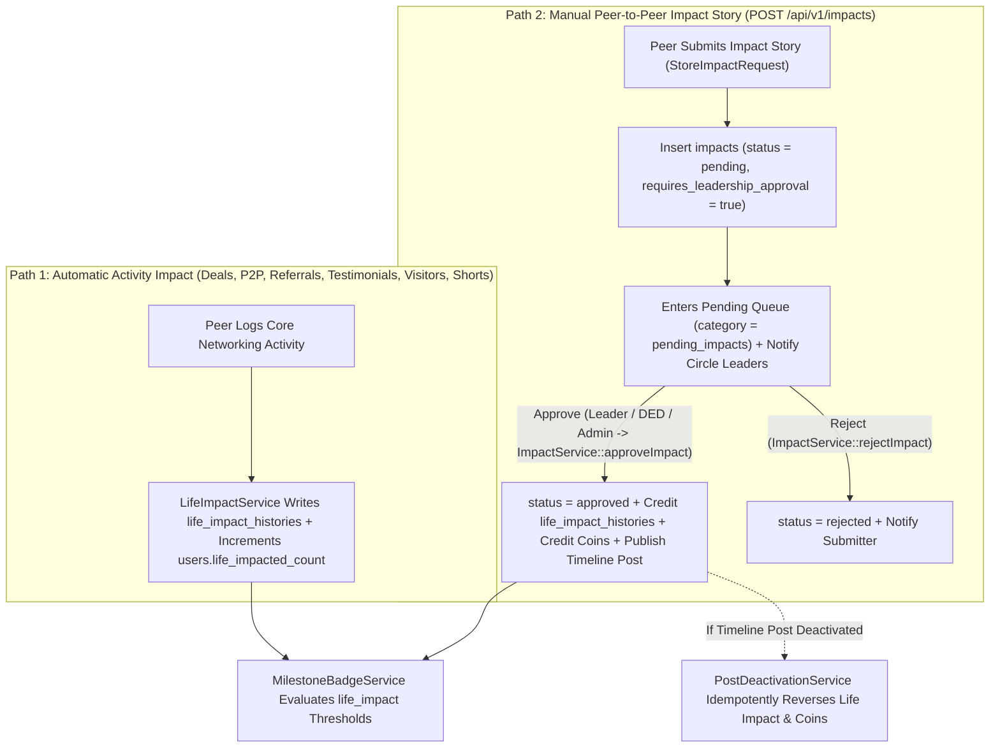

# Activity 22: Impact Activity & Life Impact Score

| Metadata Field | Verified Value |
|---|---|
| **Workbook Activity #** | `22` (`Row 30` in Sheet 1, `Row 29` in Sheets 2 & 3) |
| **Exact Workbook Name** | `Impact Activity & Life Impact Score` |
| **Domain Category** | `Recognition & Leaderboards` (Sheets 1 & 2) / `Analytics / Gamification` (Sheet 3) |
| **Activity Governance Tier** | Tier 1 — Community Recognition, Leadership Verification Queue (`pending_impacts`), Coins/Timeline Sync & Executive Leaderboard |
| **Overall Implementation Status** | `Implemented but Incorrect` (Backend `ImpactService` + `LifeImpactService`, `pending_impacts` queue, timeline auto-posting, and Member App + Admin Web work well; **HOWEVER**, `LeaderDashboardService` contains severe SQL/math/fabrication bugs—querying non-existent `peer_user_id` instead of `impacted_peer_id`, computing `max(SUM, COUNT)`, and fabricating fake scores & 5 fictional people in `getTopImpacters`—while Leadership App has an orphaned `CreateImpactBottomSheet` with mismatched fields, an unrouted `POST` expectation, and no `pending_impacts` approval UI!) |
| **Surface Status Breakdown** | **Backend:** `Implemented but Incorrect` (Core `ImpactController` & `ImpactService` are solid; `LeaderDashboardService` has `peer_user_id` column bug, `max(sum, count)` bug, and fake `top_impacters`; `/api/v1/admin/impacts*` lacks admin guard) \| **Member App:** `Fully Implemented` ([life_impact_screen.dart](file:///D:/office%20project/peers-unity/unity_app/lib/features/highlights/presentation/screens/life_impact_screen.dart), [add_impact_tab.dart](file:///D:/office%20project/peers-unity/unity_app/lib/features/highlights/presentation/widgets/add_impact_tab.dart), [impact_guidelines_screen.dart](file:///D:/office%20project/peers-unity/unity_app/lib/features/leaderboard/presentation/screens/impact_guidelines_screen.dart)) \| **Leadership App:** `Implemented but Not Integrated` / `Implemented but Incorrect` ([impacts_view.dart](file:///D:/office%20project/LeaderApp-Fornt-end-/lib/features/impacts/view/impacts_view.dart) is read-only; [create_impact_bottom_sheet.dart](file:///D:/office%20project/LeaderApp-Fornt-end-/lib/features/impacts/view/widgets/create_impact_bottom_sheet.dart) is **100% orphaned**; no `pending_impacts` Approve/Reject UI) \| **Admin Web:** `Fully Implemented` ([ImpactsPage.tsx](file:///D:/office%20project/unity-admin-web/src/features/impacts/ImpactsPage.tsx) — 5 tabs + [ImpactRecognitionsTab.tsx](file:///D:/office%20project/unity-admin-web/src/features/recognition/ImpactRecognitionsTab.tsx)) |
| **Related Canonical Documents** | [12-master-35-activities-index.md](../12-master-35-activities-index.md) \| [19-activity-to-role-access-matrix.md](../19-activity-to-role-access-matrix.md) \| [23-coins-activity-wallet-and-history.md](./23-coins-activity-wallet-and-history.md) \| [25-activity-workflow-reference.md](../25-activity-workflow-reference.md) \| [28-badges-earned.md](./28-badges-earned.md) \| [41-master-reporting-and-metrics-reference.md](../41-master-reporting-and-metrics-reference.md) |

---

## 1. Business Purpose (§9.1)

- **WORKBOOK REQUIREMENT:** Tracks *"cumulative societal and economic impact generated by passing deals and mentoring peers"*, claiming *"Automatic Aggregation (from closed deals, referrals given, visitors registered, and mentoring)"* to drive `lifeImpactedCount`, a Visual Radar Chart, and Impact Honor Certificates.
- **FACT (Dual-Source Impact Engine):** Contrary to the Workbook's claim that Impact is *purely* automatic, the verified codebase implements a **hybrid dual-source Life Impact architecture**:
  1. **Automatic Activity-Triggered Impact (`App\Services\LifeImpact\LifeImpactService` -> `life_impact_histories`)**: Automatically increments `life_impact_histories` and `users.life_impacted_count` when a Peer logs Business Deals (Activity 1), P2P Meetings (Activity 2), Referrals (Activity 3), Testimonials (Activity 8), Peer Recommendations (Activity 16), Visitor Registrations (Activity 17), or uploads their first Intro Short Video (Activity 26) — governed by `impact_guidelines`.
  2. **Manual Peer-to-Peer Impact Submission (`App\Models\Impact` -> `impacts` + `impact_actions`)**: Peers explicitly submit stories of helping/mentoring another Peer (`POST /api/v1/impacts` via [add_impact_tab.dart](file:///D:/office%20project/peers-unity/unity_app/lib/features/highlights/presentation/widgets/add_impact_tab.dart), validated by [StoreImpactRequest.php](file:///c:/Users/malic/OneDrive/Documents/GitHub/unity-app-new/app/Http/Requests/Impacts/StoreImpactRequest.php#L25-L46)). When `config('impact.requires_leadership_approval', true)` is enabled, manual impacts start as `status = 'pending'` in the **`pending_impacts` Unified Pending Queue** (`PendingRequestAdminController` & `DedPendingRequestsController`). Upon Leadership/Admin approval (`ImpactService::approveImpact`), the system atomically credits `life_impact_histories`, updates `users.life_impacted_count`, awards `impact_coin` (`coins_ledger`), publishes a celebratory post to `posts` (`timeline_posted_at`), evaluates `milestone_badges` (`type = 'life_impact'`), and sends push notifications! Furthermore, if that timeline post is later deactivated, `PostDeactivationService` idempotently **reverses** both the Life Impact score and Coins!

---

## 2. Sub-Activities Catalogue (§9.2)

| # | Sub-Activity / Atomic Operation | Member App (`unity_app`) | Leadership App (`LeaderApp`) | Admin Web (`unity-admin-web` / Blade) | Backend (`unity-app-new`) | Classification Status |
|---:|---|---|---|---|---|---|
| 22.1 | Fetch Active Impact Actions Catalog & Guidelines | [life_impact_screen.dart](file:///D:/office%20project/peers-unity/unity_app/lib/features/highlights/presentation/screens/life_impact_screen.dart), [impact_guidelines_screen.dart](file:///D:/office%20project/peers-unity/unity_app/lib/features/leaderboard/presentation/screens/impact_guidelines_screen.dart) | N/A | [ImpactOptionsTab.tsx](file:///D:/office%20project/unity-admin-web/src/features/impacts/components/ImpactOptionsTab.tsx), [ImpactGuidelinesTab.tsx](file:///D:/office%20project/unity-admin-web/src/features/impacts/components/ImpactGuidelinesTab.tsx) | `GET /api/v1/impacts/actions`, `GET /api/v1/impact-guidelines` ([ImpactController.php](file:///c:/Users/malic/OneDrive/Documents/GitHub/unity-app-new/app/Http/Controllers/Api/V1/ImpactController.php#L26-L39)) | `Fully Implemented` |
| 22.2 | Submit Manual Peer-to-Peer Impact Story (`POST /impacts`) | [add_impact_tab.dart](file:///D:/office%20project/peers-unity/unity_app/lib/features/highlights/presentation/widgets/add_impact_tab.dart), [add_impact_bottom_sheet.dart](file:///D:/office%20project/peers-unity/unity_app/lib/features/highlights/presentation/widgets/add_impact_bottom_sheet.dart) | **Orphaned [create_impact_bottom_sheet.dart](file:///D:/office%20project/LeaderApp-Fornt-end-/lib/features/impacts/view/widgets/create_impact_bottom_sheet.dart)** (Never called in [impacts_view.dart](file:///D:/office%20project/LeaderApp-Fornt-end-/lib/features/impacts/view/impacts_view.dart); wrong fields; no `POST /leader/impacts` route!) | [AddEditImpactModal.tsx](file:///D:/office%20project/unity-admin-web/src/features/impacts/components/AddEditImpactModal.tsx) (`POST /admin/life-impact/manual`) | `POST /api/v1/impacts` (& `/life-impact`) -> `ImpactController@store` (`StoreImpactRequest`) | `Fully Implemented` in Member App; `Implemented but Not Integrated` in Leadership App |
| 22.3 | View Own Life Impact Score, Submissions & Point Ledger | [life_impact_screen.dart](file:///D:/office%20project/peers-unity/unity_app/lib/features/highlights/presentation/screens/life_impact_screen.dart) | N/A | Peer Drawer `ActivitiesTab.tsx` | `GET /api/v1/impacts/my` (also self-heals `users.life_impacted_count` at `ImpactController.php:95-102`!), `GET /api/v1/life-impact/history` | `Fully Implemented` |
| 22.4 | View Approved Impact Timeline & Impact Leaderboard | [leaderboard_screen.dart](file:///D:/office%20project/peers-unity/unity_app/lib/features/leaderboard/presentation/screens/leaderboard_screen.dart) | [impacts_view.dart](file:///D:/office%20project/LeaderApp-Fornt-end-/lib/features/impacts/view/impacts_view.dart), [dashboard_top_impacters.dart](file:///D:/office%20project/LeaderApp-Fornt-end-/lib/features/dashboard/view/widgets/dashboard_top_impacters.dart) | [ImpactsPage.tsx](file:///D:/office%20project/unity-admin-web/src/features/impacts/ImpactsPage.tsx), [ImpactOverviewTab.tsx](file:///D:/office%20project/unity-admin-web/src/features/impacts/components/ImpactOverviewTab.tsx) | `GET /api/v1/impacts/timeline`, `GET /api/v1/leaderboards/impacts`, `GET /api/v1/leader/activities/impacts`, `GET /api/v1/dashboard/top-impacters` | `Implemented but Incorrect` (`LeaderDashboardService` has `peer_user_id` column bug, `max(sum, count)` bug, and fabricates fake `top_impacters`; `/leader/activities/impacts` allows unscoped `?circle_id` IDOR!) |
| 22.5 | Approve / Reject Pending Impacts (`pending_impacts` Queue) | N/A | **Missing Pending Queue UI** (Backend `/leader/pending-requests/pending_impacts/*` ready) | [PendingRequestsPage.tsx](file:///D:/office%20project/unity-admin-web/src/features/pendingRequests/PendingRequestsPage.tsx), [ImpactListTab.tsx](file:///D:/office%20project/unity-admin-web/src/features/impacts/components/ImpactListTab.tsx) | `POST /api/v1/leader/pending-requests/pending_impacts/{id}/approve\|reject`, DED `/ded/pending-requests/pending-impacts/*`, Admin `/admin/impacts/{impact}/approve\|reject` (`ImpactService`) | `Partially Implemented` (Backend + Admin Web work; Leadership App lacks approval UI; `/admin/impacts/*` lacks admin guard) |
| 22.6 | Generate Impact Recognition Creatives & Monthly Impact Script | [gratitude_script_screen.dart](file:///D:/office%20project/peers-unity/unity_app/lib/features/highlights/presentation/screens/gratitude_script_screen.dart) | N/A | [ImpactCreativeStudioTab.tsx](file:///D:/office%20project/unity-admin-web/src/features/impacts/components/ImpactCreativeStudioTab.tsx), [ImpactRecognitionsTab.tsx](file:///D:/office%20project/unity-admin-web/src/features/recognition/ImpactRecognitionsTab.tsx) | `GET /api/v1/peer-monthly-impact-script`, `/admin/life-impact-recognitions/*` | `Fully Implemented` (Workbook's `Visual Radar Chart` is **NOT IMPLEMENTED**) |

---

## 3. Input Form & Field Validation Mapping (§9.3)

- **FACT:** Verified against [StoreImpactRequest.php](file:///c:/Users/malic/OneDrive/Documents/GitHub/unity-app-new/app/Http/Requests/Impacts/StoreImpactRequest.php#L18-L46), Member App [add_impact_tab.dart](file:///D:/office%20project/peers-unity/unity_app/lib/features/highlights/presentation/widgets/add_impact_tab.dart), and the **orphaned** Leadership App [create_impact_bottom_sheet.dart](file:///D:/office%20project/LeaderApp-Fornt-end-/lib/features/impacts/view/widgets/create_impact_bottom_sheet.dart#L40-L77).
- **Orphaned Widget Mismatch Proof:** `CreateImpactBottomSheet` in Leadership App asks the leader to type a raw UUID into `'Beneficiary Peer User ID *'`, uses hardcoded dropdown `['mentor', 'connect', 'guide', 'sponsor', 'other']`, and passes `{beneficiaryUserId, impactType, title, description}` — **none** of which match `StoreImpactRequest` (`impacted_peer_id`, `action` from DB `impact_actions`, `date`, `life_impacted`, `story_to_share`, `additional_remarks`), and `routes/leader.php` has **zero `POST` route** for impacts!

| Field Name | Data Type | Required/Optional | Validation (Backend + Client; mark missing as Requires Confirmation) | Default | Input Widget | Data Source | Visibility | Who Enters | Who Edits | Who Views | Sensitive? | Backend Request Key |
|---|---|---|---|---|---|---|---|---|---|---|---|---|
| **Impacted Peer (`impacted_peer_id`)** | `uuid` | Required | **Backend (`StoreImpactRequest`):** `required`, `uuid`, `exists:users,id`, plus custom `after` rule blocking self-impact (`user()->id !== impacted_peer_id`, `L41-43`). **Client (Member App):** `"Select Peer for Life Impact"` peer picker. *(Orphaned Leader sheet wrongly used raw UUID text box `beneficiaryUserId`).* | `null` | Peer Selector Sheet | `/api/v1/members/limited` | Submitter, Impacted Peer, Leaders, Public Timeline (once approved) | Peer Member | Immutable | Public Timeline (when approved), Scoped Leaders, Admin | No | `impacted_peer_id` |
| **Impact Action Type (`action`)** | `string` | Required | **Backend:** `required`, `string`, `Rule::in(Impact::availableActions())` (active names from `impact_actions`). **Client:** Action dropdown populated from `GET /api/v1/impacts/actions`. | `null` | Action Dropdown | `GET /api/v1/impacts/actions` (`impact_actions`) | Public Timeline (when approved), Leaders, Admin | Peer Member | Admin | Public Timeline, Leaders, Admin | No | `action` |
| **Impact Date (`date`)** | `date` | Required (Auto-defaulted) | **Backend:** `prepareForValidation()` merges `now()->toDateString()` if omitted (`L20-22`); `required`, `date`. **Client:** Date picker. | Today (`YYYY-MM-DD`) | Date Picker | Calendar | Submitter, Leaders, Admin | Peer Member | Immutable | Public Timeline, Leaders, Admin | No | `date` (stored in `impacts.impact_date`) |
| **Lives Impacted Count (`life_impacted`)** | `integer` | Optional | **Backend:** `nullable`, `integer`, `min:1`, `max:100` (falls back to `impact_actions.impact_score` in `ImpactService`). **Client:** Numeric input / stepper. | `impact_actions.impact_score` (or `1`) | Integer Input | User input / Action default | Submitter, Leaders, Admin | Peer Member | Admin | Public Timeline, Leaders, Admin | No | `life_impacted` |
| **Story to Share (`story_to_share`)** | `text` | Optional in Backend / Prompted in UI | **Backend:** `nullable`, `string`, `max:5000`. **Client:** `"Story to Share"` multi-line field. | `null` | Multi-line `TextFormField` | User input | Public Timeline (once approved), Leaders, Admin | Peer Member | Admin | Public Timeline, Leaders, Admin | No | `story_to_share` |
| **Additional Remarks (`additional_remarks`)** | `text` | Optional | **Backend:** `nullable`, `string`, `max:2000`. **Client:** `"Additional Remarks"`. | `null` | Multi-line `TextFormField` | User input | Submitter, Scoped Leaders & Admin (Internal review context) | Peer Member | Admin | Submitter, Leaders, Admin | Internal Context | `additional_remarks` |
| **Leadership Review Remarks (`review_remarks`)** | `text` | Optional on Approve / Recommended on Reject | **Backend:** Stored on `impacts.review_remarks` via `ImpactService::approveImpact` / `rejectImpact`. | `null` | Reviewer Modal Input | Leader / DED / Admin | Submitter, Leaders, Admin | Approving Leader / Admin | Admin | Submitter, Leaders, Admin | Internal Governance | `review_remarks` (`reason` / `remarks`) |

---

## 4. Workflow, Lifecycle & Mermaid Diagram (§9.4)

- **WORKBOOK REQUIREMENT:** `Real-time Metric Aggregation -> Milestone Unlocked -> Honor Issued`.
- **FACT:**
  - Manual `impacts.status` transitions through `'pending'` -> `'approved'` | `'rejected'`.
  - **CRITICAL BUGS in [LeaderDashboardService.php](file:///c:/Users/malic/OneDrive/Documents/GitHub/unity-app-new/app/Leader/Services/LeaderDashboardService.php#L357-L383):**
    1. **Wrong Column Name (`L374`):** Queries `peer_user_id` on `impacts`, whereas the actual PostgreSQL column on `impacts` is `impacted_peer_id` ([LeaderActivitiesService.php](file:///c:/Users/malic/OneDrive/Documents/GitHub/unity-app-new/app/Leader/Services/LeaderActivitiesService.php#L149), [StoreImpactRequest.php](file:///c:/Users/malic/OneDrive/Documents/GitHub/unity-app-new/app/Http/Requests/Impacts/StoreImpactRequest.php#L33))!
    2. **Flawed Aggregation Formula (`L357-383, L764`):** Computes `max(SUM(users.life_impacted_count), COUNT(impacts.*))` — comparing a *sum of impact points across all activities* against a *row count of manual `impacts` records*!
    3. **Fabricated Leaderboard Data (`L867-973`):** In `getTopImpacters()`, if a real peer has `life_impacted_count <= 0`, `L924-925` **invents** `max(50 - ($rank * 8), 5)` impact score and fake coin counts, and if the query returns empty for a global admin (`L945-970`), it returns **5 hardcoded fictional people** (`"Siddharth Verma"`, `"Ananya Roy"`, etc.)!

---

## 5. Outputs & Deliverables (§9.5)

| Output / Deliverable | Workbook Specification | Actual Repository Status | Verification Evidence |
|---|---|---|---|
| **Life Impact Dashboard & History** | `LifeImpactScreen`, `ImpactGuidelinesScreen` | `Fully Implemented` (**FACT**) | [life_impact_screen.dart](file:///D:/office%20project/peers-unity/unity_app/lib/features/highlights/presentation/screens/life_impact_screen.dart) & [impact_guidelines_screen.dart](file:///D:/office%20project/peers-unity/unity_app/lib/features/leaderboard/presentation/screens/impact_guidelines_screen.dart). |
| **Impact Leaderboard & Top Impacters** | `ImpactLeaderboardScreen` | `Implemented but Incorrect` (**FACT**) | Member App `/api/v1/leaderboards/impacts` works; Leadership App `/api/v1/dashboard/top-impacters` (`LeaderDashboardService::getTopImpacters`) fabricates scores & fictional users! |
| **Impact Recognition Poster / Creative** | Impact Honor Certificate | `Fully Implemented` (**FACT**) | `LifeImpactCreative` & `LifeImpactRecognitionCreative` + React Admin [ImpactCreativeStudioTab.tsx](file:///D:/office%20project/unity-admin-web/src/features/impacts/components/ImpactCreativeStudioTab.tsx) + auto-published Timeline Post on approval. |
| **Visual Radar Chart** | Multi-axis Visual Radar Chart | `Missing` (**NOT IMPLEMENTED**) | Confirmed absent in both Member App and Leadership App. |

---

## 6. Database & Metrics Mapping (§9.6)

1. **`impacts` (`App\Models\Impact`):** `id` (`uuid`), `user_id` (`uuid` actor), `impacted_peer_id` (`uuid` beneficiary), `impact_date` (`date`), `action` (`string`), `story_to_share` (`text`), `life_impacted` (`int`), `additional_remarks`, `requires_leadership_approval` (`bool`), `status` (`pending`|`approved`|`rejected`), `approved_by`, `approved_at`, `rejected_by`, `rejected_at`, `review_remarks`, `timeline_posted_at`, `created_at`, `updated_at`.
2. **`impact_actions` (`App\Models\ImpactAction`):** `id`, `name`, `is_active` (`bool`), `impact_score` (`int`), `impact_coin` (`int`), `sort_order`.
3. **`life_impact_histories` (`App\Models\LifeImpactHistory`):** `id` (`uuid`), `user_id`, `triggered_by_user_id`, `activity_type`, `activity_id`, `impact_value` (`int`), `impact_after` (`int`), `life_impacted`, `counted_in_total` (`bool`), `action_key`, `description`, `remarks`, `meta` (`json`).
4. **Cached User Total:** `users.life_impacted_count` (`int` — reconciled from `SUM(life_impact_histories.impact_value)` in `ImpactController@my`).

### Sheet 3 Workbook Metric Keys Comparison
| Workbook Metric Key (Sheet 3) | Actual Backend / DB Equivalent | Status |
|---|---|---|
| `lifeImpactedCount` | `users.life_impacted_count` (backed by `SUM(life_impact_histories.impact_value)`) | `Fully Implemented` (Broken aggregation in `LeaderDashboardService`) |
| `impactScorePoints` | `life_impact_histories.impact_value` / `impact_after` | `Fully Implemented` |
| `impactTierLevel` | `user_milestone_badges` (`milestone_type = 'life_impact'`) + `users.contribution_award_name` | `Fully Implemented` (See Activity 28) |

---

## 7. API & Backend Service Mapping (§9.7)

| Surface | Method & Endpoint | Controller @ Action | Service / Request | Auth Middleware | Scope Enforcement & Security Bugs | Client Integration |
|---|---|---|---|---|---|---|
| Member API | `GET /api/v1/impacts/actions`, `POST /api/v1/impacts` (`/life-impact`), `GET /api/v1/impacts/my\|timeline`, `GET /api/v1/life-impact/history`, `GET /api/v1/impact-guidelines`, `GET /api/v1/leaderboards/impacts` | [ImpactController.php](file:///c:/Users/malic/OneDrive/Documents/GitHub/unity-app-new/app/Http/Controllers/Api/V1/ImpactController.php), `LifeImpactHistoryController`, `ImpactGuidelineController`, `LeaderboardController` | `ImpactService`, `ImpactActionService`, `StoreImpactRequest` | `auth:sanctum`, `unity.user` | Proper ownership & self-impact prevention (`StoreImpactRequest.php:41`). | Integrated in Member App (`LifeImpactRemoteDatasource`) |
| Leader API | `GET /api/v1/activities/impacts` (`/leader/activities/impacts`), `GET /api/v1/dashboard/top-impacters`, `GET /api/v1/leader/members/{member_id}/impacts` | `LeaderActivitiesController@impacts`, `LeaderDashboardController@topImpacters`, `LeaderMemberController` | `LeaderActivitiesService`, `LeaderDashboardService`, `LeaderMember360Service` | `auth:sanctum`, `leader.user` | **BUGS:** `getImpacts` allows arbitrary `?circle_id=<uuid>` (**IDOR**); `LeaderDashboardService` checks non-existent `peer_user_id`, computes `max(sum, count)`, and fabricates fake `top_impacters`; **NO `POST /leader/impacts` route exists!** | `ImpactsView` & `DashboardTopImpacters` integrated; `CreateImpactBottomSheet` **orphaned** |
| Leader & DED Pending Queue | `GET /api/v1/leader/pending-requests?category=pending_impacts`, `POST .../pending_impacts/{id}/approve\|reject`; DED `/api/v1/ded/pending-requests/pending-impacts/*` | `PendingRequestAdminController`, `DedPendingRequestsController` | `ImpactService::approveImpact\|rejectImpact` | `leader.user` / `ensure.ded.api` | Scoped to leader's circles/districts; `PendingRequestAdminController` lacks capability check (`viceChair`/`secretary` can approve impacts & mint coins!). | **Missing UI in Leadership App**; Integrated in Admin Web |
| Admin V1 API | `POST /api/v1/admin/impacts/{impact}/approve\|reject`, `POST /api/v1/admin/life-impact/manual`, CRUD `/api/v1/admin/impact-actions` | `ImpactAdminController`, `AdminOpsController` | `ImpactService` | `auth:sanctum`, `unity.user` | **CRITICAL P0 BUG:** Mounted in `routes/api.php` without admin guard — any Peer can self-approve their own impact or manually credit unlimited `life-impact/manual`! | Integrated in React Admin Web (`impactService.ts`) |

---

## 8. Role-Wise Access Governance (§9.8)

| Role | View Activity | Create Record | Edit Own | Edit Others | Submit for Review | Verify | Approve | Reject | Assign | Manage | Delete | View Aggregated Reports |
|---|---|---|---|---|---|---|---|---|---|---|---|---|
| **Super Admin** | Allowed (Global) | Allowed (Peer impact or `/admin/life-impact/manual`) | Allowed | Allowed (`impact_actions`, `impact_guidelines`, manual adjustments) | Allowed | Allowed | Allowed (Global `pending_impacts`) | Allowed (Global) | DENIED — No assignee field. | Allowed (Actions, Guidelines, Creatives) | Allowed (Deactivate impact post via `PostDeactivationService` reversing points/coins) | Allowed (Global) |
| **Country Director** | Allowed (Country scope) | Allowed (As Peer) | DENIED (Immutable) | DENIED — No permission under the verified backend authorization model. | Allowed | Allowed | Allowed (Country scope `pending_impacts`) | Allowed (Country scope) | DENIED | DENIED | DENIED | Allowed (Country scope) |
| **DED** | Allowed (District scope via `/ded/life-impact` & `/leader/*`) | Allowed (As Peer) | DENIED | DENIED — No permission under the verified backend authorization model. | Allowed | Allowed | Allowed (District `pending-impacts` via `/ded/*` & `/leader/*`) | Allowed (District scope) | DENIED | DENIED | DENIED | Allowed (District scope) |
| **Industry Director** | Allowed (Industry scope) | Allowed (As Peer) | DENIED | DENIED — No permission under the verified backend authorization model. | Allowed | Allowed | Allowed (Industry scope `pending_impacts`) | Allowed (Industry scope) | DENIED | DENIED | DENIED | Allowed (Industry scope) |
| **Circle Founder** | Allowed (Own Circle) | Allowed (As Peer) | DENIED | DENIED — No permission under the verified backend authorization model. | Allowed | Allowed | Allowed (Own Circle `pending_impacts`) | Allowed (Own Circle) | DENIED | DENIED | DENIED (Use `PostDeactivationService` admin escalation; fix unguarded `deleteCreative`!) | Allowed (Own Circle) |
| **Circle Director** | Allowed (Own Circle) | Allowed (As Peer) | DENIED | DENIED — No permission under the verified backend authorization model. | Allowed | Allowed | Allowed (Own Circle `pending_impacts`) | Allowed (Own Circle) | DENIED | DENIED | DENIED | Allowed (Own Circle) |
| **Chair / Committee Chairs** (`chairEventsPrograms` = Events & Impacts Chair!) | Allowed (Own Circle) | Allowed (As Peer) | DENIED | DENIED — No permission under the verified backend authorization model. | Allowed | Allowed (Impact screening) | UNVERIFIED — **Business Confirmation Recommended:** `chairEventsPrograms` (*Chair - Events & Impacts Committee*) is specifically named for Impacts; confirm whether they have direct `pending_impacts` approval authority alongside CD/CF! | UNVERIFIED | DENIED | DENIED | DENIED | Allowed (Own Circle) |
| **Vice Chair** | Allowed (Own Circle read-only) | Allowed (As Peer) | DENIED | DENIED — No permission under the verified backend authorization model. | Allowed | DENIED | DENIED — Should require explicit impact-approval capability. | DENIED | DENIED | DENIED | DENIED | Allowed (Own Circle) |
| **Secretary** | Allowed (Own Circle read-only) | Allowed (As Peer) | DENIED | DENIED — No permission under the verified backend authorization model. | Allowed | DENIED | DENIED — Should require explicit impact-approval capability. | DENIED | DENIED | DENIED | DENIED | Allowed (Own Circle) |
| **Committee Leader** | DENIED in Leader App (Role resolver bug); Member App allowed | Allowed (Member App) | DENIED | DENIED — No permission under the verified backend authorization model. | Allowed | DENIED | DENIED | DENIED | DENIED | DENIED | DENIED | DENIED |
| **Peer Member** | Allowed (Own `/impacts/my` + public approved `/impacts/timeline` & `/leaderboards/impacts`) | Allowed (`POST /api/v1/impacts` for another peer) | DENIED (Immutable) | DENIED — No permission under the verified backend authorization model. | Allowed | DENIED | DENIED | DENIED | DENIED | DENIED | DENIED | DENIED |

---

## 9. Existing Implementation Summary, Gaps & Minimum-Change Enhancement Recommendations

| # | 1. Existing Implementation Summary | 2. Identified Gap / Defect | 3. Classification Status | 4. Impact / Risk Severity | 5. Target Repo & Layer | 6. Exact File(s) / Endpoint(s) / Table(s) | 7. Minimum-Change Enhancement Specification | 8. RBAC & Scope Enforcement Rule | 9. Migration / Compatibility Impact | 10. Verification / Test Criteria |
|---:|---|---|---|---|---|---|---|---|---|---|
| **22-R1** | `/api/v1/admin/impacts/*` and `/api/v1/admin/life-impact/manual` lack admin middleware; `/api/v1/leader/activities/impacts` skips `?circle_id` scope validation. | Any Peer token can self-approve their own `pending` impacts (minting coins + timeline posts) or award arbitrary manual life impact via `/admin/life-impact/manual`; Leaders can pass `?circle_id=<uuid>` to read other circles' impacts. | `Implemented but Incorrect` | **P0 Critical (Gamification/Coin Minting Exploit & IDOR)** | `unity-app-new` | `routes/api.php`, `ImpactAdminController.php`, [LeaderActivitiesService.php](file:///c:/Users/malic/OneDrive/Documents/GitHub/unity-app-new/app/Leader/Services/LeaderActivitiesService.php#L138-L161) | Guard `/api/v1/admin/impacts*` and `/life-impact/manual` with `admin.auth` + `admin.permission:impacts.manage`; intersect `?circle_id` with `resolveScopedCircleIds($user)` in `LeaderActivitiesService::getImpacts()`. | Manual point injection restricted to `superAdmin`; impact approval restricted to `CF`, `CD`, `chairEventsPrograms` (if confirmed), `ID`, `DED`, `countryDirector`, `superAdmin` within scope (and block self-approval `$impact->user_id === $approver->id`!). | Non-breaking for Admin Web. | Feature test asserting `403` for Peer on `/admin/impacts/{id}/approve` and `403` when a CD attempts to approve their own impact submission. |
| **22-R2** | `LeaderDashboardService` (`L357-383`, `L764`, `L867-973`) computes dashboard `impact` and `top_impacters`. | Queries non-existent `impacts.peer_user_id` instead of `impacted_peer_id`, takes `max(SUM(users.life_impacted_count), COUNT(impacts.*))`, fabricates scores `max(50 - rank*8, 5)` for 0-score users, and returns 5 fictional names when empty! | `Implemented but Incorrect` | **P1 High (Corrupted Executive KPIs & Fake Prod Data)** | `unity-app-new` (`LeaderDashboardService`) | [LeaderDashboardService.php](file:///c:/Users/malic/OneDrive/Documents/GitHub/unity-app-new/app/Leader/Services/LeaderDashboardService.php#L357-L383), [LeaderDashboardService.php](file:///c:/Users/malic/OneDrive/Documents/GitHub/unity-app-new/app/Leader/Services/LeaderDashboardService.php#L867-L973) | Fix column reference to `impacted_peer_id`; compute scoped `impact` strictly from `SUM(life_impact_histories.impact_value)` (or deduplicated `SUM(users.life_impacted_count)` for `$scopedMemberUserIds` when All-Time, filtered by `created_at` date window on `life_impact_histories` when period filter is active); delete all fake score formulas and hardcoded fictional names in `getTopImpacters()`, returning `[]` when `0` peers have `life_impacted_count > 0`. | Enforce deduplicated `$scopedMemberUserIds` (All-Circles Deduplication Rule). | Preserves JSON schema; eliminates fake numbers. | Unit test on empty/zero-impact circle confirming `impact = 0` and `top_impacters = []`. |
| **22-R3** | Leadership App contains orphaned `CreateImpactBottomSheet` (raw UUID input, wrong fields, no `POST` route) and lacks a `pending_impacts` approval UI in `ImpactsView` / Action Center. | Leaders cannot review/approve `pending_impacts` inside the Leadership App, while dead widget `CreateImpactBottomSheet` has broken UX & mismatched schema. | `Implemented but Not Integrated` / `Requires Enhancement` | **P1 High (Missing Leader Moderation UI & Dead Code)** | `LeaderApp-Fornt-end-` & `unity-app-new` | [impacts_view.dart](file:///D:/office%20project/LeaderApp-Fornt-end-/lib/features/impacts/view/impacts_view.dart), [create_impact_bottom_sheet.dart](file:///D:/office%20project/LeaderApp-Fornt-end-/lib/features/impacts/view/widgets/create_impact_bottom_sheet.dart) | Add a `Pending Approval` / `Approved` segmented tab inside `ImpactsView` (and Action Center) consuming existing `GET /api/v1/leader/pending-requests?category=pending_impacts` and `POST .../pending_impacts/{id}/approve\|reject`; either delete orphaned `CreateImpactBottomSheet` (if impact logging stays in Member App) or refactor it to use searchable Peer Picker + `GET /api/v1/impacts/actions` + existing `POST /api/v1/impacts` endpoint (**no duplicate `/leader/impacts` POST needed**). | Show `Pending Approval` actions only to roles with impact-review permission (`CF`, `CD`, `chairEventsPrograms`, `ID`, `DED`, `countryDirector`, `superAdmin`). | Zero new backend endpoints required! | Widget & API test verifying CD approves a circle peer's pending impact from `ImpactsView` and sees `status = approved` + coins/impact credited. |
