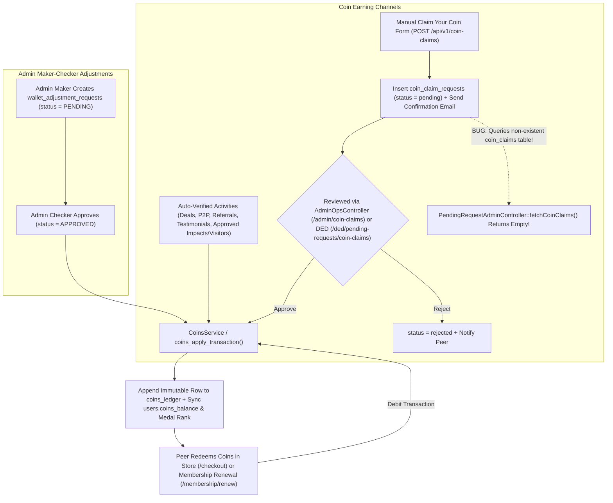

# Activity 23: Coins Activity, Wallet & History

| Metadata Field | Verified Value |
|---|---|
| **Workbook Activity #** | `23` (`Row 31` in Sheet 1, `Row 30` in Sheets 2 & 3) |
| **Exact Workbook Name** | `Coins Activity, Wallet & History` |
| **Domain Category** | `Gamification & Rewards` (Sheets 1 & 2) / `Gamification / Ledger` (Sheet 3) |
| **Activity Governance Tier** | Tier 1 — Immutable Coin Economy (`coins_ledger`), Manual Proof Claims (`coin_claim_requests`), Store Redemption & Maker-Checker Adjustments |
| **Overall Implementation Status** | `Implemented but Incorrect` (Immutable `coins_ledger`, automatic rewards, 9-activity manual Coin Claim engine, Coin Store e-commerce redemption + Maker-Checker `wallet_adjustment_requests`, and Leadership App `PeersByCoinsView` exist; **CRITICAL BUGS:** `PendingRequestAdminController::fetchCoinClaims()` checks non-existent table `coin_claims` instead of `coin_claim_requests`, `DynamicRbacSeeder` accidentally grants `coin_payouts` to every leader role down to `secretary`, `StoreOtpService` accepts `'123456'` & arbitrary `'store_otp_tok_*'` in prod, and `/api/v1/admin/coin-claims*` lacks admin middleware!) |
| **Surface Status Breakdown** | **Backend:** `Implemented but Incorrect` (Rich ledger + Store wallet; `PendingRequestAdminController` `coin_claims` vs `coin_claim_requests` table-name bug; `DynamicRbacSeeder` `coin_payouts` over-grant; `StoreOtpService` auth bypass; `/api/v1/admin/coin-claims*` missing admin guard) \| **Member App:** `Fully Implemented` ([coins_screen.dart](file:///D:/office%20project/peers-unity/unity_app/lib/features/highlights/presentation/screens/coins_screen.dart), [claim_your_coin_screen.dart](file:///D:/office%20project/peers-unity/unity_app/lib/features/highlights/presentation/screens/claim_your_coin_screen.dart), [claim_coins_form_screen.dart](file:///D:/office%20project/peers-unity/unity_app/lib/features/highlights/presentation/screens/claim_coins_form_screen.dart), [coin_milestones_screen.dart](file:///D:/office%20project/peers-unity/unity_app/lib/features/milestones/presentation/screens/coin_milestones_screen.dart) + 172-file `store` module) \| **Leadership App:** `Partially Implemented` ([peers_by_coins_view.dart](file:///D:/office%20project/LeaderApp-Fornt-end-/lib/features/peers_by_coins/view/peers_by_coins_view.dart), [peer_coins_screen.dart](file:///D:/office%20project/LeaderApp-Fornt-end-/lib/features/peer_profile/view/peer_coins_screen.dart) read-only; no Coin Claim approval UI) \| **Admin Web:** `Fully Implemented` ([CoinsPage.tsx](file:///D:/office%20project/unity-admin-web/src/features/coins/CoinsPage.tsx), [CoinClaimsPage.tsx](file:///D:/office%20project/unity-admin-web/src/features/coins/CoinClaimsPage.tsx), [StoreWalletsPage.tsx](file:///D:/office%20project/unity-admin-web/src/features/store/StoreWalletsPage.tsx), [StoreCoinAdjustmentsPage.tsx](file:///D:/office%20project/unity-admin-web/src/features/store/StoreCoinAdjustmentsPage.tsx)) |
| **Related Canonical Documents** | [12-master-35-activities-index.md](../12-master-35-activities-index.md) \| [19-activity-to-role-access-matrix.md](../19-activity-to-role-access-matrix.md) \| [22-impact-activity-and-life-impact-score.md](./22-impact-activity-and-life-impact-score.md) \| [25-activity-workflow-reference.md](../25-activity-workflow-reference.md) \| [28-badges-earned.md](./28-badges-earned.md) \| [42-rbac-security-audit.md](../42-rbac-security-audit.md) \| [43-sensitive-data-and-finance-access.md](../43-sensitive-data-and-finance-access.md) |

---

## 1. Business Purpose (§9.1)

- **WORKBOOK REQUIREMENT:** Enables Peers to *"Earn reward coins for networking activities and redeem coins for membership perks or event tickets"*, combining automatic credits on verified activities with a manual *"Claim Your Coin Form (Activity type, date, proof screenshot)"*, full credit/debit ledger, and Silver -> Gold milestone progression.
- **FACT:** The Peers Unity Coin Economy is a comprehensive virtual-currency ecosystem spanning **four backend subsystems**:
  1. **Immutable Coin Ledger (`coins_ledger` + `CoinsService` + PostgreSQL function `coins_apply_transaction(...)`)**: Credits coins automatically on Deals, P2Ps, Referrals, Testimonials, Peer Recommendations, Approved Visitors, Approved Impacts, and Intro Shorts, maintaining `users.coins_balance`, `coin_medal_rank`, and `coin_milestone_title` (reversible via `PostDeactivationService`).
  2. **Manual Coin Claims (`coin_claim_requests` + `config/coin_claims.php`)**: Supports **9 structured claimable activities** (`attend_circle_meeting` [1,000], `vyapaarjagat_story` [2,000], `host_member_spotlight` [1,500], `bring_speaker` [1,500], `join_circle` [1,000], `renew_membership` [2,500], `invite_visitor` [1,000], `new_member_addition` [5,000], `peers_global_feedback_video` [5,000]), validated dynamically by [StoreCoinClaimRequest.php](file:///c:/Users/malic/OneDrive/Documents/GitHub/unity-app-new/app/Http/Requests/CoinClaims/StoreCoinClaimRequest.php#L19-L100) via `CoinClaimActivityRegistry`.
  3. **Peers Unity Coin Store & Coin-Based Membership Renewal (`routes/store.php` + `routes/admin_store.php`)**: Full e-commerce catalog where Peers redeem coins for physical/digital products (`/api/v1/store/*`, `/checkout/otp/*`) or renew memberships with coins (`/api/v1/membership/renew`), governed on the Admin side by **Maker-Checker `wallet_adjustment_requests`** (`CREDIT` | `DEBIT`, `PENDING` -> `APPROVED` | `REJECTED`) and `bonus_coin_grants`.
  4. **Executive Coin Leaderboard & Member Wallet Inspection (`PeersByCoinsView` & `LeaderMemberController@wallet`)**: Allows scoped leaders in the Leadership App to rank peers by coin balance (`Active` vs `At Risk` filters in [peers_by_coins_view.dart](file:///D:/office%20project/LeaderApp-Fornt-end-/lib/features/peers_by_coins/view/peers_by_coins_view.dart#L19-L150)) and inspect individual peer coin ledgers (`GET /api/v1/leader/members/{member_id}/wallet`).

---

## 2. Sub-Activities Catalogue (§9.2)

| # | Sub-Activity / Atomic Operation | Member App (`unity_app`) | Leadership App (`LeaderApp`) | Admin Web (`unity-admin-web` / Blade) | Backend (`unity-app-new`) | Classification Status |
|---:|---|---|---|---|---|---|
| 23.1 | View Own Coin Balance, Credit/Debit Ledger, Guidelines & Milestones | [coins_screen.dart](file:///D:/office%20project/peers-unity/unity_app/lib/features/highlights/presentation/screens/coins_screen.dart), [coin_milestones_screen.dart](file:///D:/office%20project/peers-unity/unity_app/lib/features/milestones/presentation/screens/coin_milestones_screen.dart), [coin_guidelines_screen.dart](file:///D:/office%20project/peers-unity/unity_app/lib/features/leaderboard/presentation/screens/coin_guidelines_screen.dart) | N/A | Peer Drawer [MembershipCoinsEditTab.tsx](file:///D:/office%20project/unity-admin-web/src/components/PeerDetailDrawer/editTabs/MembershipCoinsEditTab.tsx) | `GET /api/v1/me/coins[/ledger]`, `GET /api/v1/coins/history`, `GET /api/v1/coin-guidelines`, `GET /api/v1/milestones` | `Fully Implemented` |
| 23.2 | Submit Manual "Claim Your Coin" Request (9 Activity Codes + Proof Upload) | [claim_your_coin_screen.dart](file:///D:/office%20project/peers-unity/unity_app/lib/features/highlights/presentation/screens/claim_your_coin_screen.dart), [claim_coins_form_screen.dart](file:///D:/office%20project/peers-unity/unity_app/lib/features/highlights/presentation/screens/claim_coins_form_screen.dart), [claim_activity_bottom_sheet.dart](file:///D:/office%20project/peers-unity/unity_app/lib/features/highlights/presentation/widgets/claim_activity_bottom_sheet.dart) | N/A | N/A | `GET /api/v1/coin-claims/activities`, `POST /api/v1/coin-claims`, `GET /api/v1/coin-claims/my` ([CoinClaimController.php](file:///c:/Users/malic/OneDrive/Documents/GitHub/unity-app-new/app/Http/Controllers/Api/V1/CoinClaimController.php#L28-L176)) | `Fully Implemented` |
| 23.3 | Approve / Reject Coin Claim Requests (`coin_claim_requests`) | N/A | **Broken in Unified Pending Queue + Missing UI** | [CoinClaimsPage.tsx](file:///D:/office%20project/unity-admin-web/src/features/coins/CoinClaimsPage.tsx) (`AdminOpsController` works; `PendingRequestsPage.tsx` affected by table-name bug!) | `PATCH /api/v1/admin/coin-claims/{id}/approve\|reject`, DED `/api/v1/ded/pending-requests/coin-claims/*`, Unified Queue `PendingRequestAdminController` | `Implemented but Incorrect` (**BUG:** `PendingRequestAdminController::fetchCoinClaims()` checks `Schema::hasTable('coin_claims')` instead of `coin_claim_requests`, returning `0` items in unified queue! Also `/api/v1/admin/coin-claims*` lacks admin guard!) |
| 23.4 | Leader View: Peers Ranked by Coins (`PeersByCoinsView`) & Member 360° Wallet | [leaderboard_screen.dart](file:///D:/office%20project/peers-unity/unity_app/lib/features/leaderboard/presentation/screens/leaderboard_screen.dart) | [peers_by_coins_view.dart](file:///D:/office%20project/LeaderApp-Fornt-end-/lib/features/peers_by_coins/view/peers_by_coins_view.dart), [peer_coins_screen.dart](file:///D:/office%20project/LeaderApp-Fornt-end-/lib/features/peer_profile/view/peer_coins_screen.dart), [coins_view.dart](file:///D:/office%20project/LeaderApp-Fornt-end-/lib/features/member_activities/view/coins_view.dart) | [CoinsOverviewTab.tsx](file:///D:/office%20project/unity-admin-web/src/features/coins/components/CoinsOverviewTab.tsx) | `GET /api/v1/leader/activities?type=coins` (`/leader/peers-by-coins`), `GET /api/v1/leader/members/{member_id}/wallet`, DED `GET /api/v1/ded/coins[/history]` | `Fully Implemented` |
| 23.5 | Redeem Coins in Store Checkout & Coin-Based Membership Renewal | `store` module (`checkout_screen.dart`, `StoreApiEndpoints`) | N/A | `StoreOrdersPage.tsx`, `StoreCoinEconomyPage.tsx` | `/api/v1/wallet/*`, `/api/v1/checkout/otp/send\|verify`, `/api/v1/orders`, `/api/v1/membership/renew` (`routes/store.php`) | `Implemented but Incorrect` (**CRITICAL P0 BUG:** `StoreOtpService.php:49-87` accepts `'123456'`, falls back to another user's `StoreOtpChallenge::latest()`, and accepts any string starting with `'store_otp_tok_'`!) |
| 23.6 | Admin Manual Coin Award/Deduct & Store Maker-Checker `wallet_adjustment_requests` | N/A | N/A (`can_issue_coins` flag exists; no `/leader/*` coin-grant endpoint) | [AddCoinsModal.tsx](file:///D:/office%20project/unity-admin-web/src/features/coins/components/AddCoinsModal.tsx), [StoreCoinAdjustmentsPage.tsx](file:///D:/office%20project/unity-admin-web/src/features/store/StoreCoinAdjustmentsPage.tsx), [StoreWalletsPage.tsx](file:///D:/office%20project/unity-admin-web/src/features/store/StoreWalletsPage.tsx) | Web `/admin/coins/*`, Store Admin `/api/admin/v1/wallet-adjustments[/{id}/approve\|reject]`, `/wallets/{userId}/freeze\|unfreeze` | `Fully Implemented` in Store Admin (`Maker-Checker`); `DynamicRbacSeeder` bug over-grants `coin_payouts` flag in `LeaderPermissionService` |

---

## 3. Input Form & Field Validation Mapping (§9.3)

- **FACT:** Verified against [StoreCoinClaimRequest.php](file:///c:/Users/malic/OneDrive/Documents/GitHub/unity-app-new/app/Http/Requests/CoinClaims/StoreCoinClaimRequest.php#L19-L100), [config/coin_claims.php](file:///c:/Users/malic/OneDrive/Documents/GitHub/unity-app-new/config/coin_claims.php#L4-L80), and Store `wallet_adjustment_requests`.

| Field Name | Data Type | Required/Optional | Validation (Backend + Client; mark missing as Requires Confirmation) | Default | Input Widget | Data Source | Visibility | Who Enters | Who Edits | Who Views | Sensitive? | Backend Request Key |
|---|---|---|---|---|---|---|---|---|---|---|---|---|
| **Claim Activity Code (`activity_code`)** | `string` (enum) | Required | **Backend (`StoreCoinClaimRequest`):** `required`, `string`, must exist in `CoinClaimActivityRegistry` (`attend_circle_meeting`, `vyapaarjagat_story`, `host_member_spotlight`, `bring_speaker`, `join_circle`, `renew_membership`, `invite_visitor`, `new_member_addition`, `peers_global_feedback_video`). | Selected tile | Activity Claim Tile (`ClaimYourCoinScreen`) | `GET /api/v1/coin-claims/activities` | Claimant, DED, Admin, Scoped Leaders | Peer Member | Immutable | Claimant, DED, Admin, Scoped Leaders | No | `activity_code` |
| **Dynamic Activity Fields (`fields` / `payload`)** | `json` (`object`) | Required per `activity_code` | **Backend (`CoinClaimActivityRegistry`):** Rejects unknown keys with Levenshtein typo suggestion (`L84-95`); enforces per-field `type` (`date`, `url`, `text`, `phone`, `email`) & `required` from [config/coin_claims.php](file:///c:/Users/malic/OneDrive/Documents/GitHub/unity-app-new/config/coin_claims.php#L4-L80). | `{}` | Dynamic `ClaimActivityBottomSheet` | `GET /api/v1/coin-claims/activities` | Claimant, DED, Admin | Peer Member | Immutable | Claimant, DED, Admin | Contains Prospect Phone/Email on `invite_visitor` & `new_member_addition` | `fields.*` / `payload.*` |
| **Proof File / Video Upload (`files.*`)** | `file` (`uuid` FK) | Required on `renew_membership` & `peers_global_feedback_video`; Optional on `invite_visitor` & `new_member_addition` | **Backend:** Stored in `files` via `CoinClaimController::storeClaimFile()` (`L78-92`). *(File MIME/max-size constraint in `StoreCoinClaimRequest` lines 101–202 — verify strict video/image size cap).* **Client:** `ClaimProofPicker` camera/gallery or URL. | `null` | `ClaimProofPicker` / URL Field | Camera / Gallery | Claimant, DED, Admin | Peer Member | Immutable | Claimant, DED, Admin | Yes (Payment Receipt / Video Proof) | `files[<field_key>]` |
| **Coin Claim Review Notes & Coins Awarded** | `text` + `integer` | Optional (`admin_notes`) / Auto-filled (`coins_awarded`) | **Backend:** `coins_awarded` defaults to `config("coin_claims.activities.{$code}.coins")` (`1000`–`5000`), `admin_notes` (`nullable\|string`). | Config coin value | Admin / DED Review Modal | Reviewer input | Claimant & Admin | Admin / DED | Admin | Claimant & Admin | Internal Notes | `coins_awarded`, `admin_notes` |
| **Store Checkout OTP (`otp`, `otp_token`)** | `string` | Required on Coin Redemption | **Backend (`StoreOtpService`):** **BROKEN** — accepts `'123456'` and any `'store_otp_tok_*'` prefix! Must enforce 6-digit user-bound OTP. | `null` | OTP Input Sheet | SMS/Email OTP | Buyer only | Peer Member | N/A | System only | Yes (Auth Secret) | `otp`, `otp_token` |
| **Store Wallet Maker-Checker Adjustment (`type`, `amount`, `reason`)** | `enum` + `bigint` + `string` | Required | **Backend (`AdminStoreWalletAdjustmentController`):** `type` (`CREDIT`\|`DEBIT`), `amount` (`required\|integer\|min:1`), `reason` (`required\|string`); Checker (`reviewed_by`) must approve `PENDING -> APPROVED`. | `status = 'PENDING'` | `StoreCoinAdjustmentsPage.tsx` Modal | Admin Maker input | Finance / Super Admin & User Ledger (`remark`) | Admin (Maker) | Checker Approves/Rejects | Super Admin & Peer | Yes (Financial Ledger Mutation) | `user_id`, `type`, `amount`, `reason` |

---

## 4. Workflow, Lifecycle & Mermaid Diagram (§9.4)

- **WORKBOOK REQUIREMENT:** `Action Completed -> Proof Validated -> Coins Minted/Deducted`.
- **FACT:**
  - `coins_ledger` rows are **append-only immutable** transactions (`amount` +/- `bigint`, `balance_after`), updating `users.coins_balance`.
  - `coin_claim_requests.status` transitions `'pending'` -> `'approved'` (credits `coins_ledger` + sends email via `CoinClaimEmailService`) | `'rejected'`.
  - **CRITICAL TABLE-NAME MISMATCH BUG (`PendingRequestAdminController::fetchCoinClaims()`):** Checks `Schema::hasTable('coin_claims')` (`subagent_3:472, 810`), whereas the actual PostgreSQL table used by `CoinClaimRequest`, `CoinClaimController`, `AdminOpsController`, `DedApiService`, and even `PendingRequestAdminController::processApproval()` is **`coin_claim_requests`**! As a result, `GET /api/v1/admin/pending-requests?category=coin_claims` and `GET /api/v1/leader/pending-requests?category=coin_claims` fail to list pending coin claims!

---

## 5. Outputs & Deliverables (§9.5)

| Output / Deliverable | Workbook Specification | Actual Repository Status | Verification Evidence |
|---|---|---|---|
| **Full Credit/Debit Transaction Ledger** | `CoinsScreen` ledger | `Fully Implemented` (**FACT**) | `GET /api/v1/me/coins/ledger`, `GET /api/v1/wallet/ledger`, and Leader Member 360° `GET /api/v1/leader/members/{id}/wallet`. |
| **Milestone Progression Bar (Silver -> Gold -> Platinum -> Titanium)** | `CoinMilestonesScreen` | `Fully Implemented` (**FACT**) | [coin_milestones_screen.dart](file:///D:/office%20project/peers-unity/unity_app/lib/features/milestones/presentation/screens/coin_milestones_screen.dart) (`GET /api/v1/milestones`) + cached `users.coin_medal_rank` & `coin_milestone_title`. |
| **Executive Peers-by-Coins Leaderboard** | Leader gamification oversight | `Fully Implemented` (**FACT**) | [peers_by_coins_view.dart](file:///D:/office%20project/LeaderApp-Fornt-end-/lib/features/peers_by_coins/view/peers_by_coins_view.dart) with `All`, `Active`, and `At Risk` filters. |

---

## 6. Database & Metrics Mapping (§9.6)

1. **`coins_ledger` (`App\Models\CoinLedger` / `CoinsLedger`):** PK `transaction_id` (`uuid`), `user_id`, `amount` (`bigint` signed), `balance_after` (`bigint`), `activity_id` (`uuid`, nullable), `reference` (`string`), `source_type`, `source_id`, `remark`, `created_by`, `created_at`.
2. **`coin_claim_requests` (`App\Models\CoinClaimRequest`):** `id` (`uuid`), `user_id`, `activity_code`, `payload` (`json`), `status` (`pending`|`approved`|`rejected`), `coins_awarded` (`int`), `admin_notes`, `approved_at`, `rejected_at`, `reviewed_by_admin_id`, `created_at`, `updated_at`.
3. **`wallet_transactions` (`WalletTransaction`) & Store `wallet_adjustment_requests` (`WalletAdjustmentRequest`) + `bonus_coin_grants` (`BonusCoinGrant`) + `award_coins_histories`.**
4. **User Cached Columns (`users`):** `coins_balance` (`bigint`), `coin_medal_rank`, `coin_milestone_title`, `coin_milestone_meaning`.

### Sheet 3 Workbook Metric Keys Comparison
| Workbook Metric Key (Sheet 3) | Actual Backend / DB Equivalent | Status |
|---|---|---|
| `coinsBalance` | `users.coins_balance` (authoritative latest `coins_ledger.balance_after`) | `Fully Implemented` |
| `coinsEarnedLifetime` | `SUM(coins_ledger.amount WHERE amount > 0)` (`/api/v1/wallet/summary` & `/activities/my/coins-summary`) | `Fully Implemented` |
| `coinsSpentLifetime` | `ABS(SUM(coins_ledger.amount WHERE amount < 0))` | `Fully Implemented` |

---

## 7. API & Backend Service Mapping (§9.7)

| Surface | Method & Endpoint | Controller @ Action | Service | Auth Middleware | Scope Enforcement & Security Bugs | Client Integration |
|---|---|---|---|---|---|---|
| Member API (Coins & Claims) | `GET /api/v1/me/coins[/ledger]`, `GET /api/v1/coin-claims/activities\|my`, `POST /api/v1/coin-claims`, `GET /api/v1/milestones` | `CoinsController`, [CoinClaimController.php](file:///c:/Users/malic/OneDrive/Documents/GitHub/unity-app-new/app/Http/Controllers/Api/V1/CoinClaimController.php), `CoinMilestoneController` | `CoinsService`, `CoinClaimActivityRegistry` | `auth:sanctum`, `unity.user` | Scoped to `$request->user()->id`. Safe. | Integrated in Member App (`CoinsRemoteDatasource`) |
| Store Wallet & Checkout API | `GET /api/v1/wallet[/ledger\|/summary\|/status]`, `POST /api/v1/checkout/otp/send\|verify`, `POST /api/v1/orders`, `POST /api/v1/membership/renew` | `Store\WalletController`, `CheckoutController`, `Store\MembershipController` | `StoreOtpService` | `auth:sanctum`, `unity.user` | **CRITICAL P0 BUG:** [StoreOtpService.php](file:///c:/Users/malic/OneDrive/Documents/GitHub/unity-app-new/app/Services/Store/StoreOtpService.php#L49-L87) accepts `'123456'`, reads `StoreOtpChallenge::latest()` across users, and accepts any `'store_otp_tok_*'` string! | Integrated in Member App (`StoreRemoteDatasource`) |
| Leader API | `GET /api/v1/leader/activities?type=coins` (`/leader/peers-by-coins`), `GET /api/v1/leader/activities/coin-claims`, `GET /api/v1/leader/members/{member_id}/wallet` | `LeaderActivitiesController`, `LeaderMemberController` | `LeaderActivitiesService`, `LeaderMember360Service` | `auth:sanctum`, `leader.user` | Scoped to leader's circles on list & Member 360°; **RBAC Bug:** `DynamicRbacSeeder` makes `coins` module visible to all roles, causing `LeaderPermissionService` (`L441`) to set `can_issue_coins = true` (`coin_payouts`) for every role down to `secretary`! | `PeersByCoinsView` & `PeerCoinsScreen` integrated |
| Leader & Admin Unified Queue | `GET /api/v1/leader/pending-requests?category=coin_claims`, `POST .../coin_claims/{id}/approve\|reject` | `PendingRequestAdminController` | `PendingRequestModerationService` | `leader.user` / `unity.user` | **BUG 1:** `fetchCoinClaims()` checks `Schema::hasTable('coin_claims')` instead of `coin_claim_requests`! **BUG 2:** `/api/v1/admin/*` lacks admin middleware! | Broken in Unified Queue; **Missing UI in Leadership App** |
| DED API | `GET /api/v1/ded/coins[/history]`, `GET\|POST /api/v1/ded/pending-requests/coin-claims[/{id}/approve\|reject]` | `DedCoinsController`, `DedPendingRequestsController` | `DedApiService` | `auth:sanctum`, `ensure.ded.api` | Properly queries `coin_claim_requests` scoped to DED's assigned districts! | Backend ready |
| Admin V1 & Store Admin API | `GET\|PATCH /api/v1/admin/coin-claims/*` (`AdminOpsController`); Store `/api/admin/v1/wallets/*`, `/wallet-adjustments/*` | `AdminOpsController`, `AdminStoreWalletController`, `AdminStoreWalletAdjustmentController` | `CoinsService` | `/api/v1/admin/*` lacks admin guard! | **CRITICAL P0 BUG:** `/api/v1/admin/coin-claims/{id}/approve` is callable by any Peer token to self-approve 5,000-coin claims! | Integrated in React Admin Web (`coinService.ts`, `storeService.ts`) |

---

## 8. Role-Wise Access Governance (§9.8)

| Role | View Activity | Create Record | Edit Own | Edit Others | Submit for Review | Verify | Approve | Reject | Assign | Manage | Delete | View Aggregated Reports |
|---|---|---|---|---|---|---|---|---|---|---|---|---|
| **Super Admin** | Allowed (Global ledgers, claims, wallets) | Allowed (`bonus_coin_grants` & Maker-Checker adjustments) | N/A | Allowed (Freeze/unfreeze wallet, coin rules, guidelines) | Allowed (Maker adjustment) | Allowed (Checker verification) | Allowed (Global `coin_claim_requests` & Checker `wallet_adjustment_requests`) | Allowed (Global) | DENIED | Allowed (Coin economy rules, Store config, payouts) | DENIED — **`coins_ledger` is strictly immutable** (reversals via compensating debit only!). | Allowed (Global) |
| **Country Director** | Allowed (Country scope `PeersByCoinsView` & claims) | Allowed (As Peer) | DENIED | DENIED — Direct wallet adjustment is Super Admin Maker-Checker only. | Allowed | Allowed | Allowed (`can_issue_coins` default `true` in `LeaderPermissionService` — Country scope `coin_claim_requests` approval) | Allowed (Country scope) | DENIED | DENIED — Coin rules are global Super Admin config. | DENIED (Immutable ledger) | Allowed (Country scope) |
| **DED** | Allowed (District scope via `/ded/coins` & `PeersByCoinsView`) | Allowed (As Peer) | DENIED | DENIED | Allowed | Allowed | Allowed (District `coin_claim_requests` via `/ded/pending-requests/coin-claims/{id}/approve`) | Allowed (District scope) | DENIED | DENIED | DENIED | Allowed (District scope) |
| **Industry Director** | Allowed (Industry scope `PeersByCoinsView` & Member 360° wallet) | Allowed (As Peer) | DENIED | DENIED | Allowed | UNVERIFIED — Confirm whether ID approves `coin_claim_requests` or only DED/Country Director/Admin. | UNVERIFIED — Default `coin_payouts` is `false` for ID in `getDefaultRoleCapabilities()`. | UNVERIFIED | DENIED | DENIED | DENIED | Allowed (Industry scope) |
| **Circle Founder** | Allowed (Own Circle `PeersByCoinsView` & Member 360° wallet) | Allowed (As Peer) | DENIED | DENIED | Allowed | Allowed (Verify chapter attendance/visitor claims if delegated) | UNVERIFIED — **Business Confirmation Required:** Default `coin_payouts` is `false` for CF/CD (`L145`), yet `PendingRequestAdminController` exposes `/leader/pending-requests/coin_claims` to Circle Leaders! Confirm whether CD/CF can approve `attend_circle_meeting` / `bring_speaker` claims or only DED/Admin. | UNVERIFIED | DENIED | DENIED | DENIED | Allowed (Own Circle) |
| **Circle Director** | Allowed (Own Circle `PeersByCoinsView` & Member 360° wallet) | Allowed (As Peer) | DENIED | DENIED | Allowed | Allowed (If delegated) | UNVERIFIED — Same confirmation as Circle Founder above. | UNVERIFIED | DENIED | DENIED | DENIED | Allowed (Own Circle) |
| **Chair / Committee Chairs** | Allowed (Own Circle `PeersByCoinsView` read-only) | Allowed (As Peer) | DENIED | DENIED | Allowed | DENIED — Fix `DynamicRbacSeeder` over-grant of `coin_payouts`! | DENIED — No permission under the verified default capability model (`getDefaultRoleCapabilities()`). | DENIED | DENIED | DENIED | DENIED | Allowed (Own Circle) |
| **Vice Chair** | Allowed (Own Circle `PeersByCoinsView` read-only) | Allowed (As Peer) | DENIED | DENIED | Allowed | DENIED — Fix `DynamicRbacSeeder` over-grant! | DENIED — No permission under the verified backend authorization model. | DENIED | DENIED | DENIED | DENIED | Allowed (Own Circle) |
| **Secretary** | Allowed (Own Circle `PeersByCoinsView` read-only) | Allowed (As Peer) | DENIED | DENIED | Allowed | DENIED — Fix `DynamicRbacSeeder` over-grant! | DENIED — No permission under the verified backend authorization model. | DENIED | DENIED | DENIED | DENIED | Allowed (Own Circle) |
| **Committee Leader** | DENIED in Leader App (Role resolver bug); Own wallet in Member App | Allowed (Member App) | DENIED | DENIED | Allowed | DENIED | DENIED | DENIED | DENIED | DENIED | DENIED | DENIED |
| **Peer Member** | Allowed (Own `coins_ledger`, `coin_claim_requests/my`, Store wallet & public Coin Leaderboard) | Allowed (`POST /api/v1/coin-claims` & Store redemption orders) | DENIED (Immutable once submitted) | DENIED — No permission under the verified backend authorization model. | Allowed | DENIED | DENIED | DENIED | DENIED | DENIED | DENIED | DENIED |

---

## 9. Existing Implementation Summary, Gaps & Minimum-Change Enhancement Recommendations

| # | 1. Existing Implementation Summary | 2. Identified Gap / Defect | 3. Classification Status | 4. Impact / Risk Severity | 5. Target Repo & Layer | 6. Exact File(s) / Endpoint(s) / Table(s) | 7. Minimum-Change Enhancement Specification | 8. RBAC & Scope Enforcement Rule | 9. Migration / Compatibility Impact | 10. Verification / Test Criteria |
|---:|---|---|---|---|---|---|---|---|---|---|
| **23-R1** | `StoreOtpService` validates coin-redemption checkout OTPs; `/api/v1/admin/coin-claims*` and `/api/v1/admin/coin-rules*` sit under `unity.user`; `DynamicRbacSeeder` maps `coins` module visibility to `coin_payouts`. | **Critical coin theft & minting vulnerabilities:** Any Peer can self-approve 5,000-coin claims via `/api/v1/admin/coin-claims/{id}/approve` and drain Store inventory using OTP `'123456'` or `'store_otp_tok_anything'`; every leader down to `secretary` receives `can_issue_coins = true`. | `Implemented but Incorrect` | **P0 Critical (Direct Financial / Merchandise Loss & Privilege Escalation)** | `unity-app-new` | [StoreOtpService.php](file:///c:/Users/malic/OneDrive/Documents/GitHub/unity-app-new/app/Services/Store/StoreOtpService.php#L49-L87), `routes/api.php`, [LeaderPermissionService.php](file:///c:/Users/malic/OneDrive/Documents/GitHub/unity-app-new/app/Leader/Services/LeaderPermissionService.php#L441-L443) | Remove `'123456'`, `StoreOtpChallenge::latest()` cross-user fallback, and `'store_otp_tok_'` prefix bypass from `StoreOtpService` (bind strictly to `user_id` + hashed DB token); guard `/api/v1/admin/coin-claims*` and `/coin-rules*` with `admin.auth` + `admin.permission`; in `LeaderPermissionService::resolveCapabilitiesFromDynamicRbac()` (`L441`), require `approve`/`edit` permission on `coins` (not mere read `visibility`) before granting `coin_payouts`, and block self-approval of own coin claims! | `coin_payouts` granted strictly to `superAdmin`, `countryDirector`, `DED` (and `CD`/`CF` only if explicitly confirmed by business), never `chair`/`viceChair`/`secretary`/`member`. | Immediate security hardening; legitimate OTP flows continue working. | Feature tests asserting `403` for Peer on `/admin/coin-claims/{id}/approve`, `422` for `'123456'` and `'store_otp_tok_fake'` in `StoreOtpService`, and `can_issue_coins === false` for `secretary`. |
| **23-R2** | `PendingRequestAdminController::fetchCoinClaims()` queries `coin_claims`, whereas `CoinClaimController`, `CoinClaimRequest`, and `processApproval()` use `coin_claim_requests`. | Unified Pending Requests Queue (`GET /api/v1/admin/pending-requests` & `GET /api/v1/leader/pending-requests` + summary badge counts) silently skips all `coin_claim_requests` rows! | `Implemented but Incorrect` | **P1 High (Silent Broken Approval Queue)** | `unity-app-new` & `LeaderApp-Fornt-end-` | [PendingRequestAdminController.php](file:///c:/Users/malic/OneDrive/Documents/GitHub/unity-app-new/app/Http/Controllers/Api/Admin/PendingRequestAdminController.php#L810) | Fix `PendingRequestAdminController::fetchCoinClaims()` and summary counter to query `coin_claim_requests` (falling back to `coin_claims` only if `coin_claim_requests` is absent); surface `coin_claims` tab in Leadership App Pending Approvals screen for roles authorized to approve coin claims (`DED`, `countryDirector`, `superAdmin`, and `CD`/`CF` if confirmed). | Enforce `leader.can:coin_payouts` (or DED/CD role check) + circle/district scope + `$claim->user_id !== $approver->id`. | Zero DB migration required; immediately populates existing queue contract. | Create `CoinClaimRequest` -> call `GET /api/v1/leader/pending-requests?category=coin_claims` -> assert claim is returned and `POST .../approve` credits `coins_ledger` once. |
