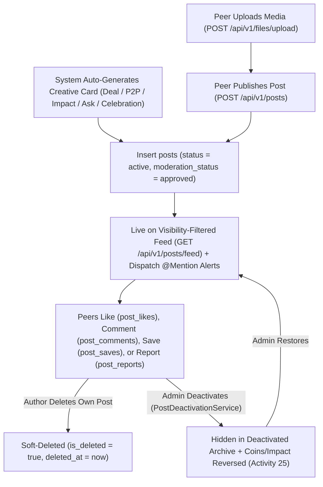

# Activity 24: Timeline Posts Created

| Metadata Field | Verified Value |
|---|---|
| **Workbook Activity #** | `24` (`Row 32` in Sheet 1, `Row 31` in Sheets 2 & 3) |
| **Exact Workbook Name** | `Timeline Posts Created` |
| **Domain Category** | `Content & Feed` (Sheets 1 & 2) / `Content / Social Feed` (Sheet 3) |
| **Activity Governance Tier** | Tier 2 — Community Social Feed, Audience-Scoped Broadcasting (`public`/`circle`/`district`/`connections`), Auto-Generated Activity Creatives & Content Moderation |
| **Overall Implementation Status** | `Implemented but Incorrect` (Full timeline composer, photo/video upload, `@mentions`, audience visibility targeting, likes/comments/saves, celebratory & activity auto-posts, and Member 360° post inspection work; **HOWEVER**, `LeaderMemberController@deletePost` and `@deleteCreative` lack `manage_peers` capability checks—allowing any Circle Chair, Vice Chair, or Secretary to delete peers' posts/creatives while bypassing `PostDeactivationService` coin/impact reversal—and `/api/v1/admin/posts/*` lacks admin role middleware!) |
| **Surface Status Breakdown** | **Backend:** `Implemented but Incorrect` (Rich `PostController` feed; `LeaderMemberController@deletePost` & `@deleteCreative` skip `manage_peers` check and bypass `PostDeactivationService`; `/api/v1/admin/posts*` lacks admin guard; `LeaderActivitiesService::showDetail` has IDOR) \| **Member App:** `Fully Implemented` ([home_screen.dart](file:///D:/office%20project/peers-unity/unity_app/lib/features/home/presentation/screens/home_screen.dart), [create_post_screen.dart](file:///D:/office%20project/peers-unity/unity_app/lib/features/home/presentation/screens/create_post_screen.dart)) \| **Leadership App:** `Partially Implemented` ([peer_post_card.dart](file:///D:/office%20project/LeaderApp-Fornt-end-/lib/features/peer_profile/view/widgets/peer_post_card.dart) in Peer Profile & `LeaderActivitiesView` `posts`/`creatives` read/delete) \| **Admin Web:** `Fully Implemented` ([PostsPage.tsx](file:///D:/office%20project/unity-admin-web/src/features/posts/PostsPage.tsx), [TimeAnalyticsPage.tsx](file:///D:/office%20project/unity-admin-web/src/features/time/TimeAnalyticsPage.tsx), [TimelineCardsTab.tsx](file:///D:/office%20project/unity-admin-web/src/features/appConfig/components/TimelineCardsTab.tsx)) |
| **Related Canonical Documents** | [12-master-35-activities-index.md](../12-master-35-activities-index.md) \| [19-activity-to-role-access-matrix.md](../19-activity-to-role-access-matrix.md) \| [25-deactivated-hidden-posts.md](./25-deactivated-hidden-posts.md) \| [25-activity-workflow-reference.md](../25-activity-workflow-reference.md) \| [42-rbac-security-audit.md](../42-rbac-security-audit.md) |

---

## 1. Business Purpose (§9.1)

- **WORKBOOK REQUIREMENT:** Enables Peers to *"Publish news, business updates, milestones, and media to the community home timeline"* via `CreatePostScreen` (supporting rich text, camera/gallery photos with EXIF rotation, 1–2 minute videos, and audience targeting), tracking `postsCount`, `postLikesCount`, and `postCommentsCount`.
- **FACT:** Beyond user-composed social updates (`source_type = 'post'`), the `posts` table in `unity-app-new` acts as the **central community broadcast hub** for auto-generated milestone and networking creative cards across the platform (`source_type` in `business_deal`, `testimonial`, `p2p_meeting`, `referral`, `impact`, `ask`, `collaboration_post`, `celebration`), governed by configurable templates in `timeline_card_configs` (`TimelineCardConfigController`) and scheduled birthday/anniversary jobs (`celebrations:publish-due` cron at `>= 07:00 IST`).
- **Classification by Actor:**
  - **Member Action:** Composing, editing, hiding/deactivating, or deleting own posts (`POST|PUT|DELETE /api/v1/posts[/{id}]`), `@mentioning` peers, liking, commenting, saving, or reporting posts (`POST /api/v1/posts/{post}/report` — see Activity 25).
  - **Leadership Action:** Viewing scoped peers' posts and creatives in Member 360° (`GET /api/v1/leader/members/{member_id}/posts|creatives`) and `LeaderActivitiesView`, and moderating inappropriate chapter content (subject to `manage_peers` governance — currently unguarded on `deletePost`/`deleteCreative`!).
  - **Admin Action:** Platform-wide feed moderation, post deactivation/restoration with automatic coin/impact reversal (`PostDeactivationService`), comment moderation, and configuring `timeline_card_configs`.

---

## 2. Sub-Activities Catalogue (§9.2)

| # | Sub-Activity / Atomic Operation | Member App (`unity_app`) | Leadership App (`LeaderApp`) | Admin Web (`unity-admin-web` / Blade) | Backend (`unity-app-new`) | Classification Status |
|---:|---|---|---|---|---|---|
| 24.1 | Compose & Publish Timeline Post (Text, Photos, Video up to 2m, `@mentions`, Visibility) | [create_post_screen.dart](file:///D:/office%20project/peers-unity/unity_app/lib/features/home/presentation/screens/create_post_screen.dart), [create_post_options_sheet.dart](file:///D:/office%20project/peers-unity/unity_app/lib/features/home/presentation/widgets/create_post/create_post_options_sheet.dart) | Not Required (Consumer social action) | N/A | `POST /api/v1/posts` ([PostController.php](file:///c:/Users/malic/OneDrive/Documents/GitHub/unity-app-new/app/Http/Controllers/Api/PostController.php), [StorePostRequest.php](file:///c:/Users/malic/OneDrive/Documents/GitHub/unity-app-new/app/Http/Requests/Post/StorePostRequest.php)) | `Fully Implemented` |
| 24.2 | Browse Visibility-Scoped Timeline Feed (Interleaved with Asks & Sponsored Ads) | [home_screen.dart](file:///D:/office%20project/peers-unity/unity_app/lib/features/home/presentation/screens/home_screen.dart) | Not Required | [PostsFeedTab.tsx](file:///D:/office%20project/unity-admin-web/src/features/time/PostsFeedTab.tsx) | `GET /api/v1/posts/feed` ([PostController.php](file:///c:/Users/malic/OneDrive/Documents/GitHub/unity-app-new/app/Http/Controllers/Api/PostController.php#L45-L200)) | `Fully Implemented` (Note: `feed()` runs synchronous `unlinkedAsks` auto-healing writes on `GET` at `L97-124`!) |
| 24.3 | Like, Comment, Save & View Post Engagement | [home_screen.dart](file:///D:/office%20project/peers-unity/unity_app/lib/features/home/presentation/screens/home_screen.dart) | Read-only counts on [peer_post_card.dart](file:///D:/office%20project/LeaderApp-Fornt-end-/lib/features/peer_profile/view/widgets/peer_post_card.dart) | [PostEngagementModal.tsx](file:///D:/office%20project/unity-admin-web/src/features/time/components/PostEngagementModal.tsx) | `POST\|DELETE /api/v1/posts/{id}/like\|save`, `GET\|POST\|DELETE /api/v1/posts/{id}/comments[/{commentId}]` | `Fully Implemented` |
| 24.4 | Edit or Delete Own Post | [home_screen.dart](file:///D:/office%20project/peers-unity/unity_app/lib/features/home/presentation/screens/home_screen.dart) / [profile_screen.dart](file:///D:/office%20project/peers-unity/unity_app/lib/features/profile/presentation/screens/profile_screen.dart) | N/A | N/A | `PUT\|PATCH\|DELETE /api/v1/posts/{id}` (`PostController`) | `Fully Implemented` |
| 24.5 | Auto-Generate Activity Creative Posts & Scheduled Celebration Posts | [welcome_creative_template_screen.dart](file:///D:/office%20project/peers-unity/unity_app/lib/features/highlights/presentation/screens/welcome_creative_template_screen.dart) (`activity_creatives`) | Viewed in Member 360° `creatives` | [TimelineCardsTab.tsx](file:///D:/office%20project/unity-admin-web/src/features/appConfig/components/TimelineCardsTab.tsx) | `GET /api/v1/activity-creatives`, `celebrations:publish-due` cron | `Fully Implemented` |
| 24.6 | Leader Member 360° Post/Creative Inspection & Deletion | N/A | [peer_profile_view.dart](file:///D:/office%20project/LeaderApp-Fornt-end-/lib/features/peer_profile/view/peer_profile_view.dart), [peer_post_card.dart](file:///D:/office%20project/LeaderApp-Fornt-end-/lib/features/peer_profile/view/widgets/peer_post_card.dart) | N/A | `GET\|DELETE /api/v1/leader/members/{member_id}/posts[/{post_id}]`, `GET\|DELETE .../creatives[/{creative_id}]` ([LeaderMemberController.php](file:///c:/Users/malic/OneDrive/Documents/GitHub/unity-app-new/app/Leader/Controllers/LeaderMemberController.php#L221-L295)) | `Implemented but Incorrect` (**HIGH Security/Logic Bug:** Missing `manage_peers` check — any `Chair`/`Vice Chair`/`Secretary` in the circle can delete a peer's posts or creatives, and `deleteCreative` even deletes underlying `member_creatives`/`business_deals`/`testimonials`/`impacts` without `PostDeactivationService` coin/impact reversal!) |
| 24.7 | Admin Post Moderation, Deactivation & Restoration | Deactivated notice in [deactivated_posts_screen.dart](file:///D:/office%20project/peers-unity/unity_app/lib/features/deactivated_posts/presentation/screens/deactivated_posts_screen.dart) (Activity 25) | N/A | [PostsPage.tsx](file:///D:/office%20project/unity-admin-web/src/features/posts/PostsPage.tsx), [DeactivatePostModal.tsx](file:///D:/office%20project/unity-admin-web/src/features/posts/components/DeactivatePostModal.tsx) | `/api/v1/admin/posts/*` (`Api\Admin\PostController` -> `PostDeactivationService`) | `Implemented but Incorrect` (Moderation logic works cleanly, but `/api/v1/admin/posts/*` lacks admin role middleware in `routes/api.php`!) |

---

## 3. Input Form & Field Validation Mapping (§9.3)

- **FACT:** Verified against [StorePostRequest.php](file:///c:/Users/malic/OneDrive/Documents/GitHub/unity-app-new/app/Http/Requests/Post/StorePostRequest.php#L14-L33), [create_post_screen.dart](file:///D:/office%20project/peers-unity/unity_app/lib/features/home/presentation/screens/create_post_screen.dart), and [create_post_options_sheet.dart](file:///D:/office%20project/peers-unity/unity_app/lib/features/home/presentation/widgets/create_post/create_post_options_sheet.dart).

| Field Name | Data Type | Required/Optional | Validation (Backend + Client; mark missing as Requires Confirmation) | Default | Input Widget | Data Source | Visibility | Who Enters | Who Edits | Who Views | Sensitive? | Backend Request Key |
|---|---|---|---|---|---|---|---|---|---|---|---|---|
| **Post Caption / Rich Text (`content_text`)** | `text` | Conditional (Required if no `media` / `image_id`) | **Backend (`StorePostRequest`):** `nullable\|string\|max:5000` (Controller checks non-empty text or media). **Client:** `"What do you want to share with peers? (Use @ to mention)"`. | `null` | Mention-aware Multi-line Composer | User input | Audience per `visibility` | Peer Member | Author (`PUT /posts/{id}`) | Audience per `visibility`, Scoped Leaders, Admin | No | `content_text` |
| **Audience Visibility (`visibility`)** | `string` (enum) | Required | **Backend:** `required\|in:public,connections,members,circle,private,district,global`. **Client:** Audience selector pill (`Public`, `My Circle`, `District`, `Connections`). | `'public'` | Visibility Dropdown Pill | Static enum | Everyone on card badge | Peer Member | Author | Permitted audience | Controls Privacy Boundary | `visibility` |
| **Target Circle ID (`circle_id`)** | `uuid` | Conditional (When `visibility = circle`) | **Backend:** `nullable\|uuid\|exists:circles,id` (**Confirm controller verifies author belongs to `circle_id` — Requires Confirmation**). **Client:** Circle selector when `circle` visibility chosen. | `users.active_circle_id` or `null` | Circle Picker | `/api/v1/circles/my` | Circle Members, Circle Leaders, Admin | Peer Member | Author | Circle Members, Leaders, Admin | No | `circle_id` |
| **Attached Media Array (`media[]` / `image_id`)** | `array<object>` / `uuid` | Optional | **Backend:** `image_id` (`nullable\|uuid`), `media` (`nullable\|array`), `media.*.id` (`required_with:media\|uuid\|exists:files,id`), `media.*.type` (`required_with:media\|string\|max:50`). **Client:** Camera/Gallery photo cropper; Video recorder (`Max 1 min`) / picker (`Max 2 mins`). | `[]` | `CreatePostOptionsSheet` Media Picker | `POST /api/v1/files/upload` | Audience per `visibility` | Peer Member | Author | Audience per `visibility`, Leaders, Admin | No | `media`, `image_id` |
| **Hashtags / Topic Tags (`tags[]`)** | `array<string>` | Optional | **Backend:** `nullable\|array`, `tags.*` (`string\|max:100`). **Client:** Tag chips / inline `#tag`. | `[]` | Tag Input | User input | Audience per `visibility` | Peer Member | Author | Audience per `visibility` | No | `tags` |
| **Peer `@Mentions` & Tagged Peers (`mentions[]`, `tagged_peer_ids[]`)** | `array` | Optional | **Backend:** `mentions` (`nullable\|array`), `mentions.*.id` (`required_with:mentions\|uuid\|exists:users,id`), `mentions.*.name` (`max:255`), `tagged_peer_ids.*` (`uuid\|exists:users,id`). **Client:** `@` autocomplete overlay. | `[]` | `@` Mention Autocomplete | `/api/v1/members/limited` | Audience + Push alert to mentioned peers | Peer Member | Author | Audience + Mentioned Peers | No | `mentions`, `tagged_peer_ids` |
| **Sponsored Flag (`sponsored`)** | `boolean` | Optional (**Security Check!**) | **Backend (`StorePostRequest:31`):** `'sponsored' => 'nullable\|boolean'` (**BUG: Exposed in public `StorePostRequest`! Must NOT allow regular peers to mark their own posts `sponsored = true` without paid ad campaign!**). | `false` | System / Admin only | Ad Engine | Public Feed ("Sponsored" badge) | System / Admin only (Restrict!) | Admin | All Feed Viewers | Monetization Integrity | `sponsored` |
| **Post Comment (`comment` / `content`)** | `string` | Required on Comment | **Backend (`StorePostCommentRequest`):** `required\|string\|max:1000`. **Client:** Comment input bar. | `null` | Comment Text Field | User input | Post Audience | Any Peer with view access | Author / Admin (Delete) | Post Audience | No | `content` |

---

## 4. Workflow, Lifecycle & Mermaid Diagram (§9.4)

- **WORKBOOK REQUIREMENT:** `Composed -> Media Processed -> Live on Feed -> Interaction Logged`.
- **FACT:**
  - Media files are pre-uploaded via `POST /api/v1/files/upload` (`files` table; **note:** no HLS transcoding pipeline runs on regular timeline videos — `HlsVideoTranscoder` in Workbook is conceptual; raw MP4/MOV files are served via storage/CDN).
  - Posts are published immediately (`status = 'active'`, `active = true`, `moderation_status = 'approved'`), firing `PostCreatedEvent` and `@mention` notifications (`NotifyUserService`).
  - **Post Moderation Lifecycle (Cross-reference [Activity 25](./25-deactivated-hidden-posts.md)):** Admin deactivation via `PostDeactivationService` transitions `status = 'inactive'` / `deactivated_at = now()`, records `deactivation_remarks`, notifies the author, and **reverses coins/impact** if `source_type` was a rewarded activity; Admin restore reverses the deactivation. By contrast, `DELETE /api/v1/leader/members/{member_id}/posts/{post_id}` in `LeaderMember360Service` directly soft-deletes the post without `manage_peers` check!

---

## 5. Outputs & Deliverables (§9.5)

| Output / Deliverable | Workbook Specification | Actual Repository Status | Verification Evidence |
|---|---|---|---|
| **Feed Post Card (Optimistic UI, Likes, Comments, Saves)** | `TimelineFeedView`, `CreatePostScreen` | `Fully Implemented` (**FACT**) | [home_screen.dart](file:///D:/office%20project/peers-unity/unity_app/lib/features/home/presentation/screens/home_screen.dart) & [create_post_screen.dart](file:///D:/office%20project/peers-unity/unity_app/lib/features/home/presentation/screens/create_post_screen.dart). |
| **Auto-Generated Activity & Celebration Creative Cards** | Branded visual cards on feed | `Fully Implemented` (**FACT**) | `activity_creatives`, `timeline_card_configs`, and `celebration_schedules` (`celebrations:publish-due`). |
| **Leader Member 360° Posts & Creatives View** | Chapter member content audit | `Implemented but Incorrect` (**FACT**) | [peer_post_card.dart](file:///D:/office%20project/LeaderApp-Fornt-end-/lib/features/peer_profile/view/widgets/peer_post_card.dart) + `LeaderMemberController@posts|creatives` (delete actions lack `manage_peers` check). |

---

## 6. Database & Metrics Mapping (§9.6)

- **Primary Table:** `posts` (`App\Models\Post`, `SoftDeletes`):
  - **Columns:** `id` (`uuid`), `user_id` (`uuid`), `circle_id` (`uuid`, nullable), `content_text` (`text`), `media` (`json`), `tags` (`json`), `visibility` (`public`|`circle`|`connections`|`district`|`members`|`private`|`global`), `moderation_status` (`approved`|`pending`|`rejected`), `sponsored` (`bool`), `is_deleted` (`bool`), `active` (`bool`), `status` (`active`|`inactive`|`rejected`|`hidden`), `source_type`, `source_id` (`uuid`), `source_event`, `post_type`, `title`, `description`, `image`, `deactivation_remarks`, `deactivated_by`, `deactivated_at`, `created_at`, `updated_at`, `deleted_at`.
- **Interaction & Supporting Tables:** `post_likes`, `post_comments` (`SoftDeletes`), `post_saves`, `post_mentions`, `activity_creatives`, `timeline_card_configs`, `celebration_schedules`.

### Sheet 3 Workbook Metric Keys Comparison
| Workbook Metric Key (Sheet 3) | Actual Backend / DB Equivalent | Status |
|---|---|---|
| `postsCount` | `COUNT(posts WHERE user_id = ? AND deleted_at IS NULL AND active = true)` | `Fully Implemented` |
| `postLikesCount` | `SELECT COUNT(*) FROM post_likes WHERE post_id = posts.id` (`likes_count`) | `Fully Implemented` |
| `postCommentsCount` | `SELECT COUNT(*) FROM post_comments WHERE post_id = posts.id AND deleted_at IS NULL` (`comments_count`) | `Fully Implemented` |

---

## 7. API & Backend Service Mapping (§9.7)

| Surface | Method & Endpoint | Controller @ Action | Service / Request | Auth Middleware | Scope Enforcement & Security Bugs | Client Integration |
|---|---|---|---|---|---|---|
| Member API | `GET /api/v1/posts/feed` (`/timeline`, `/posts`), `POST /api/v1/posts`, `GET\|PUT\|PATCH\|DELETE /api/v1/posts/{id}`, `GET /api/v1/profile/posts`, `GET /api/v1/users/{user}/posts` | [PostController.php](file:///c:/Users/malic/OneDrive/Documents/GitHub/unity-app-new/app/Http/Controllers/Api/PostController.php), `MyPostsController` | `StorePostRequest`, `AdFeedService` | `auth:sanctum`, `unity.user` | Enforces visibility (`public`, `circle`, `district`) & author ownership on edit/delete; **Bug:** `StorePostRequest` accepts `sponsored` boolean from client! | Integrated in Member App (`HomeRemoteDatasource`) |
| Member Interactions | `POST\|DELETE /api/v1/posts/{id}/like\|save`, `GET /api/v1/posts/saved`, `GET\|POST /api/v1/posts/{id}/comments`, `DELETE .../comments/{commentId}` | `PostController`, `PostSaveController` | `StorePostCommentRequest`, `NotifyUserService` | `auth:sanctum`, `unity.user` | Comment delete verifies comment author or post owner. | Integrated in Member App |
| Leader Member 360° API | `GET /api/v1/leader/members/{member_id}/posts`, `DELETE .../posts/{post_id}`, `GET .../creatives`, `DELETE .../creatives/{creative_id}` | [LeaderMemberController.php](file:///c:/Users/malic/OneDrive/Documents/GitHub/unity-app-new/app/Leader/Controllers/LeaderMemberController.php#L200-L295) | [LeaderMember360Service.php](file:///c:/Users/malic/OneDrive/Documents/GitHub/unity-app-new/app/Leader/Services/LeaderMember360Service.php#L1973-L2145) | `auth:sanctum`, `leader.user` | `resolveMember()` enforces circle membership scope, **HIGH BUG:** Neither `deletePost` nor `deleteCreative` checks `manage_peers` (`LeaderPermissionService`) — any `Chair`, `Vice Chair`, or `Secretary` can delete peers' posts/creatives! Also check privacy of `visibility = 'private'/'connections'` posts in `LeaderMember360Service::posts()`. | Integrated in Leadership App (`PeerProfileView`) |
| Leader Feed API | `GET /api/v1/leader/activities/posts`, `GET /api/v1/leader/activities/creatives` | `LeaderActivitiesController` | `LeaderActivitiesService` | `auth:sanctum`, `leader.user` | `showDetail` lacks `$scopedPeerIds` check (**IDOR**). | Available in `LeaderActivitiesService` |
| Admin V1 API | `GET /api/v1/admin/posts`, `GET\|DELETE /api/v1/admin/posts/{id}`, `PATCH .../{id}/status\|toggle`, `POST .../{id}/deactivate\|restore`, `DELETE .../{id}/comments/{commentId}` | `App\Http\Controllers\Api\Admin\PostController` | `PostDeactivationService` | `auth:sanctum`, `unity.user` | **CRITICAL P0 BUG:** Mounted in `routes/api.php` without admin guard — any Peer token can delete or deactivate any user's post on the platform! | Integrated in React Admin Web (`postService.ts`, `timeline.service.ts`) |

### Workbook Cloud Service vs Actual Laravel Service Comparison
- **WORKBOOK REQUIREMENT:** `MediaTranscodingPipeline`, `FeedFanoutService`.
- **FACT:** No asynchronous fan-out cache or HLS video transcoder exists for timeline posts; `PostController@feed` executes live PostgreSQL SQL union/filter queries across `posts`, `circle_members`, `asks`, and `AdFeedService`.

---

## 8. Role-Wise Access Governance (§9.8)

| Role | View Activity | Create Record | Edit Own | Edit Others | Submit for Review | Verify | Approve | Reject | Assign | Manage | Delete | View Aggregated Reports |
|---|---|---|---|---|---|---|---|---|---|---|---|---|
| **Super Admin** | Allowed (Global public, circle & district posts; respect Super Admin Privacy Boundary on strictly personal private drafts if any) | Allowed | Allowed | DENIED (Content text of peer posts should not be silently rewritten; moderate via deactivate/delete) | N/A | Allowed (Post report review) | Allowed (`moderation_status = approved` / restore) | Allowed (`PostDeactivationService` deactivate) | DENIED | Allowed (`timeline_card_configs`, feed moderation) | Allowed (`PostDeactivationService` / Admin delete with audit log) | Allowed (Global `TimeAnalyticsPage.tsx`) |
| **Content / Marketing Team** (`content_team`) | Allowed (Global public/reported posts) | Allowed (Official announcements) | Allowed | DENIED | N/A | Allowed | Allowed (Restore) | Allowed (Deactivate via `PostDeactivationService`) | DENIED | Allowed (Moderation queue) | Allowed (Moderation soft-delete) | Allowed |
| **Country Director** | Allowed (Country scope public & circle posts) | Allowed (As Peer) | Allowed (Own posts) | DENIED — No permission under the verified backend authorization model. | N/A | DENIED | DENIED | DENIED | DENIED | DENIED | Allowed on scoped circle posts ONLY if `manage_peers` is authorized & routed through `PostDeactivationService` (**Requires Business Confirmation**) | Allowed (Country scope) |
| **DED** | Allowed (District scope public & circle posts) | Allowed (As Peer) | Allowed (Own posts) | DENIED — No permission under the verified backend authorization model. | N/A | DENIED | DENIED | DENIED | DENIED | DENIED | Allowed within District ONLY with `manage_peers` (**Requires Business Confirmation** — prefer Admin report/deactivation) | Allowed (District scope) |
| **Industry Director** | Allowed (Assigned Industry circles' posts; note `manage_peers` is `false` for ID!) | Allowed (As Peer) | Allowed (Own posts) | DENIED — No permission under the verified backend authorization model. | N/A | DENIED | DENIED | DENIED | DENIED | DENIED | DENIED (`manage_peers` is `false` for Industry Director) | Allowed (Industry scope) |
| **Circle Founder** | Allowed (Own Circle posts & Member 360° public/circle posts) | Allowed (As Peer) | Allowed (Own posts) | DENIED — No permission under the verified backend authorization model. | N/A | DENIED | DENIED | DENIED | DENIED | DENIED | Allowed on Own Circle posts (`manage_peers = true`, must route via `PostDeactivationService` with remarks!) | Allowed (Own Circle) |
| **Circle Director** | Allowed (Own Circle posts & Member 360° public/circle posts) | Allowed (As Peer) | Allowed (Own posts) | DENIED — No permission under the verified backend authorization model. | N/A | DENIED | DENIED | DENIED | DENIED | DENIED | Allowed on Own Circle posts (`manage_peers = true`, must route via `PostDeactivationService` with remarks!) | Allowed (Own Circle) |
| **Chair / Committee Chairs** | Allowed (Own Circle read-only) | Allowed (As Peer) | Allowed (Own posts) | DENIED — No permission under the verified backend authorization model. | N/A | DENIED | DENIED | DENIED | DENIED | DENIED | **DENIED — Must fix `LeaderMemberController@deletePost` & `@deleteCreative` (`manage_peers` is `false` for Chairs)!** | Allowed (Own Circle) |
| **Vice Chair** | Allowed (Own Circle read-only) | Allowed (As Peer) | Allowed (Own posts) | DENIED — No permission under the verified backend authorization model. | N/A | DENIED | DENIED | DENIED | DENIED | DENIED | **DENIED — Must fix `LeaderMemberController@deletePost` & `@deleteCreative`!** | Allowed (Own Circle) |
| **Secretary** | Allowed (Own Circle read-only) | Allowed (As Peer) | Allowed (Own posts) | DENIED — No permission under the verified backend authorization model. | N/A | DENIED | DENIED | DENIED | DENIED | DENIED | **DENIED — Must fix `LeaderMemberController@deletePost` & `@deleteCreative`!** | Allowed (Own Circle) |
| **Committee Leader** | DENIED in Leader App (Role resolver bug); Member App feed allowed | Allowed (Member App) | Allowed (Own posts) | DENIED — No permission under the verified backend authorization model. | N/A | DENIED | DENIED | DENIED | DENIED | DENIED | DENIED (Except own posts in Member App) | DENIED |
| **Peer Member** | Allowed (Visibility-filtered feed: `public`, own `circle`, own `district`, `connections`, & own posts) | Allowed (`POST /api/v1/posts`) | Allowed (`PUT /api/v1/posts/{id}` on own post) | DENIED — No permission under the verified backend authorization model. | N/A (Published directly; can report others' posts via `POST /posts/{post}/report`) | DENIED | DENIED | DENIED | DENIED | DENIED | Allowed (Own posts & own comments only) | DENIED |

---

## 9. Existing Implementation Summary, Gaps & Minimum-Change Enhancement Recommendations

| # | 1. Existing Implementation Summary | 2. Identified Gap / Defect | 3. Classification Status | 4. Impact / Risk Severity | 5. Target Repo & Layer | 6. Exact File(s) / Endpoint(s) / Table(s) | 7. Minimum-Change Enhancement Specification | 8. RBAC & Scope Enforcement Rule | 9. Migration / Compatibility Impact | 10. Verification / Test Criteria |
|---:|---|---|---|---|---|---|---|---|---|---|
| **24-R1** | `/api/v1/admin/posts/*` sits inside `['auth:sanctum', 'unity.user']`; `StorePostRequest` accepts `'sponsored' => 'nullable\|boolean'` from any user; `LeaderMemberController@deletePost` (`L221`) and `@deleteCreative` (`L273`) do not check `manage_peers` and bypass `PostDeactivationService`. | Any Peer can delete/deactivate anyone's posts via `/api/v1/admin/posts/{id}` or spoof `sponsored = true` on their own post; any Circle Chair, Vice Chair, or Secretary can delete a peer's posts or creatives (leaving orphaned Coins/Life Impact when a creative post is deleted without `PostDeactivationService`!). | `Implemented but Incorrect` | **P0 Critical / P1 High (Unauthorized Content Destruction & Reward Integrity)** | `unity-app-new` | `routes/api.php`, [StorePostRequest.php](file:///c:/Users/malic/OneDrive/Documents/GitHub/unity-app-new/app/Http/Requests/Post/StorePostRequest.php#L31), [LeaderMemberController.php](file:///c:/Users/malic/OneDrive/Documents/GitHub/unity-app-new/app/Leader/Controllers/LeaderMemberController.php#L221-L295), [LeaderMember360Service.php](file:///c:/Users/malic/OneDrive/Documents/GitHub/unity-app-new/app/Leader/Services/LeaderMember360Service.php#L1973-L2145) | Protect `/api/v1/admin/posts*` with `admin.auth` + `admin.permission:posts.moderate`; remove `sponsored` from `StorePostRequest` (force `sponsored = false` on user-created posts); add `leader.can:manage_peers` middleware (and controller check) on `LeaderMemberController@deletePost` and `@deleteCreative`, and delegate post removal to `PostDeactivationService` with mandatory `deactivation_remarks` so Coins/Life Impact are cleanly reversed and audited! | Only `superAdmin`, `content_team`, and `manage_peers`-enabled leaders (`CF`, `CD`, `DED`, `countryDirector`) within verified circle scope may deactivate/delete member posts; filter out `visibility IN ('private','connections')` from `LeaderMember360Service::posts()` when viewer is not the author. | Non-breaking for Member App & Admin Web; Leadership App `PeerProfileView` should hide the Delete Post icon when `leaderPermissions.canAddEditPeer == false`. | Feature tests asserting `403` for `secretary`/`viceChair`/`chairBusinessGrowth` on `DELETE /api/v1/leader/members/{id}/posts/{postId}`, `403` for Peer on `/admin/posts/{id}`, and `sponsored === false` when Peer passes `sponsored: true`. |
| **24-R2** | `PostController@feed` (`L97-124`) queries `asks` and writes missing `posts` / `ask_timeline_links` synchronously inside `GET /api/v1/posts/feed`. | Violates HTTP `GET` idempotency and adds extra write queries/lock contention on the highest-traffic endpoint in the platform. | `Requires Enhancement` | **P2 Medium (Feed Latency & DB Contention)** | `unity-app-new` (`PostController` & `AskService`) | [PostController.php](file:///c:/Users/malic/OneDrive/Documents/GitHub/unity-app-new/app/Http/Controllers/Api/PostController.php#L97-L124) | Move the `ensureTimelinePost` auto-healing loop out of `PostController@feed` into `AskService::publish()` + a low-frequency background scheduled command (`asks:heal-timeline-links` every 10 minutes). | N/A (Internal service hygiene). | Zero API contract change; faster `GET /api/v1/posts/feed` p95 response time. | Benchmark `GET /api/v1/posts/feed` query count (`DB::getQueryLog()`) confirming zero `INSERT`/`UPDATE` statements during feed reads. |
