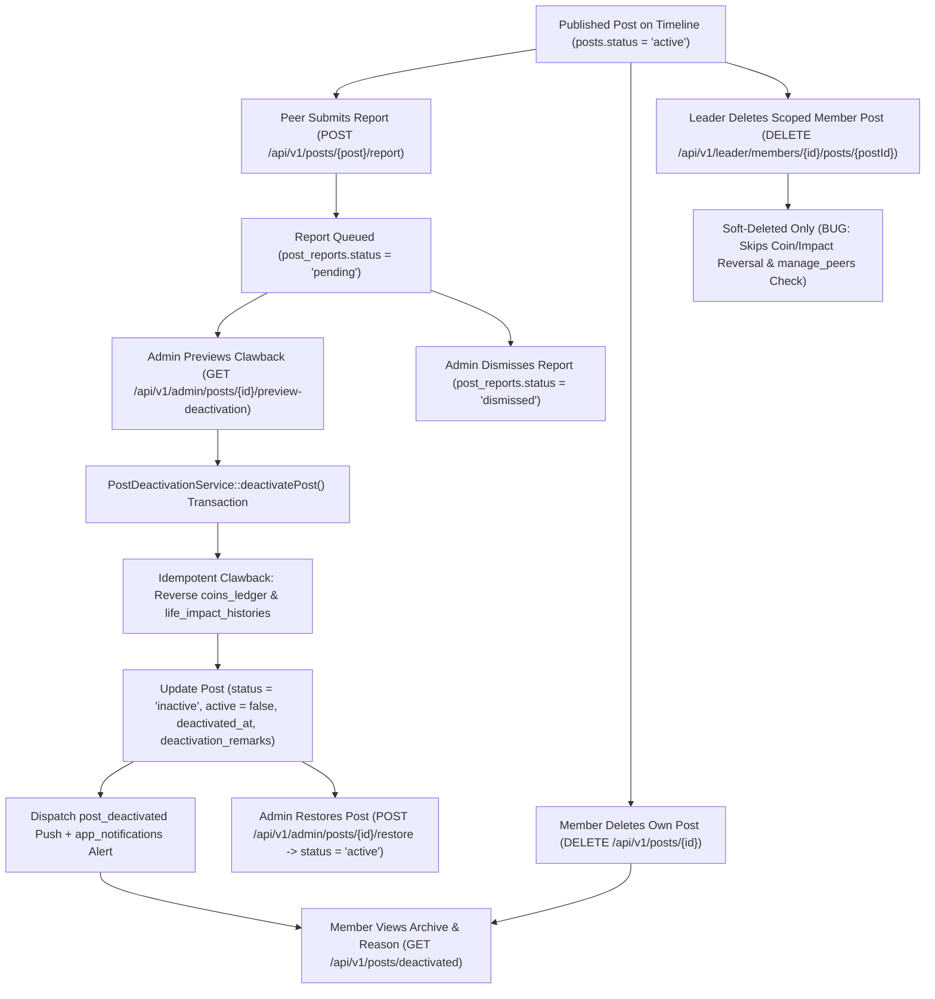

# Activity 25: Deactivated / Hidden Posts

| Attribute | Verified Audit Classification |
|---|---|
| **Workbook Activity #** | `25` |
| **Exact Workbook Name** | `Deactivated / Hidden Posts` |
| **Domain Category** | `Content & Feed` *(Sheet 3: `Content / Moderation`)* |
| **Activity Governance Tier** | `Global Administration` *(Admin Moderation + Member Self-Service Read Notice; Scoped Soft-Delete in Leader Member 360°)* |
| **Overall Implementation Status** | `Partially Implemented` *(Backend moderation + reward reversal + Admin Web + Member read-only archive work; Member self-reactivate/purge from workbook is absent, and Leader Member 360° post deletion bypasses `PostDeactivationService` reward reversal and lacks `manage_peers` check)* |
| **Master Index & Cross-Links** | [12-master-35-activities-index.md](../12-master-35-activities-index.md) · [19-activity-to-role-access-matrix.md](../19-activity-to-role-access-matrix.md) · [25-activity-workflow-reference.md](../25-activity-workflow-reference.md) · [24-timeline-posts-created.md](./24-timeline-posts-created.md) |

---

## 1. Business Purpose (§9.1)

- **WORKBOOK REQUIREMENT:** Sheet 1 & Sheet 2 define Activity 25 as allowing a member to *"Manage and restore or permanently delete previously hidden personal posts"* after selecting *"Hide / Deactivate Post"* on their own published content, viewing an archive list on `DeactivatedPostsScreen` with *"Reactivate or Permanently Delete"* actions.
- **FACT:** In the actual Laravel 12 + Flutter ecosystem, Activity 25 operates primarily as a **Platform Content Moderation & Reward-Clawback Compliance Archive**, paired with peer post reporting (`post_reports`) and member transparency:
  1. **Peer Reporting (`post_reports`):** Any authenticated Peer Member can flag inappropriate or fraudulent timeline content via `POST /api/v1/posts/{post}/report` using curated `post_report_reasons`.
  2. **Admin Deactivation & Idempotent Reward Clawback (`PostDeactivationService`):** When an Administrator deactivates a post via [PostDeactivationService.php](file:///c:/Users/malic/OneDrive/Documents/GitHub/unity-app-new/app/Services/Posts/PostDeactivationService.php#L62-L194), the service resolves the true beneficiary (including system/"Genie" recognition posts where `source_id` holds the celebrated member), idempotently reverses awarded **Coins** (`coins_ledger` + `users.coins_balance`) and **Life Impact Points** (`life_impact_histories` + `users.life_impacted_count`), records `deactivation_remarks`, `deactivated_by`, and `deactivated_at` on `posts`, and sends a `post_deactivated` push + in-app notification.
  3. **Member Deactivated Archive (`DeactivatedPostService`):** The affected Peer Member views their deactivated/hidden posts and moderation remarks in read-only mode on [deactivated_posts_screen.dart](file:///D:/office%20project/peers-unity/unity_app/lib/features/deactivated_posts/presentation/screens/deactivated_posts_screen.dart) via [DeactivatedPostService.php](file:///c:/Users/malic/OneDrive/Documents/GitHub/unity-app-new/app/Services/Posts/DeactivatedPostService.php#L25-L154). Members **cannot** unilaterally reactivate an admin-deactivated post.
  4. **Leadership App Boundary:** Circle Leaders can soft-delete a scoped member's post via `DELETE /api/v1/leader/members/{member_id}/posts/{post_id}` in [LeaderMemberController.php](file:///c:/Users/malic/OneDrive/Documents/GitHub/unity-app-new/app/Leader/Controllers/LeaderMemberController.php#L186), **however** `LeaderMember360Service::deletePost()` performs a raw soft-delete without invoking `PostDeactivationService` (leaving Coins/Life Impact unreversed) and fails to verify the `manage_peers` capability. Full moderation preview/restore belongs in Admin Web, while Leadership App only requires scoped `manage_peers`-guarded moderation visibility.

---

## 2. Sub-Activities Catalogue (§9.2)

| # | Sub-Activity / Atomic Operation | Member App (`unity_app`) | Leadership App (`LeaderApp`) | React Admin Web (`unity-admin-web`) / Blade | Laravel 12 Backend (`unity-app-new`) | Classification |
|---|---|---|---|---|---|---|
| **25.1** | **View Own Deactivated / Hidden Posts Archive** | `deactivated_posts_screen.dart` (`GET /api/v1/posts/deactivated`) | `Not Required` (consumer self-view) | N/A | `DeactivatedPostController@index` → `DeactivatedPostService::getDeactivatedPosts()` | `Fully Implemented` |
| **25.2** | **View Latest Deactivation Banner / Notice & Single Detail** | Supported in `deactivated_posts_remote_datasource.dart` | `Not Required` | N/A | `GET /api/v1/posts/deactivated-notice`, `GET /api/v1/posts/deactivated/{id}` | `Fully Implemented` |
| **25.3** | **Member Self-Delete Own Timeline Post** | Home/Profile post menu (`DELETE /api/v1/posts/{id}`) | `Not Required` | N/A | `Api\PostController@destroy` (sets `deleted_at` / `is_deleted`) | `Fully Implemented` |
| **25.4** | **Member Self-Hide & Self-Reactivate Own Post** | **NOT IMPLEMENTED** (no member reactivate button/API) | `Not Required` | N/A | **NOT IMPLEMENTED** (`restore` exists only on `/api/v1/admin/posts/{id}/restore`) | `Missing` *(Workbook vs Code Mismatch)* |
| **25.5** | **Report Another Peer's Post (`post_reports`)** | Post overflow menu (`GET /posts/report-reasons`, `POST /posts/{post}/report`) | `Missing` | `PostReportsTab.tsx` (`src/features/time/PostReportsTab.tsx`) | `PostReportReasonsController`, `PostReportController`, `Api\Admin\PostReportController` | `Fully Implemented` |
| **25.6** | **Preview & Execute Admin Deactivation with Coin + Impact Clawback** | N/A | `Not Required` (Global Admin workflow) | `DeactivatePostModal.tsx` (`src/features/posts/components/DeactivatePostModal.tsx`) + Blade `PostModerationController` | `Api\Admin\PostController@previewDeactivation`, `@deactivate` → `PostDeactivationService::deactivatePost()` | `Implemented but Incorrect` *(`/api/v1/admin/*` lacks admin role guard in `routes/api.php`)* |
| **25.7** | **Preview & Restore Deactivated Post (Re-crediting or Restoring Visibility)** | N/A | `Not Required` | `RestorePostModal.tsx` (`src/features/posts/components/RestorePostModal.tsx`) + Blade | `Api\Admin\PostController@previewRestore`, `@restore` → `PostDeactivationService` | `Implemented but Incorrect` *(`/api/v1/admin/*` auth gap)* |
| **25.8** | **Leader Member 360° Scoped Post Removal** | N/A | `peer_post_card.dart` (`DELETE /leader/members/{id}/posts/{postId}`) | `PostsPage.tsx` | `LeaderMemberController@deletePost` → `LeaderMember360Service::deletePost()` | `Implemented but Incorrect` *(Missing `manage_peers` guard; skips `PostDeactivationService` coin/impact reversal)* |
| **25.9** | **Resolve / Dismiss Peer Post Reports** | N/A | `Not Required` (Admin Triage) | `PostReportsTab.tsx` + Blade `/admin/post-reports/*` | `Api\Admin\PostReportController@resolve`, `@dismiss` | `Partially Implemented` *(Admin API unprotected by admin middleware)* |

---

## 3. Input Form & Field Validation Mapping (§9.3)

**FACT:** Activity 25 combines three input surfaces: (A) Member Deactivated Archive filter query, (B) Member Post Report submission (`POST /api/v1/posts/{post}/report`), and (C) Admin Post Deactivation / Restoration modal (`POST /api/v1/admin/posts/{id}/deactivate` & `restore`).

| Field Name | Data Type | Required/Optional | Validation | Default | Input Widget | Data Source | Visibility | Who Enters | Who Edits | Who Views | Sensitive? | Backend Request Key |
|---|---|---|---|---|---|---|---|---|---|---|---|---|
| **Post ID (Target)** | `uuid` | Required | Valid UUID existing in `posts.id` | Selected post | Context action / Route param | `posts.id` | Internal / Route | Member / Leader / Admin | Immutable | Author, Scoped Leader, Admin | No | `{post}` / `{id}` / `{post_id}` |
| **Report Reason ID** | `uuid` | Required *(on Report)* | `exists:post_report_reasons,id` (active reason) | `null` | Radio list sheet | `GET /api/v1/posts/report-reasons` (`post_report_reasons`) | Member App Report Sheet | Reporting Peer | Immutable | Admin Moderators | Yes *(Reporter identity private)* | `reason_id` |
| **Report Reason Label** | `string` | Optional | `nullable\|string\|max:255` | Derived from `reason_id` | Auto-populated / Chip | `post_report_reasons.title` | Report Sheet & Admin Queue | Reporting Peer / System | Immutable | Admin Moderators | Yes | `reason` |
| **Reporter Note** | `string` | Optional | `nullable\|string\|max:1000` | `null` | Multiline `TextField` | User input | Report Sheet & Admin Queue | Reporting Peer | Immutable | Admin Moderators | Yes *(Confidential moderation note)* | `note` |
| **Deactivation Remarks** | `string` | Required *(on Admin Deactivate)* | `required\|string\|max:1000` (`trim()`) | `""` | Textarea in `DeactivatePostModal.tsx` | Moderator input | Admin Modal, Member `DeactivatedPostsScreen`, Push Notice | Super Admin / Content Moderator | Super Admin | Post Author, Admin | No *(Shown to author)* | `remarks` / `deactivation_remarks` |
| **Reverse Awarded Coins?** | `boolean` | Optional | `boolean` | `true` | Toggle switch (`DeactivatePostModal.tsx`) | `PostDeactivationService::findAwardedCoins()` | Admin Modal only | Super Admin | Super Admin | Super Admin | No | `reverse_coins` |
| **Custom Coins Reversal Amount** | `integer` | Optional | `nullable\|integer\|min:0` | Previewed `coinsRewardData['amount']` | Numeric input override | `coins_ledger` preview | Admin Modal only | Super Admin | Super Admin | Super Admin, Target Member (ledger) | No | `custom_coins_amount` |
| **Reverse Life Impact Points?** | `boolean` | Optional | `boolean` | `true` | Toggle switch (`DeactivatePostModal.tsx`) | `PostDeactivationService::findAwardedImpactPoints()` | Admin Modal only | Super Admin | Super Admin | Super Admin | No | `reverse_impact` |
| **Custom Impact Reversal Amount** | `integer` | Optional | `nullable\|integer\|min:0` | Previewed `impactRewardData['points']` | Numeric input override | `life_impact_histories` preview | Admin Modal only | Super Admin | Super Admin | Super Admin, Target Member | No | `custom_impact_amount` |
| **Notify User?** | `boolean` | Optional | `boolean` | `true` | Checkbox / Toggle | Client toggle | Admin Modal only | Super Admin | Immutable after send | Super Admin | No | `notify_user` |
| **Report Resolution Admin Note** | `string` | Optional | `nullable\|string\|max:1000` | `null` | Textarea in `PostReportsTab.tsx` | Moderator input | Admin Report Drawer | Super Admin | Super Admin | Super Admin | Yes *(Internal audit)* | `admin_note` |
| **Archive Search Filter** | `string` | Optional | `nullable\|string` (`LIKE` on `content_text`, `title`, `deactivation_remarks`) | `null` | Search bar | Query param | Member Archive & Admin Feed | Member / Admin | N/A | Requesting User | No | `search` |
| **Pagination (`page`, `per_page`)** | `integer` | Optional | `int`, default `15` (`DeactivatedPostService`) | `1` / `15` | Infinite scroll / Paginator | Query param | Member & Admin lists | Client App | N/A | Requesting User | No | `page`, `per_page` |

---

## 4. Workflow, Lifecycle & Mermaid Diagram (§9.4)

### Workbook vs Actual PostgreSQL Lifecycle Comparison
- **WORKBOOK REQUIREMENT:** `Hidden from Public -> In Soft-Delete Archive -> Restored or Purged` (assumes a member-controlled hide/restore recycle bin).
- **FACT (Actual Database Columns & Enums):**
  - `posts.status`: `'active'` | `'inactive'` | `'rejected'` | `'hidden'`
  - `posts.moderation_status`: `'approved'` | `'pending'` | `'rejected'`
  - `posts.active`: `boolean` (`true` / `false`)
  - `posts.is_deleted`: `boolean` (`true` / `false`) + `deleted_at` (`SoftDeletes`)
  - `posts.deactivation_remarks` (`text`), `posts.deactivated_by` (`uuid`), `posts.deactivated_at` (`timestamp`)
  - `post_reports.status`: `'pending'` | `'reviewed'` | `'resolved'` | `'dismissed'`
- **Key Mismatches Identified:**
  1. `DeactivatedPostService::getDeactivatedPosts()` ([DeactivatedPostService.php](file:///c:/Users/malic/OneDrive/Documents/GitHub/unity-app-new/app/Services/Posts/DeactivatedPostService.php#L33-L48)) uses `Post::withTrashed()` matching `deactivation_remarks IS NOT NULL OR deactivated_at IS NOT NULL OR status = 'inactive' OR active = false OR is_deleted = true`. Consequently, posts soft-deleted by a member themselves (`is_deleted = true`) and posts moderated by an Admin (`status = 'inactive'`, `deactivated_at != null`) appear together in the archive, without a member self-restore endpoint.
  2. `LeaderMember360Service::deletePost()` soft-deletes a post directly instead of routing through `PostDeactivationService::deactivatePost()`, leaving Coins and Life Impact intact when a Circle Leader deletes an activity-generated post.

---

## 5. Outputs & Deliverables (§9.5)

| Deliverable / Output | Workbook Spec | Actual Codebase Reality | Verification Label |
|---|---|---|---|
| **Deactivated Posts Archive List** | Archive list on `DeactivatedPostsScreen` | Paginated cards showing post content/media, `deactivation_remarks`, and `deactivated_at` timestamp in [deactivated_posts_screen.dart](file:///D:/office%20project/peers-unity/unity_app/lib/features/deactivated_posts/presentation/screens/deactivated_posts_screen.dart) | **FACT** (`Fully Implemented` — Read-Only) |
| **Reactivate / Permanently Purge Buttons (Member)** | Member buttons to Reactivate or Purge | **Absent** from Member App and member APIs; restoration is exclusively an Admin action (`RestorePostModal.tsx`) | **NOT IMPLEMENTED** *(Intentional Moderation Guard vs Workbook)* |
| **Latest Deactivation Notice Banner** | Not in workbook | `GET /api/v1/posts/deactivated-notice` surfaces the most recent moderation takedown reason + clawback summary to the member | **FACT** |
| **Clawback Preview Card (Admin)** | Not in workbook | `DeactivatePostModal.tsx` previews exact `coins_to_reverse`, `impact_to_reverse`, `matched_tx_ids`, and `target_user` before execution | **FACT** |
| **Deactivation Push & In-App Notification** | Not specified in workbook | `PostDeactivationService::sendDeactivationNotification()` writes to `app_notifications` + `notifications` and dispatches `SendPushNotificationJob` detailing reversed Coins/Impact and remarks | **FACT** |
| **Peer Report Queue & Resolution Stats** | Not in workbook | `GET /api/v1/admin/post-reports` + `/stats` rendered in React Admin `PostReportsTab.tsx` (`pending`, `reviewed`, `resolved`, `dismissed`) | **FACT** |

---

## 6. Database & Metrics Mapping (§9.6)

### Eloquent Models & PostgreSQL Tables
1. **`App\Models\Post`** ([Post.php](file:///c:/Users/malic/OneDrive/Documents/GitHub/unity-app-new/app/Models/Post.php)) → Table `posts` (`SoftDeletes`):
   - **Key Deactivation Columns:** `id` (`uuid`), `user_id` (`uuid` FK → `users.id`), `circle_id` (`uuid`, nullable), `status` (`active`|`inactive`|`rejected`|`hidden`), `moderation_status` (`approved`|`pending`|`rejected`), `active` (`bool`), `is_deleted` (`bool`), `source_type` (e.g., `business_deal`, `p2p_meeting`, `referral`, `testimonial`, `impact`, `life_impact`), `source_id` (`uuid`), `post_type` (incl. `life_impact_recognition`, `growth_honour`, `milestone_honour`), `deactivation_remarks` (`text`), `deactivated_by` (`uuid`), `deactivated_at` (`timestamp`), `deleted_at`.
2. **`App\Models\PostReport`** (`app/Models/PostReport.php`, `SoftDeletes`) → Table `post_reports`:
   - **Columns:** `id` (`uuid`), `post_id` (`uuid` FK → `posts.id`), `reporter_user_id` (`uuid` FK → `users.id`), `reason_id` (`uuid` FK → `post_report_reasons.id`), `reason` (`string`), `note` (`text`), `status` (`pending`|`reviewed`|`resolved`|`dismissed`), `reviewed_by_admin_user_id` (`uuid`), `reviewed_at` (`timestamp`), `admin_note` (`text`), `deleted_at`.
3. **`App\Models\PostReportReason`** → Table `post_report_reasons` (`id`, `title`, `description`, `sort_order`, `is_active`).
4. **Reward Reversal Ledger Tables:**
   - `coins_ledger` + `users.coins_balance` (negative debit row inserted by `PostDeactivationService::reverseCoins()`).
   - `life_impact_histories` + `users.life_impacted_count` (reversal entry / `counted_in_total` update via `PostDeactivationService::reverseImpactPoints()`).

### Ownership, Organizational Scope & Audit Trail
- **Ownership:** `posts.user_id` owns regular posts; for automated "Genie" celebration/recognition posts, `PostDeactivationService::resolveTargetUser()` ([PostDeactivationService.php](file:///c:/Users/malic/OneDrive/Documents/GitHub/unity-app-new/app/Services/Posts/PostDeactivationService.php#L29-L57)) resolves `posts.source_id` as the true peer owner so reward clawbacks hit the celebrated peer rather than the system bot!
- **Organizational Scope:** Member API strictly scopes to `$request->user()->id` (`DeactivatedPostController`). Leader Member 360° (`LeaderMember360Service::resolveMember()`) scopes `DELETE /leader/members/{member_id}/posts/{post_id}` to `$scopedCircleIds`. Admin Web moderates globally (or circle-scoped via `AdminCircleScope` on Blade).
- **Audit History:** `posts.deactivated_by`, `deactivated_at`, `deactivation_remarks`, `post_reports.reviewed_by_admin_user_id`, `coins_ledger` reversal remarks, and `Log::info('[PostDeactivationService] Post deactivated successfully', ...)`. Note: Does not write a row to `admin_audit_logs` on API deactivation (`Requires Enhancement`).

### Sheet 3 Workbook Metric Keys vs Actual Database Mapping
| Workbook Metric Key (Sheet 1 & Sheet 3) | Actual Backend / SQL Equivalent | Status |
|---|---|---|
| `deactivatedPostsCount` | `paginator->total()` from `DeactivatedPostService::getDeactivatedPosts(['user_id' => $auth->id])` (no denormalized column on `users`) | Computed Dynamically (`FACT`) |
| `archivedPostsList` | `data` array returned by `GET /api/v1/posts/deactivated` | `Fully Implemented` |
| *(Unlisted in Workbook)* `post_reports` stats | `GET /api/v1/admin/post-reports/stats` (`pending`, `resolved`, `dismissed`, `total`) | `Fully Implemented` (Backend + Admin Web) |

---

## 7. API & Backend Service Mapping (§9.7)

| Surface | Method & Endpoint | Controller & Action | Service Layer | Auth Middleware | Scope Enforcement & Security Audit | Flutter / Web Integration |
|---|---|---|---|---|---|---|
| **Member API** | `GET /api/v1/posts/deactivated` | `Api\V1\DeactivatedPostController@index` | `DeactivatedPostService::getDeactivatedPosts()` | `auth:sanctum`, `unity.user` | Strictly forces `user_id = $request->user()->id` | Wired in `unity_app` (`ApiEndpoints.deactivatedPosts`) |
| **Member API** | `GET /api/v1/posts/deactivated-notice` | `Api\V1\DeactivatedPostController@notice` | `DeactivatedPostService::getLatestDeactivatedPostForUser()` | `auth:sanctum`, `unity.user` | Strictly scoped to authenticated user | Wired in `unity_app` |
| **Member API** | `GET /api/v1/posts/deactivated/{id}` | `Api\V1\DeactivatedPostController@show` | `DeactivatedPostService::getDeactivatedPostById()` | `auth:sanctum`, `unity.user` | Passes `$request->user()->id` to prevent cross-user IDOR | Wired in `unity_app` |
| **Member API** | `GET /api/v1/posts/report-reasons` | `Api\PostReportReasonsController@index` | Direct `PostReportReason` query | `auth:sanctum`, `unity.user` | Public lookup catalog for authenticated members | Wired in `unity_app` (`ApiEndpoints.postReportReasons`) |
| **Member API** | `POST /api/v1/posts/{post}/report` | `Api\PostReportController@store` | `PostReport` creation | `auth:sanctum`, `unity.user` | Sets `reporter_user_id = auth()->id()`; prevents self-report abuse | Wired in `unity_app` (`ApiEndpoints.postReport`) |
| **Leader API** | `DELETE /api/v1/leader/members/{member_id}/posts/{post_id}` | `LeaderMemberController@deletePost` | `LeaderMember360Service::deletePost()` | `auth:sanctum`, `leader.user` | Scoped to leader's circles via `resolveMember()`, **BUG 1:** Missing `leader.can:manage_peers` (Vice Chair/Secretary can delete!); **BUG 2:** Bypasses `PostDeactivationService` clawback | Wired in `LeaderApp` (`ApiEndpoints.memberPost`) |
| **Admin API** | `GET /api/v1/admin/posts/{id}/preview-deactivation` & `preview-restore` | `Api\Admin\PostController` | `PostDeactivationService` | `auth:sanctum`, `unity.user` *(in `routes/api.php`)* | **CRITICAL P0 BUG:** `/api/v1/admin/*` in `routes/api.php` lacks `admin.auth` / `admin.role` middleware! | Wired in `unity-admin-web` (`DeactivatePostModal.tsx`, `RestorePostModal.tsx`) |
| **Admin API** | `POST /api/v1/admin/posts/{id}/deactivate` & `POST\|PATCH .../restore` | `Api\Admin\PostController` | `PostDeactivationService::deactivatePost()` / `restorePost()` | `auth:sanctum`, `unity.user` | **CRITICAL P0 BUG:** Missing admin role middleware on `/api/v1/admin/*` | Wired in `unity-admin-web` (`postService.ts`) |
| **Admin API** | `GET /api/v1/admin/post-reports[/{id}\|/stats]`, `POST\|PATCH .../{id}/resolve\|dismiss` | `Api\Admin\PostReportController` | Direct `PostReport` moderation | `auth:sanctum`, `unity.user` | **CRITICAL P0 BUG:** Missing admin role middleware on `/api/v1/admin/*` | Wired in `unity-admin-web` (`PostReportsTab.tsx`) |
| **Admin Web** | `POST /admin/posts/{post}/deactivate\|restore`, `/admin/post-reports/*` | `Admin\PostModerationController`, `Admin\PostReportsController` | `PostDeactivationService` | `web`, `admin.auth`, `admin.permission` | Protected by stateful `admin` guard + RBAC permissions | Blade Admin Views |

### Workbook Cloud Services vs Actual Laravel 12 Services
- **WORKBOOK REQUIREMENT:** Sheet 1 & Sheet 3 name `SoftDeleteLifecycleManager` and `FeedCacheInvalidator`.
- **FACT:** Neither conceptual service exists. Actual implementation uses Laravel Eloquent `SoftDeletes` + [PostDeactivationService.php](file:///c:/Users/malic/OneDrive/Documents/GitHub/unity-app-new/app/Services/Posts/PostDeactivationService.php) + [DeactivatedPostService.php](file:///c:/Users/malic/OneDrive/Documents/GitHub/unity-app-new/app/Services/Posts/DeactivatedPostService.php), querying PostgreSQL directly without an external feed cache layer.

---

## 8. Role-Wise Access Governance (§9.8)

> **Governance Principle:** Personal hidden/deactivated post archives belong to the authoring Peer Member; global content takedown with Coin/Life Impact clawback is a `Global Administration` function in Admin Web. In the Leadership App, only roles holding `manage_peers` (`Super Admin`, `Country Director`, `DED`, `Circle Founder`, `Circle Director`) should be permitted to moderate/hide a circle peer's post within their authorized scope, and **never** inspect confidential `reporter_user_id` identities unless acting as `Super Admin` in Admin Web.

| Role (`UserRoleResolverService` / `roles.key`) | View activity | Create record *(Deactivate / Report)* | Edit own | Edit others | Submit for review *(Report Post)* | Verify | Approve | Reject *(Dismiss Report)* | Assign | Manage *(Deactivate + Clawback / Restore)* | Delete | View aggregated reports |
|---|---|---|---|---|---|---|---|---|---|---|---|---|
| **Super Admin** (`superAdmin` / `global_admin`) | Allowed (Global Admin Web + Member 360°) | Allowed (`deactivatePost`) | Allowed | Allowed (Moderation status/remarks) | Allowed | Allowed (`previewDeactivation`) | Allowed (`restore` / `resolve`) | Allowed (`dismiss` report) | DENIED — No permission under the verified backend authorization model. *(No `assigned_to` on `post_reports`)* | Allowed (Global Deactivate, Coin/Impact Clawback, Restore) | Allowed (Soft-delete any post) | Allowed (`GET /admin/post-reports/stats`) |
| **Country Director** (`countryDirector` / `eed`) | Allowed (Country Scope active posts; Admin Web if RBAC granted) | DENIED — No permission under the verified backend authorization model. *(No Leader deactivate route)* | Allowed (Own member account) | DENIED — No permission under the verified backend authorization model. | Allowed (As Peer) | DENIED — No permission under the verified backend authorization model. | DENIED — No permission under the verified backend authorization model. | DENIED — No permission under the verified backend authorization model. | DENIED — No permission under the verified backend authorization model. | DENIED — No permission under the verified backend authorization model. *(Admin Web only if granted `posts` module)* | Allowed (Scoped Member 360° `deletePost` — has `manage_peers`) | UNVERIFIED — Requires backend/business confirmation. |
| **DED** (`districtExecDirector` / `ded`) | Allowed (District Scope Member 360° posts) | DENIED — No permission under the verified backend authorization model. | Allowed (As Peer) | DENIED — No permission under the verified backend authorization model. | Allowed (As Peer) | DENIED — No permission under the verified backend authorization model. | DENIED — No permission under the verified backend authorization model. | DENIED — No permission under the verified backend authorization model. | DENIED — No permission under the verified backend authorization model. | DENIED — No permission under the verified backend authorization model. | Allowed (District-scoped Member 360° `deletePost` — has `manage_peers`) | DENIED — No permission under the verified backend authorization model. |
| **Industry Director** (`industryDirector` / `industry_director`) | Allowed (Industry Scope Member 360° active posts) | DENIED — No permission under the verified backend authorization model. | Allowed (As Peer) | DENIED — No permission under the verified backend authorization model. | Allowed (As Peer) | DENIED — No permission under the verified backend authorization model. | DENIED — No permission under the verified backend authorization model. | DENIED — No permission under the verified backend authorization model. | DENIED — No permission under the verified backend authorization model. | DENIED — No permission under the verified backend authorization model. | **Target: DENIED** *(Lacks `manage_peers` by default; **BUG:** backend `LeaderMemberController@deletePost` currently allows it!)* | DENIED — No permission under the verified backend authorization model. |
| **Circle Founder** (`circleFounder` / `circle_founder`) | Allowed (Own Circle Member 360° active posts) | DENIED — No permission under the verified backend authorization model. | Allowed (As Peer) | DENIED — No permission under the verified backend authorization model. | Allowed (As Peer) | DENIED — No permission under the verified backend authorization model. | DENIED — No permission under the verified backend authorization model. | DENIED — No permission under the verified backend authorization model. | DENIED — No permission under the verified backend authorization model. | DENIED — No permission under the verified backend authorization model. | Allowed (Own Circle Member 360° `deletePost` — has `manage_peers`) | DENIED — No permission under the verified backend authorization model. |
| **Circle Director** (`circleDirector` / `circle_director`) | Allowed (Own Circle Member 360° active posts) | DENIED — No permission under the verified backend authorization model. | Allowed (As Peer) | DENIED — No permission under the verified backend authorization model. | Allowed (As Peer) | DENIED — No permission under the verified backend authorization model. | DENIED — No permission under the verified backend authorization model. | DENIED — No permission under the verified backend authorization model. | DENIED — No permission under the verified backend authorization model. | DENIED — No permission under the verified backend authorization model. | Allowed (Own Circle Member 360° `deletePost` — has `manage_peers`) | DENIED — No permission under the verified backend authorization model. |
| **Chair / Committee Chairs** (`chairBusinessGrowth`, `chairMembership`, `chairEventsPrograms`, `circleChair`) | Allowed (Own Circle Member 360° active posts) | DENIED — No permission under the verified backend authorization model. | Allowed (As Peer) | DENIED — No permission under the verified backend authorization model. | Allowed (As Peer) | DENIED — No permission under the verified backend authorization model. | DENIED — No permission under the verified backend authorization model. | DENIED — No permission under the verified backend authorization model. | DENIED — No permission under the verified backend authorization model. | DENIED — No permission under the verified backend authorization model. | **Target: DENIED** *(Lacks `manage_peers`; **BUG:** backend `deletePost` currently lacks capability guard!)* | DENIED — No permission under the verified backend authorization model. |
| **Vice Chair** (`viceChair` / `vice_chair`) | Allowed (Own Circle Member 360° active posts) | DENIED — No permission under the verified backend authorization model. | Allowed (As Peer) | DENIED — No permission under the verified backend authorization model. | Allowed (As Peer) | DENIED — No permission under the verified backend authorization model. | DENIED — No permission under the verified backend authorization model. | DENIED — No permission under the verified backend authorization model. | DENIED — No permission under the verified backend authorization model. | DENIED — No permission under the verified backend authorization model. | **Target: DENIED** *(Lacks `manage_peers`; **BUG:** currently unguarded on backend)* | DENIED — No permission under the verified backend authorization model. |
| **Secretary** (`secretary`) | Allowed (Own Circle Member 360° active posts) | DENIED — No permission under the verified backend authorization model. | Allowed (As Peer) | DENIED — No permission under the verified backend authorization model. | Allowed (As Peer) | DENIED — No permission under the verified backend authorization model. | DENIED — No permission under the verified backend authorization model. | DENIED — No permission under the verified backend authorization model. | DENIED — No permission under the verified backend authorization model. | DENIED — No permission under the verified backend authorization model. | **Target: DENIED** *(Lacks `manage_peers`; **BUG:** currently unguarded on backend)* | DENIED — No permission under the verified backend authorization model. |
| **Committee Leader** (`committee_leader`) | DENIED in Leader App *(Broken `EnsureLeaderUser` resolution — `403`)*; Allowed as Peer on public timeline | DENIED — No permission under the verified backend authorization model. | Allowed (As Peer) | DENIED — No permission under the verified backend authorization model. | Allowed (As Peer) | DENIED — No permission under the verified backend authorization model. | DENIED — No permission under the verified backend authorization model. | DENIED — No permission under the verified backend authorization model. | DENIED — No permission under the verified backend authorization model. | DENIED — No permission under the verified backend authorization model. | DENIED — No permission under the verified backend authorization model. | DENIED — No permission under the verified backend authorization model. |
| **Peer Member** (`member`) *(incl. `Ambassador` milestone holders)* | Allowed (**Own** deactivated archive only via `GET /posts/deactivated`) | Allowed (Report peer post; Soft-delete own post) | DENIED *(Cannot edit a deactivated post)* | DENIED — No permission under the verified backend authorization model. | Allowed (`POST /posts/{post}/report`) | DENIED — No permission under the verified backend authorization model. | DENIED — No permission under the verified backend authorization model. | DENIED — No permission under the verified backend authorization model. | DENIED — No permission under the verified backend authorization model. | DENIED *(Cannot self-reactivate admin-deactivated posts)* | Allowed (`DELETE /api/v1/posts/{id}` on own post only) | DENIED — No permission under the verified backend authorization model. |

---

## 9. Existing Implementation Summary, Gaps & Minimum-Change Enhancement Recommendations

| # | Audit Dimension | Verified Assessment |
|---|---|---|
| **1** | **Member App Status (`unity_app`)** | `Fully Implemented` (Read-Only Moderation Archive + Peer Post Reporting). `DeactivatedPostsScreen` displays deactivated posts and admin remarks; peer post reporting works via `postReportReasons` and `postReport`. |
| **2** | **Leadership App Status (`LeaderApp`)** | `Partially Implemented` / `Implemented but Incorrect`. No standalone Deactivated Posts screen exists (`Not Required`), while Member 360° `peer_post_card.dart` calls `DELETE /leader/members/{id}/posts/{postId}` without capability gating or reward clawback. |
| **3** | **Admin Web & Blade Status** | `Fully Implemented` in UI (`DeactivatePostModal.tsx`, `RestorePostModal.tsx`, `PostReportsTab.tsx`, plus Blade `PostModerationController` and `PostReportsController`). |
| **4** | **Backend & Database Status** | `PostDeactivationService` (`2,548` lines) is rich and idempotent (handling Coin + Life Impact clawback and Genie celebration post resolution), backed by `posts` and `post_reports`. |
| **5** | **Workbook vs Codebase Discrepancies** | Workbook describes Activity 25 as a member-operated hide/restore/purge bin; actual production architecture uses it as an Admin moderation & reward-clawback transparency archive where members cannot self-restore moderated posts. |
| **6** | **Security, RBAC & Scope Vulnerabilities** | **1. (`P0`)** `/api/v1/admin/posts/*` and `/api/v1/admin/post-reports/*` in `routes/api.php` only check `['auth:sanctum', 'unity.user']` — any regular mobile peer token can deactivate any user's post, reverse their coins, or restore posts! **2. (`P1`)** `DELETE /api/v1/leader/members/{member_id}/posts/{post_id}` lacks `leader.can:manage_peers`, allowing Chairs/Vice Chairs/Secretaries to delete peer posts. **3. (`P1`)** Leader `deletePost` bypasses `PostDeactivationService`, leaving Coins/Life Impact unreversed. |
| **7** | **Notification & Audit Trail Gaps** | `PostDeactivationService` sends push + `app_notifications` (`post_deactivated`) and writes `Log::info`, but does not write an immutable row to `admin_audit_logs` / `activity_logs` on API deactivation/restoration. |
| **8** | **Leadership App Disposition** | **`Not Required` as a standalone screen**; **Enhance** existing Member 360° post moderation action only for `manage_peers` leaders. Do NOT build a global Post Reports queue in the mobile Leadership App (keep in React Admin Web). |
| **9** | **Minimum-Change Enhancement Plan** | 1. Protect `/api/v1/admin/posts/*` and `/api/v1/admin/post-reports/*` with `admin.auth` + `admin.permission:posts.edit` middleware (`P0`). 2. Attach `leader.can:manage_peers` middleware to `DELETE /api/v1/leader/members/{member_id}/posts/{post_id}` and route `LeaderMember360Service::deletePost()` through `PostDeactivationService::deactivatePost($post, $remarks, $leader->id)` so Coin and Life Impact reversals stay consistent. 3. Log all post deactivations/restorations to `AdminAuditService` / `ActivityLoggerService`. |
| **10** | **Open Business Decisions** | **BUSINESS DECISION REQUIRED:** (1) Should Peer Members be allowed to privately "Archive / Hide" and "Unarchive" their *own* non-moderated posts separately from Admin-moderated (`deactivated_by != user_id`) posts? (2) Should Circle Founders / Circle Directors require mandatory `remarks` when removing a circle member's post from Member 360°? |
