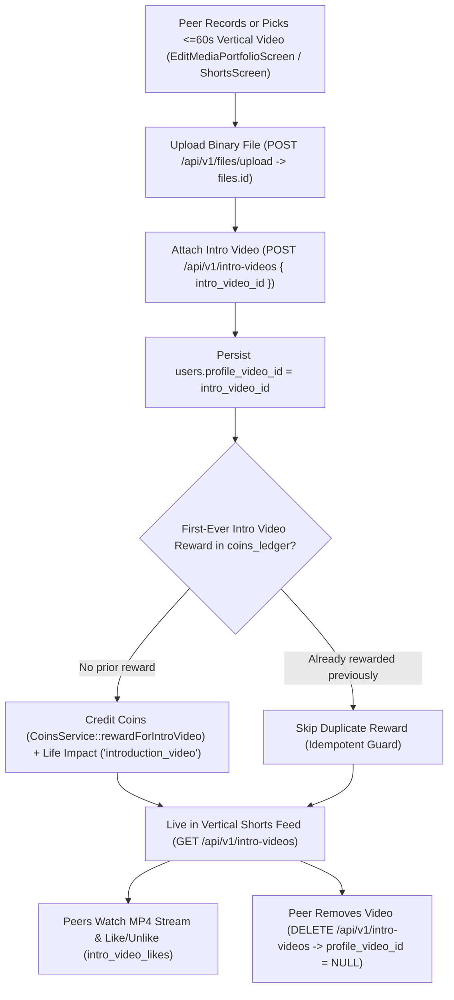

# Activity 26: User Shorts / Videos

| Attribute | Verified Audit Classification |
|---|---|
| **Workbook Activity #** | `26` |
| **Exact Workbook Name** | `User Shorts / Videos (Uploaded or Not)` |
| **Domain Category** | `Content & Feed` *(Sheet 3: `Media / Video Streaming`)* |
| **Activity Governance Tier** | `Member-Only` *(Consumer Vertical Intro-Video Reel + Member Profile Pitch; Read-Only URL Field in Leader Peer Profile)* |
| **Overall Implementation Status** | `Partially Implemented` *(Single-slot `users.profile_video_id` + vertical reel feed `ShortsScreen` + `intro_video_likes` + first-upload Coin/Impact reward work; workbook multi-short library, captions/category tags, HLS transcoding, and view-count telemetry are NOT implemented)* |
| **Master Index & Cross-Links** | [12-master-35-activities-index.md](../12-master-35-activities-index.md) · [19-activity-to-role-access-matrix.md](../19-activity-to-role-access-matrix.md) · [25-activity-workflow-reference.md](../25-activity-workflow-reference.md) · [34-profile-edit-history-and-last-updated.md](./34-profile-edit-history-and-last-updated.md) |

---

## 1. Business Purpose (§9.1)

- **WORKBOOK REQUIREMENT:** Sheet 1 & Sheet 2 state Activity 26 exists so members can *"Record and share short vertical business tips, elevator pitches, and video introductions"* via a vertical camera/gallery uploader with captions and category tags, maintaining *"Shorts Uploaded (Yes/No flag), Total Shorts count, Shorts View count"* in a full-screen vertical reel player (`ShortsScreen`).
- **FACT:** In the actual codebase, Activity 26 is implemented specifically as a **Single-Slot Member Profile Elevator-Pitch Short (`users.profile_video_id`)**, distinct from two Admin-curated platform video catalogs (`activity_videos` and `tutorials`):
  1. **Member Intro Video / Short (`users.profile_video_id` + `intro_video_likes`):** Each Peer Member can record or upload one up-to-60-second vertical profile video via [edit_media_portfolio_screen.dart](file:///D:/office%20project/peers-unity/unity_app/lib/features/profile/presentation/screens/edit_media_portfolio_screen.dart) or [shorts_screen.dart](file:///D:/office%20project/peers-unity/unity_app/lib/features/shorts/presentation/screens/shorts_screen.dart). Uploading a file (`POST /api/v1/files/upload`) and attaching its UUID via `POST /api/v1/intro-videos` ([IntroVideoController.php](file:///c:/Users/malic/OneDrive/Documents/GitHub/unity-app-new/app/Http/Controllers/Api/V1/IntroVideoController.php#L29-L85)) idempotently awards **first-upload Coins** (`CoinsService::rewardForIntroVideo`) and **Life Impact points** (`action_key = 'introduction_video'`). Peers browse all members' intro shorts in a vertical swipe feed (`GET /api/v1/intro-videos`) and like/unlike them (`intro_video_likes`).
  2. **Platform Explainer Videos (`activity_videos`) & App Tutorials (`tutorials`):** Separate Admin-managed instructional videos explaining how each networking activity works (`GET /api/v1/activities/videos` via `ActivityVideoApiController`, managed at `/admin/activities/videos`) and general tutorials (`GET /api/v1/tutorials`, managed in `TutorialsPage.tsx`). These are platform educational assets, **not** user-generated shorts.
  3. **Leadership App Boundary:** Leaders do **not** need a consumer TikTok/Reels feed in the Leadership App (`Not Required`). On a Peer Profile in the Leadership App, `PeerModel.introVideoUrl` is serialized by `LeaderPeersService`, and [edit_peer_bottom_sheet.dart](file:///D:/office%20project/LeaderApp-Fornt-end-/lib/features/peer_profile/view/widgets/edit_peer_bottom_sheet.dart#L62-L64) includes an `Intro Video URL` field — which currently fails silently because `LeaderPeersController::update()` is unrouted!

---

## 2. Sub-Activities Catalogue (§9.2)

| # | Sub-Activity / Atomic Operation | Member App (`unity_app`) | Leadership App (`LeaderApp`) | React Admin Web (`unity-admin-web`) / Blade | Laravel 12 Backend (`unity-app-new`) | Classification |
|---|---|---|---|---|---|---|
| **26.1** | **Upload & Attach Personal Profile Intro Short (with First-Upload Coin + Impact Reward)** | `edit_media_portfolio_screen.dart` & `shorts_screen.dart` (`POST /files/upload` → `POST /intro-videos`) | `Not Required` | `PeerEditorPage.tsx` (Admin profile inspect/edit) | `IntroVideoController@store` (`CoinsService::rewardForIntroVideo` + `LifeImpactService::addLifeImpact`) | `Fully Implemented` |
| **26.2** | **Fetch Own Current Intro Short Metadata** | `shorts_remote_datasource.dart` | `Not Required` | N/A | `GET /api/v1/intro-videos/me` (`IntroVideoController@show` / `@myVideo`) | `Fully Implemented` |
| **26.3** | **Browse Vertical Peer Intro Shorts Feed** | `shorts_screen.dart` (`GET /api/v1/intro-videos`) | `Not Required` (consumer discovery feed) | N/A | `IntroVideoController@index` (paginates `users` where `profile_video_id IS NOT NULL`) | `Partially Implemented` *(Does not filter out `PeerBlock` blocked users or inactive/suspended accounts!)* |
| **26.4** | **Like / Unlike / Toggle-Like a Peer's Intro Short** | `shorts_screen.dart` | `Not Required` | N/A | `POST /api/v1/intro-videos/{id}/like`, `.../unlike`, `.../toggle-like` (`intro_video_likes`) | `Fully Implemented` |
| **26.5** | **Remove Own Profile Intro Short** | `edit_media_portfolio_screen.dart` (`DELETE /api/v1/intro-videos`) | `Not Required` | Admin User Management | `IntroVideoController@destroy` (sets `users.profile_video_id = null`; does not claw back first-time upload reward) | `Fully Implemented` |
| **26.6** | **Multi-Short Library per User, Captions, Category Tags & Shorts View Counter** | **NOT IMPLEMENTED** (1 video per user on `users.profile_video_id`) | `Not Required` | **NOT IMPLEMENTED** | **NOT IMPLEMENTED** (no `user_shorts` table, no caption/tags columns, no view counter table) | `Missing` *(Workbook vs Code Mismatch)* |
| **26.7** | **View / Edit Peer Intro Video on Leader Peer Profile** | N/A | `app_video_player.dart` + `edit_peer_bottom_sheet.dart` (`_videoUrlController`) | `PeerDetailDrawer.tsx` | `LeaderPeersService::getPeer()` returns `intro_video_url`; `LeaderPeersController::update()` is **UNROUTED** | `Implemented but Not Integrated` *(Silent `catch (_) {}` in `EditPeerBottomSheet`)* |
| **26.8** | **Manage Platform Activity Explainer Videos & Tutorials *(Distinct Admin Catalog)*** | `tutorials_screen.dart` (`GET /tutorials`, `GET /activities/videos`) | `Not Required` | `TutorialsPage.tsx` + Blade `/admin/activities/videos` | `ActivityVideoController`, `TutorialController` (**P0 Bug:** `POST\|DELETE /api/v1/tutorials` unauthenticated!) | `Implemented but Incorrect` *(Public unauthenticated write/delete on `/api/v1/tutorials`)* |

---

## 3. Input Form & Field Validation Mapping (§9.3)

| Field Name | Data Type | Required/Optional | Validation | Default | Input Widget | Data Source | Visibility | Who Enters | Who Edits | Who Views | Sensitive? | Backend Request Key |
|---|---|---|---|---|---|---|---|---|---|---|---|---|
| **Video File Upload (Step 1)** | `file` (`multipart/form-data`) | Required | Video MIME (`mp4`, `mov`, `webm`), UI hint `"Max 60 seconds"` (`edit_media_portfolio_screen.dart:675`) | `null` | Camera / Gallery video picker | Device camera or gallery | Member App Media Portfolio / Shorts | Peer Member | Peer Member (replaces video) | All Authenticated Peers | No | `file` *(via `POST /api/v1/files/upload` → returns `id`)* |
| **Intro Video File ID (Step 2)** | `uuid` | Required | `required\|uuid\|exists:files,id` ([IntroVideoController.php](file:///c:/Users/malic/OneDrive/Documents/GitHub/unity-app-new/app/Http/Controllers/Api/V1/IntroVideoController.php#L31-L33)) | `null` | Hidden UUID passed after upload | `files.id` | Internal API payload | Peer Member App | Peer Member | Public / Peer Feed | No | `intro_video_id` |
| **Short Caption *(Workbook Only)*** | `string` | Optional *(Workbook)* | **NOT IMPLEMENTED** in `IntroVideoController` (uses Peer's profile bio/designation/company instead) | `null` | **Absent** | N/A | Workbook spec only | N/A | N/A | N/A | No | *None (`NOT IMPLEMENTED`)* |
| **Short Category Tags *(Workbook Only)*** | `array<string>` | Optional *(Workbook)* | **NOT IMPLEMENTED** (derived automatically from `user.level4Category` / `businessCategory`) | Peer's business category | **Absent** | `users.business_category_id` | Displayed as creator category pill | System (from profile) | Peer Member (via Business Info edit) | All Peers in Shorts Feed | No | *None (`NOT IMPLEMENTED`)* |
| **Target Video / Owner ID (Like Action)** | `uuid` | Required *(on Like)* | Route `{id}` matched against `users.id` or `users.profile_video_id` (`findTargetVideoOwner`) | Selected reel | Heart / Like button on `ShortsScreen` | `IntroVideoController@index` item | Shorts Reel UI | Any Authenticated Peer | Toggleable (`like`/`unlike`) | Aggregated `likes_count` public; `is_liked` private to viewer | No | `{id}` |
| **Feed Pagination (`page`, `per_page`, `all`)** | `int` / `bool` | Optional | `per_page` clamped `1..100` (default `10`), or `all=true` | `page=1`, `per_page=10` | Vertical page-view preload | Query string | Shorts Feed | Member App | N/A | Requesting User | No | `page`, `per_page`, `all` |
| **Leader Peer Edit `intro_video_url`** | `string` (`url`) | Optional | `nullable\|string\|max:2048` in `LeaderUpdatePeerRequest` (**UNROUTED**) | `peer.introVideoUrl` | `TextField` in `EditPeerBottomSheet` | `LeaderPeersService::getPeer()` | Leader App Edit Peer Sheet | Authorized Leader (`manage_peers`) | Authorized Leader | Leaders & Peers | No | `intro_video_url` |

---

## 4. Workflow, Lifecycle & Mermaid Diagram (§9.4)

### Workbook vs Actual PostgreSQL Lifecycle Comparison
- **WORKBOOK REQUIREMENT:** `Video Recorded -> Transcoded (HlsVideoTranscoder) -> Short Streamable -> Views Counted`.
- **FACT (Actual Database Columns & State):**
  - There is **no** transcoding state machine or `user_shorts` status enum.
  - Upload state is binary on `users.profile_video_id`: `NULL` (*Not Uploaded*) vs `<files.id UUID>` (*Uploaded & Live*).
  - First-time attachment triggers `CoinsService::rewardForIntroVideo($user)` (guarded against duplicate payouts in `coins_ledger` even if the user deletes and re-uploads a new video) and `LifeImpactService::addLifeImpact(..., 'introduction_video', ...)`.
  - Video files are served directly as MP4/MOV progressive downloads from storage (`files` table) — **no HLS adaptive bitrate transcoding** and **no view-count tracking table** exist.

---

## 5. Outputs & Deliverables (§9.5)

| Deliverable / Output | Workbook Spec | Actual Codebase Reality | Verification Label |
|---|---|---|---|
| **Full-Screen Vertical Reel Player** | `ShortsScreen` with creator profile attribution pill | Implemented in [shorts_screen.dart](file:///D:/office%20project/peers-unity/unity_app/lib/features/shorts/presentation/screens/shorts_screen.dart) displaying peer name, avatar, company, category, connection/follow state, and like button | **FACT** (`Fully Implemented`) |
| **Profile Short Preview & Upload Card** | `UserProfileMediaTab` | Implemented in [edit_media_portfolio_screen.dart](file:///D:/office%20project/peers-unity/unity_app/lib/features/profile/presentation/screens/edit_media_portfolio_screen.dart#L670-L677) (`"Profile Short — Record or upload your short video (Max 60 seconds)"`) | **FACT** (`Fully Implemented`) |
| **First-Upload Coins & Life Impact Payload** | Not in workbook | `IntroVideoController@store` returns `coins: { earned, balance_after }` and `life_impact: { earned, total, balance_after }` | **FACT** |
| **HLS Adaptive Stream (`.m3u8`)** | `HlsVideoTranscoder` & `VideoStreamingCdnWorker` | **Absent**; streams raw uploaded MP4/MOV file URL from `files` table | **NOT IMPLEMENTED** *(Workbook Conceptual AWS Spec)* |
| **Shorts View Count (`totalShortsViews`)** | Per-short & cumulative view counter | **Absent**; only `likes_count` (`intro_video_likes`) is tracked | **NOT IMPLEMENTED** |

---

## 6. Database & Metrics Mapping (§9.6)

### Eloquent Models & PostgreSQL Tables
1. **`App\Models\User`** (`users`):
   - `profile_video_id` (`uuid`, nullable FK → `files.id`) — stores the member's active intro short.
2. **`App\Models\File`** / **`App\Models\FileModel`** (`files`):
   - Stores uploaded video binary metadata (`id`, `disk`, `path`, `url`, `mime_type`, `size_bytes`, `uploaded_by`).
3. **`App\Models\IntroVideoLike`** (`app/Models/IntroVideoLike.php` → `intro_video_likes`):
   - `id` (`uuid`), `user_id` (`uuid` — liker), `video_owner_id` (`uuid` — creator), `intro_video_id` (`uuid`, nullable FK → `files.id`), `created_at`.
4. **Distinct Platform Video Tables (Admin-Managed, Non-UGC):**
   - `App\Models\ActivityVideo` → `activity_videos` (`id`, `activity_key`, `activity_name`, `video_type`, `video_url`, `file_id`, `is_active`).
   - `App\Models\Tutorial` → `tutorials` (`id`, `title`, `description`, `video_url`, `thumbnail_url`, `sort_order`, `is_active`).

### Ownership, Organizational Scope & Audit Trail
- **Ownership:** `users.id` owns `users.profile_video_id`.
- **Scope & Filtering Gaps:** `IntroVideoController@index` ([IntroVideoController.php](file:///c:/Users/malic/OneDrive/Documents/GitHub/unity-app-new/app/Http/Controllers/Api/V1/IntroVideoController.php#L130-L136)) runs `User::query()->whereNotNull('profile_video_id')->latest()` **without**:
  1. Filtering out deactivated/suspended users (`status = 'active'` / `deleted_at IS NULL`), or
  2. Filtering out mutually blocked peers (`PeerBlockService`), or
  3. Requiring authentication if `?all=true` is hit on a public route (check route group).
  Furthermore, `?all=true` loads **every video-owning user on the platform** in a single unpaginated query!

### Sheet 3 Workbook Metric Keys vs Actual Database Mapping
| Workbook Metric Key (Sheet 1 & Sheet 3) | Actual Backend / SQL Equivalent | Status |
|---|---|---|
| `hasUploadedShortsFlag` | `users.profile_video_id IS NOT NULL` (`has_intro_video` boolean in API responses) | `Fully Implemented` (`FACT`) |
| `shortsCount` | `0` or `1` per user (single `users.profile_video_id` column; platform total = `User::whereNotNull('profile_video_id')->count()`) | `Partially Implemented` *(Single-video architecture)* |
| `totalShortsViews` | **None** (`intro_video_likes` tracks likes `likes_count`, not views) | **NOT IMPLEMENTED** |

---

## 7. API & Backend Service Mapping (§9.7)

| Surface | Method & Endpoint | Controller & Action | Service Layer | Auth Middleware | Scope Enforcement & Security Audit | Flutter / Web Integration |
|---|---|---|---|---|---|---|
| **Member API** | `GET /api/v1/intro-videos` | `Api\V1\IntroVideoController@index` | Direct `User` + `IntroVideoLike` query | `auth:sanctum` (optional/auth) | **Gap:** Missing `PeerBlock` exclusion & active-user check; `?all=true` unbounded query | Wired in `unity_app` (`ApiEndpoints.introVideos`, `ShortsScreen`) |
| **Member API** | `POST /api/v1/intro-videos` | `Api\V1\IntroVideoController@store` | `CoinsService::rewardForIntroVideo`, `LifeImpactService::addLifeImpact` | `auth:sanctum`, `unity.user` | Strictly updates `$request->user()->profile_video_id` | Wired in `unity_app` |
| **Member API** | `GET /api/v1/intro-videos/me` | `Api\V1\IntroVideoController@show` | Self lookup | `auth:sanctum`, `unity.user` | Strictly self-scoped | Wired in `unity_app` |
| **Member API** | `DELETE /api/v1/intro-videos` | `Api\V1\IntroVideoController@destroy` | Clears `profile_video_id` | `auth:sanctum`, `unity.user` | Strictly self-scoped | Wired in `unity_app` |
| **Member API** | `POST /api/v1/intro-videos/{id}/like`, `.../unlike`, `.../toggle-like` | `Api\V1\IntroVideoController` | `IntroVideoLike` upsert/delete | `auth:sanctum`, `unity.user` | Authenticated user only; **Gap:** Missing `PeerBlock` check | Wired in `unity_app` (`ShortsScreen`) |
| **Leader API** | `GET /api/v1/leader/peers/{id}` & `GET /api/v1/leader/members/{member_id}` | `LeaderPeersController@show`, `LeaderMemberController@show` | `LeaderPeersService`, `LeaderMember360Service` | `auth:sanctum`, `leader.user` | `LeaderMemberController` enforces circle scope; **IDOR Bug:** `LeaderPeersController@show` has zero circle scope check! | Wired in `LeaderApp` (`PeerProfileView`) |
| **Leader API** | *(Unrouted)* `LeaderPeersController@update` | `LeaderPeersController@update` | `LeaderUpdatePeerRequest` (`intro_video_url`) | **UNROUTED** (`0` routes in `routes/leader.php`) | Unreachable (`404`/`405`), while `EditPeerBottomSheet` swallows failure via `catch (_) {}` | Broken in `LeaderApp` (`EditPeerBottomSheet`) |
| **Public / Admin Tutorials** | `GET /api/v1/activities/videos`, `GET\|POST\|DELETE /api/v1/tutorials` | `ActivityVideoApiController`, `Api\V1\TutorialController` | Direct `ActivityVideo` / `Tutorial` CRUD | `GET` public; **CRITICAL P0 BUG:** `POST` & `DELETE /api/v1/tutorials` (`routes/api.php:389-390`) have **ZERO auth middleware**! | Unauthenticated callers can create or delete platform tutorials! | Wired in `unity_app` (`TutorialsScreen`) & `unity-admin-web` (`TutorialsPage.tsx`) |

### Workbook Cloud Services vs Actual Laravel 12 Services
- **WORKBOOK REQUIREMENT:** `HlsVideoTranscoder` and `VideoStreamingCdnWorker`.
- **FACT:** Not implemented. Videos are uploaded via `FileController@upload` into Laravel storage (`files` table) and streamed directly as progressive MP4/MOV URLs (`AppVideoPlayer` / `video_player` in Flutter).

---

## 8. Role-Wise Access Governance (§9.8)

| Role (`UserRoleResolverService` / `roles.key`) | View activity | Create record *(Upload Intro Short)* | Edit own | Edit others | Submit for review | Verify | Approve | Reject | Assign | Manage *(Platform Explainer Videos / Tutorials)* | Delete | View aggregated reports |
|---|---|---|---|---|---|---|---|---|---|---|---|---|
| **Super Admin** (`superAdmin` / `global_admin`) | Allowed (All intro videos + Admin Web) | Allowed (As Member; + Platform `activity_videos` / `tutorials`) | Allowed | Allowed (Clear inappropriate `profile_video_id` via Admin User Management) | DENIED — No permission under the verified backend authorization model. *(No moderation queue)* | DENIED — No permission under the verified backend authorization model. | DENIED — No permission under the verified backend authorization model. | DENIED — No permission under the verified backend authorization model. | DENIED — No permission under the verified backend authorization model. | Allowed (`/admin/activities/videos`, `/admin/tutorials`) | Allowed (Clear peer `profile_video_id` or delete tutorials) | Allowed (Profile completion metrics in Admin Web) |
| **Country Director** (`countryDirector` / `eed`) | Allowed (View peer `intro_video_url` in Country Scope) | Allowed (In Member App) | Allowed (In Member App) | DENIED — No permission under the verified backend authorization model. *(Leader `update` unrouted)* | DENIED — No permission under the verified backend authorization model. | DENIED — No permission under the verified backend authorization model. | DENIED — No permission under the verified backend authorization model. | DENIED — No permission under the verified backend authorization model. | DENIED — No permission under the verified backend authorization model. | DENIED — No permission under the verified backend authorization model. | DENIED — No permission under the verified backend authorization model. | DENIED — No permission under the verified backend authorization model. |
| **DED** (`districtExecDirector` / `ded`) | Allowed (View peer `intro_video_url` in District Scope) | Allowed (In Member App) | Allowed (In Member App) | DENIED — No permission under the verified backend authorization model. | DENIED — No permission under the verified backend authorization model. | DENIED — No permission under the verified backend authorization model. | DENIED — No permission under the verified backend authorization model. | DENIED — No permission under the verified backend authorization model. | DENIED — No permission under the verified backend authorization model. | DENIED — No permission under the verified backend authorization model. | DENIED — No permission under the verified backend authorization model. | DENIED — No permission under the verified backend authorization model. |
| **Industry Director** (`industryDirector` / `industry_director`) | Allowed (View peer `intro_video_url` in Industry Scope) | Allowed (In Member App) | Allowed (In Member App) | DENIED — No permission under the verified backend authorization model. | DENIED — No permission under the verified backend authorization model. | DENIED — No permission under the verified backend authorization model. | DENIED — No permission under the verified backend authorization model. | DENIED — No permission under the verified backend authorization model. | DENIED — No permission under the verified backend authorization model. | DENIED — No permission under the verified backend authorization model. | DENIED — No permission under the verified backend authorization model. | DENIED — No permission under the verified backend authorization model. |
| **Circle Founder** (`circleFounder` / `circle_founder`) | Allowed (View circle peer `intro_video_url`) | Allowed (In Member App) | Allowed (In Member App) | DENIED — No permission under the verified backend authorization model. | DENIED — No permission under the verified backend authorization model. | DENIED — No permission under the verified backend authorization model. | DENIED — No permission under the verified backend authorization model. | DENIED — No permission under the verified backend authorization model. | DENIED — No permission under the verified backend authorization model. | DENIED — No permission under the verified backend authorization model. | DENIED — No permission under the verified backend authorization model. | DENIED — No permission under the verified backend authorization model. |
| **Circle Director** (`circleDirector` / `circle_director`) | Allowed (View circle peer `intro_video_url`) | Allowed (In Member App) | Allowed (In Member App) | DENIED — No permission under the verified backend authorization model. | DENIED — No permission under the verified backend authorization model. | DENIED — No permission under the verified backend authorization model. | DENIED — No permission under the verified backend authorization model. | DENIED — No permission under the verified backend authorization model. | DENIED — No permission under the verified backend authorization model. | DENIED — No permission under the verified backend authorization model. | DENIED — No permission under the verified backend authorization model. | DENIED — No permission under the verified backend authorization model. |
| **Chair / Committee Chairs** (`chairBusinessGrowth`, `chairMembership`, `chairEventsPrograms`, `circleChair`) | Allowed (View circle peer `intro_video_url`) | Allowed (In Member App) | Allowed (In Member App) | DENIED — No permission under the verified backend authorization model. | DENIED — No permission under the verified backend authorization model. | DENIED — No permission under the verified backend authorization model. | DENIED — No permission under the verified backend authorization model. | DENIED — No permission under the verified backend authorization model. | DENIED — No permission under the verified backend authorization model. | DENIED — No permission under the verified backend authorization model. | DENIED — No permission under the verified backend authorization model. | DENIED — No permission under the verified backend authorization model. |
| **Vice Chair** (`viceChair` / `vice_chair`) | Allowed (View circle peer `intro_video_url`) | Allowed (In Member App) | Allowed (In Member App) | DENIED — No permission under the verified backend authorization model. | DENIED — No permission under the verified backend authorization model. | DENIED — No permission under the verified backend authorization model. | DENIED — No permission under the verified backend authorization model. | DENIED — No permission under the verified backend authorization model. | DENIED — No permission under the verified backend authorization model. | DENIED — No permission under the verified backend authorization model. | DENIED — No permission under the verified backend authorization model. | DENIED — No permission under the verified backend authorization model. |
| **Secretary** (`secretary`) | Allowed (View circle peer `intro_video_url`) | Allowed (In Member App) | Allowed (In Member App) | DENIED — No permission under the verified backend authorization model. | DENIED — No permission under the verified backend authorization model. | DENIED — No permission under the verified backend authorization model. | DENIED — No permission under the verified backend authorization model. | DENIED — No permission under the verified backend authorization model. | DENIED — No permission under the verified backend authorization model. | DENIED — No permission under the verified backend authorization model. | DENIED — No permission under the verified backend authorization model. | DENIED — No permission under the verified backend authorization model. |
| **Committee Leader** (`committee_leader`) | Allowed in Member App; DENIED in Leader App (`403` bug) | Allowed (In Member App) | Allowed (In Member App) | DENIED — No permission under the verified backend authorization model. | DENIED — No permission under the verified backend authorization model. | DENIED — No permission under the verified backend authorization model. | DENIED — No permission under the verified backend authorization model. | DENIED — No permission under the verified backend authorization model. | DENIED — No permission under the verified backend authorization model. | DENIED — No permission under the verified backend authorization model. | DENIED — No permission under the verified backend authorization model. | DENIED — No permission under the verified backend authorization model. |
| **Peer Member** (`member`) | Allowed (`GET /api/v1/intro-videos` vertical feed) | Allowed (`POST /api/v1/intro-videos`) | Allowed (Replace own `profile_video_id`) | DENIED — No permission under the verified backend authorization model. | DENIED — No permission under the verified backend authorization model. | DENIED — No permission under the verified backend authorization model. | DENIED — No permission under the verified backend authorization model. | DENIED — No permission under the verified backend authorization model. | DENIED — No permission under the verified backend authorization model. | DENIED — No permission under the verified backend authorization model. | Allowed (`DELETE /api/v1/intro-videos` on own video) | DENIED — No permission under the verified backend authorization model. |

---

## 9. Existing Implementation Summary, Gaps & Minimum-Change Enhancement Recommendations

| # | Audit Dimension | Verified Assessment |
|---|---|---|
| **1** | **Member App Status (`unity_app`)** | `Fully Implemented` for single-slot 60-second Intro Short (`ShortsScreen` vertical player + `EditMediaPortfolioScreen` uploader + likes + Coin/Impact reward). |
| **2** | **Leadership App Status (`LeaderApp`)** | `Not Required` as a vertical Shorts feed. Read-only `AppVideoPlayer` exists for viewing a peer's pitch video on their profile; `EditPeerBottomSheet` includes an `Intro Video URL` input that silently fails (`Implemented but Not Integrated`). |
| **3** | **Admin Web & Blade Status** | Platform `TutorialsPage.tsx` and Blade `/admin/activities/videos` are implemented; member intro videos are inspectable on peer records, though there is no dedicated Intro Video Moderation tab. |
| **4** | **Backend & Database Status** | `IntroVideoController`, `users.profile_video_id`, and `intro_video_likes` work reliably with idempotent Coin/Life Impact rewards on first upload. |
| **5** | **Workbook vs Codebase Discrepancies** | Workbook envisions multi-short uploads per member with captions, category tags, view counts, and HLS transcoding; actual system stores 1 elevator-pitch video per peer (`users.profile_video_id`) streamed as MP4 with like counts only. |
| **6** | **Security, RBAC & Scope Vulnerabilities** | **1. (`P0`)** `POST /api/v1/tutorials` and `DELETE /api/v1/tutorials/{id}` (`routes/api.php:389-390`) sit outside auth middleware — unauthenticated callers can inject or delete tutorials! **2. (`P2`)** `IntroVideoController@index` and `@like` do not exclude mutually blocked peers (`PeerBlockService`) or soft-deleted/suspended accounts, and `?all=true` allows unbounded full-table hydration. |
| **7** | **Notification & Audit Trail Gaps** | Liking an intro video (`IntroVideoController@like`) inserts into `intro_video_likes` silently without dispatching a push/in-app notification to `video_owner_id`. |
| **8** | **Leadership App Disposition** | **`Not Required` for Shorts Reel / Camera Upload**. Keep read-only playback of a circle peer's `intro_video_url` inside Peer Profile 360°, and remove the broken `Intro Video URL` text input from `EditPeerBottomSheet` (members should upload their own video file via Member App). |
| **9** | **Minimum-Change Enhancement Plan** | 1. Immediately move `POST /api/v1/tutorials` and `DELETE /api/v1/tutorials/{id}` behind `['auth:sanctum', 'admin.auth', 'admin.role:global_admin']` (`P0`). 2. Filter `IntroVideoController@index` by `whereNull('deleted_at')`, active user status, and `PeerBlockService` exclusions, and remove or cap `?all=true`. 3. Remove `_videoUrlController` from `LeaderApp`'s `EditPeerBottomSheet` (since `users.profile_video_id` is a `files.id` UUID FK, not a raw external URL string). |
| **10** | **Open Business Decisions** | **BUSINESS DECISION REQUIRED:** Should Activity 26 remain a single 60-second "Profile Elevator Pitch" per member (recommended to keep networking focused), or does Product want a multi-video Reels library with captions and view-count telemetry in a future phase? |
