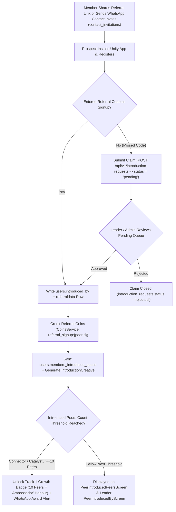

# Activity 27: Invited Friends / Introduced Peers

| Attribute | Verified Audit Classification |
|---|---|
| **Workbook Activity #** | `27` |
| **Exact Workbook Name** | `Invited Friends / Introduced Peers` |
| **Domain Category** | `Community Growth` *(Sheet 3: `Growth / Viral Loops`)* |
| **Activity Governance Tier** | `Verification & Approval` *(Member Viral Growth + Retroactive Introduction Claim Queue in Leader/Admin Pending Requests + Ambassador 10-Peer Honour)* |
| **Overall Implementation Status** | `Fully Implemented` *(End-to-end across Member App, Leader App `PeerIntroducedByScreen` + `introduction_requests` approval queue, React Admin Web Recognition & WhatsApp Invitations, and Backend `IntroducedPeerService` — with minor scope/RBAC hardening needed)* |
| **Master Index & Cross-Links** | [12-master-35-activities-index.md](../12-master-35-activities-index.md) · [19-activity-to-role-access-matrix.md](../19-activity-to-role-access-matrix.md) · [25-activity-workflow-reference.md](../25-activity-workflow-reference.md) · [16-recommend-a-peer-form.md](./16-recommend-a-peer-form.md) · [28-badges-earned.md](./28-badges-earned.md) |

---

## 1. Business Purpose (§9.1)

- **WORKBOOK REQUIREMENT:** Sheet 1 & Sheet 2 define Activity 27 as enabling members to *"Invite contacts via SMS/WhatsApp to expand the peer network and earn referral recognition"* using phonebook sync (`InviteContactsScreen`) and viewing actual registered peers introduced by the member (`PeerIntroducedPeersScreen`, `ContactInvitationsHistoryScreen`).
- **FACT:** In the production Laravel 12 codebase, Activity 27 is the core **Viral Community Growth & Member Attribution Engine**, spanning four integrated mechanisms:
  1. **Referral Code & Token Link Attribution (`referraldata` & `referral_links`):** Every member has a unique `users.referral_code` and shareable `referral_links` tokens. When a new peer registers using that code/link, `users.introduced_by` / `users.referred_by_user_id` and `referraldata` are populated, `users.members_introduced_count` increments, Coins (`referral_signup:{peerId}`) are auto-credited, and an `IntroductionCreative` poster + WhatsApp milestone celebration is generated via `IntroductionCreativeService` and `MilestoneWhatsappNotificationService`.
  2. **Phonebook Sync & WhatsApp Contact Invitations (`user_contacts` & `contact_invitations`):** Members sync device contacts (`POST /api/v1/contacts/sync`) and dispatch personalized WhatsApp invitations (`POST /api/v1/contact-invitations/send`), tracked with delivery receipts (`whatsapp_status`, `whatsapp_provider_id`).
  3. **Retroactive Introduction Claim Requests (`introduction_requests`):** If a peer registered without entering their introducer's referral code, a member can file an attribution claim (`POST /api/v1/introduction-requests`), which enters the unified **Leader & Admin Pending Requests Queue** (`category = 'introduction_requests'` in [PendingRequestAdminController.php](file:///c:/Users/malic/OneDrive/Documents/GitHub/unity-app-new/app/Http/Controllers/Api/Admin/PendingRequestAdminController.php#L817)).
  4. **Track 1 Growth Honours & The `Ambassador` 10-Peer Milestone:** Reaching **10 introduced peers** unlocks the **`Ambassador`** Growth Milestone Honour (`ContributionMilestoneResolver.php:30`, `Track1GrowthHonoursSeeder.php:39` — alongside Connector/Catalyst tiers). **Governance Fact:** `Ambassador` is strictly a 10-peer-introductions recognition honour (with a legacy typo alias `'ambassador' => 'ambassader'` in `RolePermissionMatrixController.php:76`), **NOT** a hierarchical leadership role in `UserRoleResolverService`!
  5. **Leadership App Oversight:** Leaders inspect any scoped member's introduced peers tree via [peer_introduced_by_screen.dart](file:///D:/office%20project/LeaderApp-Fornt-end-/lib/features/peer_profile/view/peer_introduced_by_screen.dart#L32-L51) (`GET /api/v1/leader/members/{member_id}/introduced-peers`), browse circle-wide introductions (`GET /api/v1/leader/activities/introduced-peers`), and approve/reject `introduction_requests` in the Pending Requests queue.

---

## 2. Sub-Activities Catalogue (§9.2)

| # | Sub-Activity / Atomic Operation | Member App (`unity_app`) | Leadership App (`LeaderApp`) | React Admin Web (`unity-admin-web`) / Blade | Laravel 12 Backend (`unity-app-new`) | Classification |
|---|---|---|---|---|---|---|
| **27.1** | **Generate & Share Personal Referral Code / Dynamic Link** | `polaroid_refer_and_earn_screen.dart` (`GET /referrals/stats`, `/referrals/validate/{code}`) | `Not Required` | N/A | `Api\V1\ReferralController` (`me`, `generate`, `links`, `stats`) → `referral_links`, `users.referral_code` | `Fully Implemented` |
| **27.2** | **Sync Phonebook Contacts & Dispatch WhatsApp Invitations** | `invite_contacts_screen.dart`, `contact_invitations_history_screen.dart` | `Not Required` (consumer phonebook action; note `GET /teams/contacts` leak bug!) | `WhatsAppContactInvitationsPage.tsx`, `ContactsPage.tsx` | `UserContactController@sync`, `ContactInvitationApiController@send`, `@history` | `Fully Implemented` |
| **27.3** | **Automatic Signup Attribution, Coin Credit & Introduction Creative** | `register_referral_section.dart` (`Referral / Invite Code`) | Reflected in Member 360° | `MemberIntroducersTab.tsx`, `CreativeStudioTab.tsx` | `IntroducedPeerService` ([IntroducedPeerService.php](file:///c:/Users/malic/OneDrive/Documents/GitHub/unity-app-new/app/Services/Users/IntroducedPeerService.php#L61-L150)), `IntroductionCreativeService`, `CoinsService` | `Fully Implemented` |
| **27.4** | **View Introduced Peers List & Top Community Builders** | `peer_introduced_peers_screen.dart`, `top_community_builders_screen.dart` | `peer_introduced_by_screen.dart` (`GET /leader/members/{id}/introduced-peers`) | `IntroducedPeersModal.tsx`, `MemberIntroducersTab.tsx`, `SponsoredMilestonesTab.tsx` | `IntroducedPeerController@index`, `ProfileController`, `LeaderMemberController@introducedPeers`, `LeaderActivitiesController` | `Fully Implemented` |
| **27.5** | **Submit Retroactive Introduction Attribution Claim** | Profile / Network introducer claim (`POST /api/v1/introduction-requests`) | `Not Required` (member-initiated) | Viewable in `PendingRequestsPage.tsx` | `IntroductionRequestsApiController@store` → `introduction_requests` | `Fully Implemented` |
| **27.6** | **Approve / Reject `introduction_requests` in Pending Queue** | N/A | Supported via `ApiEndpoints.leaderApprovePendingRequest` (`category: introduction_requests`) | `PendingRequestsPage.tsx` + Blade `/admin/pending-requests/introduction-requests` | `PendingRequestAdminController` (`introduction_requests`), `Admin\IntroductionRequestsController` | `Requires Enhancement` *(Leader route lacks `CheckLeaderCapability` — Vice Chair/Secretary can approve)* |
| **27.7** | **Unlock 10-Peer `Ambassador` Growth Milestone & Dispatch WhatsApp Honour** | `coin_milestones_screen.dart` / Profile Badges | `peer_badge_detail_screen.dart` | `MilestoneBadgesTab.tsx`, `WhatsAppAwardsPage.tsx` | `ContributionMilestoneResolver`, `UserMilestoneSyncService`, `AwardRecognitionWhatsappService` | `Fully Implemented` |

---

## 3. Input Form & Field Validation Mapping (§9.3)

| Field Name | Data Type | Required/Optional | Validation | Default | Input Widget | Data Source | Visibility | Who Enters | Who Edits | Who Views | Sensitive? | Backend Request Key |
|---|---|---|---|---|---|---|---|---|---|---|---|---|
| **Phonebook Contacts Batch (`contacts`)** | `array<object>` | Required *(on Sync)* | `required\|array`, `*.name` (`string`), `*.phone` (`string`) | Device contacts | OS Contacts Permission + Sync (`InviteContactsScreen`) | Device Address Book | Private to Uploading Member & Super Admin | Peer Member | Re-synced by Member | Owning Member *(Admin only via `UserContactsDrawer.tsx`)* | **Yes** *(Third-party PII)* | `contacts` (`POST /api/v1/contacts/sync`) |
| **Selected Invitees (`contacts` / `contact_ids`)** | `array<object>` | Required *(on Invite)* | `required\|array\|min:1`, `contact_name` (`max:150`), `contact_phone` (normalized mobile) | `[]` | Multi-select contact checkboxes (`InviteContactsScreen`) | Synced `user_contacts` or picker | Member Invite History & WhatsApp Logs | Peer Member | Immutable after dispatch | Inviting Member, Admin | **Yes** *(Phone PII)* | `contacts` (`POST /api/v1/contact-invitations/send`) |
| **Custom Invitation Message** | `string` | Optional | `nullable\|string\|max:1000` | Campaign template from `/referral/campaign-config` | Prefilled message preview | `referral_campaign_config` / WhatsApp template | Sent via WhatsApp | Peer Member / System | Admin (template) | Recipient & Admin Logs | No | `invitation_message` |
| **Signup Referral Code** | `string` | Optional *(at Signup)* | Validated via `GET /api/v1/referrals/validate/{code}` (`exists:users,referral_code`) | `null` | `TextField` (`"Referral / Invite Code (optional)"`) | Share URL / Manual entry | Registration Screen | New Registering Peer | Admin (via Introducer edit) | Introducer, Introduced Peer, Scoped Leaders, Admin | No | `referral_code` |
| **Retroactive Introducer Peer ID** | `uuid` | Required *(on Claim)* | `required\|uuid\|exists:users,id` (`!= auth()->id()`) | `null` | Peer selector | `users.id` | Introduction Claim & Pending Queue | Claiming Member | Immutable | Claiming Peer, Introducer, Scoped Leaders, Admin | No | `introducer_id` (`POST /api/v1/introduction-requests`) |
| **Claim Review Decision & Admin Note** | `string` | Optional *(on Approve/Reject)* | `admin_note` / `reason` (`nullable\|string\|max:500`) | `null` | Approve / Reject modal (`PendingRequestsPage.tsx`) | Moderator input | Pending Queue & Audit | Circle Director / Founder / DED / Super Admin | Immutable after review | Claiming Peer, Admin | No | `admin_note` / `rejection_reason` |

---

## 4. Workflow, Lifecycle & Mermaid Diagram (§9.4)

### Workbook vs Actual PostgreSQL Lifecycle Comparison
- **WORKBOOK REQUIREMENT:** `Invite Link Dispatched -> App Installed -> Referral Code Attributed`.
- **FACT (Actual Multi-Table Status Columns):**
  - `referral_links.status`: `'active'` | `'revoked'` | `'expired'`
  - `contact_invitations.status` & `whatsapp_status`: `'pending'` | `'sent'` | `'delivered'` | `'read'` | `'failed'`
  - `referraldata.reward_status`: tracks coin payout completion (`used_at` timestamp)
  - `introduction_requests.status`: `'pending'` | `'approved'` | `'rejected'`
  - **Cross-Table Union Nuance:** `IntroducedPeerService::getIntroducedPeers()` ([IntroducedPeerService.php](file:///c:/Users/malic/OneDrive/Documents/GitHub/unity-app-new/app/Services/Users/IntroducedPeerService.php#L63-L88)) unions **four** attribution sources: `users.introduced_by = $id`, `users.referred_by_user_id = $id`, `referraldata.referrer_user_id = $id`, AND `users.phone IN (SELECT peer_mobile FROM peer_recommendations WHERE user_id = $id)`!

---

## 5. Outputs & Deliverables (§9.5)

| Deliverable / Output | Workbook Spec | Actual Codebase Reality | Verification Label |
|---|---|---|---|
| **Introduced Peers Directory List** | `PeerIntroducedPeersScreen` with profile links & join dates | Implemented in Member App (`peer_introduced_peers_screen.dart`), Leader App ([peer_introduced_by_screen.dart](file:///D:/office%20project/LeaderApp-Fornt-end-/lib/features/peer_profile/view/peer_introduced_by_screen.dart)), and Admin Web (`IntroducedPeersModal.tsx`), sorted by sub-introductions `introduced_count DESC` | **FACT** (`Fully Implemented`) |
| **Contact Invitations History & Stats** | `ContactInvitationsHistoryScreen` | Implemented in `contact_invitations_history_screen.dart` backed by `GET /api/v1/contact-invitations/history` & `/referrals/invitation-stats` | **FACT** (`Fully Implemented`) |
| **Polaroid "Refer & Earn" Share Card** | Not explicitly named in workbook | `polaroid_refer_and_earn_screen.dart` + `IntroductionCreativeService` (`introduction_creatives`) generates branded peer-introduction posters | **FACT** |
| **WhatsApp Milestone Recognition (Connector / Catalyst / Ambassador)** | Not in workbook | `MilestoneConnectorWhatsappService`, `MilestoneCatalystWhatsappService`, and `AwardRecognitionWhatsappService` dispatch automated WhatsApp honour cards (`member_award_sends`) | **FACT** |

---

## 6. Database & Metrics Mapping (§9.6)

### Eloquent Models & PostgreSQL Tables
1. **`App\Models\User`** (`users`): `introduced_by` (`uuid`), `referred_by_user_id` (`uuid`), `referral_code` (`string`), `members_introduced_count` (`int`), `is_sponsored_member` (`bool`), `contribution_award_name` (`string`), `contribution_award_recognition` (`string`).
2. **`App\Models\ReferralData`** (`referraldata`): `id`, `referrer_user_id`, `referred_user_id`, `referral_code`, `referrer_email`, `coins`, `reward_status`, `used_at`.
3. **`App\Models\ReferralLink`** (`referral_links`): `id`, `referrer_user_id`, `token`, `status` (`active`|`revoked`|`expired`), `stats` (`json`), `expires_at`.
4. **`App\Models\IntroductionRequest`** (`introduction_requests`): `id` (`uuid`), `requester_id`, `introducer_id`, `status` (`pending`|`approved`|`rejected`), `admin_note`, `reviewed_by`, `requested_at`, `reviewed_at`.
5. **`App\Models\ContactInvitation`** (`contact_invitations`) & **`App\Models\UserContact`** (`user_contacts`): Stores phonebook contacts and WhatsApp invite dispatches (`contact_name`, `contact_phone`, `mobile_normalized`, `status`, `whatsapp_status`, `whatsapp_sent_at`, `whatsapp_provider_id`).
6. **`App\Models\IntroductionCreative`** (`introduction_creatives`): Generated welcome/introduction graphics.

### Sheet 3 Workbook Metric Keys vs Actual Database Mapping
| Workbook Metric Key (Sheet 1 & Sheet 3) | Actual Backend / SQL Equivalent | Status |
|---|---|---|
| `invitedContactsCount` | `ContactInvitation::where('user_id', $id)->count()` (`GET /api/v1/referrals/invitation-stats`) | `Fully Implemented` (`FACT`) |
| `joinedFriendsCount` | `users.members_introduced_count` & `IntroducedPeerService::getIntroducedPeers($user)->count()` | `Fully Implemented` (`FACT`) |
| `referralCodeClicks` | `referral_links.stats` JSON (`clicks` / `registrations`) | `Partially Implemented` (`FACT`) |

---

## 7. API & Backend Service Mapping (§9.7)

| Surface | Method & Endpoint | Controller & Action | Service Layer | Auth Middleware | Scope Enforcement & Security Audit | Flutter / Web Integration |
|---|---|---|---|---|---|---|
| **Member API** | `GET /api/v1/introduced-peers`, `GET /api/v1/members/{member_id}/introduced-peers`, `GET\|POST /api/v1/profile/introduced-peers` | `IntroducedPeerController@index`, `ProfileController` | `IntroducedPeerService` | `auth:sanctum`, `unity.user` | Authenticated peer lookup; respects active/non-deleted users | Wired in `unity_app` (`ApiEndpoints.memberIntroducedPeers`) |
| **Member API** | `POST /api/v1/introduction-requests` | `IntroductionRequestsApiController@store` | Direct `IntroductionRequest` creation | `auth:sanctum`, `unity.user` | Self-claim prevention enforced | Wired in `unity_app` |
| **Member API** | `GET /api/v1/referrals/{me\|members\|stats\|links\|visitors}`, `POST /api/v1/referrals/{generate\|links}` | `Api\V1\ReferralController` | Referral code & link service | `auth:sanctum`, `unity.user` | Scoped to `$request->user()->id` | Wired in `unity_app` |
| **Member API** | `POST /api/v1/contacts/sync`, `POST /api/v1/contact-invitations/send`, `GET /api/v1/contact-invitations/history` | `UserContactController`, `ContactInvitationApiController` | WhatsApp invitation dispatcher | `auth:sanctum`, `unity.user` | Strictly scoped to `$request->user()->id` | Wired in `unity_app` (`InviteContactsScreen`) |
| **Leader API** | `GET /api/v1/leader/members/{member_id}/introduced-peers` (& `/api/v1/members/{member_id}/introduced-peers`) | `LeaderMemberController@introducedPeers` | `LeaderMember360Service` | `auth:sanctum`, `leader.user` | Enforces `$scopedCircleIds` via `resolveMember()` | Wired in `LeaderApp` (`PeerIntroducedByScreen`) |
| **Leader API** | `GET /api/v1/leader/activities/introduced-peers` | `LeaderActivitiesController@activitiesByType` | `LeaderActivitiesService` | `auth:sanctum`, `leader.user` | Scoped via `resolveActivityScope()`; **Bug:** `?circle_id=<uuid>` IDOR on `LeaderActivitiesService` | Available to `LeaderActivitiesView` |
| **Leader / Admin Queue** | `GET /api/v1/leader/pending-requests?category=introduction_requests`, `POST .../introduction_requests/{id}/approve\|reject` | `PendingRequestAdminController` | Attribution + `IntroducedPeerService` | `auth:sanctum`, `leader.user` | Scoped to leader's circles, **Bug:** Missing `CheckLeaderCapability` (Vice Chair/Secretary can approve!) | Supported in `LeaderApp` & `unity-admin-web` |
| **Leader API *(Related Leak)*** | `GET /api/v1/leader/teams/contacts` (`/leader/contacts`) | `LeaderTeamsController@contacts` | `LeaderTeamsService::getUserContacts()` | `auth:sanctum`, `leader.user` | **CRITICAL PRIVACY LEAK (`LeaderTeamsService.php:1942-1947`):** When leader has `0` rows in `contact_posts`, drops `WHERE user_id = ...` and leaks up to 500 global contacts! | Wired in `LeaderApp` (`ApiEndpoints.leaderContacts`) |
| **Admin API & Web** | `/api/v1/admin/contact-invitations/*`, `/api/v1/admin/sponsored-members/milestones`, `/admin/member-introducers/*` | `Admin\ContactInvitationController`, `SponsoredMembersMilestonesController`, `MemberIntroducersController` | Admin analytics & recognition | `admin.auth` on Web; **P0 Bug:** `/api/v1/admin/*` missing admin guard | Fix `/api/v1/admin/*` middleware | Wired in `unity-admin-web` (`RecognitionPage.tsx`, `WhatsAppContactInvitationsPage.tsx`) |

### Workbook Cloud Services vs Actual Laravel 12 Services
- **WORKBOOK REQUIREMENT:** `DynamicLinkResolver` and `ReferralAttributionEngine`.
- **FACT:** Implemented natively in Laravel via `ReferralLink` token resolution, `ProfileController::ensureReferralCoinsCredited()`, and [IntroducedPeerService.php](file:///c:/Users/malic/OneDrive/Documents/GitHub/unity-app-new/app/Services/Users/IntroducedPeerService.php) (no Firebase Dynamic Links dependency; Firebase is used strictly for FCM push + Google Sign-In).

---

## 8. Role-Wise Access Governance (§9.8)

| Role (`UserRoleResolverService` / `roles.key`) | View activity *(Introduced Peers)* | Create record *(Invite / Claim)* | Edit own | Edit others *(Reassign Introducer)* | Submit for review *(Intro Claim)* | Verify | Approve *(`introduction_requests`)* | Reject *(`introduction_requests`)* | Assign | Manage *(Campaigns & Honours)* | Delete | View aggregated reports |
|---|---|---|---|---|---|---|---|---|---|---|---|---|
| **Super Admin** (`superAdmin` / `global_admin`) | Allowed (Global + Contact Invites) | Allowed | Allowed | Allowed (`IntroducedMembersEditTab.tsx` in Admin Web) | Allowed | Allowed | Allowed (Global) | Allowed (Global) | DENIED — No permission under the verified backend authorization model. | Allowed (Referral config, Milestone Honours, WhatsApp Bulk) | Allowed (Admin Web) | Allowed (`MemberIntroducersTab.tsx`, `SponsoredMilestonesTab.tsx`) |
| **Country Director** (`countryDirector` / `eed`) | Allowed (Country Scope introduced peers; **NOT** private `user_contacts` phonebooks) | Allowed (As Peer) | Allowed (As Peer) | DENIED — No permission under the verified backend authorization model. | Allowed (As Peer) | Allowed (Country Scope) | Allowed (Country Scope `introduction_requests`) | Allowed (Country Scope) | DENIED — No permission under the verified backend authorization model. | DENIED — No permission under the verified backend authorization model. | DENIED — No permission under the verified backend authorization model. | Allowed (Country Scope) |
| **DED** (`districtExecDirector` / `ded`) | Allowed (District Scope introduced peers) | Allowed (As Peer) | Allowed (As Peer) | DENIED — No permission under the verified backend authorization model. | Allowed (As Peer) | Allowed (District Scope) | Allowed (District Scope `introduction_requests`) | Allowed (District Scope) | DENIED — No permission under the verified backend authorization model. | DENIED — No permission under the verified backend authorization model. | DENIED — No permission under the verified backend authorization model. | Allowed (District Scope) |
| **Industry Director** (`industryDirector` / `industry_director`) | Allowed (Industry Scope introduced peers) | Allowed (As Peer) | Allowed (As Peer) | DENIED — No permission under the verified backend authorization model. | Allowed (As Peer) | Allowed (Industry Scope) | Allowed (Industry Scope `introduction_requests`) | Allowed (Industry Scope) | DENIED — No permission under the verified backend authorization model. | DENIED — No permission under the verified backend authorization model. | DENIED — No permission under the verified backend authorization model. | Allowed (Industry Scope) |
| **Circle Founder** (`circleFounder` / `circle_founder`) | Allowed (Own Circle `PeerIntroducedByScreen`) | Allowed (As Peer) | Allowed (As Peer) | DENIED — No permission under the verified backend authorization model. | Allowed (As Peer) | Allowed (Own Circle) | Allowed (Own Circle `introduction_requests`) | Allowed (Own Circle) | DENIED — No permission under the verified backend authorization model. | DENIED — No permission under the verified backend authorization model. | DENIED — No permission under the verified backend authorization model. | Allowed (Own Circle) |
| **Circle Director** (`circleDirector` / `circle_director`) | Allowed (Own Circle `PeerIntroducedByScreen`) | Allowed (As Peer) | Allowed (As Peer) | DENIED — No permission under the verified backend authorization model. | Allowed (As Peer) | Allowed (Own Circle) | Allowed (Own Circle `introduction_requests`) | Allowed (Own Circle) | DENIED — No permission under the verified backend authorization model. | DENIED — No permission under the verified backend authorization model. | DENIED — No permission under the verified backend authorization model. | Allowed (Own Circle) |
| **Chair / Committee Chairs** *(esp. `chairMembership`)* | Allowed (Own Circle `PeerIntroducedByScreen`) | Allowed (As Peer) | Allowed (As Peer) | DENIED — No permission under the verified backend authorization model. | Allowed (As Peer) | Allowed (Membership Growth Chair review) | **UNVERIFIED — Requires backend/business confirmation.** *(Currently allowed on backend without capability gate; confirm if `chairMembership` can approve `introduction_requests`)* | **UNVERIFIED — Requires backend/business confirmation.** | DENIED — No permission under the verified backend authorization model. | DENIED — No permission under the verified backend authorization model. | DENIED — No permission under the verified backend authorization model. | Allowed (Own Circle) |
| **Vice Chair** (`viceChair` / `vice_chair`) | Allowed (Own Circle `PeerIntroducedByScreen`) | Allowed (As Peer) | Allowed (As Peer) | DENIED — No permission under the verified backend authorization model. | Allowed (As Peer) | DENIED — No permission under the verified backend authorization model. | **Target: DENIED** *(Currently unguarded in `PendingRequestAdminController`)* | **Target: DENIED** | DENIED — No permission under the verified backend authorization model. | DENIED — No permission under the verified backend authorization model. | DENIED — No permission under the verified backend authorization model. | Allowed (Own Circle) |
| **Secretary** (`secretary`) | Allowed (Own Circle `PeerIntroducedByScreen`) | Allowed (As Peer) | Allowed (As Peer) | DENIED — No permission under the verified backend authorization model. | Allowed (As Peer) | DENIED — No permission under the verified backend authorization model. | **Target: DENIED** *(Currently unguarded in `PendingRequestAdminController`)* | **Target: DENIED** | DENIED — No permission under the verified backend authorization model. | DENIED — No permission under the verified backend authorization model. | DENIED — No permission under the verified backend authorization model. | Allowed (Own Circle) |
| **Committee Leader** (`committee_leader`) | Allowed in Member App; DENIED in Leader App (`403` bug) | Allowed (As Peer) | Allowed (As Peer) | DENIED — No permission under the verified backend authorization model. | Allowed (As Peer) | DENIED — No permission under the verified backend authorization model. | DENIED — No permission under the verified backend authorization model. | DENIED — No permission under the verified backend authorization model. | DENIED — No permission under the verified backend authorization model. | DENIED — No permission under the verified backend authorization model. | DENIED — No permission under the verified backend authorization model. | DENIED — No permission under the verified backend authorization model. |
| **Peer Member** (`member`) *(incl. `Ambassador` 10-Peer Milestone Holders)* | Allowed (Own + Public peer's introduced peers; Own `contact_invitations` history) | Allowed (Invite contacts, share referral code, submit `introduction_requests`) | DENIED *(Immutable once sent)* | DENIED — No permission under the verified backend authorization model. | Allowed (`POST /api/v1/introduction-requests`) | DENIED — No permission under the verified backend authorization model. | DENIED — No permission under the verified backend authorization model. | DENIED — No permission under the verified backend authorization model. | DENIED — No permission under the verified backend authorization model. | DENIED — No permission under the verified backend authorization model. *(Note: `Ambassador` badge grants recognition, NOT Leader App RBAC permissions)* | DENIED — No permission under the verified backend authorization model. | DENIED — No permission under the verified backend authorization model. |

---

## 9. Existing Implementation Summary, Gaps & Minimum-Change Enhancement Recommendations

| # | Audit Dimension | Verified Assessment |
|---|---|---|
| **1** | **Member App Status (`unity_app`)** | `Fully Implemented` across `InviteContactsScreen`, `ContactInvitationsHistoryScreen`, `PeerIntroducedPeersScreen`, `PolaroidReferAndEarnScreen`, and `TopCommunityBuildersScreen`. |
| **2** | **Leadership App Status (`LeaderApp`)** | `Fully Implemented` for viewing a peer's introduced members (`PeerIntroducedByScreen`), plus backend support for `introduction_requests` in Pending Requests (UI Action Center card wiring needed so leaders can approve/reject claims directly in-app). |
| **3** | **Admin Web & Blade Status** | `Fully Implemented` (`RecognitionPage.tsx` → `MemberIntroducersTab.tsx`, `IntroducedPeersModal.tsx`, `SponsoredMilestonesTab.tsx`, `IntroducedMembersEditTab.tsx`, and `WhatsAppContactInvitationsPage.tsx`). |
| **4** | **Backend & Database Status** | `IntroducedPeerService`, `referraldata`, `referral_links`, `introduction_requests`, `contact_invitations`, and `ContributionMilestoneResolver` (10-peer `Ambassador` milestone) are mature and production-verified. |
| **5** | **Workbook vs Codebase Discrepancies** | Actual backend is substantially richer than the workbook: adds retroactive `introduction_requests` moderation, `IntroductionCreative` poster generation, 4-source SQL attribution union, and the 10-peer `Ambassador` Growth Milestone Honour. |
| **6** | **Security, RBAC & Scope Vulnerabilities** | **1. (`P0` Data Leak)** `LeaderTeamsService::getUserContacts()` ([LeaderTeamsService.php](file:///c:/Users/malic/OneDrive/Documents/GitHub/unity-app-new/app/Leader/Services/LeaderTeamsService.php#L1942-L1947)) drops `WHERE user_id = $user->id` whenever a leader has `0` rows, leaking up to 500 other users' uploaded contacts! **2. (`P1`)** `PendingRequestAdminController` allows Vice Chair / Secretary to approve/reject `introduction_requests` without capability checks. **3. (`P2`)** Typo `'ambassador' => 'ambassader'` hardcoded in `RolePermissionMatrixController.php:76`. |
| **7** | **Notification & Audit Trail Gaps** | Referral signups and milestone unlocks trigger Coins, Push, and WhatsApp honour alerts; `introduction_requests` approvals broadcast `PendingRequestChangedEvent`, but should also write to `activity_logs` when `users.introduced_by` is mutated retroactively. |
| **8** | **Leadership App Disposition** | **Keep & Enhance**: Retain `PeerIntroducedByScreen` (scoped to leader's circles) and surface `introduction_requests` inside the Leadership App Action Center / Pending Approvals tab for Circle Directors, Circle Founders, DEDs, Country Directors, and Super Admin. Never expose raw member phonebook `user_contacts` in the Leadership App. |
| **9** | **Minimum-Change Enhancement Plan** | 1. Fix `LeaderTeamsService::getUserContacts()` immediately so `0` rows returns an empty array `[]` instead of dumping global contacts (`P0`). 2. Gate `POST /leader/pending-requests/introduction_requests/{id}/approve|reject` behind `can_review_pending_peers` (`CF`, `CD`, `ID`, `DED`, `Country Director`, `Super Admin`). 3. Clean up the `'ambassader'` / `'ambessader'` typo alias while preserving `Ambassador` strictly as a Track 1 Growth Milestone Honour. |
| **10** | **Open Business Decisions** | **BUSINESS DECISION REQUIRED:** Should `Chair - Membership Growth Committee` (`chairMembership`) be granted approval authority over `introduction_requests` and `circle_peer_referrals` within their circle, or should approval remain restricted to `Circle Director` / `Circle Founder` and above? |
