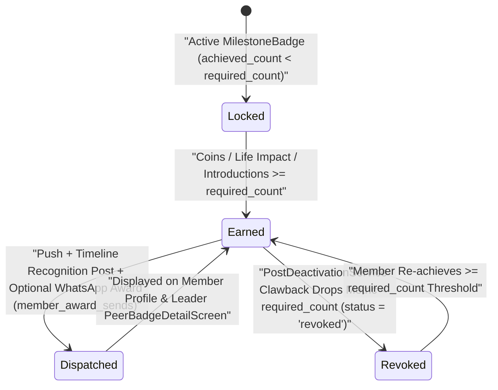

# Activity 28: Badges Earned

| Attribute | Verified Audit Classification |
|---|---|
| **Workbook Activity #** | `28` |
| **Exact Workbook Name** | `Badges Earned` |
| **Domain Category** | `Gamification & Rewards` *(Sheet 3: `Gamification / Badges`)* |
| **Activity Governance Tier** | `Leadership Oversight` *(Automated Member Milestone Engine + Read-Only Recognition Showcase in Leadership App + Global Catalog CRUD in Admin Web)* |
| **Overall Implementation Status** | `Fully Implemented` *(Works end-to-end across `milestone_badges`, `user_milestone_badges`, `PeerBadgeService`, Member App `CoinMilestonesScreen` / Profile Badges, Leader App `PeerBadgeDetailScreen`, and React Admin Web `MilestoneBadgesTab.tsx` + WhatsApp Award Dispatch)* |
| **Master Index & Cross-Links** | [12-master-35-activities-index.md](../12-master-35-activities-index.md) · [19-activity-to-role-access-matrix.md](../19-activity-to-role-access-matrix.md) · [25-activity-workflow-reference.md](../25-activity-workflow-reference.md) · [22-impact-activity-and-life-impact-score.md](./22-impact-activity-and-life-impact-score.md) · [23-coins-activity-wallet-and-history.md](./23-coins-activity-wallet-and-history.md) · [27-invited-friends-introduced-peers.md](./27-invited-friends-introduced-peers.md) |

---

## 1. Business Purpose (§9.1)

- **WORKBOOK REQUIREMENT:** Sheet 1 & Sheet 2 define Activity 28 as showcasing *"peer accomplishments, giving milestones, and verified credentials on member profile"*, awarded automatically by the backend upon hitting milestones, displaying `badgesCount` and `Unlocked vs Locked badges` in a high-res showcase (`ProfileBadgesTab`, `LeaderboardScreen`, `BadgeDetailDialog`).
- **FACT:** In the Laravel 12 + Flutter architecture, Activity 28 is powered by a **3-Track Automated Milestone Badge & Honour Engine** (`MilestoneBadgeService` + `PeerBadgeService` + `AwardRecognitionWhatsappService`):
  1. **Three Official Badge Tracks (`milestone_badges.type`):**
     - `member_introduction` (*Track 1 Growth Honours* — e.g., Connector, Catalyst, **Ambassador** at 10 introduced peers),
     - `life_impact` (*Life Impact Honours* — unlocked by `users.life_impacted_count` thresholds), and
     - `coins` (*Coin Medal Ranks* — unlocked by `users.coins_balance` / lifetime earned coins, mirrored onto `users.coin_medal_rank` & `users.coin_milestone_title`).
  2. **Just-in-Time Recalculation & Revocation:** `PeerBadgeService::getPeerBadges()` ([PeerBadgeService.php](file:///c:/Users/malic/OneDrive/Documents/GitHub/unity-app-new/app/Services/Peers/PeerBadgeService.php#L61-L68)) invokes `MilestoneBadgeService::calculateForUser($peer)` on read, guaranteeing earned badges (`user_milestone_badges.status = 'earned'`) and revoked badges (`status = 'revoked'` when `PostDeactivationService` claws back Coins or Life Impact below `required_count`!) stay synchronized.
  3. **Leadership App Recognition Oversight:** Circle and Regional Leaders inspect any scoped member's earned badges on their Member 360° profile (`GET /api/v1/leader/members/{member_id}/badges`) and open the full-screen showcase in [peer_badge_detail_screen.dart](file:///D:/office%20project/LeaderApp-Fornt-end-/lib/features/peer_profile/view/peer_badge_detail_screen.dart#L1-L250), viewing badge artwork, track pill, description, milestone progress (`achievedCount / requiredCount`), and earned date.
  4. **Global Administration (`unity-admin-web`):** Super Admin manages badge definitions (`MilestoneBadgesTab.tsx`, `AddEditBadgeModal.tsx`), generates Canva-style recognition posters (`CreativeStudioModal.tsx`), and dispatches WhatsApp award recognition messages (`WhatsAppAwardsPage.tsx` → `member_award_sends`).

---

## 2. Sub-Activities Catalogue (§9.2)

| # | Sub-Activity / Atomic Operation | Member App (`unity_app`) | Leadership App (`LeaderApp`) | React Admin Web (`unity-admin-web`) / Blade | Laravel 12 Backend (`unity-app-new`) | Classification |
|---|---|---|---|---|---|---|
| **28.1** | **Automatic Milestone Evaluation & Badge Unlocking / Revocation** | Triggered automatically on Coins, Life Impact, & Peer Introductions | Triggered on read via Member 360° | Triggered on manual Coin/Impact awards | `MilestoneBadgeService::calculateForUser()` → `user_milestone_badges` (`earned` / `revoked`) | `Fully Implemented` |
| **28.2** | **View Peer's Earned, Locked & All Badges (`?status=earned\|locked\|all`)** | `profile_screen.dart`, `peer_profile_screen.dart`, `coin_milestones_screen.dart` | `peer_profile_view.dart` → `peer_badge_detail_screen.dart` (`GET /leader/members/{id}/badges`) | `PeerDetailDrawer.tsx`, `RecognitionPage.tsx` | `PeerBadgeController@index` → `PeerBadgeService::getPeerBadges()`, `LeaderMemberController@badges` | `Fully Implemented` |
| **28.3** | **View Coin Milestone Progression & History** | `coin_milestones_screen.dart` (`GET /milestones`, `/milestones/latest`, `/milestones/history`) | `peer_coins_screen.dart` / `profile_milestones_card.dart` | `CoinsPage.tsx` | `CoinMilestoneController` (`users.coin_medal_rank`, `coin_milestone_title`) | `Fully Implemented` |
| **28.4** | **Create, Edit & Toggle Milestone Badge Definitions (Global Catalog)** | N/A | `Not Required` (Global Admin config) | `MilestoneBadgesTab.tsx`, `AddEditBadgeModal.tsx` + Blade `/admin/milestone-badges/*` | `Admin\MilestoneBadgeController` (`index`, `store`, `update`, `toggleStatus`, `destroy`) | `Fully Implemented` |
| **28.5** | **Dispatch WhatsApp Award Recognition & Canva Poster (`member_award_sends`)** | Received on Member's WhatsApp + Timeline | `Not Required` (Admin Recognition Studio) | `WhatsAppAwardsPage.tsx`, `CreativeStudioTab.tsx` | `AwardRecognitionAdminController` → `AwardRecognitionWhatsappService` → `member_award_sends` | `Implemented but Incorrect` *(`/api/v1/admin/whatsapp/awards/*` lacks admin role guard in `routes/api.php`)* |

---

## 3. Input Form & Field Validation Mapping (§9.3)

**FACT:** Members and Leaders do not fill out a form to earn badges (badges are system-awarded). Below are (A) the Query Filter Parameters exposed on `GET /api/v1/peers/{peerId}/badges` ([PeerBadgeService.php](file:///c:/Users/malic/OneDrive/Documents/GitHub/unity-app-new/app/Services/Peers/PeerBadgeService.php#L70-L122)) and (B) the Admin Badge Definition Form (`MilestoneBadgeController` / `AddEditBadgeModal.tsx`).

| Field Name | Data Type | Required/Optional | Validation | Default | Input Widget | Data Source | Visibility | Who Enters | Who Edits | Who Views | Sensitive? | Backend Request Key |
|---|---|---|---|---|---|---|---|---|---|---|---|---|
| **Target Peer ID** | `uuid` | Required | Valid UUID in `users.id` (`deleted_at IS NULL`) | Viewed profile | Route parameter | `users.id` | Member & Leader Profile | Client App | N/A | Peers (if unblocked & visible), Scoped Leaders, Admin | No | `{peerId}` / `{member_id}` |
| **Badge Status Filter** | `string` (`enum`) | Optional *(Query)* | `in:earned,locked,all` (defaults to `'earned'`) | `'earned'` | Filter tabs (`Unlocked` / `Locked` / `All`) | Query string | Member Profile Badges Tab | Member App | N/A | Requesting Viewer | No | `status` |
| **Sort Order** | `string` | Optional *(Query)* | `<field>:<asc\|desc>` where field ∈ `earned_at,created_at,required_count,sort_order` | `'earned_at:desc'` | Sort selector / Default | Query string | API consumer | Client App | N/A | Requesting Viewer | No | `sort` |
| **Result Limit** | `integer` | Optional *(Query)* | Clamped `1..100` | `50` | Implicit query limit | Query string | API consumer | Client App | N/A | Requesting Viewer | No | `limit` |
| **Badge Track (`type`) *(Admin CRUD)*** | `string` (`enum`) | Required *(Admin)* | `required\|in:life_impact,coins,member_introduction` | `'coins'` | Dropdown (`AddEditBadgeModal.tsx`) | Static enum | Admin Badge Catalog & `PeerBadgeDetailScreen` pill | Super Admin | Super Admin | All Peers & Leaders | No | `type` |
| **Badge Title *(Admin CRUD)*** | `string` | Required *(Admin)* | `required\|string\|max:150` | `""` | `TextField` | Admin input | Public Badge Showcase | Super Admin | Super Admin | All Peers & Leaders | No | `title` |
| **Badge Description *(Admin CRUD)*** | `string` | Optional *(Admin)* | `nullable\|string\|max:1000` | `null` | Multiline `TextField` | Admin input | `BadgeDetailDialog` & Leader `PeerBadgeDetailScreen` | Super Admin | Super Admin | All Peers & Leaders | No | `description` |
| **Required Milestone Threshold** | `integer` | Required *(Admin)* | `required\|integer\|min:1` | `1` | Numeric input | Admin input | Progress bar (`achieved_count / required_count`) | Super Admin | Super Admin | All Peers & Leaders | No | `required_count` |
| **Badge Artwork Image** | `file` / `url` | Required *(Admin)* | Image upload (`png`, `webp`, `jpg`, `svg`) → `badge_image_url` | `null` | Image uploader (`AddEditBadgeModal.tsx`) | Storage / CDN URL | 3D/HD Badge Showcase (`180x180` Hero in Leader App) | Super Admin | Super Admin | All Peers & Leaders | No | `badge_image` / `badge_image_url` |
| **Display Sort Order & Active Toggle** | `int` / `bool` | Optional *(Admin)* | `sort_order` (`integer`), `is_active` (`boolean`) | `0` / `true` | Number input + Switch | Admin input | Controls catalog ordering & visibility | Super Admin | Super Admin | All Peers & Leaders | No | `sort_order`, `is_active` |

---

## 4. Workflow, Lifecycle & Mermaid Diagram (§9.4)

### Workbook vs Actual PostgreSQL Lifecycle Comparison
- **WORKBOOK REQUIREMENT:** `Milestone Reached -> Badge Unlocked -> Push Alert -> Displayed on Profile` ( mentioning examples like *"50 Deals, Top Giver, 100 Meetings"*).
- **FACT (Actual Database Columns & Tracks):**
  - **Workbook Track Nuance:** Individual `business_deals` count or `p2p_meetings` count do **not** have separate `milestone_badges.type` tracks directly; instead, Deals and P2Ps award **Coins** and **Life Impact**, and badges evaluate the **3 canonical tracks**: `coins`, `life_impact`, and `member_introduction`.
  - `user_milestone_badges.status`: `'earned'` | `'revoked'` (`earned_at`, `revoked_at`). Unlike static systems, if a fraudulent post/activity is deactivated via `PostDeactivationService` and the member's Coin or Life Impact total drops below `required_count`, recalculation transitions the badge to `'revoked'`!

---

## 5. Outputs & Deliverables (§9.5)

| Deliverable / Output | Workbook Spec | Actual Codebase Reality | Verification Label |
|---|---|---|---|
| **Profile Badge Showcase & Locked Progress** | 3D Badge Showcase on Profile + Unlocked vs Locked progress | Implemented in Member App (`profile_screen.dart`, `coin_milestones_screen.dart`) and Leader App ([peer_badge_detail_screen.dart](file:///D:/office%20project/LeaderApp-Fornt-end-/lib/features/peer_profile/view/peer_badge_detail_screen.dart)) with Hero image, gradient type pill, description, and `achievedCount / requiredCount` progress bar | **FACT** (`Fully Implemented`) |
| **Cached Profile Medal Titles** | Badge label on member card | Cached on `users` (`coin_medal_rank`, `coin_milestone_title`, `contribution_award_name`) for fast directory/leaderboard rendering without N+1 joins | **FACT** |
| **Automated Timeline Recognition Post & Canva Poster** | Not in workbook | Unlocking major honours publishes a celebration post (`post_type = 'growth_honour'` / `'milestone_honour'`) and supports Canva poster generation in Admin `CreativeStudioModal.tsx` | **FACT** |
| **WhatsApp Official Award Dispatch** | Push alert only in workbook | `AwardRecognitionWhatsappService` dispatches official WhatsApp recognition messages logged in `member_award_sends` | **FACT** |

---

## 6. Database & Metrics Mapping (§9.6)

### Eloquent Models & PostgreSQL Tables
1. **`App\Models\MilestoneBadge`** (`app/Models/MilestoneBadge.php` → `milestone_badges`):
   - `id` (`uuid`), `type` (`life_impact` | `coins` | `member_introduction`), `title`, `description`, `required_count` (`int`), `badge_image_url`, `sort_order` (`int`), `is_active` (`bool`), `created_at`, `updated_at`.
2. **`App\Models\UserMilestoneBadge`** (`app/Models/UserMilestoneBadge.php` → `user_milestone_badges`):
   - `id` (`uuid`), `user_id` (`uuid` FK → `users.id`), `badge_id` (`uuid` FK → `milestone_badges.id`), `milestone_type` (`string`), `achieved_count` (`int`), `status` (`earned` | `revoked`), `earned_at` (`timestamp`), `revoked_at` (`timestamp`).
3. **`App\Models\MemberAwardSend`** (`app/Models/MemberAwardSend.php` → `member_award_sends`):
   - Tracks WhatsApp milestone/award dispatches (`user_id`, `badge_id` / `milestone_key`, `phone`, `status`, `sent_at`, `provider_message_id`).
4. **Denormalized `users` Summary Fields:** `coin_medal_rank`, `coin_milestone_title`, `coin_milestone_meaning`, `contribution_award_name`, `contribution_award_recognition`.

### Ownership, Organizational Scope & Privacy Enforcement
- **Member API (`PeerBadgeService::getPeerBadges`):** Properly enforces **both** `PeerBlockService::isBlockedEitherWay($viewer->id, $peer->id)` (returns `peer_found: false`) **and** `ProfileVisibilityService::canView($viewer, $peer)` (returns `restricted: true`)!
- **Leader API (`LeaderMemberController@badges`):** Enforces circle/regional organizational scope via `LeaderMember360Service::resolveMember($user, $memberId)` (`403` if target member is outside the leader's assigned circles/district/industry).

### Sheet 3 Workbook Metric Keys vs Actual Database Mapping
| Workbook Metric Key (Sheet 1 & Sheet 3) | Actual Backend / SQL Equivalent | Status |
|---|---|---|
| `badgesCount` | `data.total_count` in `PeerBadgeService::getEarnedBadges()` (`user_milestone_badges` where `status='earned'`, `revoked_at IS NULL`) | `Fully Implemented` (`FACT`) |
| `unlockedBadgesArray` | `data.badges` (`?status=earned`) | `Fully Implemented` (`FACT`) |
| `nextMilestoneProgress` | `achieved_count` vs `required_count` on `?status=locked` / `GET /api/v1/milestones` | `Fully Implemented` (`FACT`) |

---

## 7. API & Backend Service Mapping (§9.7)

| Surface | Method & Endpoint | Controller & Action | Service Layer | Auth Middleware | Scope Enforcement & Security Audit | Flutter / Web Integration |
|---|---|---|---|---|---|---|
| **Member API** | `GET /api/v1/peers/{peerId}/badges` *(aliases `/members/{peerId}/badges`, `/users/{peerId}/badges`)* | `Api\V1\Peers\PeerBadgeController@index` | `PeerBadgeService::getPeerBadges()` + `MilestoneBadgeService` | `auth:sanctum`, `unity.user` | Exemplary: enforces `PeerBlockService` + `ProfileVisibilityService` | Wired in `unity_app` (`ApiEndpoints.peerBadges`, `memberBadges`) |
| **Member API** | `GET /api/v1/milestones`, `.../milestones/latest`, `.../milestones/history` | `Api\V1\CoinMilestoneController` | Coin milestone resolver | `auth:sanctum`, `unity.user` | Strictly scoped to `$request->user()->id` | Wired in `unity_app` (`CoinMilestonesScreen`) |
| **Leader API** | `GET /api/v1/leader/members/{member_id}/badges` | `LeaderMemberController@badges` | `LeaderMember360Service::badges()` | `auth:sanctum`, `leader.user` | Properly scoped to `$scopedCircleIds` via `resolveMember()` | Wired in `LeaderApp` (`PeerProfileView` → `PeerBadgeDetailScreen`) |
| **Leader Finance Milestones *(Distinct)*** | `GET /api/v1/leader/finance/milestones` (`/leader/milestones`) | `LeaderFinanceController@milestones` | `LeaderFinanceService` (`FinanceMilestoneConfig`) | `auth:sanctum`, `leader.user` | **Note:** Tracks *Leader Circle Peer-Count Bonus Milestones* (`finance_milestone_configs`), NOT member `milestone_badges`; gated in UI by `track_milestones` capability (which `DynamicRbacSeeder` accidentally strips — see RBAC audit!) | Wired in `LeaderApp` (`profile_milestones_card.dart`) |
| **Admin API** | `/api/v1/admin/whatsapp/awards/*`, `/api/v1/admin/sponsored-members/milestones` | `AwardRecognitionAdminController`, `SponsoredMembersMilestonesController` | `AwardRecognitionWhatsappService` | `auth:sanctum`, `unity.user` | **CRITICAL P0 BUG:** `/api/v1/admin/*` lacks `admin.auth` / `admin.role` middleware! | Wired in `unity-admin-web` (`WhatsAppAwardsPage.tsx`, `RecognitionPage.tsx`) |
| **Admin Web** | `/admin/milestone-badges/*` (CRUD + `POST /{id}/toggle-status`) | `Admin\MilestoneBadgeController` | Direct `MilestoneBadge` CRUD | `web`, `admin.auth`, `admin.permission` | Protected by stateful `admin` guard | Blade + `MilestoneBadgesTab.tsx` |

### Workbook Cloud Services vs Actual Laravel 12 Services
- **WORKBOOK REQUIREMENT:** `MilestoneEvaluationEngine` and `BadgeAssetDeliveryService`.
- **FACT:** Implemented natively in Laravel via `App\Services\MilestoneBadgeService`, [PeerBadgeService.php](file:///c:/Users/malic/OneDrive/Documents/GitHub/unity-app-new/app/Services/Peers/PeerBadgeService.php), `ContributionMilestoneResolver`, and standard storage URLs on `milestone_badges.badge_image_url`.

---

## 8. Role-Wise Access Governance (§9.8)

| Role (`UserRoleResolverService` / `roles.key`) | View activity *(Earned Badges)* | Create record *(Define / Award Badge)* | Edit own | Edit others | Submit for review | Verify | Approve | Reject | Assign | Manage *(Badge Catalog & WhatsApp Awards)* | Delete *(Revoke / Delete Definition)* | View aggregated reports |
|---|---|---|---|---|---|---|---|---|---|---|---|---|
| **Super Admin** (`superAdmin` / `global_admin`) | Allowed (Global) | Allowed (CRUD `milestone_badges` in Admin Web) | N/A *(System-calculated)* | N/A *(System-calculated)* | DENIED — No permission under the verified backend authorization model. | DENIED — No permission under the verified backend authorization model. | DENIED — No permission under the verified backend authorization model. | DENIED — No permission under the verified backend authorization model. | Allowed (Dispatch WhatsApp Award via `WhatsAppAwardsPage.tsx`) | Allowed (`/admin/milestone-badges/*`, `/admin/whatsapp/awards/*`) | Allowed (Delete/toggle `milestone_badges`) | Allowed (`RecognitionPage.tsx` milestone tabs) |
| **Country Director** (`countryDirector` / `eed`) | Allowed (Country Scope `PeerBadgeDetailScreen`) | DENIED — No permission under the verified backend authorization model. | N/A | DENIED — No permission under the verified backend authorization model. | DENIED — No permission under the verified backend authorization model. | DENIED — No permission under the verified backend authorization model. | DENIED — No permission under the verified backend authorization model. | DENIED — No permission under the verified backend authorization model. | DENIED — No permission under the verified backend authorization model. | DENIED — No permission under the verified backend authorization model. | DENIED — No permission under the verified backend authorization model. | Allowed (Country Scope) |
| **DED** (`districtExecDirector` / `ded`) | Allowed (District Scope `PeerBadgeDetailScreen`) | DENIED — No permission under the verified backend authorization model. | N/A | DENIED — No permission under the verified backend authorization model. | DENIED — No permission under the verified backend authorization model. | DENIED — No permission under the verified backend authorization model. | DENIED — No permission under the verified backend authorization model. | DENIED — No permission under the verified backend authorization model. | DENIED — No permission under the verified backend authorization model. | DENIED — No permission under the verified backend authorization model. | DENIED — No permission under the verified backend authorization model. | Allowed (District Scope) |
| **Industry Director** (`industryDirector` / `industry_director`) | Allowed (Industry Scope `PeerBadgeDetailScreen`) | DENIED — No permission under the verified backend authorization model. | N/A | DENIED — No permission under the verified backend authorization model. | DENIED — No permission under the verified backend authorization model. | DENIED — No permission under the verified backend authorization model. | DENIED — No permission under the verified backend authorization model. | DENIED — No permission under the verified backend authorization model. | DENIED — No permission under the verified backend authorization model. | DENIED — No permission under the verified backend authorization model. | DENIED — No permission under the verified backend authorization model. | Allowed (Industry Scope) |
| **Circle Founder** (`circleFounder` / `circle_founder`) | Allowed (Own Circle `PeerBadgeDetailScreen`) | DENIED — No permission under the verified backend authorization model. | N/A | DENIED — No permission under the verified backend authorization model. | DENIED — No permission under the verified backend authorization model. | DENIED — No permission under the verified backend authorization model. | DENIED — No permission under the verified backend authorization model. | DENIED — No permission under the verified backend authorization model. | DENIED — No permission under the verified backend authorization model. | DENIED — No permission under the verified backend authorization model. | DENIED — No permission under the verified backend authorization model. | Allowed (Own Circle) |
| **Circle Director** (`circleDirector` / `circle_director`) | Allowed (Own Circle `PeerBadgeDetailScreen`) | DENIED — No permission under the verified backend authorization model. | N/A | DENIED — No permission under the verified backend authorization model. | DENIED — No permission under the verified backend authorization model. | DENIED — No permission under the verified backend authorization model. | DENIED — No permission under the verified backend authorization model. | DENIED — No permission under the verified backend authorization model. | DENIED — No permission under the verified backend authorization model. | DENIED — No permission under the verified backend authorization model. | DENIED — No permission under the verified backend authorization model. | Allowed (Own Circle) |
| **Chair / Committee Chairs** (`chairBusinessGrowth`, `chairMembership`, `chairEventsPrograms`, `circleChair`) | Allowed (Own Circle `PeerBadgeDetailScreen`) | DENIED — No permission under the verified backend authorization model. | N/A | DENIED — No permission under the verified backend authorization model. | DENIED — No permission under the verified backend authorization model. | DENIED — No permission under the verified backend authorization model. | DENIED — No permission under the verified backend authorization model. | DENIED — No permission under the verified backend authorization model. | DENIED — No permission under the verified backend authorization model. | DENIED — No permission under the verified backend authorization model. | DENIED — No permission under the verified backend authorization model. | DENIED — No permission under the verified backend authorization model. |
| **Vice Chair** (`viceChair` / `vice_chair`) | Allowed (Own Circle `PeerBadgeDetailScreen`) | DENIED — No permission under the verified backend authorization model. | N/A | DENIED — No permission under the verified backend authorization model. | DENIED — No permission under the verified backend authorization model. | DENIED — No permission under the verified backend authorization model. | DENIED — No permission under the verified backend authorization model. | DENIED — No permission under the verified backend authorization model. | DENIED — No permission under the verified backend authorization model. | DENIED — No permission under the verified backend authorization model. | DENIED — No permission under the verified backend authorization model. | DENIED — No permission under the verified backend authorization model. |
| **Secretary** (`secretary`) | Allowed (Own Circle `PeerBadgeDetailScreen`) | DENIED — No permission under the verified backend authorization model. | N/A | DENIED — No permission under the verified backend authorization model. | DENIED — No permission under the verified backend authorization model. | DENIED — No permission under the verified backend authorization model. | DENIED — No permission under the verified backend authorization model. | DENIED — No permission under the verified backend authorization model. | DENIED — No permission under the verified backend authorization model. | DENIED — No permission under the verified backend authorization model. | DENIED — No permission under the verified backend authorization model. | DENIED — No permission under the verified backend authorization model. |
| **Committee Leader** (`committee_leader`) | Allowed in Member App; DENIED in Leader App (`403` bug) | DENIED — No permission under the verified backend authorization model. | N/A | DENIED — No permission under the verified backend authorization model. | DENIED — No permission under the verified backend authorization model. | DENIED — No permission under the verified backend authorization model. | DENIED — No permission under the verified backend authorization model. | DENIED — No permission under the verified backend authorization model. | DENIED — No permission under the verified backend authorization model. | DENIED — No permission under the verified backend authorization model. | DENIED — No permission under the verified backend authorization model. | DENIED — No permission under the verified backend authorization model. |
| **Peer Member** (`member`) | Allowed (Own earned + locked badges; visible unblocked peers' earned badges) | DENIED *(Earned automatically via networking activities)* | N/A | DENIED — No permission under the verified backend authorization model. | DENIED — No permission under the verified backend authorization model. | DENIED — No permission under the verified backend authorization model. | DENIED — No permission under the verified backend authorization model. | DENIED — No permission under the verified backend authorization model. | DENIED — No permission under the verified backend authorization model. | DENIED — No permission under the verified backend authorization model. | DENIED — No permission under the verified backend authorization model. | DENIED — No permission under the verified backend authorization model. |

---

## 9. Existing Implementation Summary, Gaps & Minimum-Change Enhancement Recommendations

| # | Audit Dimension | Verified Assessment |
|---|---|---|
| **1** | **Member App Status (`unity_app`)** | `Fully Implemented` across `CoinMilestonesScreen`, `ProfileScreen`, and `PeerProfileScreen` (`?status=earned|locked|all`). |
| **2** | **Leadership App Status (`LeaderApp`)** | `Fully Implemented` for read-only recognition oversight (`GET /api/v1/leader/members/{member_id}/badges` + `PeerBadgeDetailScreen`). |
| **3** | **Admin Web & Blade Status** | `Fully Implemented` (`RecognitionPage.tsx` → `MilestoneBadgesTab.tsx`, `AddEditBadgeModal.tsx`, `CreativeStudioModal.tsx`, `WhatsAppAwardsPage.tsx`). |
| **4** | **Backend & Database Status** | `PeerBadgeService`, `MilestoneBadgeService`, `milestone_badges`, `user_milestone_badges`, and `member_award_sends` work cleanly with automatic recalculation, block/visibility guards, and clawback revocation. |
| **5** | **Workbook vs Codebase Discrepancies** | Workbook mentions badge examples like `"50 Deals"` or `"100 Meetings"`; actual DB supports 3 tracks (`coins`, `life_impact`, `member_introduction`), where deals and P2Ps feed into Coins and Life Impact thresholds. |
| **6** | **Security, RBAC & Scope Vulnerabilities** | **1. (`P0`)** `/api/v1/admin/whatsapp/awards/*` and `/api/v1/admin/sponsored-members/milestones` sit in the unprotected `/api/v1/admin/*` group in `routes/api.php` (missing `admin.auth` / `admin.role` guard). **2. (`P2`)** In `LeaderPermissionService::resolveCapabilitiesFromDynamicRbac()`, `track_milestones` has no mapping from `role_module_access`, accidentally hiding Leader Finance Milestone cards for `circleFounder`, `circleDirector`, and `districtExecDirector`. |
| **7** | **Notification & Audit Trail Gaps** | Badge unlocks dispatch push/in-app notifications and optional WhatsApp awards (`member_award_sends`). Admin badge threshold edits (`MilestoneBadgeController@update`) should log old/new `required_count` to `admin_audit_logs`. |
| **8** | **Leadership App Disposition** | **Keep Read-Only Oversight (`Fully Implemented`)**: Retain `PeerBadgeDetailScreen` on Member 360°; optional lightweight enhancement to allow Circle Directors/Founders to send a 1-tap congratulatory wish (`LeaderWish` or WhatsApp share) when a circle member unlocks a new badge. |
| **9** | **Minimum-Change Enhancement Plan** | 1. Add `admin.auth` + `admin.permission` middleware to `/api/v1/admin/whatsapp/awards/*` and `/api/v1/admin/sponsored-members/*` (`P0`). 2. Map `track_milestones` in `LeaderPermissionService::resolveCapabilitiesFromDynamicRbac()` (and include `countryDirector` + `superAdmin` in `getDefaultRoleCapabilities()`) so Leader milestone tracking works consistently. 3. Write `AdminAuditService::log()` entries when `milestone_badges` thresholds are edited. |
| **10** | **Open Business Decisions** | **BUSINESS DECISION REQUIRED:** Should `milestone_badges.type` remain focused on the 3 cumulative tracks (`coins`, `life_impact`, `member_introduction`), or should direct activity-specific tracks (`business_deals_count`, `p2p_meetings_count`, `attendance_streak`) be added to `milestone_badges`? |
