# Activity 30: Submitted Feedback

| Attribute | Verified Audit Classification |
|---|---|
| **Workbook Activity #** | `30` |
| **Exact Workbook Name** | `Submitted Feedback` |
| **Domain Category** | `Support & Operations` *(Sheet 3: `Operations / Product`)* |
| **Activity Governance Tier** | `Global Administration` *(for General App Product Feedback `feedback_forms`)* + `Leadership Oversight` *(for Post-Event Ratings `event_feedbacks` Summary)* |
| **Overall Implementation Status** | `Partially Implemented` *(Member submission works for both General App Feedback and Event Feedback; Backend `GET /api/v1/events/{eventId}/feedback-summary` exists for Circle Leaders, but neither React Admin Web nor Leadership App renders a dedicated Feedback review screen)* |
| **Master Index & Cross-Links** | [12-master-35-activities-index.md](../12-master-35-activities-index.md) · [19-activity-to-role-access-matrix.md](../19-activity-to-role-access-matrix.md) · [25-activity-workflow-reference.md](../25-activity-workflow-reference.md) · [21-attended-events-and-registrations.md](./21-attended-events-and-registrations.md) · [31-help-and-support-tickets.md](./31-help-and-support-tickets.md) |

---

## 1. Business Purpose (§9.1)

- **WORKBOOK REQUIREMENT:** Sheet 1 & Sheet 2 state Activity 30 allows members to *"Provide direct ratings, suggestions, and feature requests to the platform product team"* via `FeedbackScreen` (`Star Rating 1-5`, `Feedback Category`, `Comments`, `Suggestions`), generating an instant thank-you sheet and routing to the product backlog.
- **FACT:** In the actual Laravel 12 codebase, Activity 30 is split into **two distinct feedback subsystems** with different governance scopes:
  1. **General Platform / Product Feedback (`feedback_forms` + `feedback_categories` + `feedback_media`, plus legacy `feedback`):** Handled by [FeedbackController.php](file:///c:/Users/malic/OneDrive/Documents/GitHub/unity-app-new/app/Http/Controllers/Api/FeedbackController.php#L18-L165). Members select a `FeedbackCategory`, enter a `subject` and `question` (comments/suggestions), and attach up to 5 screenshots/videos/documents (`media`), triggering `FeedbackSubmittedMail` to the product/ops team (`status = 'submitted'`). Notice that `FeedbackForm` does **not** have a 1–5 `rating` column! This stream is strictly **Global Product Administration** (`Not Required` in Circle Leadership App).
  2. **Post-Event Rating & Recommendation Feedback (`event_feedbacks`):** Handled by [EventFeedbackController.php](file:///c:/Users/malic/OneDrive/Documents/GitHub/unity-app-new/app/Http/Controllers/Api/V1/EventFeedbackController.php#L28-L120) and `EventFeedbackService`. Prompted automatically within 7 days after a member attends an event (`GET /api/v1/event-feedbacks/check-pending`), capturing a **1-to-5 Star `rating`**, `feedback` text, `tags` chips, and `would_recommend` boolean. Crucially, `GET /api/v1/events/{eventId}/feedback-summary` (`EventFeedbackController@feedbackSummary`) explicitly authorizes event organizers and **Circle Leadership** (`EventFeedbackService::canViewFeedbackSummary`) to view aggregated event ratings!

---

## 2. Sub-Activities Catalogue (§9.2)

| # | Sub-Activity / Atomic Operation | Member App (`unity_app`) | Leadership App (`LeaderApp`) | React Admin Web (`unity-admin-web`) / Blade | Laravel 12 Backend (`unity-app-new`) | Classification |
|---|---|---|---|---|---|---|
| **30.1** | **Fetch Active General Feedback Categories** | `feedback_screen.dart` (`GET /api/v1/feedback/categories`) | `Not Required` | N/A | `FeedbackController@categories` (`FeedbackCategory` where `is_active = true`) | `Fully Implemented` |
| **30.2** | **Submit General App Product Feedback (with up to 5 Media Files)** | `feedback_screen.dart` (`POST /api/v1/feedback`) | `Not Required` (leaders use Support or Member App) | N/A | `FeedbackController@store` → `FeedbackForm` + `FeedbackMedia` + `FeedbackSubmittedMail` | `Fully Implemented` |
| **30.3** | **Admin List & Filter General App Feedback** | N/A | `Not Required` (Global Product Ops) | **Missing UI Page** in `unity-admin-web` (`SupportPage.tsx` handles tickets, no `FeedbackPage.tsx`) | `GET /api/v1/admin/feedback` (`FeedbackController@adminIndex`) | `Implemented but Not Integrated` *(Backend API exists; unprotected `/api/v1/admin/*` + no React Admin tab)* |
| **30.4** | **Check Pending Post-Event Feedback Prompt (7-Day Window)** | Home/Events prompt (`GET /api/v1/event-feedbacks/check-pending`) | `Not Required` | N/A | `EventFeedbackController@checkPending` | `Fully Implemented` |
| **30.5** | **Submit 1–5 Star Post-Event Feedback & Tags** | Event feedback sheet (`POST /api/v1/events/{eventId}/feedback` & `POST /api/v1/event-feedbacks`) | `Not Required` | N/A | `EventFeedbackController@storeFeedback` → `EventFeedbackService::submitFeedback()` | `Fully Implemented` |
| **30.6** | **View Circle Event Feedback Summary (Avg Rating, Recommendation %, Tag Breakdown)** | Organizer view | **Missing UI** on `circle_event_detail_screen.dart` | **Missing UI** on `EventsPage.tsx` | `GET /api/v1/events/{eventId}/feedback-summary` (`EventFeedbackController@feedbackSummary` — enforces `canViewFeedbackSummary`) | `Implemented but Not Integrated` *(Ideal lightweight addition to Leader `CircleEventDetailScreen`!)* |

---

## 3. Input Form & Field Validation Mapping (§9.3)

### Table 3A — General App Product Feedback (`POST /api/v1/feedback` — [FeedbackController.php](file:///c:/Users/malic/OneDrive/Documents/GitHub/unity-app-new/app/Http/Controllers/Api/FeedbackController.php#L114-L120))
| Field Name | Data Type | Required/Optional | Validation | Default | Input Widget | Data Source | Visibility | Who Enters | Who Edits | Who Views | Sensitive? | Backend Request Key |
|---|---|---|---|---|---|---|---|---|---|---|---|---|
| **Feedback Category** | `uuid` | Required | `required\|uuid\|exists:feedback_categories,id` | `null` | Dropdown (`CategoryDropdown`) | `GET /api/v1/feedback/categories` | Member Form & Admin List | Peer Member | Immutable | Submitting Member (email), Super Admin | No | `category_id` |
| **Subject / Summary** | `string` | Required | `required\|string\|max:255` | `""` | `TextField` | User input | Member Form & Admin List | Peer Member | Immutable | Super Admin / Product Team | No | `subject` |
| **Comments / Suggestions (`question`)** | `string` (`text`) | Required | `required\|string` | `""` | Multiline `TextField` | User input | Member Form & Admin List | Peer Member | Immutable | Super Admin / Product Team | No | `question` |
| **Attachments (`media`)** | `array<file>` | Optional | `nullable\|array\|max:5`; `media.*`: `file\|mimes:jpg,jpeg,png,webp,mp4,mov,avi,pdf,doc,docx\|max:20480` (20 MB) | `[]` | Multi-file picker | Camera / Gallery / Files | Admin Feedback View | Peer Member | Immutable | Super Admin / Product Team | No *(May contain app screenshots)* | `media[]` |
| **Star Rating (1–5) *(Workbook General Form)*** | `integer` | Workbook-only on general form | **Absent** on `feedback_forms` (implemented on `event_feedbacks` instead!) | N/A | N/A on `FeedbackController` | N/A | Workbook mismatch | N/A | N/A | N/A | No | *None on `/feedback`* |

### Table 3B — Post-Event Rating Feedback (`POST /api/v1/events/{eventId}/feedback` — `StoreEventFeedbackRequest`)
| Field Name | Data Type | Required/Optional | Validation | Default | Input Widget | Data Source | Visibility | Who Enters | Who Edits | Who Views | Sensitive? | Backend Request Key |
|---|---|---|---|---|---|---|---|---|---|---|---|---|
| **Event ID** | `uuid` | Required | Route `{eventId}` existing in `events.id` (must match body `event_id` if sent) | Attended event | Route / Prompt context | `events.id` | Event Feedback Sheet | Attending Peer | Immutable | Event Organizer, Circle Leaders (aggregated), Admin | No | `{eventId}` / `event_id` |
| **Event Occurrence ID** | `uuid` | Optional | `nullable\|uuid\|exists:event_occurrences,id` | Latest attended occurrence | Hidden context | `event_occurrences.id` | Event Feedback Record | Member App | Immutable | Organizer, Circle Leaders, Admin | No | `occurrence_id` |
| **Star Rating** | `integer` | Required | `required\|integer\|min:1\|max:5` | `5` | 5-Star interactive widget | User tap | Aggregated in `feedback-summary` | Attending Peer | Immutable (1 per user/event) | Self (`my-feedback`), Aggregated to Circle Leaders & Admin | No | `rating` |
| **Written Event Feedback** | `string` (`text`) | Optional | `nullable\|string\|max:2000` | `null` | Multiline `TextField` | User input | Organizer / Admin Review | Attending Peer | Immutable | Self, Event Organizer, Admin *(Anonymize in Leader summary if desired)* | Yes *(Peer candor)* | `feedback` |
| **Experience Tags** | `array<string>` | Optional | `nullable\|array`, `tags.*: string\|max:100` | `[]` | Multi-select filter chips (e.g., `"Great Networking"`, `"Venue"`) | Static/Event config | Aggregated tag counts | Attending Peer | Immutable | Self, Circle Leaders (summary), Admin | No | `tags` |
| **Would Recommend?** | `boolean` | Optional | `nullable\|boolean` | `true` | Yes / No toggle | User input | Recommendation % KPI | Attending Peer | Immutable | Self, Circle Leaders (summary), Admin | No | `would_recommend` |

---

## 4. Workflow, Lifecycle & Mermaid Diagram (§9.4)

### Workbook vs Actual PostgreSQL Lifecycle Comparison
- **WORKBOOK REQUIREMENT:** `Submitted -> Triage Categorized -> Routed to Product Backlog` (via `ProductFeedbackDispatcher` & `SlackAlertWebhook`).
- **FACT (Actual Database Columns & Enums):**
  - `feedback_forms.status`: Set to `'submitted'` on creation (`FeedbackController.php:134`). Filterable via `?status=...` on `GET /api/v1/admin/feedback`, **but** no `PATCH /api/v1/admin/feedback/{id}/status` endpoint exists yet to transition `'submitted'` → `'triaged'` / `'resolved'`!
  - **No Slack Webhook** exists in `FeedbackController`; instead, Laravel dispatches `FeedbackSubmittedMail` via `Mail::to(...)`.
  - `event_feedbacks`: Immutable single-state log (`created_at`), preventing duplicate reviews per `(event_id, occurrence_id, user_id)` and suppressing future `check-pending` popups.

```mermaid
flowchart TD
    subgraph GeneralAppFeedback["Stream A: General Platform Feedback (feedback_forms)"]
        A1["Member Opens FeedbackScreen (GET /api/v1/feedback/categories)"] --> A2["Submits Subject + Question + <=5 Media (POST /api/v1/feedback)"]
        A2 --> A3["Persist feedback_forms (status = 'submitted') + feedback_media"]
        A3 --> A4["Send FeedbackSubmittedMail to Product Team"]
        A4 --> A5["Super Admin Queries GET /api/v1/admin/feedback (No Status Update API Yet)"]
    end

    subgraph PostEventFeedback["Stream B: Post-Event Feedback (event_feedbacks)"]
        B1["Member Attends Event (Ends Within Last 7 Days)"] --> B2["App Polls GET /api/v1/event-feedbacks/check-pending"]
        B2 --> B3["Member Submits 1-5 Stars + Tags + Would Recommend (POST /api/v1/events/{id}/feedback)"]
        B3 --> B4["Persist event_feedbacks Row"]
        B4 --> B5["Circle Leaders / Organizers View Aggregated KPIs (GET /api/v1/events/{id}/feedback-summary)"]
    end
```

---

## 5. Outputs & Deliverables (§9.5)

| Deliverable / Output | Workbook Spec | Actual Codebase Reality | Verification Label |
|---|---|---|---|
| **Submission Confirmation Sheet & Email** | Instant thank-you sheet + actionable ticket | Member App thank-you confirmation + `FeedbackSubmittedMail` dispatched on `POST /api/v1/feedback` | **FACT** (`Fully Implemented`) |
| **Member Own Event Feedback History** | History on `FeedbackScreen` | `GET /api/v1/event-feedbacks/my` & `GET /api/v1/events/{eventId}/my-feedback` *(Note: No `GET /api/v1/feedback/my` endpoint exists for general app feedback!)* | **FACT** (`Partially Implemented`) |
| **Circle Event Feedback Summary Card** | Not in workbook | `GET /api/v1/events/{eventId}/feedback-summary` computes average star rating, total responses, `would_recommend` %, and tag distribution for Circle Leadership | **FACT** (`Implemented but Not Integrated` in `LeaderApp`) |
| **Slack Alert Webhook** | `SlackAlertWebhook` | **Absent**; email notification (`FeedbackSubmittedMail`) is used instead | **NOT IMPLEMENTED** *(Workbook Conceptual Service)* |

---

## 6. Database & Metrics Mapping (§9.6)

### Eloquent Models & PostgreSQL Tables
1. **`App\Models\FeedbackForm`** (`feedback_forms`), **`App\Models\FeedbackCategory`** (`feedback_categories`), **`App\Models\FeedbackMedia`** (`feedback_media`):
   - `feedback_forms`: `id` (`uuid`), `user_id` (`uuid`), `category_id` (`uuid`), `category` (`string`), `subject` (`string`), `question` (`text`), `status` (`'submitted'`), `created_at`, `updated_at`.
   - `feedback_media`: `id` (`uuid`), `feedback_form_id` (`uuid`), `file_url`, `file_type` (`image`|`video`|`document`), `mime_type`, `original_name`.
   - *(Legacy table `feedback` / `App\Models\Feedback`: `id`, `user_id`, `type`, `message`, `metadata`, `created_at` — superseded by `feedback_forms` in `FeedbackController`).*
2. **`App\Models\EventFeedback`** (`app/Models/EventFeedback.php` → `event_feedbacks`):
   - `id` (`uuid`), `event_id` (`uuid`), `occurrence_id` (`uuid`, nullable), `user_id` (`uuid`), `rating` (`int` 1–5), `feedback` (`text`), `tags` (`json`), `would_recommend` (`bool`), `notification_id` (`uuid`, nullable), `created_at`, `updated_at`.

### Sheet 3 Workbook Metric Keys vs Actual Database Mapping
| Workbook Metric Key (Sheet 1 & Sheet 3) | Actual Backend / SQL Equivalent | Status |
|---|---|---|
| `feedbackSubmissionsCount` | `data.total` in `FeedbackController@adminIndex` (`FeedbackForm::count()`) + `EventFeedback::where('event_id', $id)->count()` | `Partially Implemented` *(No member-facing counter)* |
| `feedbackTicketId` | `feedback_forms.id` (`uuid`) | `Fully Implemented` (`FACT`) |

---

## 7. API & Backend Service Mapping (§9.7)

| Surface | Method & Endpoint | Controller & Action | Service Layer | Auth Middleware | Scope Enforcement & Security Audit | Flutter / Web Integration |
|---|---|---|---|---|---|---|
| **Public / Member API** | `GET /api/v1/feedback/categories` | `Api\FeedbackController@categories` | `FeedbackCategory` query | Public (`routes/api.php:1796`) | Read-only active category list | Wired in `unity_app` (`ApiEndpoints.feedbackCategories`) |
| **Member API** | `POST /api/v1/feedback` | `Api\FeedbackController@store` | Transaction + `FeedbackSubmittedMail` | `auth:sanctum`, `unity.user` | Sets `user_id = auth()->id()` | Wired in `unity_app` (`FeedbackScreen`) |
| **Member API** | `GET /api/v1/event-feedbacks/check-pending`, `POST /api/v1/event-feedbacks`, `GET /api/v1/event-feedbacks/my` | `Api\V1\EventFeedbackController` | `EventFeedbackService` | `auth:sanctum`, `unity.user` | Scoped to `auth()->id()` and verified attendance | Wired in `unity_app` (`ApiEndpoints.eventFeedback*`) |
| **Member / Leader API** | `POST /api/v1/events/{eventId}/feedback`, `GET .../my-feedback`, `GET .../feedback-summary` | `Api\V1\EventFeedbackController` | `EventFeedbackService::canViewFeedbackSummary()` | `auth:sanctum`, `unity.user` | `feedbackSummary` enforces `canViewFeedbackSummary($event, $user)` (`403` otherwise) | Member endpoints wired in `unity_app`; **`feedback-summary` NOT yet wired in `LeaderApp`** |
| **Admin API** | `GET /api/v1/admin/feedback` | `Api\FeedbackController@adminIndex` | `FeedbackForm` paginated query | `auth:sanctum`, `unity.user` | **CRITICAL P0 BUG:** Mounted inside unprotected `/api/v1/admin/*` group — any regular member token can read all users' feedback + emails + phones! | **Not wired** in `unity-admin-web` |

---

## 8. Role-Wise Access Governance (§9.8)

| Role (`UserRoleResolverService` / `roles.key`) | View activity | Create record *(Submit Feedback)* | Edit own | Edit others | Submit for review | Verify | Approve | Reject | Assign | Manage *(Triage Product Feedback)* | Delete | View aggregated reports *(`feedback-summary`)* |
|---|---|---|---|---|---|---|---|---|---|---|---|---|
| **Super Admin** (`superAdmin` / `global_admin`) | Allowed (Global `feedback_forms` + `event_feedbacks`) | Allowed | DENIED *(Immutable)* | DENIED — No permission under the verified backend authorization model. | Allowed | DENIED — No permission under the verified backend authorization model. | DENIED — No permission under the verified backend authorization model. | DENIED — No permission under the verified backend authorization model. | DENIED — No permission under the verified backend authorization model. | Allowed (Global Admin Triage) | DENIED *(No delete API)* | Allowed (All Events + Platform Feedback) |
| **Country Director** (`countryDirector` / `eed`) | Allowed (**Event Feedback Summary only** in Country Scope; **DENIED** on general `feedback_forms`) | Allowed (As Member) | DENIED | DENIED — No permission under the verified backend authorization model. | Allowed (As Member) | DENIED — No permission under the verified backend authorization model. | DENIED — No permission under the verified backend authorization model. | DENIED — No permission under the verified backend authorization model. | DENIED — No permission under the verified backend authorization model. | DENIED — No permission under the verified backend authorization model. | DENIED — No permission under the verified backend authorization model. | Allowed (Country Scope `event_feedbacks` summary) |
| **DED** (`districtExecDirector` / `ded`) | Allowed (District Scope `event_feedbacks` summary only) | Allowed (As Member) | DENIED | DENIED — No permission under the verified backend authorization model. | Allowed (As Member) | DENIED — No permission under the verified backend authorization model. | DENIED — No permission under the verified backend authorization model. | DENIED — No permission under the verified backend authorization model. | DENIED — No permission under the verified backend authorization model. | DENIED — No permission under the verified backend authorization model. | DENIED — No permission under the verified backend authorization model. | Allowed (District Scope `event_feedbacks` summary) |
| **Industry Director** (`industryDirector` / `industry_director`) | Allowed (Industry Scope `event_feedbacks` summary only) | Allowed (As Member) | DENIED | DENIED — No permission under the verified backend authorization model. | Allowed (As Member) | DENIED — No permission under the verified backend authorization model. | DENIED — No permission under the verified backend authorization model. | DENIED — No permission under the verified backend authorization model. | DENIED — No permission under the verified backend authorization model. | DENIED — No permission under the verified backend authorization model. | DENIED — No permission under the verified backend authorization model. | Allowed (Industry Scope `event_feedbacks` summary) |
| **Circle Founder** (`circleFounder` / `circle_founder`) | Allowed (Own Circle `event_feedbacks` summary via `canViewFeedbackSummary`) | Allowed (As Member) | DENIED | DENIED — No permission under the verified backend authorization model. | Allowed (As Member) | DENIED — No permission under the verified backend authorization model. | DENIED — No permission under the verified backend authorization model. | DENIED — No permission under the verified backend authorization model. | DENIED — No permission under the verified backend authorization model. | DENIED — No permission under the verified backend authorization model. | DENIED — No permission under the verified backend authorization model. | Allowed (Own Circle Events `feedback-summary`) |
| **Circle Director** (`circleDirector` / `circle_director`) | Allowed (Own Circle `event_feedbacks` summary) | Allowed (As Member) | DENIED | DENIED — No permission under the verified backend authorization model. | Allowed (As Member) | DENIED — No permission under the verified backend authorization model. | DENIED — No permission under the verified backend authorization model. | DENIED — No permission under the verified backend authorization model. | DENIED — No permission under the verified backend authorization model. | DENIED — No permission under the verified backend authorization model. | DENIED — No permission under the verified backend authorization model. | Allowed (Own Circle Events `feedback-summary`) |
| **Chair / Committee Chairs** *(esp. `chairEventsPrograms`)* | Allowed (Own Circle `event_feedbacks` summary — critical for Events & Impacts Chair!) | Allowed (As Member) | DENIED | DENIED — No permission under the verified backend authorization model. | Allowed (As Member) | DENIED — No permission under the verified backend authorization model. | DENIED — No permission under the verified backend authorization model. | DENIED — No permission under the verified backend authorization model. | DENIED — No permission under the verified backend authorization model. | DENIED — No permission under the verified backend authorization model. | DENIED — No permission under the verified backend authorization model. | Allowed (Own Circle Events `feedback-summary`) |
| **Vice Chair** (`viceChair` / `vice_chair`) | UNVERIFIED — Requires backend/business confirmation. *(Verify `canViewFeedbackSummary` inclusion)* | Allowed (As Member) | DENIED | DENIED — No permission under the verified backend authorization model. | Allowed (As Member) | DENIED — No permission under the verified backend authorization model. | DENIED — No permission under the verified backend authorization model. | DENIED — No permission under the verified backend authorization model. | DENIED — No permission under the verified backend authorization model. | DENIED — No permission under the verified backend authorization model. | DENIED — No permission under the verified backend authorization model. | UNVERIFIED — Requires backend/business confirmation. |
| **Secretary** (`secretary`) | UNVERIFIED — Requires backend/business confirmation. | Allowed (As Member) | DENIED | DENIED — No permission under the verified backend authorization model. | Allowed (As Member) | DENIED — No permission under the verified backend authorization model. | DENIED — No permission under the verified backend authorization model. | DENIED — No permission under the verified backend authorization model. | DENIED — No permission under the verified backend authorization model. | DENIED — No permission under the verified backend authorization model. | DENIED — No permission under the verified backend authorization model. | UNVERIFIED — Requires backend/business confirmation. |
| **Committee Leader** (`committee_leader`) | DENIED in Leader App (`403` bug); Allowed as Member | Allowed (As Member) | DENIED | DENIED — No permission under the verified backend authorization model. | Allowed (As Member) | DENIED — No permission under the verified backend authorization model. | DENIED — No permission under the verified backend authorization model. | DENIED — No permission under the verified backend authorization model. | DENIED — No permission under the verified backend authorization model. | DENIED — No permission under the verified backend authorization model. | DENIED — No permission under the verified backend authorization model. | DENIED — No permission under the verified backend authorization model. |
| **Peer Member** (`member`) | Allowed (**Own** `GET /event-feedbacks/my` only) | Allowed (`POST /feedback` & `POST /events/{id}/feedback`) | DENIED | DENIED — No permission under the verified backend authorization model. | Allowed | DENIED — No permission under the verified backend authorization model. | DENIED — No permission under the verified backend authorization model. | DENIED — No permission under the verified backend authorization model. | DENIED — No permission under the verified backend authorization model. | DENIED — No permission under the verified backend authorization model. | DENIED — No permission under the verified backend authorization model. | DENIED — No permission under the verified backend authorization model. |

---

## 9. Existing Implementation Summary, Gaps & Minimum-Change Enhancement Recommendations

| # | Audit Dimension | Verified Assessment |
|---|---|---|
| **1** | **Member App Status (`unity_app`)** | `Fully Implemented` (`FeedbackScreen` for general product feedback + post-event rating prompt & form). |
| **2** | **Leadership App Status (`LeaderApp`)** | General app feedback triage is `Not Required` in `LeaderApp`; however, **Circle Event Feedback Summary** (`GET /api/v1/events/{eventId}/feedback-summary`) is `Implemented but Not Integrated` on `CircleEventDetailScreen`. |
| **3** | **Admin Web & Blade Status** | `Partially Implemented` — `SupportPage.tsx` renders support tickets, but there is no `Product Feedback` tab in `unity-admin-web` consuming `GET /api/v1/admin/feedback`. |
| **4** | **Backend & Database Status** | `FeedbackController` (`feedback_forms`, `feedback_categories`, `feedback_media`) and `EventFeedbackController` (`event_feedbacks`) are solid, missing only a status-update endpoint (`PATCH /api/v1/admin/feedback/{id}/status`) on `feedback_forms`. |
| **5** | **Workbook vs Codebase Discrepancies** | Workbook combines Star Rating (1–5) + Category + Suggestions into one `FeedbackScreen`; codebase separates `FeedbackForm` (Category + Subject + Question + Media, no star rating) from `EventFeedback` (1–5 Stars + Tags + Would Recommend). |
| **6** | **Security, RBAC & Scope Vulnerabilities** | **(`P0`)** `GET /api/v1/admin/feedback` in `routes/api.php` lacks `admin.auth` / `admin.role` middleware — any authenticated Peer Member can dump all `feedback_forms` rows including submitters' emails, phone numbers, and uploaded media URLs! |
| **7** | **Notification & Audit Trail Gaps** | `FeedbackController@store` sends `FeedbackSubmittedMail`; `EventFeedbackService` marks the pending event feedback notification as completed. |
| **8** | **Leadership App Disposition** | **General Product Feedback = `Not Required` in Leader App** (route to Admin Web). **Post-Event Feedback Summary = `Requires Enhancement`**: surface a read-only Rating & Recommendation card on `CircleEventDetailScreen` for Circle Founder, Circle Director, `chairEventsPrograms`, ID, DED, Country Director, and Super Admin. |
| **9** | **Minimum-Change Enhancement Plan** | 1. Protect `GET /api/v1/admin/feedback` with `admin.auth` + `admin.permission:support.view` (`P0`) and add `PATCH /api/v1/admin/feedback/{id}/status` (`submitted` → `reviewed` → `archived`). 2. Add a `Product Feedback` tab inside `unity-admin-web/src/features/support/SupportPage.tsx` consuming `/api/v1/admin/feedback`. 3. Wire `GET /api/v1/events/{eventId}/feedback-summary` into `LeaderApp`'s `circle_event_detail_screen.dart` so Circle Directors and Events & Impacts Chairs see event NPS/star ratings. |
| **10** | **Open Business Decisions** | **BUSINESS DECISION REQUIRED:** When Circle Leaders view `GET /api/v1/events/{eventId}/feedback-summary`, should individual attendee comments remain **anonymized** (showing only aggregate star rating, `would_recommend` %, tag counts, and unsigned comments) to encourage honest event feedback? |
