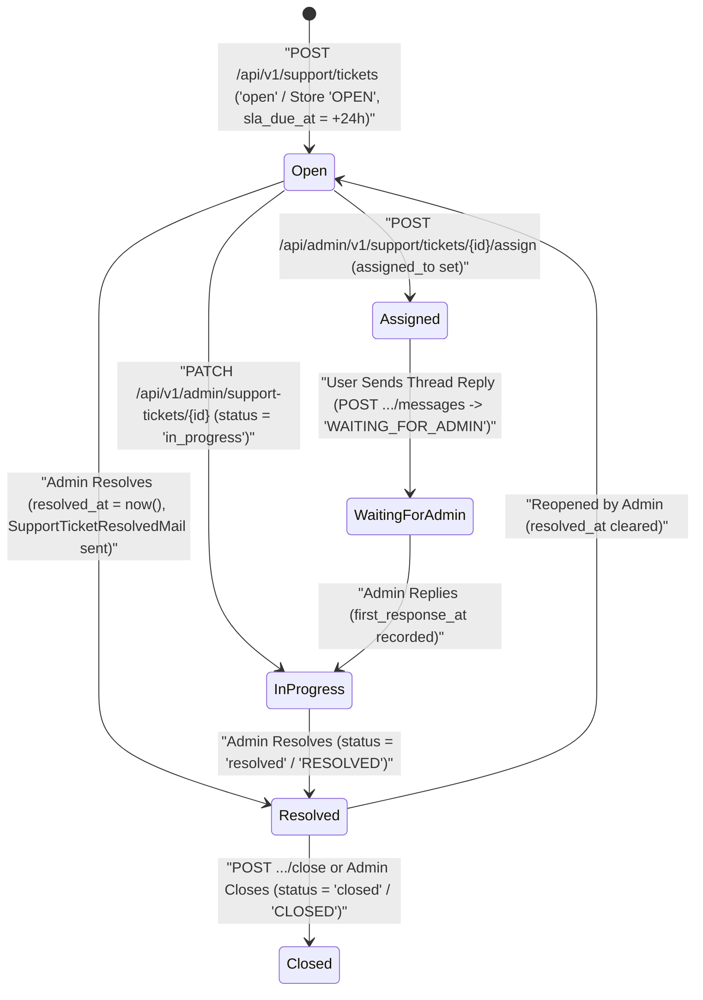

# Activity 31: Help & Support Tickets

| Attribute | Verified Audit Classification |
|---|---|
| **Workbook Activity #** | `31` |
| **Exact Workbook Name** | `Help & Support Tickets` |
| **Domain Category** | `Support & Operations` *(Sheet 3: `Support / Helpdesk`)* |
| **Activity Governance Tier** | `Global Administration` *(Platform & Store Helpdesk Triage in Admin Web; Self-Service Ticket Submission for Peers & Leaders)* |
| **Overall Implementation Status** | `Partially Implemented` *(Core `SupportTicket` + Store `StoreSupportTicket` + threaded `support_ticket_messages` + Admin Web `SupportPage.tsx` work; however, Core vs Store tickets use inconsistent lowercase vs UPPERCASE status enums on the same `support_tickets` table, `sla_due_at` has no cron breach monitor, and Leader App has no self-service Help & Support link)* |
| **Master Index & Cross-Links** | [12-master-35-activities-index.md](../12-master-35-activities-index.md) · [19-activity-to-role-access-matrix.md](../19-activity-to-role-access-matrix.md) · [25-activity-workflow-reference.md](../25-activity-workflow-reference.md) · [33-action-center-and-task-management.md](../33-action-center-and-task-management.md) · [34-escalation-rules-and-ownership.md](../34-escalation-rules-and-ownership.md) |

---

## 1. Business Purpose (§9.1)

- **WORKBOOK REQUIREMENT:** Sheet 1 & Sheet 2 define Activity 31 as allowing members to *"Submit customer support issues, technical bug reports, or billing questions with screenshots"* via `SubmitTicketScreen` (`Category`, `Subject`, `Description`, `Priority`, `Screenshot file`) and engage in an *"Interactive Ticket Conversation Thread with Admin replies and status badge"* (`TicketHistoryScreen`, `SupportTicketDetails`).
- **FACT:** In the Laravel 12 codebase, Activity 31 is implemented across **two co-existing controllers writing to the same `support_tickets` table**, plus a public web helpdesk:
  1. **Core App & Public Support (`App\Models\SupportTicket` + `SupportTicketController` + `PublicSupportController`):** Handles general app, account, and billing issues via `POST /api/v1/support` (`/api/v1/support/tickets`), generating `SUP-...` ticket numbers, uploading a single screenshot/video up to 50 MB (`media_file_id`), using **lowercase** statuses (`open`, `in_progress`, `resolved`, `closed`), and sending `SupportTicketSubmittedMail` + `SupportTicketResolvedMail` (without multi-message conversation threads).
  2. **Coin Store E-Commerce Support (`App\Models\Store\StoreSupportTicket` + `StoreSupportTicketMessage` + `StoreSupportService`):** Handles Coin Store order/refund/wallet issues via `/api/v1/store/support/tickets` (and `/api/v1/support/tickets/{id}/messages` in `StoreApiEndpoints`), generating `TKT-...` numbers, supporting **multi-turn threaded replies** (`support_ticket_messages`), ticket assignment (`assigned_to`), and setting a passive **`sla_due_at = now()->addHours(24)`** deadline — while writing **UPPERCASE** statuses (`OPEN`, `WAITING_FOR_ADMIN`, `RESOLVED`, `CLOSED`) into the same `support_tickets.status` column!
  3. **Leadership App Boundary & Route Audit:** Although legacy API documentation mentioned `/leader/support/*`, a full line-by-line inspection of [routes/leader.php](file:///c:/Users/malic/OneDrive/Documents/GitHub/unity-app-new/routes/leader.php#L1-L302) confirms **zero `/leader/support/*` routes exist in the live `routes/leader.php` file**, and `LeaderApp` (`423` Dart files) contains **no Support screen**. Because authenticated leaders hold `App\Models\User` Sanctum tokens, a leader *can* reuse `POST /api/v1/support/tickets` & `GET /api/v1/support/my-tickets` for their own personal leader-app support inquiries, while **platform support ticket resolution belongs strictly to `Super Admin` / Operations Staff in Admin Web** (not Circle Leaders).

---

## 2. Sub-Activities Catalogue (§9.2)

| # | Sub-Activity / Atomic Operation | Member App (`unity_app`) | Leadership App (`LeaderApp`) | React Admin Web (`unity-admin-web`) / Blade | Laravel 12 Backend (`unity-app-new`) | Classification |
|---|---|---|---|---|---|---|
| **31.1** | **Submit Core General Support Ticket (with Media up to 50 MB)** | `submit_ticket_screen.dart` (`POST /api/v1/support` / `/support/tickets`) | `Missing` *(No "Help & Support" tile in `profile_view.dart`)* | Public `/support` web form | `SupportTicketController@store` ([SupportTicketController.php](file:///c:/Users/malic/OneDrive/Documents/GitHub/unity-app-new/app/Http/Controllers/Api/V1/SupportTicketController.php#L76-L111)), `PublicSupportController` | `Fully Implemented` *(Member App)* |
| **31.2** | **View Own Support Ticket History & Single Ticket Status** | `menu/.../ticket_history_screen.dart` & `support/.../ticket_history_screen.dart` | `Missing` | Public `/support/check-status` | `SupportTicketController@index`, `@myTickets`, `@show` | `Fully Implemented` *(Member App)* |
| **31.3** | **Create Store Order Support Ticket + Multi-Turn Conversation Thread (`support_ticket_messages`)** | Store Support (`StoreApiEndpoints.supportTicketMessages`) | `Not Required` | `SupportPage.tsx` + Store Admin | `StoreSupportController` (`store`, `messages`, `close`) + `AdminStoreSupportController` (`assign`, `messages`, `resolve`) | `Partially Implemented` *(Threaded chat works for Store tickets, NOT wired into Core `SupportTicketController`!)* |
| **31.4** | **Admin Triage, Priority Update, Agent Assignment & Email Reply** | N/A | `Not Required` (Central Helpdesk Ops) | `SupportPage.tsx` (`src/features/support/SupportPage.tsx`) + Blade `/admin/support-tickets/*` | `SupportTicketController@adminIndex`, `@adminUpdate`; `Admin\SupportTicketController@sendEmail`; `AdminStoreSupportController@assign` | `Implemented but Incorrect` *(Case-mismatch `open` vs `OPEN`; `/api/v1/admin/support-tickets` lacks admin guard)* |
| **31.5** | **24-Hour `sla_due_at` Tracking & Automated Breach Escalation** | Passive timestamp | `Not Required` | Displayed passively | `StoreSupportService` sets `sla_due_at = now()->addHours(24)` on Store tickets only; **zero cron jobs check breaches** | `Partially Implemented` *(Passive column only — no SLA monitor or escalation)* |

---

## 3. Input Form & Field Validation Mapping (§9.3)

| Field Name | Data Type | Required/Optional | Validation | Default | Input Widget | Data Source | Visibility | Who Enters | Who Edits | Who Views | Sensitive? | Backend Request Key |
|---|---|---|---|---|---|---|---|---|---|---|---|---|
| **Contact Name** | `string` | Required *(Auto-merged)* | `required\|string\|max:150` (`SupportTicketController.php:88`) | `$user->display_name` | Auto-filled from `User` (editable on public web) | `users.display_name` | Ticket Detail & Admin Queue | System / Member / Guest | Immutable | Ticket Owner, Super Admin / Support Agent | No | `contact_name` |
| **Contact Email** | `string` (`email`) | Required *(Auto-merged)* | `required\|email\|max:150` | `$user->email` | Auto-filled from `User` | `users.email` | Ticket Detail & Admin Queue | System / Member / Guest | Immutable | Ticket Owner, Super Admin / Support Agent | **Yes** *(PII)* | `email` |
| **Category** | `string` | Optional *(Core)* / Required *(Store)* | Store: category enum; Core: **Notice `SupportTicketController@store` (`L87-94`) omits `category` from `$request->validate()`, dropping it unless added!** | `'general'` / `null` | Dropdown (`SubmitTicketScreen`) | Static categories | Ticket Card & Admin Filter | Member / Leader | Super Admin | Ticket Owner, Support Agent | No | `category` |
| **Order ID *(Store Only)*** | `uuid` | Optional | `nullable\|uuid\|exists:orders,id` (owned by user) | `null` | Order context link | `orders.id` | Store Ticket Detail | Member | Immutable | Ticket Owner, Store Support Admin | No | `order_id` |
| **Subject** | `string` | Required | `required\|string\|max:255` | `""` | `TextField` (`"Brief summary of the issue"`) | User input | Ticket List & Detail | Member / Leader | Immutable | Ticket Owner, Support Agent | No | `subject` |
| **Description / Body** | `string` (`text`) | Required | `required\|string` | `""` | Multiline `TextField` (`"Please describe the issue..."`) | User input | Ticket Detail | Member / Leader | Immutable | Ticket Owner, Support Agent | **Yes** *(May contain billing/account details)* | `description` *(Store alias: `body`)* |
| **Priority** | `string` (`enum`) | Optional | `nullable\|string\|in:low,normal,high,urgent` *(Note: Workbook/Store also reference `medium`)* | `'normal'` | Priority selector | Static enum | Ticket Pill & Admin Sort | Member / Admin | Support Admin (`adminUpdate`) | Ticket Owner, Support Agent | No | `priority` |
| **Screenshot / Video Attachment** | `file` | Optional | `nullable\|file\|mimes:jpg,jpeg,png,webp,mp4,mov,avi,webm\|max:51200` (50 MB) | `null` | Media picker | Device gallery / files | Ticket Detail preview | Member / Leader | Immutable | Ticket Owner, Support Agent | **Yes** *(May show payment receipts)* | `media` |
| **Thread Reply Message *(Store)*** | `string` (`text`) | Required *(on Reply)* | `required\|string\|max:5000` + optional `attachments` (`array`) | `""` | Chat composer | User or Admin input | Conversation Thread (`support_ticket_messages`) | Ticket Owner or Support Admin | Immutable | Ticket Owner & Support Admin | **Yes** | `message`, `attachments` |
| **Assigned Support Agent** | `uuid` | Optional *(Admin)* | `nullable\|uuid` (`admin_users.id` / `users.id`) | `null` | Agent dropdown (`POST /api/admin/v1/support/tickets/{id}/assign`) | Admin roster | Admin Helpdesk | Super Admin | Super Admin | Super Admin / Support Team | No | `assigned_to` |
| **Admin / Resolution Note** | `string` (`text`) | Optional *(Admin)* | `nullable\|string` | `null` | Textarea in `SupportPage.tsx` | Support Agent input | `admin_note` (internal) / `resolution_note` | Support Admin | Support Admin | Support Admin (`resolution_note` emailed on resolve) | Yes | `admin_note`, `resolution_note` |

---

## 4. Workflow, Lifecycle & Mermaid Diagram (§9.4)

### Workbook vs Actual PostgreSQL Lifecycle Comparison
- **WORKBOOK REQUIREMENT:** `Ticket Created -> Agent Assigned -> Discussion -> Resolved`.
- **FACT (Dual-Schema Enum Collision on `support_tickets`):**
  1. **Core `SupportTicketController`** writes lowercase `status` ∈ `'open'` | `'in_progress'` | `'resolved'` | `'closed'`, does **not** set `sla_due_at`, and does **not** use `support_ticket_messages`.
  2. **Store `StoreSupportService`** writes UPPERCASE `status` ∈ `'OPEN'` | `'WAITING_FOR_ADMIN'` | `'RESOLVED'` | `'CLOSED'`, sets `sla_due_at = now()->addHours(24)`, sets `first_response_at` on first admin message, and stores replies in `support_ticket_messages` (`sender_type` ∈ `'USER'` | `'ADMIN'`).
  3. **Impact of Case Mismatch:** Filtering `?status=open` in `SupportTicketController@adminIndex` (`where('status', $status)` — case-sensitive `=` in PostgreSQL!) **misses** `'OPEN'` Store tickets unless normalized!

---

## 5. Outputs & Deliverables (§9.5)

| Deliverable / Output | Workbook Spec | Actual Codebase Reality | Verification Label |
|---|---|---|---|
| **Unique Ticket Reference Number** | Ticket badge | Auto-generated `ticket_number` / `ticket_no` (`SUP-...` / `TKT-...`) returned on `201 Created` and emailed via `SupportTicketSubmittedMail` | **FACT** (`Fully Implemented`) |
| **Interactive Ticket Conversation Thread** | Thread with Admin replies & status badge | Implemented for Store tickets (`support_ticket_messages`), whereas Core `SupportTicketController` only returns single-record `admin_note` + email replies (`POST /admin/support-tickets/{id}/send-email`) | **FACT** (`Partially Implemented` — Unify!) |
| **Resolution Email Receipt** | Push/Email alert | `SupportTicketResolvedMail` automatically sent and logged via `EmailLogService` when `status` transitions to `'resolved'` | **FACT** (`Fully Implemented`) |
| **SLA Countdown (`sla_due_at`)** | Not in workbook | Populated (`+24h`) on Store tickets, **null** on Core tickets, and **unmonitored** by `routes/console.php` | **FACT** (`Partially Implemented`) |

---

## 6. Database & Metrics Mapping (§9.6)

### Eloquent Models & PostgreSQL Tables
1. **`App\Models\SupportTicket`** & **`App\Models\Store\StoreSupportTicket`** → Shared table `support_tickets`:
   - **Columns:** `id` (`uuid`), `ticket_number` / `ticket_no` (`string`, unique), `user_id` (`uuid`, nullable), `order_id` (`uuid`, nullable), `contact_name`, `email`, `phone`, `subject`, `category`, `description` / `body`, `media_file_id` (`uuid`), `media_type`, `media_url`, `status`, `priority`, `assigned_to` (`uuid`, nullable), `admin_note`, `resolution_note`, `sla_due_at` (`timestamp`), `first_response_at` (`timestamp`), `resolved_at` (`timestamp`), `created_at`, `updated_at`.
2. **`App\Models\Store\StoreSupportTicketMessage`** → Table `support_ticket_messages`:
   - **Columns:** `id` (`uuid`), `ticket_id` (`uuid` FK → `support_tickets.id`), `sender_id` (`uuid`), `sender_type` (`'USER'` | `'ADMIN'`), `message` (`text`), `attachments` (`json`), `created_at`, `updated_at`.
3. **Related Inquiry Tables:** `support_requests` (`routed_to_user_id`), `contact_posts` (website Contact Us), `web_messages`.

### Sheet 3 Workbook Metric Keys vs Actual Database Mapping
| Workbook Metric Key (Sheet 1 & Sheet 3) | Actual Backend / SQL Equivalent | Status |
|---|---|---|
| `ticketsCount` | `pagination.total` in `SupportTicketController@index` | `Fully Implemented` (`FACT`) |
| `openTicketsCount` | `SupportTicket::whereIn(DB::raw('LOWER(status)'), ['open','in_progress','waiting_for_admin'])->count()` | Requires case-insensitive query (`Implemented but Incorrect` if queried with case-sensitive `=`) |
| `resolvedTicketsCount` | `SupportTicket::whereIn(DB::raw('LOWER(status)'), ['resolved','closed'])->count()` | `Partially Implemented` |

---

## 7. API & Backend Service Mapping (§9.7)

| Surface | Method & Endpoint | Controller & Action | Service Layer | Auth Middleware | Scope Enforcement & Security Audit | Flutter / Web Integration |
|---|---|---|---|---|---|---|
| **Member / Leader Self API** | `POST /api/v1/support`, `POST /api/v1/support/tickets`, `GET /api/v1/support/tickets`, `GET /api/v1/support/my-tickets`, `GET /api/v1/support/tickets/{id}` | `Api\V1\SupportTicketController` | `EmailLogService` | `auth:sanctum`, `unity.user` | Scoped to `user_id = $user->id OR LOWER(email) = LOWER($user->email)` *(Safe only if `users.email` is verified!)* | Wired in `unity_app`; **Can be reused directly by `LeaderApp` for leader self-support!** |
| **Store Support API** | `GET\|POST /api/v1/store/support/tickets`, `GET .../{id}`, `POST .../{id}/messages`, `POST .../{id}/close` | `Api\V1\Store\StoreSupportController` | `StoreSupportService` | `auth:sanctum`, `unity.user` | Strictly scoped to `user_id = $user->id` | Wired in `unity_app` (`StoreApiEndpoints`) |
| **Public Web Support** | `GET\|POST /support`, `POST /support/check-status` | `PublicSupportController` | `PublicSupportService` | `web` (throttled) | Ticket lookup requires matching email + ticket number | Blade Web View |
| **Leader Dedicated API** | *`/api/v1/leader/support/*`* | **DOES NOT EXIST** in `routes/leader.php` | N/A | N/A | Confirmed absent in live `routes/leader.php` (`L1-302`); reuse `/api/v1/support/tickets` instead of duplicating! | Not wired in `LeaderApp` |
| **Core Admin API** | `GET /api/v1/admin/support-tickets`, `GET .../{id}`, `PATCH .../{id}` | `SupportTicketController@adminIndex`, `@adminShow`, `@adminUpdate` | `EmailLogService` | `auth:sanctum`, `unity.user` | **CRITICAL P0 BUG:** Mounted in unprotected `/api/v1/admin/*` — any mobile user token can read or resolve all support tickets on the platform! | Wired in `unity-admin-web` (`SupportPage.tsx`, `supportService.ts`) |
| **Store Admin API** | `GET /api/admin/v1/support/tickets[/{id}]`, `POST .../{id}/{assign\|messages\|resolve}` | `AdminStoreSupportController` | `StoreSupportService` | Store Admin middleware (`routes/admin_store.php`) | Proper admin separation + `assigned_to` support | Wired in Admin Store |

---

## 8. Role-Wise Access Governance (§9.8)

> **Governance Boundary:** Support tickets often contain personal billing disputes, payment failures, bug reports, or confidential complaints about chapter leadership. Therefore, **Circle Leaders, Industry Directors, and DEDs MUST NOT view or manage other members' support tickets**. Only centralized Helpdesk / `Super Admin` staff manage platform tickets, while every user (Peer or Leader) can create and view **their own** tickets.

| Role (`UserRoleResolverService` / `roles.key`) | View activity | Create record *(Submit Own Ticket)* | Edit own *(Reply / Close Own)* | Edit others | Submit for review | Verify | Approve | Reject | Assign *(`assigned_to`)* | Manage *(Update Status / Priority / Resolve)* | Delete | View aggregated reports |
|---|---|---|---|---|---|---|---|---|---|---|---|---|
| **Super Admin** (`superAdmin` / `global_admin`) | Allowed (All platform & store `support_tickets`) | Allowed | Allowed | Allowed (Status, priority, `admin_note`) | Allowed | Allowed | Allowed (`resolve`) | Allowed (`close`) | Allowed (`POST .../assign`) | Allowed (`SupportPage.tsx` + Store Support) | DENIED *(Audit retention — close instead of delete)* | Allowed (Open/Resolved/SLA counts) |
| **Country Director** (`countryDirector` / `eed`) | Allowed (**Own** submitted tickets only; Admin Web global tickets only if explicitly granted `support` RBAC module) | Allowed (Own ticket) | Allowed (Reply/close own ticket) | DENIED — No permission under the verified backend authorization model. | Allowed (Own ticket) | DENIED — No permission under the verified backend authorization model. | DENIED — No permission under the verified backend authorization model. | DENIED — No permission under the verified backend authorization model. | DENIED — No permission under the verified backend authorization model. | DENIED — No permission under the verified backend authorization model. | DENIED — No permission under the verified backend authorization model. | UNVERIFIED — Requires backend/business confirmation. |
| **DED** (`districtExecDirector` / `ded`) | Allowed (**Own** submitted tickets only) | Allowed (Own ticket) | Allowed (Own ticket) | DENIED — No permission under the verified backend authorization model. | Allowed (Own ticket) | DENIED — No permission under the verified backend authorization model. | DENIED — No permission under the verified backend authorization model. | DENIED — No permission under the verified backend authorization model. | DENIED — No permission under the verified backend authorization model. | DENIED — No permission under the verified backend authorization model. | DENIED — No permission under the verified backend authorization model. | DENIED — No permission under the verified backend authorization model. |
| **Industry Director** (`industryDirector` / `industry_director`) | Allowed (**Own** submitted tickets only) | Allowed (Own ticket) | Allowed (Own ticket) | DENIED — No permission under the verified backend authorization model. | Allowed (Own ticket) | DENIED — No permission under the verified backend authorization model. | DENIED — No permission under the verified backend authorization model. | DENIED — No permission under the verified backend authorization model. | DENIED — No permission under the verified backend authorization model. | DENIED — No permission under the verified backend authorization model. | DENIED — No permission under the verified backend authorization model. | DENIED — No permission under the verified backend authorization model. |
| **Circle Founder** (`circleFounder` / `circle_founder`) | Allowed (**Own** submitted tickets only) | Allowed (Own ticket) | Allowed (Own ticket) | DENIED — No permission under the verified backend authorization model. | Allowed (Own ticket) | DENIED — No permission under the verified backend authorization model. | DENIED — No permission under the verified backend authorization model. | DENIED — No permission under the verified backend authorization model. | DENIED — No permission under the verified backend authorization model. | DENIED — No permission under the verified backend authorization model. | DENIED — No permission under the verified backend authorization model. | DENIED — No permission under the verified backend authorization model. |
| **Circle Director** (`circleDirector` / `circle_director`) | Allowed (**Own** submitted tickets only) | Allowed (Own ticket) | Allowed (Own ticket) | DENIED — No permission under the verified backend authorization model. | Allowed (Own ticket) | DENIED — No permission under the verified backend authorization model. | DENIED — No permission under the verified backend authorization model. | DENIED — No permission under the verified backend authorization model. | DENIED — No permission under the verified backend authorization model. | DENIED — No permission under the verified backend authorization model. | DENIED — No permission under the verified backend authorization model. | DENIED — No permission under the verified backend authorization model. |
| **Chair / Committee Chairs** (`chairBusinessGrowth`, `chairMembership`, `chairEventsPrograms`, `circleChair`) | Allowed (**Own** submitted tickets only) | Allowed (Own ticket) | Allowed (Own ticket) | DENIED — No permission under the verified backend authorization model. | Allowed (Own ticket) | DENIED — No permission under the verified backend authorization model. | DENIED — No permission under the verified backend authorization model. | DENIED — No permission under the verified backend authorization model. | DENIED — No permission under the verified backend authorization model. | DENIED — No permission under the verified backend authorization model. | DENIED — No permission under the verified backend authorization model. | DENIED — No permission under the verified backend authorization model. |
| **Vice Chair** (`viceChair` / `vice_chair`) | Allowed (**Own** submitted tickets only) | Allowed (Own ticket) | Allowed (Own ticket) | DENIED — No permission under the verified backend authorization model. | Allowed (Own ticket) | DENIED — No permission under the verified backend authorization model. | DENIED — No permission under the verified backend authorization model. | DENIED — No permission under the verified backend authorization model. | DENIED — No permission under the verified backend authorization model. | DENIED — No permission under the verified backend authorization model. | DENIED — No permission under the verified backend authorization model. | DENIED — No permission under the verified backend authorization model. |
| **Secretary** (`secretary`) | Allowed (**Own** submitted tickets only) | Allowed (Own ticket) | Allowed (Own ticket) | DENIED — No permission under the verified backend authorization model. | Allowed (Own ticket) | DENIED — No permission under the verified backend authorization model. | DENIED — No permission under the verified backend authorization model. | DENIED — No permission under the verified backend authorization model. | DENIED — No permission under the verified backend authorization model. | DENIED — No permission under the verified backend authorization model. | DENIED — No permission under the verified backend authorization model. | DENIED — No permission under the verified backend authorization model. |
| **Committee Leader** (`committee_leader`) | Allowed (**Own** submitted tickets only) | Allowed (Own ticket) | Allowed (Own ticket) | DENIED — No permission under the verified backend authorization model. | Allowed (Own ticket) | DENIED — No permission under the verified backend authorization model. | DENIED — No permission under the verified backend authorization model. | DENIED — No permission under the verified backend authorization model. | DENIED — No permission under the verified backend authorization model. | DENIED — No permission under the verified backend authorization model. | DENIED — No permission under the verified backend authorization model. | DENIED — No permission under the verified backend authorization model. |
| **Peer Member** (`member`) | Allowed (**Own** `GET /api/v1/support/my-tickets` only) | Allowed (`POST /api/v1/support/tickets`) | Allowed (Post message & close own ticket) | DENIED — No permission under the verified backend authorization model. | Allowed | DENIED — No permission under the verified backend authorization model. | DENIED — No permission under the verified backend authorization model. | DENIED — No permission under the verified backend authorization model. | DENIED — No permission under the verified backend authorization model. | DENIED — No permission under the verified backend authorization model. | DENIED — No permission under the verified backend authorization model. | DENIED — No permission under the verified backend authorization model. |

---

## 9. Existing Implementation Summary, Gaps & Minimum-Change Enhancement Recommendations

| # | Audit Dimension | Verified Assessment |
|---|---|---|
| **1** | **Member App Status (`unity_app`)** | `Fully Implemented` (`SubmitTicketScreen` + `TicketHistoryScreen` + Store order support threads). |
| **2** | **Leadership App Status (`LeaderApp`)** | `Missing` a simple self-service *"Help & Support"* tile on Leader Profile (`profile_view.dart`) for leaders who encounter technical/reporting issues. Member ticket queues are `Not Required` in `LeaderApp`. |
| **3** | **Admin Web & Blade Status** | `Fully Implemented` in `SupportPage.tsx` and Blade `/admin/support-tickets/*`. |
| **4** | **Backend & Database Status** | `Partially Implemented` / `Implemented but Incorrect`: `SupportTicketController` drops `category` during validation, lacks `support_ticket_messages` thread endpoints on core tickets, and collides with `StoreSupportService`'s UPPERCASE status strings. |
| **5** | **Workbook vs Codebase Discrepancies** | Workbook expects threaded admin/user replies on all support tickets; currently `support_ticket_messages` is wired on `/api/v1/store/support/tickets/{id}/messages` while core `/api/v1/support/tickets/{id}` uses single-field `admin_note` + outbound email. |
| **6** | **Security, RBAC & Scope Vulnerabilities** | **1. (`P0`)** `/api/v1/admin/support-tickets*` in `routes/api.php` has **no admin role middleware** — any regular member token can view all support tickets (`contact_name`, `email`, `description`, `media_url`) and mark tickets resolved! **2. (`P2`)** `SupportTicketController@index`/`@show` matches `orWhereRaw('LOWER(email) = ?', ...)` even when `users.email_verified_at` is `null`, allowing an unverified email registrant to read prior guest tickets filed under that email. |
| **7** | **Notification & Audit Trail Gaps** | Confirmation and resolution emails are logged via `EmailLogService`, **but** core ticket replies/resolutions do not send in-app/FCM push notifications (`PushNotificationService`), and `sla_due_at` has no scheduled breach alert command. |
| **8** | **Leadership App Disposition** | **Add Lightweight Self-Service Leader Support Only** (reusing existing `/api/v1/support/tickets` on `profile_view.dart`). Keep member helpdesk management strictly in React Admin Web (`SupportPage.tsx`). |
| **9** | **Minimum-Change Enhancement Plan** | 1. Wrap `/api/v1/admin/support-tickets*` in `['auth:sanctum', 'admin.auth', 'admin.permission:support.view']` (`P0`). 2. Add `'category' => ['nullable', 'string', 'max:100']` and `sla_due_at = now()->addHours(24)` to `SupportTicketController@store`, normalize `status` comparisons with `LOWER(status)`, and expose `support_ticket_messages` on core `/api/v1/support/tickets/{id}/messages`. 3. Add a lightweight *"Help & Support"* option in `LeaderApp` `profile_view.dart` pointing to `/api/v1/support/tickets` (no new backend controller needed). |
| **10** | **Open Business Decisions** | **BUSINESS DECISION REQUIRED:** What SLA target hours should apply by ticket priority (`urgent` = 4h, `high` = 12h, `normal` = 24h, `low` = 48h?), and should breached tickets notify `Super Admin` via email/push? |
