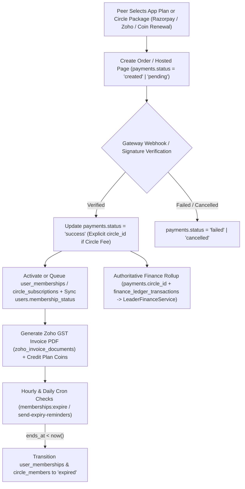

# Activity 32: Membership Plan & Subscriptions

| Attribute | Verified Audit Classification |
|---|---|
| **Workbook Activity #** | `32` |
| **Exact Workbook Name** | `Membership Plan & Subscriptions` |
| **Domain Category** | `Account & Billing` *(Sheet 3: `Billing / Subscriptions`)* |
| **Activity Governance Tier** | `Leadership Oversight` *(for Scoped Peer Membership Status & Authoritative Circle Finance)* + `Global Administration` *(for Plan Catalog, Zoho/Razorpay Billing, Commission Rates & Upgrades)* |
| **Overall Implementation Status** | `Implemented but Incorrect` *(Member Razorpay + Zoho Billing + Coin Renewal + Leader `PeerMembershipScreen` exist, **BUT** `LeaderDashboardService`, `LeaderFinanceService`, and `LeaderTeamsService` contain severe synthetic revenue formulas, cross-circle payment double-counting, unscoped wallet leaks, and unguarded offline payment insertion)* |
| **Master Index & Cross-Links** | [12-master-35-activities-index.md](../12-master-35-activities-index.md) · [19-activity-to-role-access-matrix.md](../19-activity-to-role-access-matrix.md) · [25-activity-workflow-reference.md](../25-activity-workflow-reference.md) · [41-master-reporting-and-metrics-reference.md](../41-master-reporting-and-metrics-reference.md) · [43-sensitive-data-and-finance-access.md](../43-sensitive-data-and-finance-access.md) |

---

## 1. Business Purpose (§9.1)

- **WORKBOOK REQUIREMENT:** Sheet 1 & Sheet 2 state Activity 32 allows members to *"Subscribe to or renew premium club tiers (Free, Gold, Platinum, Lifetime) and view invoices"* via `MembershipPaywallScreen` and `InvoiceListScreen`, maintaining `membershipStatus`, `membershipStartsAt`, and `membershipEndsAt`.
- **FACT:** In the production Laravel 12 platform, Activity 32 governs **three distinct commercial billing rails** and feeds **Leadership App Member 360° & Finance Analytics**:
  1. **App / Platform Unity Peer Subscriptions (`membership_plans` + `user_memberships` + `payments`):** Members subscribe via **Razorpay** (`POST /api/v1/payments/create-order` & `/verify`) or **Zoho Billing Hosted Pages** (`POST /api/v1/billing/checkout` + webhooks), updating `users.membership_status` (`visitor`, `free_peer`, `free_trial_peer`, `Only Unity Peer` / `global_peer`, `circle_peer`, `multi_circle_peer`, `charter_peer`, `suspended`, `expired`), `membership_starts_at`, and `membership_ends_at`, and generating Zoho GST tax invoices (`zoho_invoice_documents`).
  2. **Circle Chapter Subscriptions (`circle_plans` / `circle_subscriptions` / `circle_peer_memberships`):** Paid when joining or renewing a specific chapter (`payment_type = 'circle_package'` or `'circle_join_fee'`, `payments.circle_id` populated).
  3. **Coin-Based Membership Renewal (`routes/store.php`):** Members can quote and renew eligible plans using earned Coins (`POST /api/v1/membership/quote` & `/renew` → `membership_ledgers`).
  4. **Leadership App Oversight (`PeerMembershipScreen` & `FinanceView`):** Leaders inspect any scoped member's dual **App Membership** + **Circle Membership** status in [peer_membership_screen.dart](file:///D:/office%20project/LeaderApp-Fornt-end-/lib/features/peer_profile/view/peer_membership_screen.dart#L110-L250), and authorized roles (`access_finance`) view revenue, transactions, and commissions in `FinanceView`.
- **HARD AUTHORITATIVE FINANCE RULE (Mandatory Audit Standard):**
  > Finance and Dashboard revenue **MUST** be computed strictly from **authoritative payment/ledger records** (`payments` with explicit `circle_id` attribution, `finance_ledger_transactions`, `circle_subscriptions`). Where authoritative circle-attributed revenue is unavailable, the API and UI must return/display `—` (`Unavailable`). **NEVER** estimate revenue as `5%` of `business_deals` (`LeaderDashboardService.php:733`), `(circle_price ?? 120000) * peers` (`LeaderTeamsService.php:478`), or cross-circle `orWhereHas('user.circleMembers')` over-attribution (`LeaderFinanceService.php:77`)!

---

## 2. Sub-Activities Catalogue (§9.2)

| # | Sub-Activity / Atomic Operation | Member App (`unity_app`) | Leadership App (`LeaderApp`) | React Admin Web (`unity-admin-web`) / Blade | Laravel 12 Backend (`unity-app-new`) | Classification |
|---|---|---|---|---|---|---|
| **32.1** | **Browse Membership & Circle Plans (`membership_plans`, `zoho/plans`)** | `membership_paywall_screen.dart` (`GET /membership-plans`, `/zoho/plans`) | `Not Required` | `MembershipPlansPage.tsx`, `CirclePlansPage.tsx` | `MembershipPlanController`, `ZohoPlansController`, `AdminPlansApiController` | `Fully Implemented` |
| **32.2** | **Checkout & Verify Subscription via Razorpay or Zoho Hosted Page** | `membership_paywall_screen.dart`, `circle_join_screen.dart` | `Not Required` (consumer checkout) | `TestCheckoutPage.tsx` | `PaymentController`, `BillingCheckoutController`, `CircleSubscriptionController`, Razorpay/Zoho Webhooks | `Fully Implemented` |
| **32.3** | **Renew Membership with Earned Coins (`Store` Module)** | Store Membership (`GET /membership`, `POST /membership/quote`, `/renew`) | `Not Required` | `StoreCoinEconomyPage.tsx` | `Api\V1\Store\MembershipController` → `membership_ledgers` | `Fully Implemented` |
| **32.4** | **View Subscription History & Download Zoho GST Invoice PDFs** | `invoice_list_screen.dart` (`GET /billing/invoices`, `/billing/invoices/{id}/pdf`) | `Not Required` (member private tax docs) | `BillingPage.tsx`, `MembershipBillingTab.tsx` | `UserSubscriptionController@index`, `InvoiceController@index`, `@pdf` | `Fully Implemented` |
| **32.5** | **Inspect Peer's App & Circle Membership Status in Leader App** | N/A | `peer_membership_screen.dart` (2 Tabs: `App Membership` & `Circle Membership`) | `MembershipBillingTab.tsx` | `LeaderPeersController@show` / `LeaderMemberController@show` (`circle_peer_memberships`, `user_memberships`) | `Implemented but Incorrect` *(`LeaderPeersController@show` lacks circle scope check — IDOR on any peer's billing status!)* |
| **32.6** | **View Circle / Regional Authoritative Revenue & Transactions (`LeaderFinanceService`)** | N/A | `finance_view.dart` (`GET /leader/finance/metrics`, `/transactions`) | `FinanceContainerPage.tsx` | `LeaderFinanceController` → `LeaderFinanceService` | `Implemented but Incorrect` *(Multiple critical calculation & scope bugs — see §4 & §6!)* |
| **32.7** | **Record Offline Circle Payment (`POST /finance/transactions/record-offline`)** | N/A | `record_payment_bottom_sheet.dart` | `RecordPaymentModal.tsx` | `LeaderFinanceController@recordOfflinePayment` → `LeaderFinanceService::recordOfflinePayment()` | `Implemented but Incorrect` *(Zero `manage_finance` check; drops `circle_id`, `payment_date`, & `type` when inserting into `payments`!)* |
| **32.8** | **Configure Role Commission Rates (`PUT /finance/commission-rates`)** | N/A | `commission_settings_bottom_sheet.dart` | `CommissionManagementPage.tsx` | `LeaderFinanceController@updateCommissionRates` (`isSuperAdmin` enforced!) | `Fully Implemented` |
| **32.9** | **Automated Membership Expiry & Renewal Reminder Cron Jobs** | Receives push/email/WhatsApp | Reflected in peer status | Monitored in Admin | `memberships:expire`, `memberships:expire-users`, `users:expire-trial`, `memberships:send-expiry-reminders` (`routes/console.php`) | `Fully Implemented` |

---

## 3. Input Form & Field Validation Mapping (§9.3)

| Field Name | Data Type | Required/Optional | Validation | Default | Input Widget | Data Source | Visibility | Who Enters | Who Edits | Who Views | Sensitive? | Backend Request Key |
|---|---|---|---|---|---|---|---|---|---|---|---|---|
| **Membership Plan ID / Zoho Code** | `uuid` / `string` | Required *(Checkout)* | `exists:membership_plans,id` or valid `zoho_plan_code` | Selected tier | Plan card selector (`MembershipPaywallScreen`) | `GET /api/v1/membership-plans` | Member Paywall & Admin Billing | Peer Member | Super Admin (via `upgrade`) | Member, Scoped Leaders (tier/dates), Admin | No | `membership_plan_id` / `plan_code` |
| **Coupon / Promo Code** | `string` | Optional *(Checkout)* | Valid active coupon code | `null` | Promo code input | Coupon catalog / Zoho | Checkout summary | Peer Member | Immutable after payment | Member, Super Admin | No | `coupon_code` |
| **Razorpay Verification Payload** | `string` (x3) | Required *(Razorpay Verify)* | HMAC-SHA256 signature verification (`razorpay_order_id`, `razorpay_payment_id`, `razorpay_signature`) | Gateway callback | Razorpay SDK sheet | Razorpay Gateway | Backend & `payments` audit | Razorpay SDK | Immutable | Super Admin (`BillingPage.tsx`) | **Yes** *(Payment credentials/signatures)* | `razorpay_order_id`, `razorpay_payment_id`, `razorpay_signature` |
| **Offline Payment — Peer ID** | `uuid` | Required *(Leader Offline)* | `required\|string` (`LeaderRecordOfflinePaymentRequest` — **should validate `uuid\|exists:users,id`!**) | `null` | Peer selector (`RecordPaymentBottomSheet`) | Scoped circle peers | Leader Finance & Admin | Super Admin / Authorized Finance Role | Immutable ledger | Finance-authorized Leaders, Super Admin | **Yes** *(Financial)* | `peer_id` |
| **Offline Payment — Circle ID** | `uuid` | Required *(Leader Offline)* | `required\|string` (**BUG:** validated in `LeaderRecordOfflinePaymentRequest` **but dropped** by `LeaderFinanceService::recordOfflinePayment()`!) | Selected circle | Circle selector | Leader's scoped circles | Should bind to `payments.circle_id` & `circle_peer_memberships` | Authorized Finance Role | Immutable | Scoped Finance Leaders, Super Admin | **Yes** | `circle_id` |
| **Offline Payment — Amount (₹ INR)** | `numeric` | Required *(Leader Offline)* | `required\|numeric\|min:1` | `null` | Currency input | Offline receipt | Finance Ledger | Authorized Finance Role | Immutable | Scoped Finance Leaders, Super Admin | **Yes** *(Financial)* | `amount` |
| **Offline Payment — Mode & Reference** | `string` | Required / Optional | `payment_mode` (`required\|string\|max:50`), `reference_number` (`nullable\|max:100`), `payment_date` (`nullable\|date`) | `'Bank Transfer'` | Dropdown + TextField + DatePicker | Offline bank/UPI ref | Finance Transactions | Authorized Finance Role | Immutable | Scoped Finance Leaders, Super Admin | **Yes** *(UTR/Cheque PII)* | `payment_mode`, `reference_number`, `payment_date` |
| **Commission Rates Array** | `array<object>` | Required *(Super Admin)* | `commission_rates.*.role_id` (`req`), `direct_referral_cut_percentage` (`0..100`), `app_join_cut_percentage` (`0..100`), `renewal_cut_percentage` (`0..100`) | Current `finance_commission_configs` | Sliders/Inputs (`CommissionSettingsBottomSheet`) | `GET /leader/finance/commission-rates` | Finance Commission Structure | **Super Admin Only** | **Super Admin Only** | Leaders with `access_finance` | **Yes** *(Commercial terms)* | `commission_rates` |

---

## 4. Workflow, Lifecycle & Mermaid Diagram (§9.4)

### Workbook vs Actual PostgreSQL Lifecycle Comparison
- **WORKBOOK REQUIREMENT:** `Tier Selected -> Payment Gateway Verified -> Entitlements Activated` (`Free, Gold, Platinum, Lifetime`; `active, expired`).
- **FACT (Actual Multi-Tier PostgreSQL Statuses):**
  - **`users.membership_status`:** `'visitor'`, `'free_peer'`, `'free_trial_peer'`, `'Only Unity Peer'` / `'global_peer'`, `'circle_peer'`, `'multi_circle_peer'`, `'charter_peer'`, `'suspended'`, `'expired'` (much more granular than workbook's `Free/Gold/Platinum`).
  - **`user_memberships.status`:** `'active'` | `'queued'` *(for early renewals stacked after current expiry)* | `'expired'` | `'cancelled'`.
  - **`payments.status`:** `'created'` | `'pending'` | `'success'` *(plus `'Paid'` written by `recordOfflinePayment`!)* | `'failed'` | `'cancelled'`.
  - **`circle_peer_memberships`:** `payment_status` (`paid` / `pending` / `overdue`) & `subscription_status` (`active` / `expired`).

---

## 5. Outputs & Deliverables (§9.5)

| Deliverable / Output | Workbook Spec | Actual Codebase Reality | Verification Label |
|---|---|---|---|
| **Verified Membership Tier Badge & Dates** | Profile Header badge + `startsAt`/`endsAt` | Rendered across Member App Profile Header and Leader App [peer_membership_screen.dart](file:///D:/office%20project/LeaderApp-Fornt-end-/lib/features/peer_profile/view/peer_membership_screen.dart) (`App Membership` & `Circle Membership` tabs with Days Left countdown) | **FACT** (`Fully Implemented`) |
| **Downloadable Paid GST Tax Invoices** | `InvoiceListScreen` PDF | `GET /api/v1/billing/invoices/{invoiceId}/pdf` streams Zoho Billing GST tax invoice PDFs (`zoho_invoice_documents`) | **FACT** (`Fully Implemented`) |
| **Leader Finance Dashboard & Spline Chart** | Not in workbook | `FinanceView` (`finance_metrics_grid.dart`, `finance_spline_chart.dart`, `finance_transactions_list.dart`) in `LeaderApp` | **FACT** (`Implemented but Incorrect` — Fix non-authoritative formulas!) |

---

## 6. Database, Metrics & `LeaderFinanceService` Bug Audit (§9.6)

### Eloquent Models & PostgreSQL Tables
- `App\Models\MembershipPlan` (`membership_plans`), `MembershipTier` (`membership_tiers`), `CirclePlan` / `CircleSubscription` (`circle_subscriptions`).
- `App\Models\UserMembership` (`user_memberships`: `id`, `user_id`, `membership_plan_id`, `starts_at`, `ends_at`, `status`, `payment_id`).
- `App\Models\Payment` (`payments`: `id`, `user_id`, `membership_plan_id`, `circle_id`, `payment_type`, `base_amount`, `gst_amount`, `total_amount`, `status`, `razorpay_*`, `zoho_*`).
- `App\Models\ZohoInvoiceDocument` (`zoho_invoice_documents`), `App\Models\Store\MembershipLedger` (`membership_ledgers`).
- `App\Leader\Models\CirclePeerMembership` ([CirclePeerMembership.php](file:///c:/Users/malic/OneDrive/Documents/GitHub/unity-app-new/app/Leader/Models/CirclePeerMembership.php) → `circle_peer_memberships`), `FinanceWallet` (`finance_wallets`), `FinanceLedgerTransaction` (`finance_ledger_transactions`), `FinanceCommissionConfig` (`finance_commission_configs`), `FinanceLeaderTenure` (`finance_leader_tenures`).

### Critical Revenue & Financial Bugs Verified in Code (`MUST FIX`)
1. **Fake `5%` Deal Revenue on Dashboard ([LeaderDashboardService.php](file:///c:/Users/malic/OneDrive/Documents/GitHub/unity-app-new/app/Leader/Services/LeaderDashboardService.php#L733)):** Computes `overall_revenue = $dealsSum * 0.05` instead of querying `payments` / `finance_ledger_transactions`!
2. **Fake Circle Revenue Multiplication ([LeaderTeamsService.php](file:///c:/Users/malic/OneDrive/Documents/GitHub/unity-app-new/app/Leader/Services/LeaderTeamsService.php#L478-L500)):** Estimates `(circle_price_amount ?? 120000) * approved_peers_count`!
3. **Cross-Circle Payment Over-Attribution ([LeaderFinanceService.php](file:///c:/Users/malic/OneDrive/Documents/GitHub/unity-app-new/app/Leader/Services/LeaderFinanceService.php#L77-L79) & `L507+`):** `rawPaymentSum` and `getTransactions` use `whereIn('circle_id', $targetCircleIds)->orWhereHas('user.circleMembers', ...)`, attributing **100% of a multi-circle or platform user's lifetime payments (including `circle_id = null` app subscriptions and other circles' fees) to every circle they belong to**!
4. **Synthetic `commission_due` & `total_dues` ([LeaderFinanceService.php](file:///c:/Users/malic/OneDrive/Documents/GitHub/unity-app-new/app/Leader/Services/LeaderFinanceService.php#L290-L306)):** Estimates `commission_due = collections * (referralRate / 100)` and sets `total_dues = commission_due` instead of reading authoritative `leader_wallet` / unpaid peer membership balances!
5. **Broken `projected_annual_revenue` ([LeaderFinanceService.php](file:///c:/Users/malic/OneDrive/Documents/GitHub/unity-app-new/app/Leader/Services/LeaderFinanceService.php#L180-L181)):** Divides **all-time** multi-year revenue by `now()->format('n')` (`1..12`) and multiplies by `12`!
6. **Global `circle_budget` Leak ([LeaderFinanceService.php](file:///c:/Users/malic/OneDrive/Documents/GitHub/unity-app-new/app/Leader/Services/LeaderFinanceService.php#L336-L340)):** When `?circle_id` is omitted, sums `FinanceWallet::where('wallet_type', 'circle_budget')->sum('current_balance')` across **all circles globally** without filtering by `$targetCircleIds`!
7. **Broken `recordOfflinePayment` ([LeaderFinanceService.php](file:///c:/Users/malic/OneDrive/Documents/GitHub/unity-app-new/app/Leader/Services/LeaderFinanceService.php#L603-L623)):** Lacks `manage_finance` capability check and **drops `circle_id`, `payment_date`, and `type`**, inserting orphaned `'Paid'` rows into `payments`!

### Sheet 3 Workbook Metric Keys vs Actual Database Mapping
| Workbook Metric Key (Sheet 1 & Sheet 3) | Actual Backend / SQL Equivalent | Status |
|---|---|---|
| `membershipStatus` | `users.membership_status` + `user_memberships.status` | `Fully Implemented` (`FACT`) |
| `membershipTier` | `membership_plans.name` / `slug` + `users.membership_status` | `Fully Implemented` (`FACT`) |
| `membershipStartsAt` | `users.membership_starts_at` / `user_memberships.starts_at` | `Fully Implemented` (`FACT`) |
| `membershipEndsAt` | `users.membership_ends_at` (`membership_expiry`) / `user_memberships.ends_at` | `Fully Implemented` (`FACT`) |

---

## 7. API & Backend Service Mapping (§9.7)

| Surface | Method & Endpoint | Controller & Action | Service Layer | Auth Middleware | Scope Enforcement & Security Audit | Flutter / Web Integration |
|---|---|---|---|---|---|---|
| **Public / Member API** | `GET /api/v1/membership-plans`, `/circle-plans`, `/zoho/plans`, `/membership-summary` | `MembershipPlanController`, `ZohoPlansController`, `MembershipSummaryController` | Plan catalog & summary | Public plans; `auth:sanctum` summary | Safe read-only catalog / self summary | Wired in `unity_app` |
| **Member Billing API** | `POST /api/v1/payments/{create-order\|verify}`, `POST /api/v1/billing/checkout`, `GET /api/v1/billing/{subscriptions-history\|invoices[/{id}\|/{id}/pdf]}` | `PaymentController`, `BillingCheckoutController`, `UserSubscriptionController`, `InvoiceController` | Razorpay + Zoho Billing services | `auth:sanctum`, `unity.user` | Strictly self-scoped (`user_id = auth()->id()`) | Wired in `unity_app` (`MembershipPaywallScreen`, `InvoiceListScreen`) |
| **Store Coin Renewal** | `GET /api/v1/membership[/plans]`, `POST /api/v1/membership/{quote\|renew}` | `Api\V1\Store\MembershipController` | Store Coin Membership service | `auth:sanctum`, `unity.user` | Strictly self-scoped | Wired in `unity_app` (`StoreApiEndpoints`) |
| **Leader Finance API** | `GET /api/v1/leader/finance/{metrics\|transactions\|milestones}`, `PUT .../commission-rates`, `POST .../transactions/record-offline` | `LeaderFinanceController` | `LeaderFinanceService` | `auth:sanctum`, `leader.user` | **HIGH-1 & HIGH-2 BUGS:** Only `updateCommissionRates` checks `isSuperAdmin`; `metrics`/`transactions` allow `?circle_id=<any-uuid>` IDOR & lack `leader.can:access_finance`; `recordOfflinePayment` lacks `leader.can:manage_finance`! | Wired in `LeaderApp` (`FinanceView`) |
| **Admin Billing API** | `/api/v1/admin/plans/*`, `/api/v1/admin/billing/*`, `/api/v1/admin/payments`, `POST /api/v1/admin/peers/{id}/upgrade` | `AdminPlansApiController`, `AdminOpsController`, `UserManagementController` | `MembershipUpgradeService` | `auth:sanctum`, `unity.user` | **CRITICAL P0 BUG:** `/api/v1/admin/*` lacks `admin.auth` / `admin.role` middleware — any mobile user can upgrade their own membership for free! | Wired in `unity-admin-web` (`PlansPage.tsx`, `BillingPage.tsx`) |

---

## 8. Role-Wise Access Governance (§9.8)

| Role (`UserRoleResolverService` / `roles.key`) | View activity *(Peer Subscription Status & Scoped Finance)* | Create record *(Subscribe / Record Offline Payment)* | Edit own | Edit others *(Upgrade Tier)* | Submit for review | Verify | Approve *(Offline / Upgrade)* | Reject | Assign | Manage *(Plans & Commission Rates)* | Delete | View aggregated reports *(Authoritative Finance)* |
|---|---|---|---|---|---|---|---|---|---|---|---|---|
| **Super Admin** (`superAdmin` / `global_admin`) | Allowed (Global Billing, Invoices, Finance, `PeerMembershipScreen`) | Allowed (`recordOfflinePayment` + Admin Upgrades) | Allowed | Allowed (`MembershipUpgradeService`) | Allowed | Allowed | Allowed (`PendingRegistrations` / `membership_upgrade`) | Allowed | DENIED — No permission under the verified backend authorization model. | Allowed (`PlansPage.tsx`, `PUT /finance/commission-rates`) | Allowed (Deactivate plans) | Allowed (Global Authoritative Finance) |
| **Country Director** (`countryDirector` / `eed`) | Allowed (Country Scope `PeerMembershipScreen` + `access_finance` — **NO** private member GST PDFs unless Admin RBAC granted) | Allowed (`recordOfflinePayment` in Country Scope — has `manage_finance`) | Allowed (Own sub) | DENIED — No permission under the verified backend authorization model. | Allowed (Own sub) | DENIED — No permission under the verified backend authorization model. | DENIED — No permission under the verified backend authorization model. | DENIED — No permission under the verified backend authorization model. | DENIED — No permission under the verified backend authorization model. | DENIED *(Commission rates restricted to `isSuperAdmin`)* | DENIED — No permission under the verified backend authorization model. | Allowed (Country Scope Authoritative Finance + Export) |
| **DED** (`districtExecDirector` / `ded`) | Allowed (District Scope `PeerMembershipScreen` + `access_finance`) | **BUSINESS DECISION REQUIRED** *(Has `manage_finance` in default matrix — confirm if DED can `recordOfflinePayment` or if offline payments require Admin maker-checker)* | Allowed (Own sub) | DENIED — No permission under the verified backend authorization model. | Allowed (Own sub) | DENIED — No permission under the verified backend authorization model. | DENIED — No permission under the verified backend authorization model. | DENIED — No permission under the verified backend authorization model. | DENIED — No permission under the verified backend authorization model. | DENIED *(Commission rates restricted to `isSuperAdmin`)* | DENIED — No permission under the verified backend authorization model. | Allowed (District Scope Authoritative Finance + Export) |
| **Industry Director** (`industryDirector` / `industry_director`) | Allowed (Industry Scope `PeerMembershipScreen` + read-only `access_finance`) | DENIED — No permission under the verified backend authorization model. *(Lacks `manage_finance`)* | Allowed (Own sub) | DENIED — No permission under the verified backend authorization model. | Allowed (Own sub) | DENIED — No permission under the verified backend authorization model. | DENIED — No permission under the verified backend authorization model. | DENIED — No permission under the verified backend authorization model. | DENIED — No permission under the verified backend authorization model. | DENIED — No permission under the verified backend authorization model. | DENIED — No permission under the verified backend authorization model. | Allowed (Industry Scope Read-Only Authoritative Finance) |
| **Circle Founder** (`circleFounder` / `circle_founder`) | Allowed (Own Circle `PeerMembershipScreen` + read-only `access_finance`) | DENIED — No permission under the verified backend authorization model. *(Lacks `manage_finance`)* | Allowed (Own sub) | DENIED — No permission under the verified backend authorization model. | Allowed (Own sub) | DENIED — No permission under the verified backend authorization model. | DENIED — No permission under the verified backend authorization model. | DENIED — No permission under the verified backend authorization model. | DENIED — No permission under the verified backend authorization model. | DENIED — No permission under the verified backend authorization model. | DENIED — No permission under the verified backend authorization model. | Allowed (Own Circle Authoritative Revenue & Tenure Commissions) |
| **Circle Director** (`circleDirector` / `circle_director`) | Allowed (Own Circle `PeerMembershipScreen` + read-only `access_finance`) | DENIED — No permission under the verified backend authorization model. *(Lacks `manage_finance`)* | Allowed (Own sub) | DENIED — No permission under the verified backend authorization model. | Allowed (Own sub) | DENIED — No permission under the verified backend authorization model. | DENIED — No permission under the verified backend authorization model. | DENIED — No permission under the verified backend authorization model. | DENIED — No permission under the verified backend authorization model. | DENIED — No permission under the verified backend authorization model. | DENIED — No permission under the verified backend authorization model. | Allowed (Own Circle Authoritative Revenue & Tenure Commissions) |
| **Chair / Committee Chairs** (`chairBusinessGrowth`, `chairMembership`, `chairEventsPrograms`, `circleChair`) | Allowed (**Status/Expiry dates only** on Own Circle `PeerMembershipScreen` for renewal follow-up; **DENIED** on `access_finance` tab!) | DENIED — No permission under the verified backend authorization model. | Allowed (Own sub) | DENIED — No permission under the verified backend authorization model. | Allowed (Own sub) | DENIED — No permission under the verified backend authorization model. | DENIED — No permission under the verified backend authorization model. | DENIED — No permission under the verified backend authorization model. | DENIED — No permission under the verified backend authorization model. | DENIED — No permission under the verified backend authorization model. | DENIED — No permission under the verified backend authorization model. | DENIED — No permission under the verified backend authorization model. *(Lacks `access_finance`)* |
| **Vice Chair** (`viceChair` / `vice_chair`) | Allowed (Own Circle `PeerMembershipScreen` status/expiry only; **DENIED** on `access_finance`) | DENIED — No permission under the verified backend authorization model. | Allowed (Own sub) | DENIED — No permission under the verified backend authorization model. | Allowed (Own sub) | DENIED — No permission under the verified backend authorization model. | DENIED — No permission under the verified backend authorization model. | DENIED — No permission under the verified backend authorization model. | DENIED — No permission under the verified backend authorization model. | DENIED — No permission under the verified backend authorization model. | DENIED — No permission under the verified backend authorization model. | DENIED — No permission under the verified backend authorization model. |
| **Secretary** (`secretary`) | Allowed (Own Circle `PeerMembershipScreen` status/expiry only; **DENIED** on `access_finance`) | DENIED — No permission under the verified backend authorization model. | Allowed (Own sub) | DENIED — No permission under the verified backend authorization model. | Allowed (Own sub) | DENIED — No permission under the verified backend authorization model. | DENIED — No permission under the verified backend authorization model. | DENIED — No permission under the verified backend authorization model. | DENIED — No permission under the verified backend authorization model. | DENIED — No permission under the verified backend authorization model. | DENIED — No permission under the verified backend authorization model. | DENIED — No permission under the verified backend authorization model. |
| **Committee Leader** (`committee_leader`) | DENIED in Leader App (`403` bug); Allowed Own Sub in Member App | Allowed (Own sub in Member App) | Allowed (Own sub) | DENIED — No permission under the verified backend authorization model. | Allowed (Own sub) | DENIED — No permission under the verified backend authorization model. | DENIED — No permission under the verified backend authorization model. | DENIED — No permission under the verified backend authorization model. | DENIED — No permission under the verified backend authorization model. | DENIED — No permission under the verified backend authorization model. | DENIED — No permission under the verified backend authorization model. | DENIED — No permission under the verified backend authorization model. |
| **Peer Member** (`member`) | Allowed (**Own** subscription status, history, and GST invoices only) | Allowed (Razorpay / Zoho / Coin checkout for self) | Allowed (Renew/upgrade self) | DENIED — No permission under the verified backend authorization model. | Allowed | DENIED — No permission under the verified backend authorization model. | DENIED — No permission under the verified backend authorization model. | DENIED — No permission under the verified backend authorization model. | DENIED — No permission under the verified backend authorization model. | DENIED — No permission under the verified backend authorization model. | DENIED — No permission under the verified backend authorization model. | DENIED — No permission under the verified backend authorization model. |

---

## 9. Existing Implementation Summary, Gaps & Minimum-Change Enhancement Recommendations

| # | Audit Dimension | Verified Assessment |
|---|---|---|
| **1** | **Member App Status (`unity_app`)** | `Fully Implemented` (`MembershipPaywallScreen`, `InvoiceListScreen`, Circle Package checkout, and Coin-based renewal). |
| **2** | **Leadership App Status (`LeaderApp`)** | `Implemented but Incorrect`: `PeerMembershipScreen` and `FinanceView` UI screens are polished, **but** consume non-authoritative/cross-contaminated backend numbers and unguarded APIs. |
| **3** | **Admin Web & Blade Status** | `Fully Implemented` (`PlansPage.tsx`, `BillingPage.tsx`, `FinanceContainerPage.tsx`, `CommissionManagementPage.tsx`, `MembershipBillingTab.tsx`). |
| **4** | **Backend & Database Status** | Core member billing (`payments`, `user_memberships`, `circle_subscriptions`, Zoho/Razorpay webhooks, expiry crons) is solid; `LeaderFinanceService`, `LeaderDashboardService`, and `LeaderTeamsService` require surgical formula & scope fixes. |
| **5** | **Workbook vs Codebase Discrepancies** | Codebase implements 8+ domain-specific `membership_status` tiers (`visitor`, `free_trial_peer`, `global_peer`, `circle_peer`, `multi_circle_peer`, `charter_peer`), Zoho GST invoicing, and Coin Store renewals rather than simple `Free/Gold/Platinum`. |
| **6** | **Security, RBAC & Scope Vulnerabilities** | **1. (`P0`)** Unprotected `POST /api/v1/admin/peers/{id}/upgrade` & `PATCH /api/v1/admin/users/{id}/membership-status` allow any mobile user to self-upgrade! **2. (`P0`)** `POST /api/v1/leader/finance/transactions/record-offline` has zero capability/admin guard — any Circle Secretary can insert `'Paid'` rows into `payments`! **3. (`P1`)** `?circle_id=<uuid>` IDOR + global `circle_budget` leak in `LeaderFinanceService` + `GET /leader/peers/{id}` unscoped IDOR. **4. (`P1`)** `DynamicRbacSeeder` maps `finance-analytics` visibility to **both** `access_finance` AND `manage_finance`. |
| **7** | **Notification & Audit Trail Gaps** | Automated expiry/renewal reminders (`11:25` daily crons) and Zoho invoice emails work well; `recordOfflinePayment` and commission rate edits must write immutable rows to `finance_policy_audit_logs` / `admin_audit_logs`. |
| **8** | **Leadership App Disposition** | **Keep & Remediate Authoritative Data (`P0`/`P1`)**: Retain `PeerMembershipScreen` (for renewal coaching) and `FinanceView` (strictly for `access_finance` roles), backed exclusively by authoritative circle-scoped ledger/payment figures (displaying `—` when unavailable). |
| **9** | **Minimum-Change Enhancement Plan** | 1. Lock down `/api/v1/admin/*` with `admin.auth` + RBAC middleware, and enforce `leader.can:access_finance` / `leader.can:manage_finance` + `$targetCircleIds` intersection on `LeaderFinanceController` (`P0`). 2. Remove `orWhereHas('user.circleMembers')` from `LeaderFinanceService` (`L77`), remove `$dealsSum * 0.05` from `LeaderDashboardService` (`L733`), remove `(circle_price ?? 120000) * peers` from `LeaderTeamsService` (`L478`), scope `circle_budget` to `$targetCircleIds`, and persist `circle_id` + `circle_peer_memberships` in `recordOfflinePayment()`. 3. Separate `access_finance` (read) from `manage_finance` (write) in `LeaderPermissionService::resolveCapabilitiesFromDynamicRbac()`. |
| **10** | **Open Business Decisions** | **BUSINESS DECISION REQUIRED:** (1) Should offline payments recorded by a `DED` / `Country Director` create a `'pending_verification'` request requiring `Super Admin` approval before posting `'Paid'` to `payments`? (2) Should Circle Chairs (`chairMembership`) see Peer `Plan Price` (₹) on `PeerMembershipScreen`, or only `Status` + `Expiry Date`? |
