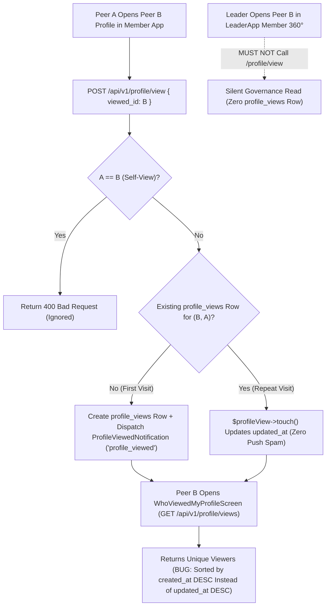

# Activity 33: Who Viewed My Profile

| Attribute | Verified Audit Classification |
|---|---|
| **Workbook Activity #** | `33` |
| **Exact Workbook Name** | `Who Viewed My Profile` |
| **Domain Category** | `Peer Discovery & Analytics` *(Sheet 3: `Telemetry / Discovery`)* |
| **Activity Governance Tier** | `Not Needed in Leader App` / `Member-Only` *(Strictly Personal Consumer Networking Insight & Privacy Boundary)* |
| **Overall Implementation Status** | `Not Required` *(in Leadership App)* · `Partially Implemented` *(in Member App & Backend via `profile_views` + `ProfileController@recordView`/`getViews` — minor `updated_at` sort & `PeerBlock` filter bugs identified)* |
| **Master Index & Cross-Links** | [12-master-35-activities-index.md](../12-master-35-activities-index.md) · [19-activity-to-role-access-matrix.md](../19-activity-to-role-access-matrix.md) · [25-activity-workflow-reference.md](../25-activity-workflow-reference.md) · [29-blocked-users.md](./29-blocked-users.md) · [43-sensitive-data-and-finance-access.md](../43-sensitive-data-and-finance-access.md) |

---

## 1. Business Purpose (§9.1)

- **WORKBOOK REQUIREMENT:** Sheet 1 & Sheet 2 define Activity 33 as allowing a member to *"View which prospective clients and fellow chapter members recently visited your profile"*, captured automatically in the background when any peer opens the user's profile and displayed chronologically on `WhoViewedMyProfileScreen` with a 1-tap `"Connect"` action.
- **FACT:** In the Laravel 12 + Flutter Member App ecosystem, Activity 33 is implemented via `App\Models\ProfileView` (`profile_views`) and [ProfileController.php](file:///c:/Users/malic/OneDrive/Documents/GitHub/unity-app-new/app/Http/Controllers/Api/ProfileController.php#L657-L788):
  1. **Background Telemetry (`POST /api/v1/profile/view`):** When Peer A opens Peer B's profile in the Member App, `ProfileController@recordView` logs `(viewed_id = B, viewer_id = A)` in `profile_views` (ignoring self-views) and dispatches `ProfileViewedNotification` (`type = 'profile_viewed'`) on the first-ever view. Repeat views call `$profileView->touch()` without spamming repeat push alerts.
  2. **Personal Visitor Feed (`GET /api/v1/profile/views`):** Peer B opens [who_viewed_my_profile_screen.dart](file:///D:/office%20project/peers-unity/unity_app/lib/features/profile/presentation/screens/who_viewed_my_profile_screen.dart) to see unique peers who visited their profile (`UserMiniResource`).
  3. **Leader App Notification Filter Confirmation:** `LeaderNotificationsController` explicitly lists `'profile_viewed'` inside `CONSUMER_EXCLUDED_TYPES` (`subagent_3_activities_notifications.md:736`) so consumer profile-view alerts never clutter the Leadership App inbox.
- **STRICT PRIVACY GOVERNANCE BOUNDARY (Enforced Across All Roles Including Super Admin):**
  - **Why `Not Required` in Leadership App:** *"Who Viewed My Profile"* is a personal LinkedIn-style social warmth signal for the profile owner alone. Allowing Circle Leaders, Regional Directors, or even `Super Admin` to inspect who browsed whose profile — OR recording a `profile_views` row when a Leader inspects a peer inside the **Leadership App Member 360°** (`GET /api/v1/leader/members/{member_id}`) — would both violate peer browsing privacy and tip off members whenever leadership is auditing their account!
  - **Two Hard Governance Rules:**
    1. **Zero Surveillance Access:** Neither Circle Leaders nor `Super Admin` may browse another user's `profile_views` log (`DENIED` across all leadership roles per Master Governance Rule #8).
    2. **Silent Governance Inspection:** Opening a member's profile in the **Leadership App** (`LeaderPeersController@show` / `LeaderMemberController@show`) MUST **never** trigger `POST /api/v1/profile/view` or insert into `profile_views`.

---

## 2. Sub-Activities Catalogue (§9.2)

| # | Sub-Activity / Atomic Operation | Member App (`unity_app`) | Leadership App (`LeaderApp`) | React Admin Web (`unity-admin-web`) / Blade | Laravel 12 Backend (`unity-app-new`) | Classification |
|---|---|---|---|---|---|---|
| **33.1** | **Record Background Peer Profile Visit & First-View Push Alert** | `peer_profile_screen.dart` (`POST /api/v1/profile/view`) | `Not Required` *(Leader 360° views must remain silent!)* | `Not Required` | `ProfileController@recordView` → `ProfileView` + `ProfileViewedNotification` | `Fully Implemented` *(with minor `PeerBlock` check missing)* |
| **33.2** | **View Own Chronological Profile Visitors List** | `who_viewed_my_profile_screen.dart` (`GET /api/v1/profile/views`) | `Not Required` | `Not Required` (Privacy boundary) | `ProfileController@getViews` (`UserMiniResource`) | `Implemented but Incorrect` *(Orders by `created_at DESC` instead of `updated_at DESC` after `touch()`; loads all rows in memory before slicing; misses `PeerBlock` exclusion!)* |
| **33.3** | **Daily / Last-7-Days Visitor Counter (`viewsLast7Days`)** | Total `total_views` only | `Not Required` | `Not Required` | Returns `total_views` (lifetime unique viewers); **no** `viewsLast7Days` breakdown | `Partially Implemented` *(Workbook metric mismatch)* |
| **33.4** | **Suppress `'profile_viewed'` Noise from Leadership App Inbox** | Shown in Member App inbox | Excluded via `CONSUMER_EXCLUDED_TYPES` | N/A | `LeaderNotificationsController` | `Fully Implemented` |

---

## 3. Input Form & Field Validation Mapping (§9.3)

**FACT:** Activity 33 has no manual user form; inputs are background telemetry and pagination parameters on [ProfileController.php](file:///c:/Users/malic/OneDrive/Documents/GitHub/unity-app-new/app/Http/Controllers/Api/ProfileController.php#L657-L740).

| Field Name | Data Type | Required/Optional | Validation | Default | Input Widget | Data Source | Visibility | Who Enters | Who Edits | Who Views | Sensitive? | Backend Request Key |
|---|---|---|---|---|---|---|---|---|---|---|---|---|
| **Viewed Peer User ID** | `uuid` | Required *(on Record)* | Non-empty valid UUID (`Str::isUuid`), `exists:users,id`, `!= $viewer->id` (`400` on self-view) | Opened peer profile | Automatic background call on profile mount | `users.id` | Visible only to `viewed_id` | Member App (background) | `updated_at` touched on repeat visit | **Viewed Member (`viewed_id`) Only** | **Yes** *(Browsing telemetry)* | `viewed_id` *(aliases: `user_id`, `peer_id`)* |
| **Page Number (`page`)** | `integer` | Optional *(Query)* | `max(1, (int) $page)` | `1` | Infinite scroll (`WhoViewedMyProfileScreen`) | Query string | Member's own visitor feed | Member App | N/A | Viewed Member Only | No | `page` |
| **Items Per Page (`per_page`)** | `integer` | Optional *(Query)* | Clamped `1..100` | `15` | Implicit pagination | Query string | Member's own visitor feed | Member App | N/A | Viewed Member Only | No | `per_page` |

---

## 4. Workflow, Lifecycle & Mermaid Diagram (§9.4)

### Workbook vs Actual PostgreSQL Lifecycle Comparison
- **WORKBOOK REQUIREMENT:** `Profile Opened -> Background Event Logged -> Aggregated in Feed`.
- **FACT (Actual Database & Code Logic):**
  - `profile_views` has no status column; each `(viewed_id, viewer_id)` pair maintains a single deduplicated row.
  - **Code Bug #1 (`created_at` vs `updated_at` Sort):** On repeat visits (`ProfileController.php:691`), `recordView()` calls `$profileView->touch()`, which updates `updated_at`. However, `getViews()` (`L727`) runs `->orderBy('created_at', 'desc')` and serializes `'viewed_at' => $view->created_at` (`L761`) — so repeat visitors stay buried at their **first-ever** visit date instead of rising to the top of the chronological list!
  - **Code Bug #2 (Missing `PeerBlock` Guard):** Neither `recordView()` (`L674`) nor `getViews()` (`L726`) checks `PeerBlockService::isBlockedEitherWay()`, meaning a blocked user can still trigger or appear in `profile_views`.

---

## 5. Outputs & Deliverables (§9.5)

| Deliverable / Output | Workbook Spec | Actual Codebase Reality | Verification Label |
|---|---|---|---|
| **Chronological Profile Visitors List** | `WhoViewedMyProfileScreen` with timestamp & 1-tap Connect | Implemented in [who_viewed_my_profile_screen.dart](file:///D:/office%20project/peers-unity/unity_app/lib/features/profile/presentation/screens/who_viewed_my_profile_screen.dart) backed by `UserMiniResource` + `viewed_at` ISO-8601 timestamp | **FACT** (`Implemented but Incorrect` — uses `created_at` instead of `updated_at`) |
| **First-Visit Push & In-App Notification** | Background alert | `ProfileViewedNotification` dispatched via `PushNotificationService::storeAndSend` (`notification_type = 'profile_viewed'`) | **FACT** (`Fully Implemented`) |
| **7-Day / Weekly Visitor Counter (`viewsLast7Days`)** | Daily / Weekly visitor count | Only lifetime unique `total_views` is returned (`ProfileController.php:775`); no 7-day rolling counter | **NOT IMPLEMENTED** |

---

## 6. Database & Metrics Mapping (§9.6)

### Eloquent Model & PostgreSQL Table
- **`App\Models\ProfileView`** (`app/Models/ProfileView.php` → `profile_views`):
  - **Columns:** `id` (`uuid`), `viewed_id` (`uuid` FK → `users.id`), `viewer_id` (`uuid` FK → `users.id`), `created_at` (`timestamp`), `updated_at` (`timestamp`).
  - **Relationships:** `viewed()` (`belongsTo User`), `viewer()` (`belongsTo User`).
- **Ownership & Strict Self Scope:** `ProfileController@getViews` queries `ProfileView::where('viewed_id', $user->id)` exclusively for the authenticated user (`L726`). No admin, leader, or DED endpoint accesses `profile_views`.

### Sheet 3 Workbook Metric Keys vs Actual Database Mapping
| Workbook Metric Key (Sheet 1 & Sheet 3) | Actual Backend / SQL Equivalent | Status |
|---|---|---|
| `profileViewsCount` | `data.total_views` (unique `viewer_id` count for `viewed_id = auth()->id()`) | `Fully Implemented` (`FACT`) |
| `recentVisitorPeerIds` | `data.views[*].viewer.id` | `Fully Implemented` (`FACT`) |
| `viewsLast7Days` | **None** (could be computed as `where('updated_at', '>=', now()->subDays(7))->count()`) | **NOT IMPLEMENTED** |

---

## 7. API & Backend Service Mapping (§9.7)

| Surface | Method & Endpoint | Controller & Action | Service Layer | Auth Middleware | Scope Enforcement & Security Audit | Flutter / Web Integration |
|---|---|---|---|---|---|---|
| **Member API** | `POST /api/v1/profile/view` | `Api\ProfileController@recordView` | `PushNotificationService` + `ProfileViewedNotification` | `auth:sanctum`, `unity.user` | Self-view blocked; **Gap:** Add `PeerBlockService::isBlockedEitherWay` check | Wired in `unity_app` (`ApiEndpoints.profileView`) |
| **Member API** | `GET /api/v1/profile/views` | `Api\ProfileController@getViews` | `UserMiniResource` | `auth:sanctum`, `unity.user` | Strictly self-scoped (`viewed_id = $user->id`); **Bugs:** Orders by `created_at` instead of `updated_at`, loads full collection in PHP memory (`->get()->unique()`), and misses `PeerBlock` filter | Wired in `unity_app` (`WhoViewedMyProfileScreen`) |
| **Leader / DED / Admin APIs** | *None* | *None* | *None* | N/A | **Properly Absent:** Zero Leader, DED, or Admin endpoints read `profile_views` | `Not Required` (Do NOT create) |

### Workbook Cloud Services vs Actual Laravel 12 Services
- **WORKBOOK REQUIREMENT:** `ProfileViewTelemetryService` and `VisitorAggregationWorker`.
- **FACT:** Handled synchronously inside `ProfileController@recordView` and `@getViews` against `profile_views` in PostgreSQL.

---

## 8. Role-Wise Access Governance (§9.8)

> **Mandatory Privacy Enforcement:** Just like `peer_blocks` (Activity 29), private `profile_views` telemetry is strictly **Self-Only (`Own`)**. Neither Circle Leaders, Regional Directors, nor `Super Admin` may inspect another member's profile-view log.

| Role (`UserRoleResolverService` / `roles.key`) | View activity *(Others' Profile Views)* | Create record *(Log Peer View)* | Edit own | Edit others | Submit for review | Verify | Approve | Reject | Assign | Manage | Delete | View aggregated reports |
|---|---|---|---|---|---|---|---|---|---|---|---|---|
| **Super Admin** (`superAdmin` / `global_admin`) | DENIED — No permission under the verified backend authorization model. *(Strict Member Privacy Boundary — cannot browse others' `profile_views`)* | Allowed (**Only** as regular Peer in Member App; Leader/Admin views stay silent) | N/A | DENIED — No permission under the verified backend authorization model. | DENIED — No permission under the verified backend authorization model. | DENIED — No permission under the verified backend authorization model. | DENIED — No permission under the verified backend authorization model. | DENIED — No permission under the verified backend authorization model. | DENIED — No permission under the verified backend authorization model. | DENIED — No permission under the verified backend authorization model. | DENIED — No permission under the verified backend authorization model. | DENIED — No permission under the verified backend authorization model. |
| **Country Director** (`countryDirector` / `eed`) | DENIED — No permission under the verified backend authorization model. | Allowed (Member App only) | N/A | DENIED — No permission under the verified backend authorization model. | DENIED — No permission under the verified backend authorization model. | DENIED — No permission under the verified backend authorization model. | DENIED — No permission under the verified backend authorization model. | DENIED — No permission under the verified backend authorization model. | DENIED — No permission under the verified backend authorization model. | DENIED — No permission under the verified backend authorization model. | DENIED — No permission under the verified backend authorization model. | DENIED — No permission under the verified backend authorization model. |
| **DED** (`districtExecDirector` / `ded`) | DENIED — No permission under the verified backend authorization model. | Allowed (Member App only) | N/A | DENIED — No permission under the verified backend authorization model. | DENIED — No permission under the verified backend authorization model. | DENIED — No permission under the verified backend authorization model. | DENIED — No permission under the verified backend authorization model. | DENIED — No permission under the verified backend authorization model. | DENIED — No permission under the verified backend authorization model. | DENIED — No permission under the verified backend authorization model. | DENIED — No permission under the verified backend authorization model. | DENIED — No permission under the verified backend authorization model. |
| **Industry Director** (`industryDirector` / `industry_director`) | DENIED — No permission under the verified backend authorization model. | Allowed (Member App only) | N/A | DENIED — No permission under the verified backend authorization model. | DENIED — No permission under the verified backend authorization model. | DENIED — No permission under the verified backend authorization model. | DENIED — No permission under the verified backend authorization model. | DENIED — No permission under the verified backend authorization model. | DENIED — No permission under the verified backend authorization model. | DENIED — No permission under the verified backend authorization model. | DENIED — No permission under the verified backend authorization model. | DENIED — No permission under the verified backend authorization model. |
| **Circle Founder** (`circleFounder` / `circle_founder`) | DENIED — No permission under the verified backend authorization model. | Allowed (Member App only) | N/A | DENIED — No permission under the verified backend authorization model. | DENIED — No permission under the verified backend authorization model. | DENIED — No permission under the verified backend authorization model. | DENIED — No permission under the verified backend authorization model. | DENIED — No permission under the verified backend authorization model. | DENIED — No permission under the verified backend authorization model. | DENIED — No permission under the verified backend authorization model. | DENIED — No permission under the verified backend authorization model. | DENIED — No permission under the verified backend authorization model. |
| **Circle Director** (`circleDirector` / `circle_director`) | DENIED — No permission under the verified backend authorization model. | Allowed (Member App only) | N/A | DENIED — No permission under the verified backend authorization model. | DENIED — No permission under the verified backend authorization model. | DENIED — No permission under the verified backend authorization model. | DENIED — No permission under the verified backend authorization model. | DENIED — No permission under the verified backend authorization model. | DENIED — No permission under the verified backend authorization model. | DENIED — No permission under the verified backend authorization model. | DENIED — No permission under the verified backend authorization model. | DENIED — No permission under the verified backend authorization model. |
| **Chair / Committee Chairs** (`chairBusinessGrowth`, `chairMembership`, `chairEventsPrograms`, `circleChair`) | DENIED — No permission under the verified backend authorization model. | Allowed (Member App only) | N/A | DENIED — No permission under the verified backend authorization model. | DENIED — No permission under the verified backend authorization model. | DENIED — No permission under the verified backend authorization model. | DENIED — No permission under the verified backend authorization model. | DENIED — No permission under the verified backend authorization model. | DENIED — No permission under the verified backend authorization model. | DENIED — No permission under the verified backend authorization model. | DENIED — No permission under the verified backend authorization model. | DENIED — No permission under the verified backend authorization model. |
| **Vice Chair** (`viceChair` / `vice_chair`) | DENIED — No permission under the verified backend authorization model. | Allowed (Member App only) | N/A | DENIED — No permission under the verified backend authorization model. | DENIED — No permission under the verified backend authorization model. | DENIED — No permission under the verified backend authorization model. | DENIED — No permission under the verified backend authorization model. | DENIED — No permission under the verified backend authorization model. | DENIED — No permission under the verified backend authorization model. | DENIED — No permission under the verified backend authorization model. | DENIED — No permission under the verified backend authorization model. | DENIED — No permission under the verified backend authorization model. |
| **Secretary** (`secretary`) | DENIED — No permission under the verified backend authorization model. | Allowed (Member App only) | N/A | DENIED — No permission under the verified backend authorization model. | DENIED — No permission under the verified backend authorization model. | DENIED — No permission under the verified backend authorization model. | DENIED — No permission under the verified backend authorization model. | DENIED — No permission under the verified backend authorization model. | DENIED — No permission under the verified backend authorization model. | DENIED — No permission under the verified backend authorization model. | DENIED — No permission under the verified backend authorization model. | DENIED — No permission under the verified backend authorization model. |
| **Committee Leader** (`committee_leader`) | DENIED — No permission under the verified backend authorization model. | Allowed (Member App only) | N/A | DENIED — No permission under the verified backend authorization model. | DENIED — No permission under the verified backend authorization model. | DENIED — No permission under the verified backend authorization model. | DENIED — No permission under the verified backend authorization model. | DENIED — No permission under the verified backend authorization model. | DENIED — No permission under the verified backend authorization model. | DENIED — No permission under the verified backend authorization model. | DENIED — No permission under the verified backend authorization model. | DENIED — No permission under the verified backend authorization model. |
| **Peer Member** (`member`) | Allowed (**Strictly Own** `GET /api/v1/profile/views` only) | Allowed (`POST /api/v1/profile/view` on unblocked peers) | N/A | DENIED — No permission under the verified backend authorization model. | DENIED — No permission under the verified backend authorization model. | DENIED — No permission under the verified backend authorization model. | DENIED — No permission under the verified backend authorization model. | DENIED — No permission under the verified backend authorization model. | DENIED — No permission under the verified backend authorization model. | DENIED — No permission under the verified backend authorization model. | DENIED — No permission under the verified backend authorization model. | DENIED — No permission under the verified backend authorization model. |

---

## 9. Existing Implementation Summary, Gaps & Minimum-Change Enhancement Recommendations

| # | Audit Dimension | Verified Assessment |
|---|---|---|
| **1** | **Member App Status (`unity_app`)** | `Fully Implemented` (`WhoViewedMyProfileScreen` + background `profileView` ping). |
| **2** | **Leadership App Status (`LeaderApp`)** | `Not Required` — Correctly excluded from `LeaderApp` screens and `LeaderNotificationsController` (`CONSUMER_EXCLUDED_TYPES`). |
| **3** | **Admin Web & Blade Status** | `Not Required` — Correctly excluded from `unity-admin-web`. |
| **4** | **Backend & Database Status** | `ProfileController@recordView` and `@getViews` (`profile_views`) work, with three targeted backend fixes needed (`updated_at` sort, SQL `DISTINCT ON` pagination instead of PHP `.get()->unique()`, and `PeerBlock` filtering). |
| **5** | **Workbook vs Codebase Discrepancies** | Workbook mentions `viewsLast7Days` and `VisitorAggregationWorker`; actual implementation computes unique lifetime viewers synchronously. |
| **6** | **Security, RBAC & Scope Vulnerabilities** | **(`P2` Privacy Gap)** `ProfileController@recordView` and `@getViews` do not exclude mutually blocked users (`PeerBlockService`), allowing a blocked peer to trigger or remain visible in `profile_views`. |
| **7** | **Notification & Audit Trail Gaps** | First visit sends `ProfileViewedNotification`; repeat visits silently `touch()` `updated_at` (good anti-spam design). |
| **8** | **Leadership App Disposition** | **`Not Required` (Strict Prohibition)**: Keep Activity 33 100% out of `LeaderApp` and ensure Leader Member 360° reads never write to `profile_views`. |
| **9** | **Minimum-Change Enhancement Plan** | 1. In `ProfileController@getViews` (`L727` & `L761`), change `orderBy('created_at', 'desc')` to `orderBy('updated_at', 'desc')` and return `'viewed_at' => $view->updated_at`, using SQL pagination rather than loading all rows into memory. 2. Add `PeerBlockService::isBlockedEitherWay()` guard in both `recordView()` and `getViews()`. |
| **10** | **Open Business Decisions** | None required — keeping `"Who Viewed My Profile"` strictly consumer-only is confirmed. |
