# Activity 34: Profile Edit History & Last Updated

| Attribute | Verified Audit Classification |
|---|---|
| **Workbook Activity #** | `34` |
| **Exact Workbook Name** | `Profile Edit History & Last Updated` |
| **Domain Category** | `Profile & Identity` *(Sheet 3: `Identity / Profile Sync`)* |
| **Activity Governance Tier** | `Leadership Oversight` *(for Scoped Peer Profile Completeness & Authorized `manage_peers` Basic Contact Assist)* + `Global Administration` *(for Full Peer Profile Editing & `admin_audit_logs` Diff History)* |
| **Overall Implementation Status** | `Implemented but Incorrect` *(Member 8-module profile editing + OTP email/phone verification + Admin `admin_audit_logs` work; **HOWEVER**, no `profile_edit_histories` table exists for member self-edits, AND in Leadership App `LeaderPeersController::update()` is 100% UNROUTED while `EditPeerBottomSheet` swallows the HTTP failure via `catch (_) {}` and fakes success in UI!)* |
| **Master Index & Cross-Links** | [12-master-35-activities-index.md](../12-master-35-activities-index.md) · [19-activity-to-role-access-matrix.md](../19-activity-to-role-access-matrix.md) · [25-activity-workflow-reference.md](../25-activity-workflow-reference.md) · [04-i-can-help-profiles-and-tags.md](./04-i-can-help-profiles-and-tags.md) · [24-member-management-flow.md](../24-member-management-flow.md) |

---

## 1. Business Purpose (§9.1)

- **WORKBOOK REQUIREMENT:** Sheet 1 & Sheet 2 define Activity 34 as allowing members to *"Update and maintain the 8 modular profile sections (Personal, Business, Goals, Social, Portfolio, Journey, Circle, Additional)"* via `EditProfileOverviewScreen`, tracking `Profile Completion %` and `updated_at` (*Last Updated audit timestamp*) with real-time directory sync.
- **FACT:** A forensic inspection across all four repositories reveals **five critical architectural realities** governing profile updates and audit history:
  1. **Member 8-Section Modular Profile (`unity_app`):** Fully implemented across `edit_profile_overview_screen.dart` and its 8 sub-screens (`edit_personal_info_screen.dart`, `edit_business_info_screen.dart`, `edit_interests_goals_screen.dart`, `edit_social_links_screen.dart`, `edit_media_portfolio_screen.dart`, `edit_professional_journey_screen.dart`, `edit_circle_membership_screen.dart`, `edit_additional_info_screen.dart`), saving to `PUT|PATCH|POST /api/v1/profile` (`ProfileController@update`) and nudged hourly by cron `profile-completion:send-reminders`.
  2. **OTP-Verified Primary Email & Phone Changes (`contact_change_otps`):** Changing a member's primary email or phone requires two-step OTP verification via [ContactChangeController.php](file:///c:/Users/malic/OneDrive/Documents/GitHub/unity-app-new/app/Http/Controllers/Api/V1/Profile/ContactChangeController.php#L25-L120) (`ContactChangeOtpService` → `contact_change_otps`).
  3. **No `profile_edit_histories` Table for Member Self-Edits:** When a member edits their own profile, `ProfileController@update` updates `users.updated_at` and writes `Log::info('profile_update_saved', ['user_id' => ..., 'updated_fields' => ...])` to the Laravel log file — **not** a queryable PostgreSQL `profile_edit_histories` table. By contrast, **Admin edits** (`PUT|PATCH /api/v1/admin/peers/{id}` in `UserManagementController@update`) **do** persist exact `{ old, new }` JSON diffs to `admin_audit_logs` (`action = 'admin.user.update'`), and **Website Leadership Nominations** snapshot profile diffs in `web_leadership_nominations.profile_changes`.
  4. **BROKEN Leader Peer Edit (`Unrouted Controller` + `Silent UI Catch` Bug):**
     - Backend [LeaderPeersController.php](file:///c:/Users/malic/OneDrive/Documents/GitHub/unity-app-new/app/Leader/Controllers/LeaderPeersController.php#L183-L261) defines `update(LeaderUpdatePeerRequest $request, string $id)`, **but ZERO `PUT` or `PATCH /peers/{id}` or `/leader/peers/{id}` routes exist in `routes/leader.php`!**
     - Meanwhile, in the Flutter Leadership App, [edit_peer_bottom_sheet.dart](file:///D:/office%20project/LeaderApp-Fornt-end-/lib/features/peer_profile/view/widgets/edit_peer_bottom_sheet.dart#L123-L136) calls `await ApiClient().put(ApiEndpoints.peerDetails(widget.peer.id), body: updated.toJson())` inside `try { ... } catch (_) {}`, **silently swallowing the `404`/`405` error**, invoking `widget.onUpdated(updated)`, and closing the bottom sheet so the Leader believes the edit was saved when PostgreSQL was never touched!
     - Worse, if `LeaderPeersController::update()` were naively routed as-is, it allows overwriting `users.email`, `users.phone`, and `users.status` **without** OTP verification, **without** circle scope checks (IDOR!), and **without** writing to `admin_audit_logs`!
  5. **Privacy Flag Bypass in Leader Directory:** `LeaderPeersService::formatPeerCard()` (`LeaderPeersService.php:616-617`) serializes raw `phone` and `email` unconditionally on peer list cards, ignoring `users.hide_phone` / `users.hide_email`!

---

## 2. Sub-Activities Catalogue (§9.2)

| # | Sub-Activity / Atomic Operation | Member App (`unity_app`) | Leadership App (`LeaderApp`) | React Admin Web (`unity-admin-web`) / Blade | Laravel 12 Backend (`unity-app-new`) | Classification |
|---|---|---|---|---|---|---|
| **34.1** | **Member 8-Module Self-Profile Edit & Completion % Calculation** | `edit_profile_overview_screen.dart` + 8 modular edit screens (`PUT /api/v1/profile`) | `Not Required` (consumer 8-module wizard) | `PeerEditorPage.tsx` (6 edit tabs) | `ProfileController@show`, `@update` (`UpdateProfileRequest`, `users.updated_at`) | `Fully Implemented` |
| **34.2** | **OTP-Gated Primary Email & Phone Change (`contact_change_otps`)** | `edit_personal_info_screen.dart` (`/profile/change-email/*`, `/change-phone/*`) | `Missing` *(Leader own profile edit `PUT /leader/profile` updates `phone` directly without OTP!)* | Admin override (`PersonalProfileEditTab.tsx`) | `ContactChangeController` → `ContactChangeOtpService` | `Fully Implemented` *(Member App)* |
| **34.3** | **Leader Own Profile & Avatar Update** | Synced via shared `users` row | `edit_profile_bottom_sheet.dart` (`PUT /leader/profile`, `POST /leader/auth/profile/avatar`) | N/A | `LeaderAuthController@updateProfile`, `@uploadAvatar` | `Fully Implemented` |
| **34.4** | **Leader Edit Scoped Peer Profile (`EditPeerBottomSheet`)** | N/A | `edit_peer_bottom_sheet.dart` (`PUT /leader/peers/{id}`) | `PeerEditorPage.tsx` (`PUT /admin/peers/{id}`) | `LeaderPeersController::update()` + `LeaderUpdatePeerRequest` — **100% UNROUTED!** | `Implemented but Not Integrated` + `Implemented but Incorrect` *(Unrouted + silent `catch (_) {}` + missing scope/OTP/audit guards!)* |
| **34.5** | **Database-Backed Profile Edit Diff History (`old_values` vs `new_values`)** | **NOT IMPLEMENTED** for self-edits (only `updated_at` shown) | `Missing` | `AuditLogsPage.tsx` (`AuditDetailDrawer.tsx` — shows Admin edits only) | `AdminAuditService` writes `admin.user.update` to `admin_audit_logs`; member self-edits only write `Log::info` | `Partially Implemented` *(Admin edits audited; Member self-edits lack DB diff history)* |
| **34.6** | **Custom Business Category Submission on Profile Edit** | `edit_business_info_screen.dart` | N/A | Admin Category Review | `CustomCategoryRequest` (`custom_category_requests`) | `Fully Implemented` |

---

## 3. Input Form & Field Validation Mapping (§9.3)

### Table 3A — Member 8-Section Profile & OTP Contact Change (`PUT /api/v1/profile` & `ContactChangeController`)
| Field Name | Data Type | Required/Optional | Validation | Default | Input Widget | Data Source | Visibility | Who Enters | Who Edits | Who Views | Sensitive? | Backend Request Key |
|---|---|---|---|---|---|---|---|---|---|---|---|---|
| **1. Personal Info (`first_name`, `last_name`, `display_name`, `dob`, `anniversary`, `gender`, `city`, `state`, `country`)** | `string` / `date` | `first_name` Required; others Optional | `max:100..150`, valid `date` (`UpdateProfileRequest`) | Current `User` fields | `EditPersonalInfoScreen` inputs & date pickers | `users`, `countries`, `cities` | Public Peer Profile (DOB year optional; celebrations feed) | Peer Member | Member, Super Admin | Peers, Scoped Leaders, Admin | Partial *(DOB)* | `first_name`, `last_name`, `display_name`, `date_of_birth`, `wedding_anniversary`, `city`, `state`, `country` |
| **Primary Email & Phone (OTP-Protected)** | `email` / `phone` + `otp` | Required *(on Change)* | Unique on `users` + valid 6-digit `otp` in `contact_change_otps` | Current `email` / `phone` | OTP verification sheet | `contact_change_otps` | Masked if `hide_email` / `hide_phone` = `true` | Peer Member | Member (with OTP), Super Admin | Respect `hide_phone` / `hide_email`! | **Yes** *(Auth identifier & PII)* | `email`, `phone`, `country_code`, `otp` |
| **2. Business Info (`company_name`, `designation`, `business_category_id`, `gst_number`, `turnover_range`, `team_size`, `business_address`)** | `string` / `uuid` | Optional (Recommended for 100%) | String/UUID limits (`UpdateProfileRequest`) | Current `User` fields | `EditBusinessInfoScreen` | `users`, `business_categories` | Peer Profile (`turnover_range` & `gst_number` sensitive) | Peer Member | Member, Super Admin | Peers, Scoped Leaders, Admin | Partial *(`gst_number`, `turnover_range`)* | `company_name`, `designation`, `main_business_category_id`, `gst_number`, `turnover_range`, `team_size` |
| **3. Interests & Goals (`i_can_help_with`, `i_am_looking_for`, `collaboration_goals`, `interests`)** | `array<string>` | Optional | JSON string arrays | `[]` | Chip inputs (`EditInterestsGoalsScreen`) | `users` JSON columns | Public Peer Profile & Ask Matching | Peer Member | Member, Super Admin | All Peers & Leaders | No | `i_can_help_with`, `i_am_looking_for`, `collaboration_goals`, `interests` |
| **4. Social Links (`linkedin_url`, `website`, `instagram_url`, `facebook_url`, `twitter_url`, `youtube_url`)** | `string` (`url`) | Optional | `nullable\|url\|max:255` | `null` | URL inputs (`EditSocialLinksScreen`) | `users` | Public Peer Profile | Peer Member | Member, Super Admin | All Peers & Leaders | No | `linkedin_url`, `website`, `instagram_url`, `facebook_url`, `twitter_url`, `youtube_url` |
| **5. Media & Portfolio (`profile_photo_file_id`, `cover_photo_file_id`, `profile_video_id`)** | `uuid` | Optional | `exists:files,id` | `null` | Image cropper & video uploader (`EditMediaPortfolioScreen`) | `files.id` | Public Peer Profile & Shorts | Peer Member | Member, Super Admin | All Peers & Leaders | No | `profile_photo_file_id`, `cover_photo_file_id`, `intro_video_id` |
| **6. Professional Journey (`experience_years`, `experience_summary`, `skills`, `awards`)** | `int` / `text` / `array` | Optional | `integer\|min:0`, `array` | `null` / `[]` | `EditProfessionalJourneyScreen` | `users` | Public Peer Profile | Peer Member | Member, Super Admin | All Peers & Leaders | No | `total_experience_years`, `experience_summary`, `skills`, `awards` |
| **7. Additional & Privacy Flags (`bio`, `superpower`, `willing_to_mentor`, `open_to_speaking_at_events`, `hide_phone`, `hide_email`)** | `text` / `bool` | Optional | `boolean`, `string\|max:1000` | `false` (visibility) | Toggles & text (`EditAdditionalInfoScreen`) | `users` | Controls contact privacy across Member & Leader apps! | Peer Member | **Member Only** *(Leaders must NOT override `hide_phone`/`hide_email`!)* | Self, Admin | **Yes** *(Privacy consent flags)* | `bio`, `superpower`, `willing_to_mentor`, `open_to_speaking_at_events`, `hide_phone`, `hide_email` |

### Table 3B — Leader App `EditPeerBottomSheet` Fields ([edit_peer_bottom_sheet.dart](file:///D:/office%20project/LeaderApp-Fornt-end-/lib/features/peer_profile/view/widgets/edit_peer_bottom_sheet.dart#L39-L136) — **Currently Broken/Unrouted**)
| Field Name | Data Type | Required/Optional | Validation | Default | Input Widget | Data Source | Visibility | Who Enters | Who Edits | Who Views | Sensitive? | Backend Request Key |
|---|---|---|---|---|---|---|---|---|---|---|---|---|
| **Full Name** | `string` | Required | Non-empty in UI; `max:150` in `LeaderUpdatePeerRequest` | `peer.name` | `TextField` | `GET /leader/peers/{id}` | Peer Directory & Profile | `manage_peers` Leader | Member, Scoped `manage_peers` Leader, Admin | All Peers & Leaders | No | `name` |
| **Company & Designation** | `string` | Optional | `max:150` | `peer.company`, `peer.designation` | `TextField` | `users` | Peer Directory & Profile | `manage_peers` Leader | Member, Scoped `manage_peers` Leader, Admin | All Peers & Leaders | No | `company`, `designation` |
| **Phone & Email *(Hazard if Unguarded!)*** | `string` | Optional | E.164 check in UI; `max:20` / `email` in request | `peer.phone`, `peer.email` | `InternationalPhoneField` + `TextField` | `users` | **SECURITY RISK:** Editing a peer's login email/phone without OTP allows account hijacking (`AdminUser` email link)! Restrict to `Super Admin` only! | Currently shown to Leader | **Restrict to `Super Admin` or Member OTP** | Respect `hide_phone`/`hide_email` | **Yes** *(Critical Auth Identifier!)* | `phone`, `email` |

---

## 4. Workflow, Lifecycle & Mermaid Diagram (§9.4)

### Workbook vs Actual PostgreSQL Lifecycle Comparison
- **WORKBOOK REQUIREMENT:** `Fields Modified -> Saved -> ElasticSearch Synced -> Audit Timestamp Set` (via `ProfileUpdatePipeline` & `ElasticsearchSyncWorker`).
- **FACT:**
  - **Zero Elasticsearch:** Search across the platform uses PostgreSQL `ILIKE` / JSON queries, not Elasticsearch.
  - **Audit Divergence:** Member self-edits update `users.updated_at` + application log `profile_update_saved`; Admin edits write structured `old`/`new` diffs to `admin_audit_logs`; Leader `EditPeerBottomSheet` hits an unrouted URL, catches the error silently, and writes nothing!

```mermaid
flowchart TD
    subgraph MemberSelfEdit["Member App 8-Module Edit"]
        M1["Member Edits Section (EditProfileOverviewScreen)"] --> M2{"Email or Phone Changed?"}
        M2 -- "Yes" --> M3["ContactChangeController: Verify OTP (contact_change_otps)"]
        M2 -- "No" --> M4["PUT /api/v1/profile (ProfileController@update)"]
        M3 --> M4
        M4 --> M5["Persist users + Set users.updated_at + Log::info('profile_update_saved')"]
    end

    subgraph AdminEdit["Admin Web Peer Edit"]
        A1["Admin Edits Peer (PeerEditorPage.tsx)"] --> A2["PUT /api/v1/admin/peers/{id} (UserManagementController@update)"]
        A2 --> A3["Persist users + Write {old, new} Diff to admin_audit_logs ('admin.user.update')"]
    end

    subgraph LeaderEditBug["Leader App EditPeerBottomSheet (CURRENT BUG)"]
        L1["Leader Saves EditPeerBottomSheet"] --> L2["PUT /api/v1/leader/peers/{id} -> 404/405 (LeaderPeersController::update UNROUTED)"]
        L2 --> L3["catch (_) {} Swallows Error -> Updates Local State Only (Zero DB Persistence!)"]
    end
```

---

## 5. Outputs & Deliverables (§9.5)

| Deliverable / Output | Workbook Spec | Actual Codebase Reality | Verification Label |
|---|---|---|---|
| **Profile Completion % & Last Updated Timestamp** | `profileCompletionPct` & `updated_at` on `EditProfileOverviewScreen` | `users.updated_at` serialized in `UserResource` (`L273`) & `UserProfileResource`; completion % computed across modular fields + hourly reminder cron `profile-completion:send-reminders` | **FACT** (`Fully Implemented`) |
| **Admin Field-Level Diff Audit Trail** | Audit history | `AuditLogsPage.tsx` + `AuditDetailDrawer.tsx` render exact `old` vs `new` field diffs from `admin_audit_logs` (`admin.user.update`) | **FACT** (`Fully Implemented` for Admin edits) |
| **Member Self-Edit Historical Diff Log** | Profile Edit History | **Absent** in DB (only latest `users.updated_at` + server file `Log::info` + `contact_change_otps` history) | **NOT IMPLEMENTED** *(No `profile_edit_histories` table)* |
| **Elasticsearch Sync** | `ElasticsearchSyncWorker` | **Absent**; directory reads PostgreSQL directly in real time | **NOT IMPLEMENTED** *(Workbook Conceptual Service)* |

---

## 6. Database & Metrics Mapping (§9.6)

### Eloquent Models & PostgreSQL Tables
1. **`App\Models\User`** (`users`): Stores all 8 profile sections + `hide_phone`, `hide_email`, `updated_at`.
2. **`App\Models\ContactChangeOtp`** (`contact_change_otps`): `id` (`uuid`), `user_id`, `channel` (`email`|`phone`), `target_value`, `otp_hash`, `attempts`, `expires_at`, `consumed_at`, `created_at`.
3. **`App\Models\AdminAuditLog`** (`admin_audit_logs`): `id` (`uuid`), `admin_user_id`, `action` (`'admin.user.update'`), `target_type`, `target_id`, `details` (`json`: `old`, `new`, `actor_source`), `ip_address`, `user_agent`, `created_at`.
4. **`App\Models\ActivityLog`** (`activity_logs` — immutable) & **`App\Models\UserActivityLog`** (`user_activity_logs` — client forensic telemetry).
5. **`App\Models\CustomCategoryRequest`** (`custom_category_requests`): `id`, `user_id`, `category_name`, `status`.

### Sheet 3 Workbook Metric Keys vs Actual Database Mapping
| Workbook Metric Key (Sheet 1 & Sheet 3) | Actual Backend / SQL Equivalent | Status |
|---|---|---|
| `profileCompletionPct` | Computed dynamically across `User` profile attributes (`ProfileCompletion` logic / `UserProfileResource`) | `Fully Implemented` (`FACT`) |
| `profileUpdatedAt` | `users.updated_at` (ISO-8601 string) | `Fully Implemented` (`FACT`) |
| `profileSectionsFilled` | Computed per-section completion flags in `EditProfileOverviewScreen` | `Fully Implemented` (`FACT`) |

---

## 7. API & Backend Service Mapping (§9.7)

| Surface | Method & Endpoint | Controller & Action | Service Layer | Auth Middleware | Scope Enforcement & Security Audit | Flutter / Web Integration |
|---|---|---|---|---|---|---|
| **Member API** | `GET /api/v1/profile`, `PUT\|PATCH\|POST /api/v1/profile` | `Api\ProfileController@show`, `@update` | `UpdateProfileRequest` | `auth:sanctum`, `unity.user` | Strictly self-scoped (`$request->user()`) | Wired in `unity_app` (`EditProfileOverviewScreen`) |
| **Member OTP API** | `POST /api/v1/profile/change-email/{request-otp\|verify-otp}`, `.../change-phone/{request-otp\|verify-otp}` | `Api\V1\Profile\ContactChangeController` | `ContactChangeOtpService` | `auth:sanctum`, `unity.user` | Strictly self-scoped + hashed OTP challenge | Wired in `unity_app` |
| **Leader Own Profile** | `GET\|PUT /api/v1/leader/profile`, `POST /api/v1/leader/auth/profile/avatar` | `LeaderAuthController@profile`, `@updateProfile`, `@uploadAvatar` | `LeaderUpdateProfileRequest` | `auth:sanctum`, `leader.user` | Self-scoped; **Note:** `updateProfile` allows changing `phone` without OTP | Wired in `LeaderApp` (`EditProfileBottomSheet`) |
| **Leader Peer Edit *(Broken)*** | *(Missing `PUT /api/v1/leader/peers/{id}`)* | `LeaderPeersController@update` (**UNROUTED**) | `LeaderUpdatePeerRequest` | **0 Routes** | **Bugs in unrouted method:** No `leader.can:manage_peers`, no `$scopedCircleIds` check, allows editing `email`/`phone`/`hide_phone`/`hide_email`/`status`, no audit log! | Broken in `LeaderApp` (`EditPeerBottomSheet` silent `catch (_) {}`) |
| **Leader Member Flag/Note** | `POST /api/v1/leader/members/{member_id}/add-note`, `PATCH .../flag-status`, `POST .../send-reminder` | `LeaderMemberController` | `LeaderMember360Service` | `auth:sanctum`, `leader.user` | Scoped via `resolveMember()`; **Note:** Prefer `send-reminder` to nudge a peer to update their own profile! | Available in `LeaderMemberController` |
| **Admin API** | `PUT\|PATCH /api/v1/admin/peers/{id}`, `GET /api/v1/admin/audit-logs` | `UserManagementController@update`, `AuditLogAdminController` | `AdminPeerService`, `AdminAuditService` | `auth:sanctum`, `unity.user` | **CRITICAL P0 BUG:** `/api/v1/admin/*` lacks `admin.auth` / `admin.role` middleware — any mobile user can overwrite any other user's profile/email! | Wired in `unity-admin-web` (`PeerEditorPage.tsx`, `AuditLogsPage.tsx`) |

---

## 8. Role-Wise Access Governance (§9.8)

| Role (`UserRoleResolverService` / `roles.key`) | View activity *(Profile & `updated_at`)* | Create record | Edit own | Edit others *(Non-Auth Business Fields vs Auth Identifiers)* | Submit for review *(Custom Category)* | Verify *(OTP)* | Approve | Reject | Assign | Manage *(Audit Logs)* | Delete | View aggregated reports *(Completion %)* |
|---|---|---|---|---|---|---|---|---|---|---|---|---|
| **Super Admin** (`superAdmin` / `global_admin`) | Allowed (Global + `admin_audit_logs` diff history) | Allowed (`AddPeerModal.tsx`) | Allowed | Allowed (Full Peer Edit in Admin Web, logged to `admin_audit_logs`) | Allowed | Allowed | Allowed (Custom categories) | Allowed | DENIED — No permission under the verified backend authorization model. | Allowed (`AuditLogsPage.tsx`, `UserActivityLogsPage.tsx`) | Allowed (Soft-delete peer in Admin Web) | Allowed (Global completion metrics) |
| **Country Director** (`countryDirector` / `eed`) | Allowed (Country Scope, respecting `hide_phone`/`hide_email`) | DENIED — No permission under the verified backend authorization model. | Allowed (`PUT /leader/profile`) | **Limited (`manage_peers`):** Non-sensitive display fields (`name`, `company`, `designation`) within Country Scope **only if routed with audit log**; **NEVER** `email`/`phone`/`hide_*`! | Allowed (Own) | Allowed (Own OTP) | DENIED — No permission under the verified backend authorization model. | DENIED — No permission under the verified backend authorization model. | DENIED — No permission under the verified backend authorization model. | DENIED — No permission under the verified backend authorization model. | DENIED — No permission under the verified backend authorization model. | Allowed (Country Scope) |
| **DED** (`districtExecDirector` / `ded`) | Allowed (District Scope, respecting `hide_phone`/`hide_email`) | DENIED — No permission under the verified backend authorization model. | Allowed (`PUT /leader/profile`) | **Limited (`manage_peers`):** Non-sensitive fields (`name`, `company`, `designation`) in District Scope only; **NEVER** `email`/`phone`/`hide_*` | Allowed (Own) | Allowed (Own OTP) | DENIED — No permission under the verified backend authorization model. | DENIED — No permission under the verified backend authorization model. | DENIED — No permission under the verified backend authorization model. | DENIED — No permission under the verified backend authorization model. | DENIED — No permission under the verified backend authorization model. | Allowed (District Scope) |
| **Industry Director** (`industryDirector` / `industry_director`) | Allowed (Industry Scope, respecting `hide_phone`/`hide_email`) | DENIED — No permission under the verified backend authorization model. | Allowed (`PUT /leader/profile`) | DENIED — No permission under the verified backend authorization model. *(Lacks `manage_peers`)* | Allowed (Own) | Allowed (Own OTP) | DENIED — No permission under the verified backend authorization model. | DENIED — No permission under the verified backend authorization model. | DENIED — No permission under the verified backend authorization model. | DENIED — No permission under the verified backend authorization model. | DENIED — No permission under the verified backend authorization model. | Allowed (Industry Scope) |
| **Circle Founder** (`circleFounder` / `circle_founder`) | Allowed (Own Circle, respecting `hide_phone`/`hide_email`) | DENIED — No permission under the verified backend authorization model. | Allowed (`PUT /leader/profile`) | **Limited (`manage_peers`):** Non-sensitive fields (`name`, `company`, `designation`) in Own Circle + `POST /send-reminder`; **NEVER** `email`/`phone`/`hide_*` | Allowed (Own) | Allowed (Own OTP) | DENIED — No permission under the verified backend authorization model. | DENIED — No permission under the verified backend authorization model. | DENIED — No permission under the verified backend authorization model. | DENIED — No permission under the verified backend authorization model. | DENIED — No permission under the verified backend authorization model. | Allowed (Own Circle) |
| **Circle Director** (`circleDirector` / `circle_director`) | Allowed (Own Circle, respecting `hide_phone`/`hide_email`) | DENIED — No permission under the verified backend authorization model. | Allowed (`PUT /leader/profile`) | **Limited (`manage_peers`):** Non-sensitive fields (`name`, `company`, `designation`) in Own Circle + `POST /send-reminder`; **NEVER** `email`/`phone`/`hide_*` | Allowed (Own) | Allowed (Own OTP) | DENIED — No permission under the verified backend authorization model. | DENIED — No permission under the verified backend authorization model. | DENIED — No permission under the verified backend authorization model. | DENIED — No permission under the verified backend authorization model. | DENIED — No permission under the verified backend authorization model. | Allowed (Own Circle) |
| **Chair / Committee Chairs** (`chairBusinessGrowth`, `chairMembership`, `chairEventsPrograms`, `circleChair`) | Allowed (Own Circle, respecting `hide_phone`/`hide_email`) | DENIED — No permission under the verified backend authorization model. | Allowed (`PUT /leader/profile`) | DENIED — No permission under the verified backend authorization model. *(Lacks `manage_peers`)* | Allowed (Own) | Allowed (Own OTP) | DENIED — No permission under the verified backend authorization model. | DENIED — No permission under the verified backend authorization model. | DENIED — No permission under the verified backend authorization model. | DENIED — No permission under the verified backend authorization model. | DENIED — No permission under the verified backend authorization model. | Allowed (Own Circle) |
| **Vice Chair** (`viceChair` / `vice_chair`) | Allowed (Own Circle, respecting `hide_phone`/`hide_email`) | DENIED — No permission under the verified backend authorization model. | Allowed (`PUT /leader/profile`) | DENIED — No permission under the verified backend authorization model. | Allowed (Own) | Allowed (Own OTP) | DENIED — No permission under the verified backend authorization model. | DENIED — No permission under the verified backend authorization model. | DENIED — No permission under the verified backend authorization model. | DENIED — No permission under the verified backend authorization model. | DENIED — No permission under the verified backend authorization model. | DENIED — No permission under the verified backend authorization model. |
| **Secretary** (`secretary`) | Allowed (Own Circle, respecting `hide_phone`/`hide_email`) | DENIED — No permission under the verified backend authorization model. | Allowed (`PUT /leader/profile`) | DENIED — No permission under the verified backend authorization model. | Allowed (Own) | Allowed (Own OTP) | DENIED — No permission under the verified backend authorization model. | DENIED — No permission under the verified backend authorization model. | DENIED — No permission under the verified backend authorization model. | DENIED — No permission under the verified backend authorization model. | DENIED — No permission under the verified backend authorization model. | DENIED — No permission under the verified backend authorization model. |
| **Committee Leader** (`committee_leader`) | DENIED in Leader App (`403` bug); Allowed as Peer | DENIED — No permission under the verified backend authorization model. | Allowed (Member App) | DENIED — No permission under the verified backend authorization model. | Allowed (Own) | Allowed (Own OTP) | DENIED — No permission under the verified backend authorization model. | DENIED — No permission under the verified backend authorization model. | DENIED — No permission under the verified backend authorization model. | DENIED — No permission under the verified backend authorization model. | DENIED — No permission under the verified backend authorization model. | DENIED — No permission under the verified backend authorization model. |
| **Peer Member** (`member`) | Allowed (Own profile + `updated_at`; visible peers) | N/A *(Created at registration)* | Allowed (All 8 sections via `PUT /api/v1/profile` + OTP for email/phone) | DENIED — No permission under the verified backend authorization model. | Allowed (`custom_category_requests`) | Allowed (Own email/phone OTP) | DENIED — No permission under the verified backend authorization model. | DENIED — No permission under the verified backend authorization model. | DENIED — No permission under the verified backend authorization model. | DENIED — No permission under the verified backend authorization model. | Allowed (Request account deletion) | DENIED — No permission under the verified backend authorization model. |

---

## 9. Existing Implementation Summary, Gaps & Minimum-Change Enhancement Recommendations

| # | Audit Dimension | Verified Assessment |
|---|---|---|
| **1** | **Member App Status (`unity_app`)** | `Fully Implemented` (8 modular profile edit screens, OTP email/phone verification, completion % tracking). |
| **2** | **Leadership App Status (`LeaderApp`)** | `Implemented but Incorrect`: Leader own-profile edit works (`EditProfileBottomSheet`), **but** peer-profile edit (`EditPeerBottomSheet`) calls an unrouted endpoint (`PUT /leader/peers/{id}`) and silently swallows the failure (`catch (_) {}`), deceiving the user! |
| **3** | **Admin Web & Blade Status** | `Fully Implemented` (`PeerEditorPage.tsx` with 6 edit tabs + `AuditLogsPage.tsx` showing `old`/`new` JSON diffs). |
| **4** | **Backend & Database Status** | `ProfileController`, `ContactChangeController`, and `AdminAuditService` work; `LeaderPeersController::update()` is dead/unrouted and unsafe as written; member self-edits only log to `Log::info` rather than `activity_logs`. |
| **5** | **Workbook vs Codebase Discrepancies** | Workbook implies a queryable Profile Edit History + Elasticsearch sync; actual system tracks `users.updated_at` + Admin `admin_audit_logs` on PostgreSQL without Elasticsearch. |
| **6** | **Security, RBAC & Scope Vulnerabilities** | **1. (`P0`)** `/api/v1/admin/peers/{id}` lacks `admin.auth` middleware in `routes/api.php` — any mobile user can edit any peer's email/phone and hijack accounts! **2. (`P1`)** `LeaderPeersService::formatPeerCard()` (`L616-617`) leaks raw `phone` and `email` even when `users.hide_phone` / `hide_email` is `true`! **3. (`P1`)** `GET /api/v1/leader/peers/{id}` has zero circle scope enforcement (IDOR) and `?scope=global` on `GET /peers` dumps all platform users! **4. (`P1`)** `EditPeerBottomSheet` exposes `phone`, `email`, and `intro_video_url` without OTP or scope checks. |
| **7** | **Notification & Audit Trail Gaps** | Member self-edits should write field-level `{ old_values, new_values }` (redacting sensitive hashes) to the existing immutable `activity_logs` table via `ActivityLoggerService` so true edit history exists without creating a new table. |
| **8** | **Leadership App Disposition** | **Restrict or Replace `EditPeerBottomSheet`**: Recommended best practice is for members to own their identity fields (with Circle Directors using `POST /api/v1/leader/members/{member_id}/send-reminder` to nudge incomplete profiles). If `EditPeerBottomSheet` is kept for `manage_peers` roles, restrict it strictly to non-auth fields (`name`, `company_name`, `designation`) within `$scopedCircleIds` (`Super Admin` alone edits `email`/`phone` in Admin Web). |
| **9** | **Minimum-Change Enhancement Plan** | 1. Protect `PUT|PATCH /api/v1/admin/peers/{id}` behind `admin.auth` + `admin.permission:peers.edit` (`P0`). 2. Enforce `hide_phone` / `hide_email` masking in `LeaderPeersService::formatPeerCard()` and enforce `$scopedCircleIds` on `GET /leader/peers` & `GET /leader/peers/{id}`. 3. Either replace `EditPeerBottomSheet` with a *"Send Profile Update Reminder"* action for non-Super-Admins, OR route `PUT /api/v1/leader/peers/{id}` guarded by `leader.can:manage_peers` + `$scopedCircleIds` + stripped `email`/`phone`/`hide_*`/`intro_video_url` + mandatory `ActivityLoggerService` audit entry — and **remove `catch (_) {}`** in `edit_peer_bottom_sheet.dart:130` so real API errors surface in a SnackBar! |
| **10** | **Open Business Decisions** | **BUSINESS DECISION REQUIRED:** Should Circle Founders / Circle Directors / DEDs be permitted to edit a peer's `name`, `company_name`, and `designation` from the Leadership App, or should peer profile fields be **strictly read-only** in the Leadership App (with a 1-tap *"Nudge Peer to Complete Profile"* reminder)? |
