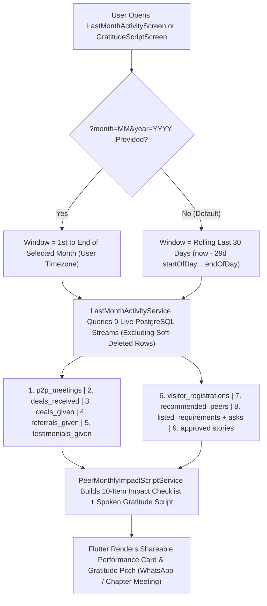

# Activity 35: Last Month Activity Summary

| Attribute | Verified Audit Classification |
|---|---|
| **Workbook Activity #** | `35` |
| **Exact Workbook Name** | `Last Month Activity Summary` |
| **Domain Category** | `Performance & Reporting` *(Sheet 3: `Reporting / Aggregations`)* |
| **Activity Governance Tier** | `Leadership Oversight` *(Member Monthly ROI & Gratitude Pitch + Scoped Peer / Circle Performance Review in Leadership App)* |
| **Overall Implementation Status** | `Fully Implemented` *(in Member App & Backend via `LastMonthActivityService` 9 dynamic streams + `PeerMonthlyImpactScriptService` 10-item checklist & pitch script)* · `Partially Implemented` *(in Leadership App: Member 360° shows lifetime/filtered activities, while `LeaderReportsService` has hardcoded stub values and needs clean monthly date-window integration)* |
| **Master Index & Cross-Links** | [12-master-35-activities-index.md](../12-master-35-activities-index.md) · [19-activity-to-role-access-matrix.md](../19-activity-to-role-access-matrix.md) · [25-activity-workflow-reference.md](../25-activity-workflow-reference.md) · [29-reporting-and-analytics-flow.md](../29-reporting-and-analytics-flow.md) · [41-master-reporting-and-metrics-reference.md](../41-master-reporting-and-metrics-reference.md) |

---

## 1. Business Purpose (§9.1)

- **WORKBOOK REQUIREMENT:** Sheet 1 & Sheet 2 state Activity 35 allows members to *"Review monthly networking ROI across all 8 core activities with shareable gratitude infographic"*, automatically compiled for the previous 30 days on `LastMonthActivityScreen`, `ActivitySummaryScreen`, and `GratitudeScriptSheet`.
- **FACT:** In the Laravel 12 + Flutter ecosystem, Activity 35 is powered dynamically in real time (zero stale materialized tables) by **three complementary backend aggregation services**:
  1. **9-Stream Monthly Activity Aggregator (`LastMonthActivityService`):** [LastMonthActivityService.php](file:///c:/Users/malic/OneDrive/Documents/GitHub/unity-app-new/app/Services/LastMonthActivityService.php#L29-L200) computes counts, deal totals, and itemized records across **9 networking streams** (1 more than the workbook's 8!) for either a **rolling 30-day window** (default, timezone-aware) or an explicit **`?month=MM&year=YYYY` calendar month**:
     1. `p2p_meetings` (initiator or peer),
     2. `business_deals_received` (`to_user_id` + ₹ `deal_amount` sum),
     3. `business_deals_given` (`from_user_id` + ₹ `deal_amount` sum),
     4. `referrals_given` (`from_user_id`),
     5. `testimonials_given` (`from_user_id`),
     6. `visitor_registrations` / `registered_visitors` (`visitor_registrations` + `event_registrations` where `registration_type = 'visitor'`),
     7. `recommended_peers` (`peer_recommendations` + `referraldata`),
     8. `listed_requirements` (legacy `requirements` + unified `asks`), and
     9. `success_story` (`sme_business_story_submissions` where `status = 'approved'`).
  2. **Monthly Impact & Chapter Gratitude Pitch Script (`PeerMonthlyImpactScriptService`):** [PeerMonthlyImpactScriptService.php](file:///c:/Users/malic/OneDrive/Documents/GitHub/unity-app-new/app/Services/PeerMonthlyImpactScriptService.php#L20-L108) aggregates 30-day vs lifetime Lives Impacted, Business Done with Peers (₹), and a **10-category giving checklist** (`qualified_referrals_given`, `mentoring_given`, `collaboration_connections`, `knowledge_shared`, `business_challenge_help`, `vendor_or_service_help`, `funding_or_capital_help`, `media_or_recognition_help`, `personal_or_business_support`, `helped_get_things_done`), generating a personalized spoken/shareable **Gratitude Script** rendered in [gratitude_script_screen.dart](file:///D:/office%20project/peers-unity/unity_app/lib/features/highlights/presentation/screens/gratitude_script_screen.dart).
  3. **Leadership App & Admin 360° Oversight (`LeaderMember360Service` & `UserActivitySummaryController`):** Leaders inspect scoped peer activity summaries via `GET /api/v1/leader/members/{member_id}` and `/activities`, while Admins inspect `GET /api/v1/admin/users/{id}/activity-summary` and Blade `/admin/activities/peer-summary/{user}`.
  4. **Hard All-Circles Deduplication Rule:** Whenever 30-day or monthly activity summaries are aggregated across `"All Circles"` for multi-circle roles (`Super Admin`, `Country Director`, `DED`, `Industry Director`, multi-circle `CF`/`CD`), KPIs **MUST deduplicate unique Peer IDs and unique Activity UUIDs** within the leader's authorized scope so a peer belonging to Circle A and Circle B is never double-counted!

---

## 2. Sub-Activities Catalogue (§9.2)

| # | Sub-Activity / Atomic Operation | Member App (`unity_app`) | Leadership App (`LeaderApp`) | React Admin Web (`unity-admin-web`) / Blade | Laravel 12 Backend (`unity-app-new`) | Classification |
|---|---|---|---|---|---|---|
| **35.1** | **View Own Rolling 30-Day or `?month=&year=` 9-Stream Activity Summary** | `last_month_activity_screen.dart`, `activity_summary_screen.dart` (`GET /api/v1/profile/last-month-activity`) | `Not Required` (self consumer screen) | N/A | `LastMonthActivityController@index` → `LastMonthActivityService::getActivityData()` | `Fully Implemented` |
| **35.2** | **Generate Personalized Monthly Impact & Chapter Gratitude Script** | `gratitude_script_screen.dart`, `gratitude_form.dart` (`GET /api/v1/peer-monthly-impact-script`) | `Not Required` | N/A | `PeerMonthlyImpactScriptController@show` → `PeerMonthlyImpactScriptService::buildForUser()` | `Fully Implemented` |
| **35.3** | **View Another Peer's Activity Summary Card** | `peer_profile_screen.dart` (`GET /api/v1/users/{user_id}/activity-summary`) | `peer_profile_view.dart` (`peer_profile_activity_section.dart` → `GET /leader/members/{id}`) | `ActivitiesTab.tsx` (`PeerDetailDrawer`) + Blade `/admin/activities/peer-summary/{user}` | `UserActivitySummaryController@show`, `LeaderMember360Service`, `UserManagementController@activitySummary` | `Partially Implemented` *(Leader Member 360° lacks explicit `?month=MM&year=YYYY` selector delegating to `LastMonthActivityService`)* |
| **35.4** | **Circle Roster Monthly Performance in Leader Reports (`LeaderReportsService`)** | N/A | `reports_view.dart`, `report_peer_roster_tile.dart` | `ReportsPage.tsx` | `LeaderReportsService::buildPeersRosterForCircle()` | `Implemented but Incorrect` *(`LeaderReportsService.php:285-345` caps roster at `20` and reads non-existent `$user->p2p_meetings_count` / `deals_closed_formatted`, returning `0` / `'₹0'` — and injects fake `94.5%` / `'₹18.5L'` defaults on submit!)* |

---

## 3. Input Form & Field Validation Mapping (§9.3)

**FACT:** Activity 35 combines query filter parameters on `GET /api/v1/profile/last-month-activity` with optional personal reflection prompts on `GratitudeScriptScreen` ([gratitude_form.dart](file:///D:/office%20project/peers-unity/unity_app/lib/features/highlights/presentation/widgets/gratitude_form.dart)).

| Field Name | Data Type | Required/Optional | Validation | Default | Input Widget | Data Source | Visibility | Who Enters | Who Edits | Who Views | Sensitive? | Backend Request Key |
|---|---|---|---|---|---|---|---|---|---|---|---|---|
| **Calendar Month (`month`)** | `integer` | Optional *(Query)* | `nullable\|integer\|min:1\|max:12` (paired with `year`) | `null` *(uses rolling last 30 days)* | Month picker (`LastMonthActivityScreen`) | Query parameter | Member Summary & Proposed Leader 360° Filter | Member / Scoped Leader | N/A | Self, Scoped Leaders, Admin | No | `month` |
| **Calendar Year (`year`)** | `integer` | Optional *(Query)* | `nullable\|integer\|min:2020\|max:2100` | `null` *(rolling 30 days)* | Year picker | Query parameter | Member Summary & Proposed Leader 360° Filter | Member / Scoped Leader | N/A | Self, Scoped Leaders, Admin | No | `year` |
| **User Timezone (`timezone`)** | `string` | Optional *(Query/Profile)* | Valid PHP `DateTimeZone::listIdentifiers()` string (`LastMonthActivityService.php:32`) | `$user->timezone ?? config('app.timezone')` (`UTC`) | Device timezone / User profile | `users.timezone` | Internal date-window boundary | Client App / Profile | Member | System | No | `timezone` |
| **Meaningful Progress This Month** | `string` (`text`) | Optional *(Gratitude UI)* | Client-side text (`max:500`) | `null` | `TextField` (`"Meaningful progress this month"`) | Member reflection input | Merged into shareable Gratitude Script | Peer Member | Peer Member | Peer Member (until shared) | No *(Private draft until shared)* | `meaningful_progress_this_month` |
| **My Goal for Next Month** | `string` (`text`) | Optional *(Gratitude UI)* | Client-side text (`max:500`) | `null` | `TextField` (`"My goal for next month"`) | Member reflection input | Merged into shareable Gratitude Script | Peer Member | Peer Member | Peer Member (until shared) | No *(Private draft until shared)* | `goal_for_next_month` |
| **Experience or Story (Optional)** | `string` (`text`) | Optional *(Gratitude UI)* | Client-side text (`max:1000`) | `null` | Multiline `TextField` | Member reflection input | Merged into shareable Gratitude Script | Peer Member | Peer Member | Peer Member (until shared) | No *(Private draft until shared)* | `experience_or_story_optional` |

---

## 4. Workflow, Lifecycle & Mermaid Diagram (§9.4)

### Workbook vs Actual PostgreSQL Lifecycle Comparison
- **WORKBOOK REQUIREMENT:** `Month Closes -> Aggregation Job (MonthlyReportCronWorker) -> Infographic Rendered (InfographicRendererService) -> Shareable`.
- **FACT (Real-Time On-Demand Aggregation vs Cron):**
  - Inspection of all 62 Artisan commands and 25 active schedules in `routes/console.php` confirms **there is NO `MonthlyReportCronWorker` batch job or materialized `monthly_summaries` table**.
  - Instead, `LastMonthActivityService::getActivityData()` and `PeerMonthlyImpactScriptService::buildForUser()` compute live, up-to-the-second aggregations directly from the 9 underlying PostgreSQL tables whenever the screen opens (respecting `is_deleted = false` and `deleted_at IS NULL`, so deactivated/deleted activities are excluded immediately!).
  - Shareable infographic rendering happens client-side on Flutter canvas (`LastMonthActivityScreen` / `GratitudeScriptScreen` widget capture + WhatsApp/Feed share intent).

---

## 5. Outputs & Deliverables (§9.5)

| Deliverable / Output | Workbook Spec | Actual Codebase Reality | Verification Label |
|---|---|---|---|
| **9-Stream Monthly Performance Breakdown** | Summary counts + records on `LastMonthActivityScreen` | Implemented in [last_month_activity_screen.dart](file:///D:/office%20project/peers-unity/unity_app/lib/features/highlights/presentation/screens/last_month_activity_screen.dart) & [activity_summary_screen.dart](file:///D:/office%20project/peers-unity/unity_app/lib/features/menu/presentation/screens/activity_summary_screen.dart) with itemized drill-down lists and ₹ deal sums | **FACT** (`Fully Implemented`) |
| **Personalized Chapter Gratitude Script & 10-Item Checklist** | `GratitudeScriptSheet` | Full-screen [gratitude_script_screen.dart](file:///D:/office%20project/peers-unity/unity_app/lib/features/highlights/presentation/screens/gratitude_script_screen.dart) backed by `PeerMonthlyImpactScriptService` (`script`, `checklist_items`, 30-day vs lifetime Lives Impacted & Business Done) | **FACT** (`Fully Implemented`) |
| **Shareable Monthly Infographic Card** | Monthly Infographic Card | Client-side Flutter widget-to-image shareable card for WhatsApp and Timeline feed | **FACT** (`Fully Implemented`) |
| **Server-Side Cron Batch Snapshot** | `MonthlyReportCronWorker` | Computed dynamically on-the-fly in SQL (superior freshness; zero stale cache lag when posts/deals are moderated) | **NOT IMPLEMENTED** *(Dynamic SQL Used Instead)* |

---

## 6. Database & Metrics Mapping (§9.6)

### Source PostgreSQL Tables Aggregated by `LastMonthActivityService`
*(Zero dedicated storage table — read-only aggregation over 11 source tables):*
1. `p2p_meetings` (`initiator_user_id` OR `peer_user_id`, `meeting_date` fallback `created_at`, `is_deleted = false`, `deleted_at IS NULL`)
2. `business_deals` (`to_user_id` for received; `from_user_id` for given; `deal_date` fallback `created_at`, `SUM(deal_amount)`)
3. `referrals` (`from_user_id`, `referral_date` fallback `created_at`)
4. `testimonials` (`from_user_id`, `created_at`)
5. `visitor_registrations` (`user_id` / `invited_by_user_id`) + `event_registrations` (`registration_type = 'visitor'`)
6. `peer_recommendations` (`user_id`) + `referraldata` (`referrer_user_id`)
7. `requirements` (`user_id`) + `asks` (`user_id`)
8. `sme_business_story_submissions` (`user_id`, `status = 'approved'`)
9. *(In `PeerMonthlyImpactScriptService`):* `life_impact_histories` + `impacts` (`status = 'approved'`) + `users.life_impacted_count`.

### Sheet 3 Workbook Metric Keys vs Actual Database Mapping
| Workbook Metric Key (Sheet 1 & Sheet 3) | Actual Backend / SQL Equivalent | Status |
|---|---|---|
| `lastMonthSummaryData` | Full JSON payload from `LastMonthActivityService::getActivityData()` (`period`, `counts`, `items` per stream) | `Fully Implemented` (`FACT`) |
| `monthlyDealsTotal` | `business_deals_received` amount sum + `business_deals_given` amount sum (`PeerMonthlyImpactScriptService::businessDealsThisMonth`) | `Fully Implemented` (`FACT`) |
| `monthlyP2pCount` | `count($p2pItems)` in `LastMonthActivityService` | `Fully Implemented` (`FACT`) |
| *(Workbook Sheet 1 Col 7)* `Coins` in Monthly Summary | **Gap:** `LastMonthActivityService` aggregates 9 networking streams but does **not** currently include `coins_earned_last_30_days` from `coins_ledger` (whereas `LeaderMember360Service` and `CoinsService` track coins separately) | `Partially Implemented` *(Easy 5-line addition to `LastMonthActivityService`)* |

---

## 7. API & Backend Service Mapping (§9.7)

| Surface | Method & Endpoint | Controller & Action | Service Layer | Auth Middleware | Scope Enforcement & Security Audit | Flutter / Web Integration |
|---|---|---|---|---|---|---|
| **Member API** | `GET /api/v1/profile/last-month-activity` (`?month=&year=`) | `Api\V1\Profile\LastMonthActivityController@index` | `LastMonthActivityService::getActivityData()` | `auth:sanctum`, `unity.user` | Strictly self-scoped (`$request->user()`) | Wired in `unity_app` (`LastMonthActivityScreen`) |
| **Member API** | `GET /api/v1/peer-monthly-impact-script` | `Api\V1\PeerMonthlyImpactScriptController@show` | `PeerMonthlyImpactScriptService::buildForUser()` | `auth:sanctum`, `unity.user` | Strictly self-scoped (`$request->user()`) | Wired in `unity_app` (`GratitudeScriptScreen`) |
| **Member API** | `GET /api/v1/users/{user_id}/activity-summary` & `/activities/summary` | `Api\V1\UserActivitySummaryController@show` | Activity summary builder | `auth:sanctum`, `unity.user` | Authenticated peer lookup | Wired in `unity_app` (`ActivitySummaryScreen`) |
| **Leader API** | `GET /api/v1/leader/members/{member_id}` & `GET .../activities` | `LeaderMemberController@show`, `@activities` | `LeaderMember360Service` | `auth:sanctum`, `leader.user` | Properly enforces `$scopedCircleIds` via `resolveMember()` (`403` outside scope) | Wired in `LeaderApp` (`PeerProfileView`, `MemberActivitiesView`) |
| **Leader API *(IDOR Legacy)*** | `GET /api/v1/leader/peers/{id}/activities` | `LeaderPeersController@activities` | `LeaderPeersService::getPeerActivities()` | `auth:sanctum`, `leader.user` | **HIGH-2 IDOR BUG:** Does NOT pass `$user` or check `$scopedCircleIds` — any leader can fetch any platform user's activities! | Wired in `LeaderApp` (`ApiEndpoints.peerActivities`) |
| **Admin API & Web** | `GET /api/v1/admin/users/{id}/activity-summary`, Web `GET /admin/activities/peer-summary/{user}` | `UserManagementController@activitySummary`, `Admin\ActivitiesController@peerSummary` | `LastMonthActivityService` / Admin summary | Web `admin.auth`; **P0 Bug:** `/api/v1/admin/*` lacks admin guard | Protect `/api/v1/admin/*` with `admin.auth` | Wired in `unity-admin-web` & Blade |

---

## 8. Role-Wise Access Governance (§9.8)

| Role (`UserRoleResolverService` / `roles.key`) | View activity *(Monthly Summary)* | Create record *(Submit Circle Report)* | Edit own | Edit others | Submit for review | Verify | Approve | Reject | Assign | Manage | Delete | View aggregated reports *(Deduplicated Scope Rollup)* |
|---|---|---|---|---|---|---|---|---|---|---|---|---|
| **Super Admin** (`superAdmin` / `global_admin`) | Allowed (Any Peer's 9-stream monthly summary; **never** unshared private gratitude drafts) | Allowed (`POST /leader/reports`) | N/A *(Computed)* | N/A | Allowed | Allowed | Allowed (Review `leader_reports`) | Allowed | DENIED — No permission under the verified backend authorization model. | Allowed | DENIED *(Derived from source activities)* | Allowed (Global Deduplicated Monthly Rollup) |
| **Country Director** (`countryDirector` / `eed`) | Allowed (Country Scope peers' monthly summaries) | Allowed (`POST /leader/reports`) | N/A | N/A | Allowed | DENIED — No permission under the verified backend authorization model. | DENIED — No permission under the verified backend authorization model. | DENIED — No permission under the verified backend authorization model. | DENIED — No permission under the verified backend authorization model. | DENIED — No permission under the verified backend authorization model. | DENIED — No permission under the verified backend authorization model. | Allowed (Country Scope Deduplicated Monthly Rollup) |
| **DED** (`districtExecDirector` / `ded`) | Allowed (District Scope peers' monthly summaries + `/api/v1/ded/activities/summary`) | Allowed (`POST /leader/reports`) | N/A | N/A | Allowed | DENIED — No permission under the verified backend authorization model. | DENIED — No permission under the verified backend authorization model. | DENIED — No permission under the verified backend authorization model. | DENIED — No permission under the verified backend authorization model. | DENIED — No permission under the verified backend authorization model. | DENIED — No permission under the verified backend authorization model. | Allowed (District Scope Deduplicated Monthly Rollup) |
| **Industry Director** (`industryDirector` / `industry_director`) | Allowed (Industry Scope peers' monthly summaries) | Allowed (`POST /leader/reports`) | N/A | N/A | Allowed | DENIED — No permission under the verified backend authorization model. | DENIED — No permission under the verified backend authorization model. | DENIED — No permission under the verified backend authorization model. | DENIED — No permission under the verified backend authorization model. | DENIED — No permission under the verified backend authorization model. | DENIED — No permission under the verified backend authorization model. | Allowed (Industry Scope Deduplicated Monthly Rollup) |
| **Circle Founder** (`circleFounder` / `circle_founder`) | Allowed (Own Circle peers' monthly summaries) | Allowed (`POST /leader/reports` for Own Circle) | N/A | N/A | Allowed | DENIED — No permission under the verified backend authorization model. | DENIED — No permission under the verified backend authorization model. | DENIED — No permission under the verified backend authorization model. | DENIED — No permission under the verified backend authorization model. | DENIED — No permission under the verified backend authorization model. | DENIED — No permission under the verified backend authorization model. | Allowed (Own Circle Monthly Rollup — deduplicated if multi-circle) |
| **Circle Director** (`circleDirector` / `circle_director`) | Allowed (Own Circle peers' monthly summaries) | Allowed (`POST /leader/reports` for Own Circle) | N/A | N/A | Allowed | DENIED — No permission under the verified backend authorization model. | DENIED — No permission under the verified backend authorization model. | DENIED — No permission under the verified backend authorization model. | DENIED — No permission under the verified backend authorization model. | DENIED — No permission under the verified backend authorization model. | DENIED — No permission under the verified backend authorization model. | Allowed (Own Circle Monthly Rollup — deduplicated if multi-circle) |
| **Chair / Committee Chairs** (`chairBusinessGrowth`, `chairMembership`, `chairEventsPrograms`, `circleChair`) | Allowed (Own Circle peers' monthly summaries for coaching & recognition) | Allowed (`can_submit_reports = true` in Own Circle) | N/A | N/A | Allowed | DENIED — No permission under the verified backend authorization model. | DENIED — No permission under the verified backend authorization model. | DENIED — No permission under the verified backend authorization model. | DENIED — No permission under the verified backend authorization model. | DENIED — No permission under the verified backend authorization model. | DENIED — No permission under the verified backend authorization model. | Allowed (Own Circle Monthly Rollup) |
| **Vice Chair** (`viceChair` / `vice_chair`) | Allowed (Own Circle peers' monthly summaries) | DENIED — No permission under the verified backend authorization model. *(`can_submit_reports = false`)* | N/A | N/A | DENIED — No permission under the verified backend authorization model. | DENIED — No permission under the verified backend authorization model. | DENIED — No permission under the verified backend authorization model. | DENIED — No permission under the verified backend authorization model. | DENIED — No permission under the verified backend authorization model. | DENIED — No permission under the verified backend authorization model. | DENIED — No permission under the verified backend authorization model. | Allowed (Read-only Own Circle Reports) |
| **Secretary** (`secretary`) | Allowed (Own Circle peers' monthly summaries) | **UNVERIFIED — Requires backend/business confirmation.** *(`can_submit_reports = false` in `LeaderPermissionService.php:495`, though chapter secretaries often compile meeting minutes/reports!)* | N/A | N/A | UNVERIFIED — Requires backend/business confirmation. | DENIED — No permission under the verified backend authorization model. | DENIED — No permission under the verified backend authorization model. | DENIED — No permission under the verified backend authorization model. | DENIED — No permission under the verified backend authorization model. | DENIED — No permission under the verified backend authorization model. | DENIED — No permission under the verified backend authorization model. | Allowed (Read-only Own Circle Reports) |
| **Committee Leader** (`committee_leader`) | DENIED in Leader App (`403` bug); Allowed Own Summary in Member App | DENIED — No permission under the verified backend authorization model. | N/A | N/A | DENIED — No permission under the verified backend authorization model. | DENIED — No permission under the verified backend authorization model. | DENIED — No permission under the verified backend authorization model. | DENIED — No permission under the verified backend authorization model. | DENIED — No permission under the verified backend authorization model. | DENIED — No permission under the verified backend authorization model. | DENIED — No permission under the verified backend authorization model. | DENIED — No permission under the verified backend authorization model. |
| **Peer Member** (`member`) | Allowed (**Own** `GET /profile/last-month-activity` & `GET /peer-monthly-impact-script` + public peer summary) | N/A | Allowed (Personal gratitude notes on client) | DENIED — No permission under the verified backend authorization model. | DENIED — No permission under the verified backend authorization model. | DENIED — No permission under the verified backend authorization model. | DENIED — No permission under the verified backend authorization model. | DENIED — No permission under the verified backend authorization model. | DENIED — No permission under the verified backend authorization model. | DENIED — No permission under the verified backend authorization model. | DENIED — No permission under the verified backend authorization model. | DENIED — No permission under the verified backend authorization model. |

---

## 9. Existing Implementation Summary, Gaps & Minimum-Change Enhancement Recommendations

| # | Audit Dimension | Verified Assessment |
|---|---|---|
| **1** | **Member App Status (`unity_app`)** | `Fully Implemented` (`LastMonthActivityScreen`, `ActivitySummaryScreen`, and `GratitudeScriptScreen`). |
| **2** | **Leadership App Status (`LeaderApp`)** | `Partially Implemented` / `Implemented but Incorrect`: Member 360° displays lifetime activity counts, while `ReportsView` (`LeaderReportsService`) suffers from a 20-peer cap, broken `0` roster counters, and synthetic fallback strings (`94.5%`, `'₹18.5L'`). |
| **3** | **Admin Web & Blade Status** | `Fully Implemented` (`ActivitiesTab.tsx` in `PeerDetailDrawer`, `ReportsPage.tsx`, and Blade `/admin/activities/peer-summary/{user}`). |
| **4** | **Backend & Database Status** | `LastMonthActivityService` (`623` lines) and `PeerMonthlyImpactScriptService` (`1,304` lines) are well-engineered, timezone-aware, and soft-delete-safe; `LeaderReportsService` and `LeaderPeersService::getPeerActivities()` need targeted fixes. |
| **5** | **Workbook vs Codebase Discrepancies** | Codebase aggregates **9** streams dynamically (adding `success_story` and splitting `deals_given` vs `deals_received`) + a **10-category** `PeerMonthlyImpactScriptService` checklist, omitting only `coins_earned_last_30_days` inside `LastMonthActivityService`. |
| **6** | **Security, RBAC & Scope Vulnerabilities** | **1. (`P0`)** `GET /api/v1/admin/users/{id}/activity-summary` sits in unprotected `/api/v1/admin/*`. **2. (`P1` IDOR)** `GET /api/v1/leader/peers/{id}/activities` has zero circle scope check, and `LeaderReportsService` (`listReports`, `downloadReportPdf`, `GET /api/v1/files/{id}/download`) allows cross-circle and unauthenticated report PDF downloads! |
| **7** | **Notification & Audit Trail Gaps** | Consider an optional 1st-of-month scheduled notification (`09:00 IST` on day `1`) deep-linking members to `LastMonthActivityScreen` and Circle Directors to their Circle Monthly Summary. |
| **8** | **Leadership App Disposition** | **Reuse `LastMonthActivityService` in Member 360° & Circle Reports (`Requires Enhancement`)**: Expose `?month=MM&year=YYYY` (or `"Last 30 Days"` toggle) on `GET /api/v1/leader/members/{member_id}` by calling `LastMonthActivityService::getActivityData($member, null, $month, $year)` directly — zero duplicate SQL logic! |
| **9** | **Minimum-Change Enhancement Plan** | 1. Fix `LeaderPeersController@activities` and `LeaderReportsService` (`listReports`, `submitReport`, `downloadReportPdf`) to enforce `$scopedCircleIds` and protect `FileController@download` (`P0`/`P1`). 2. Reuse `LastMonthActivityService` inside `LeaderMemberController` (`GET /api/v1/leader/members/{member_id}/monthly-summary?month=&year=`) and replace `LeaderReportsService::buildPeersRosterForCircle()`'s broken `$user->p2p_meetings_count` reads with aggregated SQL subqueries over all approved circle members (removing `->take(20)` and removing hardcoded `94.5%` / `'₹18.5L'` fake fallbacks!). 3. Enforce `COUNT(DISTINCT user_id)` and `COUNT(DISTINCT activity.id)` on All-Circles monthly summaries so multi-circle peers are never double-counted, and add `coins_earned_last_30_days` from `coins_ledger` to `LastMonthActivityService`. |
| **10** | **Open Business Decisions** | **BUSINESS DECISION REQUIRED:** Should Circle `Secretary` (`secretary`) be granted `can_submit_reports = true` in `LeaderPermissionService` so chapter secretaries can compile and submit weekly/monthly circle reports alongside Chairs and Circle Directors? |
